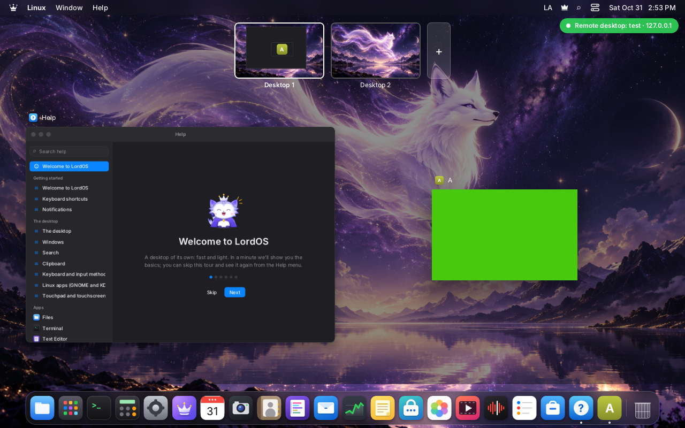
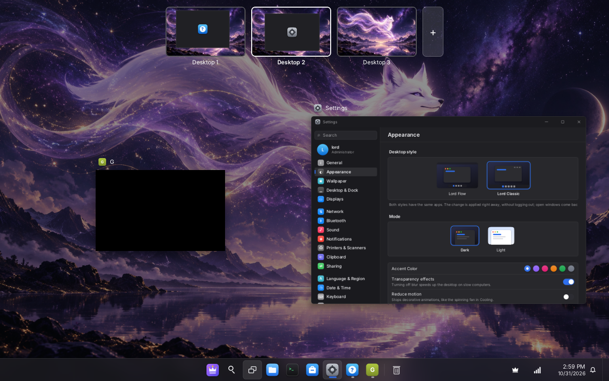
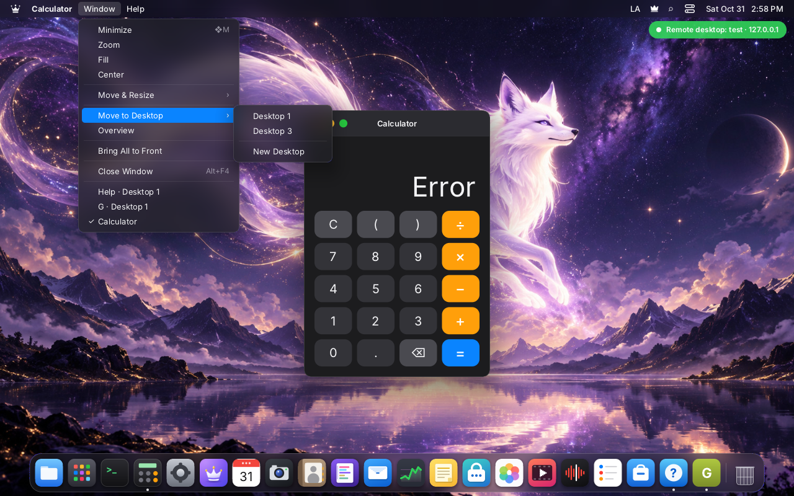

# Desktops

Several desktops, each with its own windows, in Lord Flow and Lord Classic. All displays switch together.
There is always at least one, and at most nine. Most of this is SDK work: `lord-server` knows only that a
window is *parked*.

| Code | Role |
|---|---|
| `sdk/desktopmodel.js` | The rules as plain data, no runtime: what shows, what is in front, who has the keyboard, the Overview's layout. `server/tests/desktop_model_test.mjs` |
| `sdk/windows.js` | `w.desktop`, the stores `activeDesktop` and `desktopList`, `wm.moveToDesktop`, `wm.raise`, `useWindows`, `useWindowHidden` |
| `sdk/desktops.js` | Switching, the keys, the saved count, the indicator, the animation |
| `sdk/overview.jsx` | The Overview, the same in both themes (it replaced Lord Classic's task view) |
| `sdk/windowshell.jsx` | `display: none` on a hidden desktop, the window's place in the Overview |
| `sdk/wayland.js`, `server/src/wl/wl.c` | The keyboard and the parked state of Linux windows |

## What each window is on

A window opens on the desktop in view and stays on its desktop until it is moved. `wm.focus(id)` and
`wm.open` of an open window bring its desktop into view, so the Dock, the app switcher, a notification and
Search all jump. `wm.raise(id)` brings a window forward on its own desktop without switching.

Picture-in-picture is sticky: it shows on every desktop, and it is never the front window, so it never holds
the keyboard. Back from it, the window stays on the desktop in view. Fullscreen belongs to its desktop.

`useWindows()` gives `windows` (all), `visible` and `focused` (this desktop, and `wm.focused()` agrees), and
`mounted`, what a theme draws. A LordOS app on a hidden desktop stays mounted with `display: none`, because
its state lives in React: an Editor's text, a Help search and a tour step are still there on the way back. It
costs no paint or layout. A Linux window has its state in its own process and its node goes away, as when it is
minimized. Something that animates inside an app asks `useWindowHidden(id)`.

A window a user quits from the Dock while it is on another desktop may refuse with a close guard (unsaved
changes): its desktop then comes into view, so the question is seen.

## The keyboard, a security rule

**A window on a hidden desktop never has the keyboard.** A hidden password field must not collect what
is typed on another desktop, and an app the user can't see must not be able to bring itself forward.

- `keyboardSurface` in `desktopmodel.js` is the only decision, and `sync()` in `sdk/wayland.js` follows it on
  every change of the windows or the desktop. A regression test goes through every order of a set of windows.
- `move`, `resize` and `menu` requests from a Linux app are refused unless its window is on the desktop in view
  (`acceptsAppRequest`). Otherwise an app could switch the desktop with `xdg_toplevel.move`.
- Fullscreen is presented above everything and keeps the keyboard in `wl.c`, whatever the shell says, so the
  rule needs the compositor: `lord.wayland.state(id, max, 0, iconic, parked)` → `wl_set_parked`. A parked window
  loses the keyboard, `wl_set_focus` refuses it, its menus close, and it leaves fullscreen and gets it back when
  its desktop returns. A fullscreen request while parked waits for that. This is the only thing C knows.
- A text field of a mounted LordOS app loses the focus when its window leaves the desktop in view
  (`checkFront` in `sdk/components.jsx`).
- The Overview is in the `overlay` layer, so with it open the keys are the shell's.

## X11 windows

A parked X11 window goes iconic and to the bottom of X's stack through the path a minimized window takes
(`surfaceState().iconic` → `wl_set_minimized` → `xwm_set_state`), so a stale stacking can't catch the pointer.

## The Overview

Ctrl+Up in Lord Flow, Super+Tab or the taskbar button in Lord Classic, the Window menu or the desktop's menu in
both, and a four-finger swipe up. The windows of the desktop in a grid, drawn smaller by a transform on their
real frame (lord-server paints a cached raster, so no app redraws and Linux windows stay live), with
minimized ones too: a minimized Linux window that has nothing to draw, such as an iconic X11 window, shows its app
icon and title (`OverviewPlaceholder`, behind the body, so a last buffer covers it; a LordOS app gets none, its body is translucent). Along the top, a strip with every desktop: a miniature of its windows' frames and icons
over the wallpaper, since the other desktops' windows aren't drawn. There is no capture of those.

- Click a window to go to it; Esc, a click on the wallpaper or the same key closes. Tab, the arrows and Enter work.
- Click a desktop to show it there; click the one in view to leave. The button at the end adds one; × on a
  hovered desktop closes it.
- Drag a window to a desktop, or to the add button, to move it.

Ctrl+Down shows the windows of the app in front on this desktop, with no strip. A fullscreen Linux app is presented
above every layer, so the Overview doesn't open over it.

A theme mounts `<OverviewBackdrop />` under its windows, `<OverviewChrome />` and `<DesktopHud />` above them,
inside its `ThemeProvider`, and draws `mounted` through `WindowShell`.

## Closing a desktop

Its windows move to the next one, or to the previous for the last, and that desktop comes into view if it was
showing. The last desktop can't be closed.

## Keys and gestures

| | Lord Flow | Lord Classic |
|---|---|---|
| Overview | ⌃↑ | ❖Tab |
| App windows | ⌃↓ | |
| Previous, next desktop | ⌃← ⌃→ · ❖⌃← ❖⌃→ | ❖⌃← ❖⌃→ |
| New desktop | Overview | ❖⌃D |
| Close desktop | Overview | ❖⌃F4 |

⌃ arrows are word movement in apps, in Linux apps and in the Terminal. **Settings → Keyboard → Use Ctrl + arrow
keys for Desktops** turns them off (`settings.desktopArrows`): the entries stop applying and the theme asks for the
`flow` key table instead of `flow-desktops` (`server/src/wl/keygrab.c`), so the keys reach apps. ❖⌃ arrows stay. See
[SHORTCUTS.md](SHORTCUTS.md).

Left and Right follow the layout: in a right-to-left language the strip is mirrored, and ⌃← goes to the next
desktop. There is no wrap at the ends: the indicator shows where you are.

A sideways swipe switches desktops; with only one it switches windows as before ([TRACKPAD.md](TRACKPAD.md)). The
themes register `desktopSwipe` with `registerGestureActions`. Swiping left brings the next desktop. Up with three
fingers stays the launcher or the start menu, and with four it is the Overview, when four-finger swipes
are on in Settings.

## The switch

The windows arriving slide 56 px and fade in over 170 ms, on their cached raster: `lord.setStyle` on each one's
node, no React render per frame. The windows leaving are gone at once. A small indicator shows the desktop's name for
800 ms. With Reduce motion there is no animation, and when nothing is switching, no timer runs. In a session left
alone, `lord-server` used 0 CPU ticks in 10 s with three desktops and windows open (VM 116).

## What is kept

- `settings.desktopCount`: the number of desktops, across sessions.
- Session restore ([SESSIONS.md](SESSIONS.md)): each entry has `desk`, its position in the list, left out for the
  first, and `sessionSaved.active` is the desktop in view. A window that comes back opens directly on its desktop,
  so it takes neither the front nor the keyboard of the desktop in view. Only a sane position is read back.
- A theme switch keeps the desktops, the desktop in view and each window's place, Linux windows included.

## Checked

`server/tests/desktop_model_test.mjs` and `build/keygrab-test`. On VM 116, an isolated headless session driven
over `remote.sock`, with a small Wayland client that logs keys, focus and `configure` states (2026-10-31):

- Keys reach only the window of the desktop in view, in both directions, with both themes.
- A window on a hidden desktop asked for fullscreen and for a move with a stale serial: nothing on screen changed,
  the desktop didn't switch, the keys stayed on the desktop in view, and `configure` said `fs=0`. On its return
  the request took effect (`fs=1`, keyboard). Switching away parked it again (`fs=0`, `leave`).
- The Overview in both themes with a live Linux window, adding, closing, dragging a window to another desktop.
- ⌃↑ ⌃← ⌃→ with the option off: all reached the app, and nothing switched.
- A Help search and tour step survived switching away and back, with no keys reaching the hidden field.
- Dock click and app switcher jumping desktops, Move to Desktop, session restore after a stop, a live theme switch.

|  |  |
|---|---|
| The Overview in Lord Flow | The Overview in Lord Classic |

**Not checked yet:** X11 windows (VM 116 has no Xwayland), a real monitor or GPU (these sessions compose on the CPU in
memory), the animation's look (the capture only delivers still frames), a right-to-left language on screen, real trackpad swipes,
picture-in-picture across desktops.
