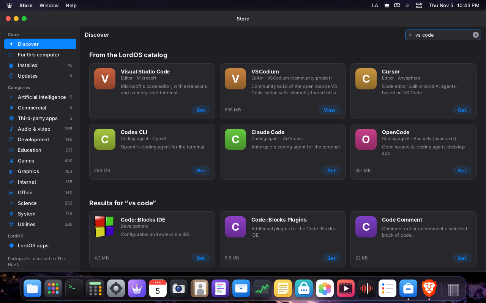

# Debian packages in LordOS

LordOS installs and removes Debian packages with its own code: it reads the apt sources,
downloads and verifies the signed indexes, resolves dependencies and downloads the `.deb` files.
**dpkg** does only the last step: unpacking and configuring. It doesn't use apt or libapt,
gpgv/sqv, curl, zlib or liblzma. The dpkg database (`/var/lib/dpkg`) is still written only by
dpkg, so `apt` and `dpkg` keep working the same on the same system.

The code is in `server/src/pkg/`:

| File | What it does |
|---|---|
| `crypto.c` | SHA-256, SHA-512, RSA PKCS#1 v1.5 verification (Montgomery) and Ed25519 (TweetNaCl arithmetic) |
| `pgp.c` | Binary or armored OpenPGP keyrings, subkeys, expirations and revocations; v4 signatures of clear-signed messages (`InRelease`) |
| `xz.c` | Our own xz/LZMA2 decompressor; gzip with `stb_image`'s inflate (already there for PNGs) |
| `deb.c` | dpkg version comparison, deb822 fields, relations (`a (>= 1) \| b`) |
| `idx.c` | The compact index that `pkg-update` builds and that is read with mmap |
| `status.c` | Reading `/var/lib/dpkg/status` (what is installed) |
| `resolve.c` | Dependency resolver and installation order |
| `pin.c` | apt's preferences and priorities (0.8.5, see "How it resolves") |
| `http.c` | HTTP/1.1 client, with a child process that runs as `nobody`; HTTPS through `lord-tls` (0.8.5, see "HTTPS") |
| `sources_admin.c` | `pkg-source-add`/`pkg-source-remove`: vendor repositories from LordOS's catalog (0.8.5) |
| `pkg.c` | Privileged helper actions (update, install, remove, local `.deb`) |
| `../ui/js_pkg.c` | `lord.pkg`, the queries for the UI (without root) |

## Security

- **Signatures.** An `InRelease` is only valid if it has at least one valid signature from a key
  in the source's keyring (`Signed-By`; if missing, those in `/etc/apt/trusted.gpg.d`). The key
  must be able to sign, and can't be expired or revoked. The signature can't be expired or come
  from the future. If a known key has an invalid signature, the whole file is rejected.
- **Rejections.** An `InRelease` is also rejected in these cases:
  - it expired (`Valid-Until`);
  - it is from another suite;
  - it is older than the one already stored (replay attack);
  - it carries data after the signature.
- **Hashes.** Every `Packages`, `Translation`, DEP-11 and `.deb` is verified against the SHA-256
  given in the signed index. Only then is it stored, read or passed to dpkg.
- **Keyring.** It is taken as trusted, as gpgv does: it is a root-owned file installed by
  `debian-archive-keyring`.
- **HTTPS since 0.8.5.** Until 0.8.4 LordOS had no TLS of its own and downloaded `https://` sources
  over `http://`, with the same path; since 0.8.5 they are downloaded over HTTPS through the sandboxed
  `lord-tls` helper (see "HTTPS" below), and `http://` sources as before. Either way security comes
  from the signatures and the SHA-256 hashes, as with apt; HTTPS adds privacy (someone watching the
  network no longer sees which packages are downloaded from an HTTPS source) and refuses an impostor
  server. A secure download is never redirected to plain HTTP. (A repository on a CDN should still
  serve plain HTTP as is, for systems not yet on 0.8.5: [UPDATES.md](UPDATES.md), "Serving it".)
- **Local repositories.** A `file:/path` source (a repository on a disk or a USB stick, like apt's
  `file:` method) is read by the same unprivileged child, as `nobody`: only world-readable files,
  checked exactly like a download. An HTTP redirect can never lead to a `file:` URL.
- **Its own firewall app** (0.8.5): before dropping root the download child moves itself into
  `lordos-net-store.scope` (`cgroup_enter_root`), so the Store and the updates are "Store and
  updates" (`lordos:store`) in Monitor → Network, with their own rules; blocking them asks first,
  because no security update arrives while they are blocked (`FIREWALL.md`, "LordOS components in
  their own scopes").
- **Downloads without root.** The process that talks to the network drops privileges before
  connecting: it becomes `nobody`, with no groups, with `no_new_privs` and no way back to root.
  It passes the bytes to the root process through a pipe. The root process only writes them into
  its folder, counts the size and computes the SHA-256: it doesn't interpret anything it
  receives.
- **Locks.** While dpkg works, LordOS takes dpkg's frontend lock
  (`/var/lib/dpkg/lock-frontend`, same as apt) and passes it `DPKG_FRONTEND_LOCKED=1`. If apt is
  running, LordOS waits its turn: they don't step on each other. LordOS operations among
  themselves are queued (`/var/lib/lordos/pkg/lock`).
- **Local `.deb`** (`pkg-install-file`):
  - the file must be in the user's folder;
  - it is opened with that user's permissions (`setfsuid`), walking the path component by
    component without following links (`O_NOFOLLOW`);
  - it is copied to a new root-owned file, and everything else (reading the control file,
    installing) is done on that copy, so the user can't change it midway.
- **Essential packages.** Packages with `Essential: yes` or `Protected: yes` are never removed.
- **Names.** They follow Debian's syntax (`[a-z0-9][a-z0-9+.-]+`). Arguments are validated in the
  helper, even though lord-server has already validated them.

## Files

| Path | Contents |
|---|---|
| `/var/lib/lordos/pkg/index.bin` | Index (packages, "provides", AppStream apps, sources, texts and long descriptions); world-readable |
| `/var/lib/lordos/pkg/lists/` | Verified `InRelease` files and the compressed indexes, named by their SHA-256 (what didn't change isn't downloaded again) |
| `/var/lib/lordos/pkg/icons/64/` | 64×64 icons of the desktop apps (DEP-11) |
| `/var/lib/lordos/pkg/auto` | Packages LordOS installed as dependencies |
| `/var/lib/lordos/pkg/sources` | SHA-256 of the list files the index was built from: when a component or source is added or removed, the next `pkg-update` rebuilds the index even if no signed release file changed |
| `/var/lib/lordos/pkg/notes` | The verified `main/notes/ReleaseNotes` of every source that has one (LordOS's; [UPDATES.md](UPDATES.md)); world-readable |
| `/var/cache/lordos/pkg/` | `.deb` files while they're being installed (deleted when done) |

## Helper actions (`admin.run`)

| Action | Argument |
|---|---|
| `pkg-update` | (none) |
| `pkg-install` | `name name… [--recommends] [--allow-remove]` |
| `pkg-remove` | `name name… [--cascade] [--purge] [--keep-orphans]` |
| `pkg-autoremove` | (none): removes dependencies that are no longer used |
| `pkg-upgrade` | `[--allow-remove]` |
| `pkg-install-file` | `/home/user/…/file.deb [--allow-remove]` |
| `pkg-source-add` | `<id>` (0.8.5): a catalog entry's vendor repository |
| `pkg-source-remove` | `<id>` (0.8.5) |

All of them run in a separate process (`A_FORK`) and require an administrator user.

**Vendor repositories (0.8.5, `sources_admin.c`).** Store → Artificial Intelligence and Store →
Commercial add a maker's signed APT repository only when one of its apps is installed. Only the id comes
from the caller: the entry is read from LordOS's catalog (`<LordOS dir>/apt/catalog.json` and
`apt/keys/`, shipped root-owned by the lordos package), must be `"type": "apt", "delivery": "direct"`,
every field passes a strict character set, and the key file must hold a primary key with exactly the
catalog's fingerprint. The action writes `/etc/apt/sources.list.d/lordos-<id>.sources` (Signed-By that
key) and `/usr/share/keyrings/lordos-<id>.asc` as fixed-format files. A package that always writes its
own source (Cursor, Chrome, Edge) gets the vendor's own file names from the catalog's `files`, with the
same text, so the package's write changes nothing (two entries for one repository with different
Signed-By would make apt refuse every source); for Spotify, whose package adds `spotify.list` unless that
file exists, the catalog's `optout` makes `pkg-source-add` create it empty (only when missing) and
`pkg-source-remove` delete it only while it is still empty. Removing the last installed app of a
repository removes that repository. The catalog itself is described in `UPDATES.md`, "Mirrored apps
(catalog)".

### Confirmations

- Recommended packages are not installed by default. `--recommends` adds them, and if one of them
  can't be installed it doesn't stop the rest.
- If a request forces removing something that wasn't asked for, the action fails with
  `ERR pkg.removeAlso names=a,b` ("these must also be removed"). For example:
  - installing `postfix` removes `exim4`, because they are two mail programs and can't coexist;
  - removing a library removes what depends on it.

  The UI shows the plan (`lord.pkg.plan`) and, if the user accepts, repeats the request with
  `--allow-remove` (when installing) or `--cascade` (when removing).
- **Orphans.** When removing, the dependencies LordOS installed (recorded in
  `/var/lib/lordos/pkg/auto`) that nobody uses anymore after that change are removed too, as
  `apt autoremove` would do afterwards. They appear in the plan with `reason: 'auto'` and do
  **not** need `--cascade`. `--keep-orphans` keeps them. `pkg-autoremove` cleans up the ones that
  were already left over.

### Progress

While running, the action sends `LOG` lines:

```
LOG plan install featherpad 1.6.1-1 603084        (one per package: install|upgrade|remove, version, bytes)
LOG plan held libfoo                               (upgrades that can't be done now)
LOG plan total 4034148 24981                       (bytes to download, KB the installed size changes by)
LOG progress download 1048576 4034148              (phases: lists, index, download, unpack, configure, remove)
LOG Unpacking featherpad (1.6.1-1) ...             (everything else: text for the log)
OK pkg.done installed=3 upgraded=0 removed=0
```

(The final `OK` line is a code line, as every helper reply: the UI shows it translated, "3 installed,
0 upgraded, 0 removed".)

The `progress <phase> <done> <total>` lines are for a progress bar.

### Notifications

When finished, the helper sends an unrequested notification:
- `EVENT pkg index`, after updating the list;
- `EVENT pkg changed`, after installing or removing.

The UI receives them with `admin.onEvent()`.

## The Store

`apps/store`. In "Discover" it shows the AppStream desktop apps by category, with their translated
names and descriptions and their icon. Search returns apps first and then the other packages. A
package's page, before installing or removing, shows the plan: what gets installed, upgraded or
removed, how much is downloaded and how much disk space it takes. It also shows the task's
progress. "Updates" lists what can be upgraded and upgrades everything together. From Files, a
`.deb` opens in the Store (`pkg-install-file`).

| | |
|---|---|
|  |  |
| Debian apps by category | The GNOME Sudoku plan: the same 9 packages as `apt-get -s install` |
|  | |
| Installed and opened from the Store (GTK 4 + libadwaita, in Spanish, with its AppStream icon in the Dock) | |

**The Store since 0.8.5.** A sidebar in three groups (Store: Discover, For this computer, Installed,
Updates; Categories: Artificial Intelligence and Debian's ten categories, each with its count; LordOS
apps), the page's title, a back button and the search in a toolbar, and apps as cards in a grid (icon,
name, category, two lines of summary, the download size and a Get, Open or View button). Discover opens
with a featured banner, then the AI shelf and a shelf per category; an app's page has a row of facts
(version, size, category, distribution). The hardware suggestions moved to their own page, **For this
computer** (below). Store → Installed shows each native LordOS app's own version.

- **Artificial Intelligence** lists LordOS's catalog of AI apps (`UPDATES.md`, "Mirrored apps
  (catalog)"), each with its kind, vendor and licence, dimmed on an architecture it doesn't support. An
  app from its vendor's repository first says whose repository it adds and its key fingerprint, then
  adds it (`pkg-source-add`) and fetches the lists; an app LordOS builds that the lists don't have yet
  offers to fetch them again.
- **Commercial** lists free-of-charge apps whose source code isn't public (Google Chrome, Microsoft
  Edge, Spotify), from their makers' signed repositories with the key LordOS pins. The page says before
  anything is installed that LordOS can't review or fix what they do. Tested on the VMware machine:
  the three sources added, the three apps installed, `apt update` and the engine's update clean
  afterwards. Steam needs i386 multiarch, which the engine doesn't do yet (see "Pending").
- **Third-party apps** (until 0.8.8.3 "Third-party suites") lists open source apps and suites from
  other projects: ArtCraft (0.8.8.1, its maker's `.deb` with a pinned SHA-256), and since 0.8.8.4
  VSCodium (#38) and Brave Browser (#39), both from their makers' signed repositories (amd64 and arm64)
  with the key LordOS pins, added the same way as the AI apps' (`UPDATES.md`, "Mirrored apps (catalog)").
  Tested on VM 116 (amd64): both sources added, verified and installed by the engine.
- **Disk Formats** (0.8.7, `lordos-disk-formats`, `tools/iso/mkdeb-diskformats.sh`) is one item in the Commercial group,
  from the LordOS repository: it depends on `ntfs-3g`, `exfatprogs` and `dosfstools`, and on amd64 suggests `apfs-dkms`,
  offered as a switch on its page. Those drivers are free software ([FILES.md](FILES.md), "Disks' file systems").
- **The featured banner** comes from the LordOS repository (`apt/featured/featured.json` and
  `banner.png`, published under `main/featured/` and listed in the signed InRelease). The engine takes
  them only from a source whose signed Release says `Origin: LordOS`, checks their hashes, that the
  JSON is an object of at most 64 KB and that the PNG has a PNG signature and at most 2 MB, and keeps
  them in `/var/lib/lordos/pkg/` (`lord.pkg.featured()`, read-only). Until the picture is there the
  Store draws a skeleton of the banner (it pulses, unless Reduce motion is on); a repository without a banner shows
  a catalog app instead.

**Search (0.8.8.4, #37).** The query is split into words; case and accents don't matter (`camara`
finds «Cámara»), the words can be in any order, and they are also tried joined, so `vs code` finds the
`vscode` packages and `vscode` finds an app called «VS Code». A result with every word comes first,
ranked by where the words are: the whole name, the start of the name, the start of a word, inside a
word, then the summaries (and a bonus when the words appear together in that order). With two words or
more, packages with only some of them follow, after all of those, when one of the words starts a word
of their name (`vs code` also lists `code-aster`); a word only in a summary isn't enough.
`lord.pkg.search` does this in C (`server/src/pkg/match.c`, tested in `build/pkg-test`), and the
Store's own lists in JS with the same rules (`apps/store/search.js`, tested in
`server/tests/store_search_test.mjs`). While searching, Discover first shows **From the LordOS
catalog**: the catalog apps that match (`apt/catalog.json`, every section), which aren't in the package
lists until their maker's repository is added; they match by name, id, package name, the catalog's
`keywords` (`"vscode"`, `"vs code"`, nicknames) and, with less weight, the summary in the user's
language and in English, the vendor and the kind. The same search filters the catalog pages,
categories, Installed and LordOS apps. Spotlight asks for `every: true`: only the packages with every
word. On VM 116 (Debian 13, 75,016 packages) a search takes 24–33 ms, the same as before (24–31 ms with
the old substring search, measured with the same queries).



*"vs code": Visual Studio Code first, then VSCodium and Cursor (VS Code in their keywords or summary), then
the catalog apps with only "code", then the packages.*

**What `lordos` depends on since 0.8.7.** `lordos-hwdata`, the signed tested-hardware snapshot
([UPDATES.md](UPDATES.md), "The tested-hardware snapshot"); `libfreerdp3-3`, `libfreerdp-client3-3` and `libwinpr3-3` for
Remote Desk; `rclone`, `fuse3` and `openssh-client` for Connect to Server; `openssl`. An update brings them in.
Since 0.8.8.5 `lordos-rclone` (upstream rclone v1.75.2 at `/usr/lib/lordos/rclone/rclone`, from `tools/iso/mkdeb-rclone.sh`, one
package per architecture) replaces Debian's `rclone` as the dependency: Cloud needs a newer rclone than Debian 13's 1.60, and
Connect to Server runs the same binary (Debian's only if ours is missing). Debian's `rclone` stays installed on an upgrade; nothing runs it.

## Suggested for your computer

Store → **For this computer** (until 0.8.5 the top of Discover) shows **Suggested for your computer**: Debian packages for the hardware
LordOS finds, each card saying why it appears, what it installs and, for software that isn't free,
that it isn't (with an orange label; such cards never have a highlighted button, and the plan
repeats the notice). **Install** shows the usual plan and runs `pkg-install` through the admin
helper; **Don't suggest again** stores the card's id in `settings.json` (`suggestions.dismissed`).
When an installable suggestion is new, the Store's Discover item shows a count until Discover is
opened, and the session shows one notification (`sdk/suggestions.js`: 3 minutes after login and
every 6 hours; never again for the same suggestion, `suggestions.notified`).

| | |
|---|---|
|  |  |
| Test data (fixture, labeled "Test data"), VM 119: the Wi-Fi firmware card expanded, with its plan | Dark: the NVIDIA card with what changes and its plan (38 packages, with `contrib` and `non-free` enabled) |
|  | |
| The one-time notification, 3 minutes after login | |

### Rules

The rules are data, `assets/store/suggestions.json`, evaluated by `sdk/suggestengine.js` (pure
functions; `server/tests/suggest_engine_test.mjs`). Every package is looked up in the package
index first, and an installable card also needs a plan that can be made (`lord.pkg.plan`): a
package that isn't in the configured sources, or that depends on one that isn't (the NVIDIA driver
needs `contrib` as well as `non-free`), is never offered as installable.

| Detected | How | Suggests | Notes |
|---|---|---|---|
| VMware virtual machine | DMI `sys_vendor` "VMware, Inc." or a PCI device of vendor `15ad` | `open-vm-tools` | Preinstalled since 0.8.1, so it normally shows as installed. `open-vm-tools-desktop` is not suggested: it targets an X11 session (LordOS runs X11 apps through Xwayland since 0.8.3, but its clipboard and resize integration was not tested there) |
| QEMU/KVM guest with a guest agent channel | a virtio port named `org.qemu.guest_agent.0` (only present when the host enabled the agent) | `qemu-guest-agent` | Clean shutdown from the host, frozen disks for backups, the guest's address |
| VirtualBox virtual machine | DMI product "VirtualBox" or PCI `80ee:cafe` | `virtualbox-guest-utils` | **Not in Debian 13** (main, contrib or backports): the card explains that, and that the kernel already has the guest drivers (display with VMSVGA, shared folders) |
| NVIDIA graphics card (x86_64) | PCI vendor `10de`, class `0300`/`0302`/`0380` | `linux-headers-amd64`, `nvidia-driver`, `firmware-misc-nonfree` | **non-free**. The card says the free `nouveau` driver is in use and stays the default; what changes: DKMS builds the module for each kernel, Secure Boot needs its key enrolled at the next restart, cards older than about 2014 need the free driver, and the LordOS desktop hasn't been tested with this driver yet. `nvidia-driver` also depends on packages in `contrib` (`nvidia-installer-cleanup`): without both components in the sources the card explains that instead (the LordOS ISO enables both) |
| USB printer | an interface of class `07`, by USB vendor ID: HP `03f0` → `hplip`, Epson `04b8` → `printer-driver-escpr`, Brother `04f9` → `printer-driver-brlaser`, Samsung `04e8` → `printer-driver-splix`, Canon `04a9` → `printer-driver-gutenprint` | the vendor's Debian driver | Vendors not in the table get nothing: most printers work driverless with CUPS |
| USB printer with IPP over USB | interface `07/01/04` | `ipp-usb` | Driverless printing and scanning: the device shows up like a network printer |
| USB scanner | udev's `libsane_matched=yes` for the device (`/run/udev/data/c189:N`; needs libsane's udev rules installed), by vendor: HP → `libsane-hpaio` | the vendor's SANE backend | Other vendors' backends are already in `libsane1` |
| Raspberry Pi 5 (and 500, CM5) | device tree `compatible` | `rpi-eeprom`, `raspi-utils`, `gpiod` (those that exist) | `rpi-eeprom` and `raspi-utils` come from the Raspberry Pi archive the LordOS image configures, and since 0.8.4.1 also from the LordOS repository (`UPDATES.md`, "Raspberry Pi firmware packages"); `gpiod` from Debian |
| A device that asked for missing firmware | the firmware loader's "Direct firmware load for X failed" / "firmware: failed to load X" lines in the kernel log, minus files present now | the package that ships X (`iwlwifi-*`, `intel/ibt-*` → `firmware-iwlwifi`; `rtl_bt/`, `rtw88/`, `rtw89/`, `rtlwifi/`, `rtl_nic/` → `firmware-realtek`; `ath*k/`, `ar3k/`, `qca/`, `htc_*` → `firmware-atheros`; `brcm/brcmfmac*` → `firmware-brcm80211`; `brcm/BCM*` → `bluez-firmware`; `mediatek/`, `mt76*` → `firmware-mediatek`; `mrvl/`, `libertas/` → `firmware-libertas`; `amdgpu/`, `radeon/` → `firmware-amd-graphics`; `i915/`, `xe/` → `firmware-intel-graphics`; `nvidia/` → `firmware-nvidia-graphics`) | **non-free-firmware**, one card per package (Wi-Fi, Bluetooth, network adapter, graphics). The prefixes were checked against trixie's `non-free-firmware` Contents. If the package is installed and a file is still missing, nothing is offered. Files no prefix matches (e.g. `regulatory.db`, which a VM without Wi-Fi also asks for) get no card |

Cards are ordered: installable, then explained (not available), then installed.

### Detection

`lord.hwinfo.scan()` (`server/src/hw/hwscan.c`, exposed in `ui/js_hw.c`) runs in `lord-server`,
**without root**, and only reads world-readable kernel files: `/sys/class/dmi/id` (vendor, product,
board, chassis; never the serial numbers, which are root-only), `/proc/device-tree/model` and
`compatible`, `/sys/bus/pci/devices/*` (vendor, device, class, bound driver),
`/sys/bus/usb/devices/*` (IDs and interface classes, root hubs skipped), `/sys/class/virtio-ports/*/name`,
udev's database entry of each USB device (only the `libsane_matched` flag) and `/dev/kmsg`. Values
are reduced to hex IDs and printable ASCII before they reach JS. Nothing runs, nothing is written,
nothing goes over the network.

The kernel log is readable by the session only with `kernel.dmesg_restrict=0` (as on the LordOS
Raspberry Pi kernel). With Debian's default (`1`) the Store asks the admin helper's fixed action
**`hw-firmware-missing`**: no arguments, any user, read-only; it reads `/dev/kmsg` as root and returns
only `LOG fw <file> <driver>` lines whose file name passes `hwscan_fw_name_valid()` (`[A-Za-z0-9._+,/-]`,
no `..`, no leading `/`) and is still missing, never other log text.

`LORD_HWSCAN_ROOT=/path` (development and screenshots only; an absolute path without `..`) makes
`lord-server` read a fake tree instead, with the kernel log in `<root>/kmsg`; the Store then labels the
section "Test data". `build/hwscan-test fixture <dir> demo` writes such a tree (also `vmware`,
`virtualbox`, `nvidia`, `printer`, `scanner`, `rpi5`, `qemu`, `firmware`); `build/hwscan-test dump`
prints the facts of the machine it runs on.

### Tests

- `build/hwscan-test` (`make test`): the facts over fake sysfs/DMI/PCI/USB/udev/kmsg trees for every
  kind, the kernel-log parser (kmsg and dmesg formats, Debian's "failed to load" line, duplicates,
  unsafe names such as `../../etc/shadow`), files already present (`.zst`, `updates/`), and this
  machine's facts as valid JSON.
- `node tests/suggest_engine_test.mjs` (`run_suites.sh`): every rule against fixtures and a fake index
  (installed, installable, not in the sources, dismissed, wrong architecture, other devices of the
  same vendor), the firmware mapping, ordering, the root helper's lines, notify-once, and that each
  card's texts exist in en, es and pt.
- **VM 119 (QEMU, real path):** `hw-firmware-missing` as root returned `fw regulatory.db platform`
  (no card: unmapped), as a user the kernel refuses (`hw.noKernelLog`), and an argument is refused.
  The Store showed one card, the guest agent, as installed (`qemu-guest-agent` was already there).
- **VM 119 (fixture `demo`):** NVIDIA, HP printer with IPP over USB, a Broadcom Wi-Fi and a Realtek
  Bluetooth firmware miss and the guest agent. With `non-free` and `non-free-firmware` temporarily
  enabled, **Review and install** on the Wi-Fi card planned `firmware-brcm80211` (5.1 MB) and
  installed it through `pkg-install`; the card went away and the others stayed. **Don't suggest
  again** on the printer card was stored and the card hidden. Sources, index and package were
  restored afterwards.
- **Raspberry Pi 5 (read-only):** device tree `raspberrypi,5-model-b`, no DMI, two PCI functions
  (the BCM2712 bridge and RP1), no USB devices, no firmware misses in the kernel log
  (`dmesg_restrict=0` there, so no root action is needed); `rpi-eeprom`, `raspi-utils` and `gpiod`
  are installed and have candidates in its sources. Fed those facts and that package state, the
  engine gives one card, `rpi5Tools`, as installed (the Store itself wasn't run on the board).

**Needs real hardware:** an NVIDIA card (the driver install, DKMS, Secure Boot enrollment and the
LordOS desktop on it), a USB printer and scanner of each vendor in the table, Wi-Fi and Bluetooth
adapters without firmware (that the miss is logged as expected and the device works after the
install), and VMware and VirtualBox guests.

## `lord.pkg` (lord-server, without root)

The queries read the index with mmap and `/var/lib/dpkg/status`, and reload by themselves when
these change. `lang` (`'es'`, `'pt'` or omitted) picks the AppStream name and description.

```js
lord.pkg.available()            // true if there is already an index
lord.pkg.lastUpdate()           // seconds since 1970 (0: never)
lord.pkg.sources()              // [{ uri, suite, component, codename, label, date, validUntil, priority, packages }]
lord.pkg.search(q, { limit = 50, apps = false, every = false, section, lang })   // [Summary], sorted by relevance
lord.pkg.info(name, { lang })   // Summary + { description, homepage, arch, source, depends, preDepends,
                                //   recommends, suggests, provides, conflicts, breaks, priority, suite,
                                //   origin, appDescription, versions: [{ version, suite, size }] } | null
lord.pkg.installed({ lang })    // [Summary] of everything installed
lord.pkg.upgrades()             // [{ name, from, to, summary, suite, size }]
lord.pkg.plan({ install: [], remove: [], recommends, allowRemove, cascade, upgrade, keepOrphans })
    // { ok, error, items: [{ action: 'install'|'upgrade'|'remove', name, version, oldVersion, size,
    //   requested, reason }], held: [], download, installedDelta }   (bytes)
    // with remove, it includes the orphans: { action: 'remove', reason: 'auto', requested: false }
lord.pkg.orphans()              // [{ name, version, summary, installedSize }]: what pkg-autoremove would remove
lord.pkg.apps({ category, type = 'desktop-application', limit = 100, offset = 0, lang })
    // [App + { package, installed, version, size }], sorted by name
lord.pkg.categories()           // { AudioVideo: 210, Development: 180, … } (desktop apps)
lord.pkg.icon(name)             // path of the 64×64 PNG or null
lord.pkg.releaseNotes(name, version)   // Markdown release notes a source published for that version, or null
lord.pkg.featured()             // (0.8.5) the Store's banner from the signed LordOS repository, or null
lord.pkg.rebootRequired()       // null, or the packages that asked for a restart (/run/reboot-required.pkgs)

// Summary = { name, version (candidate), summary, section, size, installedSize (bytes),
//             installed (version or null), upgradable, essential, auto, app: App | null }
// App     = { id, type, name, summary, icon (path or null), categories: [] }
```

To make changes:

```js
await admin.run('pkg-update')
const plan = lord.pkg.plan({ install: ['featherpad'] })      // show it and ask for confirmation
await admin.run('pkg-install', 'featherpad', (line) => …)    // line: "progress download 123 456"…
```

## How it resolves

- **Candidate.** The same version apt would choose (`server/src/pkg/pin.c`, `pkg_candidate` in
  `resolve.c`; since 0.8.5). Each version gets a priority:
  - from **apt's preferences** (`/etc/apt/preferences`, then `/etc/apt/preferences.d/*` in C sort
    order, only names of `[A-Za-z0-9_.-]` with no extension or `.pref`): the first *specific* pin
    naming the package (globs, `/regex/` or `src:name`) decides for the versions its `Pin:` matches
    (`origin <host>`, `release a=,n=,c=,o=,l=`, `version <glob>`); otherwise the first *general*
    pin (`Package: *`) matching its source. A malformed stanza is skipped; a `release` key we can't
    check (`v=`, `b=`) never matches;
  - otherwise from its source: 500 for normal ones, 100 for `NotAutomatic` + `ButAutomaticUpgrades`
    (backports), 1 for `NotAutomatic` only (experimental).

  Then, as apt does, the versions are taken from the newest down and only a strictly higher priority
  replaces the one chosen; the installed version counts at least 100; an older version than the
  installed one only with 1000 or more; a negative priority never. So what was installed from
  backports keeps being upgraded from there, and on the Raspberry Pi image Raspberry Pi's `+rpt`
  builds of Debian packages are not taken. The preferences are re-read when they change, without a
  new index (`idx_refresh`). Tested in `pkg-test` with the Pi image's own pin files.
- **Sources.** One-line `.list` files and deb822 `.sources`; since 0.8.5 `Architectures:` may be
  separated by commas as well as spaces (`amd64,arm64`, as Cursor's package writes it), as apt accepts.
- **Dependencies.** It walks those of what changes: `Pre-Depends` and `Depends`, and `Recommends`
  with `--recommends`.
- **Choices.** Alternatives (`a | b`) and virtual packages are tried in order. Among providers of
  a virtual package, the highest `Priority` is preferred, then the name. If a path fails, it
  backtracks, with a maximum of 4000 attempts.
- **Conflicts.** It checks `Conflicts` and `Breaks` in both directions. If it clashes with
  something installed:
  1. it upgrades that package, if its new version no longer clashes;
  2. otherwise it removes it, with confirmation.
- **Orphans.** Marking starts from the roots: what was installed manually, what is essential and
  what is being installed now. `Pre-Depends`, `Depends` and `Recommends` are followed, because apt
  also counts recommended packages, and so are all present alternatives or providers. Whatever in
  `auto` is left unmarked is removed. Only dependencies LordOS installed are touched: what apt
  installed as automatic is not included.
- **Neighbors.** When something is upgraded or removed, it rechecks what depended on it.
  Installed packages left without what they need are first upgraded, and if that isn't possible
  they are removed (with confirmation). It repeats until nothing else changes.
- **Order for dpkg.** It sorts topologically by dependencies and uses one `dpkg --install` per
  batch. A `Pre-Depends` on something in the same batch splits it, because that has to be
  configured first.

## Tests

```sh
make -C server build/pkg-test
build/pkg-test                         # unit tests: versions, deb822, SHA, RSA, Ed25519, xz/gz,
                                       # index and resolver over a toy repository
build/pkg-test pgp /usr/share/keyrings/debian-archive-keyring.gpg InRelease
build/pkg-test plan /var/lib/lordos/pkg /var/lib/dpkg/status gimp     # the plan, without installing
sudo build/pkg-test run pkg-update     # the real actions, without lord-server
sudo build/pkg-test run pkg-install "cowsay sl"
```

## Real tests (VM, Debian 13.7, 2026-10-16)

- **Unit tests:** `pkg-test` passes 78/78, including the orphan tests.
- **Real signature:** the real trixie `InRelease` was verified with `debian-archive-keyring.gpg`.
  It has three signatures: two RSA-4096 and one Ed25519, the Stable Release Key 13, and all three
  are valid. With one byte changed it is rejected.
- **`pkg-update` against deb.debian.org**, with 4 sources: trixie, trixie-updates,
  trixie-backports and trixie-security.

  | Situation | Downloaded | Time | Peak memory |
  |---|---|---|---|
  | First time | 11 indexes, 29 MB | 4.9 s | 122 MB, in the child process that lives as long as the action |
  | No changes in the lists (304 responses) | nothing | 0.12 s | 3 MB |

  Result: 74,362 packages and 2,100 icons. On disk, `/var/lib/lordos/pkg` takes 98 MB:
  60 MB of index and 29 MB of compressed lists.
- **Plans against `apt-get -s install --no-install-recommends`:**

  | Package | Packages in the plan |
  |---|---|
  | cowsay | 1 |
  | sl | 2 |
  | postfix | 3 |
  | gnome-calculator | 13 |
  | thunderbird | 30 |
  | inkscape | 48 |
  | libreoffice-writer | 79 |
  | vlc | 110 |
  | gimp | 121 |
  | blender | 197 |
  | krita | 237 |
  | kdenlive | 437 |

  In all 12 cases the names and versions match apt's.
  - With recommended packages, gimp gives 188 packages, same as apt.
  - `pkg-upgrade` gives 1 upgrade (libexpat1, from trixie-security), same as
    `apt-get -s upgrade`.
  - Removing `libqt6core6t64` gives the same 18 removals as `apt-get -s remove`.
- **Real installations:**
  - `cowsay sl`: 3 packages in 1.7 s; `cowsay` works.
  - `gnome-calculator`: 13 packages, 3.9 MB, in 4.9 s.
  - `hello` from a `.deb` downloaded to the user's folder: works.
  - Removals: `sl cowsay`, `gnome-calculator` and the 13 dependencies recorded in `auto`.
  - Rejections:
    - removing `dpkg`, because it is essential;
    - removing `libgtk-4-1` without `--cascade`, which lists what would have to be removed;
    - a name `../etc`;
    - a `.deb` that is a link to `/etc/shadow`;
    - a path through a link to `/root`;
    - a file outside the home folder.

  - Orphans: `pkg-autoremove` removed the 8 left over from a Store test
    (libadwaita-1-0, libqqwing2v5…).
  - Installing `gnome-sudoku` (9 packages) and then `pkg-remove gnome-sudoku`, without
    `--cascade`, removes all 9. With `keepOrphans` the plan has 1.

  After each test, `apt-get check` and `dpkg --audit` came back clean. The VM was left as it was.
- **`lord.pkg`**, with `build/pkg-js-test`:

  | Query | Time |
  |---|---|
  | `search` over 74 thousand packages | 27–42 ms |
  | `info` | 0.1 ms |
  | `apps` by category | 0.6 ms |
  | `plan` for gimp | 7 ms |
  | `installed` (648 packages) | 3 ms |

  The process's peak memory is 37 MB, including the pages of the mapped index touched while
  searching; the kernel can reclaim them.

## Pending

- `Suggests` don't count for orphans (apt does by default); apt's `extended_states` is not
  touched.
- **Packages from other architectures.** Today only the native one and `all` are used. What is
  installed from another architecture (i386) is ignored when resolving.
- **Versions or suites on request.** `package=version` or `package/backports` can't be requested
  yet.
- **Flat repositories.** Those whose suite ends in `/` are not accepted.
- **`control.tar.zst`** in local `.deb` files (Ubuntu); Debian's use xz.
- **Incremental index diffs** (`Packages.diff`). Today the whole index is downloaded when it
  changes.

## HTTPS (0.8.5)

The engine downloads `https://` sources over TLS and `http://` ones as before. The download child (nobody,
in `lordos-net-store.scope`) resolves and connects the TCP socket itself; for `https://` it starts
`lord-tls` (`server/src/tls/tlsproxy.c`, next to `lord-server`, root's) with the socket on fd 3 and a
socketpair on fd 4. lord-tls loads the system's CA bundle, takes the helpers' sandbox (no sockets, no exec,
no files), does a TLS 1.2+ handshake with SNI, checks the chain and the host name, answers `1` (or `0`,
which the engine reports as `pkg.http.tlsFailed`) and then relays plain HTTP, so the HTTP code is the
same for both schemes. Redirects may go from `http://` to `https://`, never back (`pkg.http.downgrade`).
TLS adds privacy and refuses an impostor server; what is installed is still decided by the signed
index and each file's SHA-256, exactly as over HTTP. Sources written as `https://` are no longer
rewritten to `http://`.

A `+` in a file's path is sent as `%2B`, as apt does (0.8.5): lordos.org's CDN reads a bare `+` as a
space, so packages such as `kms++-utils` and `libkms++0` failed with 404 before.

Tested against real servers (`server/tests/pkg_https_test.c`, run as root with network, not part of
`make test`): an HTTPS-only vendor repository, lordos.org over both schemes, an HTTP→HTTPS redirect, and
self-signed, wrong-host and expired certificates refused (7/7).

