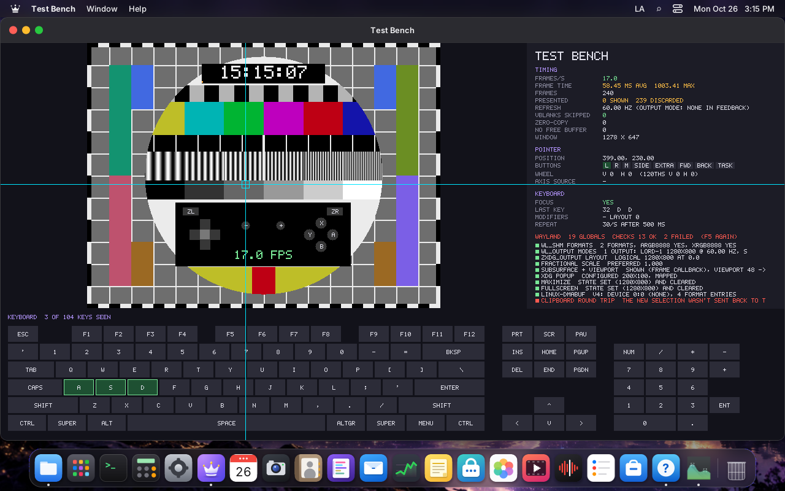
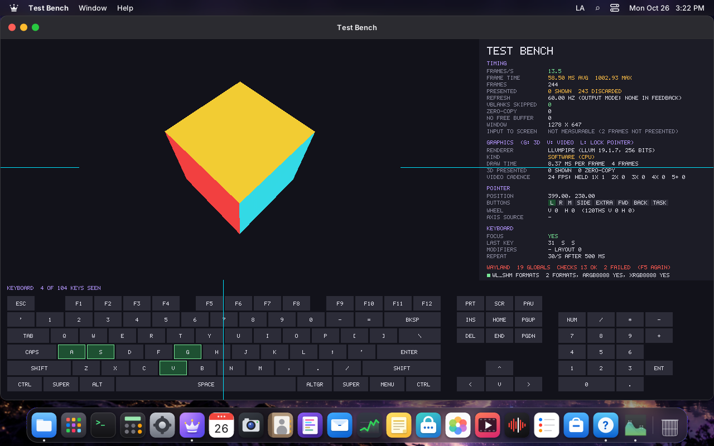
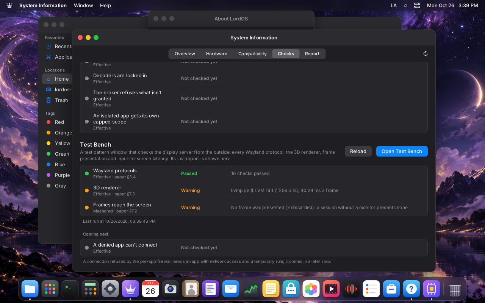

# Validating the paper

The technical paper (https://lordos.org/paper/, `docs/PAPER.md`) makes claims about LordOS. This page was
written against its 0.8.0 edition and lists each claim with how it is checked today and its state in 0.8.5, with rows added for the
0.8.6 edition (published with the 0.8.6-beta release on 2026-10-30) and for what the paper marks in 0.8.7, and one section per 0.8.8.x release up to 0.8.8.9 (2026-11-15), and one for 0.8.9 (2026-11-18; the 0.8.8.10 pre-release
never shipped) and each 0.8.9.x release up to 0.8.9.6.1 (2026-11-25, the latest release and the paper's current edition), so anyone can see what is proven, what was measured once and what is not tested. **The rows marked
Outdated were corrected in the paper's 0.8.5 edition (2026-10-26; published with the 0.8.5-beta release on
2026-10-27)**, which also separates whole-system
memory from a process's RSS (§7.1) and points to versioned results (§11.5, `docs/RESULTS.md`).

**How a claim is checked**

| Mark | Meaning |
|---|---|
| **Test** | An automated test in the repository (`make -C server test`, `test-full` or `node` suites) fails if the claim stops being true. |
| **Check** | System Information → Checks verifies it on the user's own computer: *configured* (the mechanism is there) or *effective* (it was tried and gave the right answer). |
| **Measured** | A number measured by hand on a named machine; nothing repeats it yet. LordBench (0.8.6) is meant to. |
| **Untested** | The paper itself says it wasn't tested (real hardware). |
| **Outdated → corrected in 0.8.5** | No longer true in 0.8.5: the paper must change. |
| **Design** | A design rule, checked by review and `AGENTS.md`, not by a program. |

## §1–§2 Vision and architecture

| § | Claim | How | State |
|---|---|---|---|
| 1.2 | JavaScript has no API to run programs, with three narrow exceptions | Design (`AGENTS.md`); the exceptions grew since: Xwayland (0.8.3), the network connectors and the blocklist downloader (0.8.5) | **Outdated → corrected in 0.8.5** (§1.2 now lists them, the Store's download child included) |
| 1.2 | GPU composition optional, the CPU path always works | Test (`canvas-test`, CPU path in every test); Check `gpu` says which path and why | Holds |
| 1.2 | The compositor never waits on helpers or apps | Design (non-blocking sockets) | Design |
| 2.2 | `lord-server` runs as the user | Check `serverUser` (configured) | Holds |
| 2.4 | `lord-netd` only takes `net-*` actions from uid 0 peers | Design; `net-test` covers the actions | Partly tested |
| 2.4 | `lord-fand` writes only fans its scan found and restores them on stop or crash | Test (`fan-test`, fake sysfs); Measured on the Pi 5 (§7.4) | Holds |
| 2.4 | (0.8.6) With no default chosen, a file opens with the system's default or the first installed app that declares its type, shown as "Automatic" | Test (`defaults-test`, fake XDG tree); checked once in an isolated session on VM 116 (2026-10-29) | Holds |
| 2.4 | Display changes revert after 15 s without confirmation | Manual | Not automated |
| 3.6 | Passwords are checked by the root process, not the login screen | Design; `remote-sec-test` covers the parsers | Design |

## §3 Compositor and remote desktop

| § | Claim | How | State |
|---|---|---|---|
| 3.1 | Modesetting with our own DRM ioctls, the card with connectors | Design (`kms.c`, no libdrm) | Design |
| 3.2 | CPU path without a 3D card; software OpenGL falls back to it | Check `gpu` names the reason (`no-3d`, `software`…) | Holds (VM 116 shows it) |
| 3.2 | GPU path tested only with Mesa's software renderer | Since corrected: it runs on V3D (Pi 5) and SVGA3D (VMware), and, reported on real hardware, on Intel i915 (14 machines) and AMD (RX 580, RX 7800 XT, RX 9060 XT, FirePro W6150M on `radeon`) (`docs/HARDWARE-REPORT.md`) | Reported by users, not repeated by a test; Nvidia **Untested** |
| 3.3 | Touchpad gestures replayed in tests | Test (`tp-test`, `tests/touchpad-sim`) | Holds |
| 3.4 | Only `libwayland-server` plus generated protocol code | Design | Design |
| 3.4 | **Xwayland not supported** | Xwayland launches on demand since 0.8.3 | **Outdated → corrected in 0.8.5** |
| 3.4 | No screen-capture protocol offered to apps | Design | Design |
| 3.5 | Scale per display; two virtual heads tested | Manual (VM 116); real monitors reported: three on the author's RX 580 PC, two at 120 Hz on an RX 7800 XT (#159), an external monitor on three laptops, a 4K laptop panel at 300 % (#47) (`docs/HARDWARE-REPORT.md`) | Reported by users; DisplayPort MST hubs and 4K/HiDPI external monitors **Untested** |
| 3.6 | Remote desktop off by default, port 5673 | Check `remoteClosed` (effective: `/proc/net`) | Holds |
| 3.6 | TLS 1.2+, self-signed P-256; cookie Secure, HttpOnly, SameSite=Strict | Test (`remote-sec-test`, `remote-fuzz`) | Holds |
| 3.6 | **Failed logins wait 1, 2, 4… s up to 5 min** | Since 0.8.3: 3 failures block the source 15 min → 1 h → 24 h, answers at a fixed 1.25 s | **Outdated → corrected in 0.8.5** |
| 3.6 | **Screen updates are PNG still and JPEG moving** | WebRTC video (H.264, VP8) since 0.8.4 | **Outdated → corrected in 0.8.5** |
| 3.6 | **No audio** | Sound since 0.8.4 (Opus) | **Outdated → corrected in 0.8.5** |

## §4–§5 UI engine and apps

| § | Claim | How | State |
|---|---|---|---|
| 4.2 | React 19.3.1, QuickJS 2025-04-26; default theme 367 KB | Build output | Size changed → corrected in 0.8.5 (about 1.8 MB, 540 KB compressed) |
| 4.2 | Shaping identical to HarfBuzz on 409 of 409 sentences | Test (`shape-test`, `hb_compare.py` in `test-full`) | Holds |
| 4.2, 7.4 | NEON loops bit-identical to C | Test (`canvas-test` on the Pi) | Holds |
| 4.4 | English, Spanish, Portuguese; keys and brand names checked | Test (`tools/i18n-check.mjs`) | Holds |
| 5.1 | About thirty native apps | Count | 34 in `apps/`, System Information and its hidden probe included; the 0.8.5 edition says thirty-one (without the live installer and the hidden probe) |
| 5.2 | `.lpk` limits: 2,000 files, 64 MB | Test (`pkg-test`, `sign-test`) | Holds |
| 5.3 | InRelease signatures, plans equal to apt's in 12 cases | Test (`pkg-test`, `engine-test`) | Holds |
| 5.3 | Downloads over HTTP even for HTTPS sources | `lord-tls` (0.8.5) fetches `https://` sources over HTTPS; the Store's update and installs used it on VM 116 and the VMware machine | **Outdated → corrected in 0.8.5** (2026-10-27: §5.3 now says HTTPS since 0.8.5) |
| 5.3 | AI category: vendor repositories added with the pinned key; llama.cpp downloads models with `-hf` and runs on the CPU | Measured: VMware machine, 2026-10-27 (llama.cpp from the Store, `llama-server -hf ggml-org/Qwen3-0.6B-GGUF:Q8_0`, about 33 tokens/s on the CPU); VM 116 (Cursor's and VS Code's sources added, `apt update` and the engine's update clean). GPU through Vulkan | Holds; GPU **Untested** |
| 5.4 | Linux apps not sandboxed by default | Still true; restrictions per app since 0.8.3 | Holds, needs a note |
| 5.5 | WebAssembly 2.0 without SIMD, 26,290 of 26,290 assertions | Test (`wasm-test`) | Holds |
| 5.5 | WebAssembly 3–5× faster than JS on the example | Measured once | Measured |
| 5.6 | Install script checks the Ed25519 signature and SHA-256 | Manual | Not automated |

## §6 Security

| § | Claim | How | State |
|---|---|---|---|
| 6.4 | Landlock ABI up to 6 for `.lpk` apps | Check `landlock` (configured) + Sandbox Probe `appSandbox` (effective) | Holds |
| 6.4 | Seccomp denies ptrace, mount, exec…; no new privileges; no capabilities | Sandbox Probe (effective: each tried; NoNewPrivs, Seccomp 2, CapEff 0 read by lord-server); Test (`sandbox-test`) | Holds |
| 6.4 | Per-app cgroup: memory.high 192 MB, memory.max 512 MB, one core | Sandbox Probe `appScope` (memory.max) | Holds in a session; memory.high and CPU not shown yet |
| 6.4 | No network permission: no internet sockets, no TCP | Sandbox Probe (`netInet` refused) | Holds |
| 6.4 | `sandbox-test` 14/14 and 14/14 with network | Test (`test-full`) | Holds |
| 6.4 | Malicious test app fails at everything | Test (`tests/lpk-evil`) | Holds |
| 6.4, 7.1 | Isolated app ~13.7 MB RSS, starts in 106 ms, sandbox in 0.89 ms (VM 122) | Measured once | Measured |
| 6.5 | The broker checks every request in C | Sandbox Probe `broker` (effective: four requests refused); Test (`broker-restrict-test`, `brokermail-test`) | Holds |
| 6.6 | Seven network eBPF programs plus device and LSM programs | Check `netperm` (configured); Test (`npverify-test`, kernel, VM) | Holds where installed (VM 116 lacks it) |
| 6.6 | 480,000 random connections, 0 differences | Test (`npcompile-test`) | Holds |
| 6.6 | ~0.5 µs per UDP connect, no per-packet cost | Measured once | Measured |
| 6.6 | A denied app can't connect | Not yet effective on the user's machine | **Pending** (Checks) |
| 6.7 | Helpers: no sockets, no exec, seccomp on every thread, exit if it fails | Sandbox Probe `helperSandbox` (effective); Test (`sandbox-test helper`, 17/17) | Holds |
| 6.8 | Ed25519 and SHA-256 against NIST and RFC 8032: 55 of 55 | Test (`sign-test`) | Holds |
| 6.8 | Official `.lpk` packages signed with a development key | `server/src/sec/keys.h` (checked 2026-10-26: only the development key) | Holds; re-check before publishing |
| 6.9 | Release key fingerprint, SBOM in SPDX 2.3 | Release scripts | Manual |
| 6.9 | Every bundle verified against the signed manifest | Check `code` (effective: this session's bundles) | Holds |
| 6.10 | Vault: Argon2id, XChaCha20-Poly1305, 1,165 of 1,165 tamper tests | Test (`vault.mk` suites) | Holds |
| 6.10 | FIDO2 keys untested on real hardware | — | **Untested** |
| 6.11 | Protected windows black in screenshots, recordings, remote desktop | Test (`media-test` covers capture paths) | Partly tested |
| 3–10 | Final pass of the released code (v087.28, the tree tagged as 0.8.7 apart from the version): unpinned Dock order, Go to file after a minimize, Mail found by "correo", Classic Start menu over Linux and isolated apps, ❖M and restore of fullscreen Linux apps (Wayland 7 of 7, X11 13 of 13), Overview clicks | Seen on screen on the Raspberry Pi 5 (arm64) and VM 125 (amd64), from installed packages; the VMware guest ran v087.27 (2,172 frames compared, 0 differ) | Holds. An X11 restore came back windowed once on the build before, cause unknown, not reproduced |
| 10.1 | Cleaner's real removal of an installed Linux app, with its row in Activity | Seen on screen on VM 125 (v087.27) | Measured once |
| 6.12 | Aligned with ISO/IEC 29147, 30111, 5230, 18974; no audit | Documents | Design |

## §7 Performance

| § | Claim | How | State |
|---|---|---|---|
| 7.1 | Live ISO idle 465 MB, installed idle 487 MB, CPU 99 % idle | Measured once (VM 117, 120) | Measured → LordBench |
| 7.1 | Boot 16.3 s with UEFI | Measured once | Measured → LordBench |
| 7.1 | `lord-server` without 3D ~32 MB RSS; session ~50 MB, login 41 MB | Measured once; Check `memory` shows the current number (VM 116 today: ~100 MB in a headless session with apps open) | **Re-measure** at idle |
| 7.2 | Window drag 1280×800 CPU path 6.7–6.9 ms, ~120 fps | Measured once (VM 118) | Measured → LordBench |
| 7.2 | Video: lord-server 42 % → 13 %, fullscreen 92 % → 15 % of a core | Measured once | Measured |
| 7.1 | — | New in the 0.8.5-beta edition: the released package measured on a VMware VM updated from 0.8.4.1, whole system 592 MB used and the first frame 7.4 s after the kernel started (`results/0.8.5-beta/vmware-fusion`, `RESULTS.md`) | Measured, versioned results (§7.1) |
| 7.2 | — | New in 0.8.5: remote desktop CPU reference (`REMOTE.md`, "Measurements (0.8.5, CPU reference)") | Added in the 0.8.5 edition (§7.2) |
| 7.2 | — | New in 0.8.6: dragged windows' rounded corners no longer turn black (the drag layer's corner restore mixes both pixels alpha included); a drag frame repaints only what changed, pixel-identical except an approved 1-level change at rounded corners below the window; GPU drag composes the window with the CPU's exact arithmetic after a self-test (`WINDOWS.md`, `GPU.md`) | Test (`engine-test`: `test_drag_corners` against a full repaint on both paths, `test_drag_exact`'s 2,417 golden frame hashes per path, the `gpu-drag` path; `canvas-test`: GPU drag's arithmetic over all 8,421,376 valid combinations, x86_64 only) | Holds on VM 116; on the Pi 5 (V3D, 2026-10-29) GPU drag's self-test passes (11,373,321 pixels, 341 ms), `LORD_GPU_VERIFY=1` compared 138 frames with 0 differences, and screenshots of the monitor show clean corners while dragging; GPU drag is off by default (no measurable gain) |
| 7.3 | GPU benefits on real cards not measured | GPU composition runs on real Intel and AMD graphics (`docs/HARDWARE-REPORT.md`); no frame-cost measurement on them | **Untested** (the benefit); Nvidia **Untested** |
| 7.4 | In 0.8.7: GPU drag covers the whole drag and is on by default, verified on V3D and SVGA3D only (`GPU.md`, "The whole drag") | Pi 5 (V3D, v087.22, 4 real 16 s drags per setting): alone 58.1–60.6 % → 27.2–28.4 % of a core, 7.0 → 5.0 ms; under a memory load 28.8–29.1 → 34.4–35.1 fps, 20.3 → 13.2 ms, 67 % → 45 %; `LORD_GPU_VERIFY=1` 1,662 frames, all `differ=0`. VMware (SVGA3D, development build): 2,102 frames, all `differ=0`. Any other GPU: **Untested**, only the self-test guards it. Measured |
| 7.4 | In 0.8.7: what slows the Pi 5's GPU under load is memory (`build/gpu-contention`, verdict `memory`, two runs: 1.4 ms spinning, 28 ms reading, 3.7 ms writing; no throttling) | Measured on the Pi 5 16 GB, build 0.8.6+v087.4. What a real desktop load reads, and what a compositor change can avoid, is open. Measured |
| 7.4 | In 0.8.7: the buffer-age scissor stays off (GPU part 1.51 → 2.58 ms alone; under load 30.1–31.8 → 28.4–29.9 fps, pointer p99 63–66 → 83–95 ms) | Measured on the Pi 5 (5 runs without, 3 with, v087.22); `build/engine-test` over a simulated chain. Measured |
| 10.1 | In 0.8.7: Cleaner on a Pi 5 with its monitor: 4.5–7.2 % of a core with the hero idle, 12.2–18.0 % scanning, 0.1 % closed (`CLEANER-TESTS.md`) | Measured (v087.22, two runs a cell). Aurora's pauses of up to a second are not explained. Measured |
| 10.1 | In development after 0.8.9.5: Monitor → Processes groups processes by app and quits a whole group on a snapshot (PID and start time; a reused PID skipped) through the same per-process paths with no new privilege; shows who started each process and an origin badge from dpkg's own file lists (worker thread); holds its order under the pointer; keeps 1, 5 and 15-minute averages and peaks per process and group (`docs/MONITOR.md`) | Test (`tests/monitor_procgroup_test.mjs`, `tests/monitor_grouped_scene.mjs`, `build/procctl-test`); headless screenshots (`tests/monitor_headless.sh`, a made-up list) | Holds in tests; **Untested** on the VM and with real processes |
| 7.4 | Pi 5: build 1 min 02 s, tests 23/0/0, NEON 2.0–2.3×, idle 36 MB, fan behaviour | Measured once on the Pi (2026-10-18; the tests were not rerun on the Pi for 0.8.6) | Measured |
| 7.4 | — | New in 0.8.6: with a 1920×1080 60 Hz monitor, login screen 5.99 s after the kernel starts; desktop 59.4 fps alone (p99 13.0 ms, 1 % late) and 24 fps under a low-priority all-core load (96.5 % late); 3 minutes sustained at 5.9 GFLOP/s, 55.6 °C; software video decoding per codec. LordBench on the Pi (`BENCHMARK.md`, "Built so far") | Measured with LordBench (one run each); the load result led to two fixes (compositor CPU weight: 31–33 % → 7–8 % late without the monitor; with the real-time priority, measured on the monitor: 24 → 28.9–30.5 fps, still 94–98 % late, the frame's build time under load still to explain) |
| 7.4 | — | New in 0.8.6: LordBench's square now turns; with it, the frame-cost work took the Pi 5 with its monitor from 53–58 to 59.8–60 fps alone and from 24–25 to about 31 fps under load; the frame pipeline (+2–5 fps under load, 17–29 ms more pointer latency) and GPU drag (no measurable gain) were measured and are off by default; the remaining cost under load is the GPU's time per frame (1.5 → 14–16 ms, no clock or thermal throttling; memory contention likely, not proven); fewer pixels per frame, what slows the GPU and GPU drag for the whole drag moved to 0.8.7 (2026-10-30) (`BENCHMARK.md`, "The drag frame's cost") | Measured with LordBench on the Pi 5 (2–3 runs each, 2026-10-28; final run 2026-10-29: both off 59.9 / 30.5–31.1 fps, pointer to screen p50 25.7–25.9 / 48.5–49.0 ms; GPU drag on 59.9 / 30.8–31.6; the pipeline 60.0 / 33.0–36.2 fps, pointer 42 / 78 ms; `vcgencmd` every 2 s) | Measured (2026-10-29) |
| 7.5 | No LordBench reference for a real PC | The author's PC (voice, §5.1) and two community reports with a LordBench quick run (#136, #156; `docs/HARDWARE-REPORT.md`) | Measured once by users; no x86 PC reference yet |
| 7.5 | — | New in 0.8.6: LordBench's interface workloads on VM 116 (layout and paint 37.0/39.9 fps, shaping 619/3,595 runs/s; compared only within the same LordOS version) and the helper-sandbox self-test (six tries, all refused on VM 116: seccomp `EPERM`, Landlock `EACCES`) (`BENCHMARK.md`, "Built so far") | Measured with LordBench (one Full and four Quick runs); on the Pi 5 two Quick runs from a terminal (2026-10-29): 39.3–39.4 / 45.4 fps, 630–632 / 2,522–2,527 runs/s; its reference from a Full run over SSH without the monitor (2026-10-30, `ondemand`, 180 s sustained, 37.0 → 49.6 °C, no throttling or under-voltage): 39.22 / 45.23 fps, 628.3 / 2,514.0 runs/s, a second Full run within 0.4 % | Measured (2026-10-30) |
| 7.5 | — | New in 0.8.6: on a Raspberry Pi LordBench watches the firmware's under-voltage alarm (the only flag the LordOS kernel exposes), `get_throttled` on older kernels and 80 °C as the firmware's limit (a peak test stops as throttled); System Information's Raspberry Pi section reads the same through `hw/rpifw.c` and leaves out what the kernel doesn't show (`BENCHMARK.md`, "The Raspberry Pi firmware's throttling") | Tested on fake sysfs trees (`tests/lordbench_test.c`, `tests/sysreport_test.c`) on VM 116; on the Pi 5 (2026-10-29) the `rpi_volt` alarm is present and reads 0 with the official supply (LordBench's `piFirmware`), `get_throttled` absent; an actual under-voltage not provoked |

## §10–§11 Limits and verification

| § | Claim | How | State |
|---|---|---|---|
| 10.2 | Real hardware: 22 physical machines (14 Intel and 4 AMD GPUs, 14 laptops, multi-monitor PCs, a Bluetooth headset on three laptops); untested: Nvidia, AMD integrated graphics, Intel graphics newer than Whiskey Lake, DisplayPort hubs, suspend and resume, printers, scanners, FIDO2, mail providers | Community reports and issues, counted in `docs/HARDWARE-REPORT.md` (see the 2026-11-15 rows for §3.5, 10.2) | Reported by users; the listed gaps **Untested** |
| 10.2 | Secure Boot must be off | System Information shows Secure Boot | Holds |
| 11.2 | `make test` on a development build of the 0.8.6-beta tag's code on VM 116: 23 passed, 0 failed, 13 skipped; `engine-test` 7,010 checks, `defaults-test` 38/38, `test-full` 7 passed | The 13 skipped: 12 need node (run on the maintainer's machine, 12/12) and `bidi-test` needs its data file. Not rerun on the final ISO or on the Pi (2026-10-30) | Holds |
| 11.2 | (0.8.6) every frame compared with a full repaint; seven partial-repaint errors fixed; the 0.8.2 scene on a running desktop found no stale area | `build/engine-test` (`test_damage_pipeline`, `test_damage_fuzz`); VM 116 isolated headless session, six runs of 54 checks (`docs/MONITOR.md`, "The 0.8.2 integration test, repeated") | Holds (2026-10-29) |
| 11.2 | (0.8.6) a blurred window hidden whole behind an opaque one is no longer repainted with every change near it (a translucent Terminal behind Monitor's moving map: 46 % of the screen per frame → 11–15 % in one box, 3–4 % in several rectangles) | `build/engine-test` (`test_hidden_blur_damage`); VM 116 `--profile` and the repaint check in both modes, before and after rebasing onto the frame-cost work (`docs/MONITOR.md`, "A blurred window hidden behind Monitor") | Holds (2026-10-29; rebased build: 11.2 % and 3.3 %) |
| 11.2 | 47,467 parser checks with mutation fuzzing | Tests (`remote-fuzz`, mail, doc, imager fuzzers) | Holds: `build/mail-test` 47,467/47,467 and `build/mailc-test` 77/77 on the Debian 13 development machine (2026-11-12, main after 0.8.8.8); earlier 47,395 on VM 116 (2026-11-05, 0.8.8.4) |
| 11.4 | Port 5673 closed until enabled | Check `remoteClosed` (effective) | Holds |

## 0.8.7

| § | Claim | How | State |
|---|---|---|---|
| 3.3 | One key dispatcher per theme; a fixed list of keys kept from Linux apps, by name | Test (`keygrab-test`) | Holds |
| 3.3 | A pointer lock holds only with the pointer on the surface and the keyboard on its app; ❖Esc releases it | Test (`ptrlock-test`); reproduced on the Pi 5 with uinput and the kernel's cursor plane | Holds. The pointer speeding up by itself was not reproduced |
| 3.3 | On-screen keyboard: closed key list, no Ctrl, Alt or Super, only the theme and login screen | Test (`osk-test`, `osk_model_test.mjs`); VM 125 end to end | Holds; used on a real tablet PC (#127, `docs/HARDWARE-REPORT.md`), where the administrator prompt refuses it by design; no recorded test run on a touchscreen |
| 3.6 | Session restore after logout, restart, shutdown, forced power-off and `SIGKILL` | Manual on VM 125 | Measured once; after a forced power-off Chromium needs its own "Restore pages?" |
| 3.6 | A card with no KMS counts as no display, with a message on the text console | Manual | Not automated |
| 4.3 | `lord.fs` refuses a parent of a protected path | Test (`fsops-test`) | Holds |
| 5.1 | Files → Network: one bounded pass, read by a sandboxed helper, JS names no address | Test (`lan-test` under ASan and UBSan, 40,000 damaged answers); a pass on the real LAN on VM 116 and VM 125, outside a session | Holds outside a session; no pass through the `lan` connector inside a session is recorded |
| 5.1 | `share-mount`: guest, password and NFS 4.2 | VM 125 against a test server over a veth | Measured once; a real NFS server **Untested** |
| 5.1 | SMB with a password: sign-in, share list, mount, reading a file | One real share on a desktop system with a local account (`FILES.md`), and that test server | Measured once; no other SMB server tried; listing the shares of a server outside the local network is refused |
| 5.1 | RDP refuses RDP's own security before any credential | Test (`rdesk_rdp_test.c`, stub server; the old setting sent 395 bytes); xrdp over TLS on the test VM | Holds |
| 5.1 | SMB sign-in carries a target name and MIC and needs the server's signature | Test (`lan-test`); `lan-list` against Samba on the test VM, right and wrong password | Holds on Samba and on the one real share above |
| 5.1 | Programs that read a server's bytes run read-only with a 15 s limit | Test (`rconnect-run-test`, also `ssh-keyscan`, `openssl`, `rclone obscure` for real) | Holds with Landlock; without it only scope and deadline |
| 3.3, 7.4 | Moving wallpapers need GPU composition and hardware decoding; on the Pi 5 at login, 1080p60 HEVC: `lord-media` 41 %, `lord-server` 147 % of one core | Test (`motion_model_test.mjs`, `wallpaper_find_test.c`); Measured on the Pi 5, 30 s, SoC 52 °C (`WALLPAPERS.md`) | Measured once; no run on a desktop session is recorded |
| 3.6 | The login screen composes on the GPU (`lordos-greeter` in `render` and `video`) | Measured on the Pi 5 with the row above | Measured once |
| 5.1 | Remote Desk: VNC and RDP with pointer and keyboard | A throwaway test machine | Measured once; RDP to a real session of a desktop system and RDP's shared folders **Untested** |
| 5.1 | Disk Formats: NTFS, exFAT and FAT32 read and write, HFS+ and APFS read-only | VM 125 from the sidebar with the drivers present (`FILES.md`) | Measured once |
| 5.6 | arm64 live ISO: live desktop, wizard install, boot of the result | An unsigned development build on emulated QEMU (`ISO.md`) | Measured once; real hardware, a USB stick, a hardware-accelerated hypervisor, a 3D virtual GPU, sound, the browsers and a signed build **Untested** |
| 6.2, 6.7 | `lord-media` opens two exact decoder device files, only for `v4l2request` playback | Design (`lm_main.c`) | Design |
| 6.3 | `wallpaper-get` deletes a file whose size or SHA-256 isn't the catalog's | Design (`wallpaper_admin.c`); `wallpaper_find_test.c` covers the lookup | Partly tested |
| 6.6 | A `.desktop` file can't take `desktop:lordos-rclone`, `desktop:lordos-cloud` or `desktop:lordos-rdesk` | Design (`app_scope_reserved`) | Design |
| 6.7 | `lord-rdesk` takes the helpers' sandbox after connecting; a VNC server that skips a given password is refused | Test (`rdesk_test.c`, with a fuzz run) | Holds |
| 6.7 | SFTP keys, and certificates for ftps and https WebDAV, kept only after being shown; an accepted certificate outranks the system's list | Test (`lan-test`, `rconnect-run-test`); VM 116 against the test server | Partly tested |
| 6.9 | The tested-hardware snapshot is verified in C before it is shown | Test (`hwsnap-test`, a tampered snapshot refused) | Holds; the update path against the real signed repository **Untested** |
| 7.2 | Cleaner: a tree of 102,653 entries in 446 ms, duplicates in 5.1 s, a real delete of 20,000 files in 1.0 s | Measured on VM 116 (122,000 files, warm cache; `CLEANER-TESTS.md`) | Measured once |
| 3.3 | Windows reopen by display identity, clamped when it's gone | Test (`place_model_test.mjs`) | Model only so far; two real displays **Untested** |
| 5.1 | A network mount that stops answering doesn't freeze the interface | VM 125: never blocked in 24 samples, against 30 s on SMB and over 100 s on NFSv4 | Measured once |
| 5.1 | Monitor → Voltage | Test (`voltage-test`, `settings-hw-test`, `voltage_model_test.mjs`); an isolated session with the real board's values as a fixture | Holds on fixtures; a real under-voltage, sensor chip and battery **Untested** |
| 5.6 | `install.sh` names an administrator on a Debian with a root password | A clean amd64 Debian 13 virtual machine | Measured once on a VM; logging in on the login screen not part of that run. `install.sh` over an existing Debian 13 also reported on real hardware (HP ZBook 17 G2, #40, `docs/HARDWARE-REPORT.md`) |
| 6.3 | `admin-rescue` decides again as root and refuses when an administrator exists | Test (`admin-rescue-test`); an installed amd64 virtual machine | Holds; real hardware and arm64 **Untested** |
| 6.3 | `hw-serial-numbers`, `rpi-pmic`: read-only, values validated in C | Test (`settings-hw-test`) | Holds |
| 6.7 | `lord-clean` and `lord-lan` take the helpers' sandbox | Test (`clean-test`, `lan-test`) | Holds; `clean-test` has no case yet for what a scan shows per rule or for the minimum time per step |
| 6.11 | The on-screen keyboard's panel and System Information with serials showing are protected | Design (`protected` node) | Partly tested |

## 0.8.8.6 (released on 2026-11-08 as 0.8.8.6-beta; the paper's edition of 2026-11-08)

| § | Claim | How | State |
|---|---|---|---|
| 1.2, 6.7 | `lord-server` starts only `lord-say`, from a fixed path, with fixed arguments, the text on a sealed memfd and a voice name checked in C | Design (`server/src/tts/speak.c`, AGENTS.md); `saytext_test.c` (25) | Design |
| 5.1, 6.7 | `lord-tts` is the only binary that links audio.cpp and ggml; no network, sockets, fork or exec; on the GPU only the render node and a read-only listing of `/dev/dri` | Test (`server/tests/tts_test.sh`, 17, in `test-full` when a model is installed) | Holds where a model is installed; the Raspberry Pi **Untested** |
| 5.1 | About 10 s of speech in 1.3 s on the GPU and 3 s on the CPU, 220 MB | Measured once (i9-10900 with a Radeon RX 580; `docs/VOICE.md`) | Measured |
| 5.1 | 23 voices, Standard 128 MB and HD 672 MB (English 1.3 GB) per language, as signed packages; only voices whose recordings allow redistribution and commercial use | `sdk/voicecatalog.js` (`voicecatalog_test.mjs`, 21), `tools/voice/` | Holds in the catalog; the published packages in the APT repository were not checked for this edition |
| 5.1 | Personal Voice: consent first, a room check, six phrases or 15–30 s of free speech | Test (`voicerec_model_test.mjs`, 20) | Model tested; a run with a real microphone not recorded here |
| 5.1, 6.7 | `lord-ocr` is the only binary that links Tesseract; pixels in a sealed memfd; no home folder, `/tmp` writes, network, sockets or fork | Test (`server/tests/ocr_test.sh`, `test-full`) | Holds |
| 5.1 | Text recognition takes about 0.3 s a selection | Measured (`CHANGELOG.md`, 0.8.8.6-beta) | Measured once |
| 6.10 | A Terminal password goes between `lord-vault` and the pty in C, never through JavaScript; a typed one is kept in one `mlock`ed page and wiped on every way out | Test (`build/term-secret-test`, 10, on a real pty; `build/term-capture-test`, 28, also under ASan and UBSan; `terminal_secret_test.mjs`) | Holds |
| 3.3 | Shake to find the pointer | Test (`build/shake-test`, 12) | Detector tested; the cursor on screen not automated |
| 3.3 | Alps touchpads that report pressure above their declared range | Test (a `tp-test` case built from the driver's report format) | Holds in the test; fixed and confirmed by the reporter on a Latitude 7480 (#67); #54 not confirmed (`docs/HARDWARE-REPORT.md`) |
| 3.5 | Scales up to 300 % where the desktop keeps at least 1024 × 600 | `CHANGELOG.md`, 0.8.8.6-beta (#47) | Not automated; a 15.3" 4K laptop panel ran at 300 % (#47, by its reporter, `docs/HARDWARE-REPORT.md`) |
| 3.5 | The cursor plane at the driver's size (128 × 128 on amdgpu) and the login screen on the chosen main display | Fixed from what one PC with a Radeon RX 580 and three monitors showed | Not automated; the cursor fix confirmed on a FirePro W6150M (#57) and in daily use on the author's RX 580 PC (`docs/HARDWARE-REPORT.md`) |
| 7.1 | Memory in use counted as `MemTotal − MemFree − (Buffers + Cached + SReclaimable − Shmem)` | Test (`sysreport-test`, `server/src/meminfo.h`) | Holds; the measured rows of §7.1 were not taken again |
| 2.4 | `intel-microcode` and `amd64-microcode` are dependencies on amd64 (Recommends since 0.8.9.6.1) | Package control file | Design; the update path against the signed repository not yet run |

## 0.8.8.7 (released on 2026-11-09 as 0.8.8.7-beta; the paper's edition of 2026-11-09)

| § | Claim | How | State |
|---|---|---|---|
| 1.2, 5.1, 6.7 | Files mode runs no program: `lord-server` opens channels on the tab's own `ssh` control socket with OpenSSH's mux protocol, and remote commands come from a closed list checked in C | Design (`server/src/term/sshmux.c`, `sftpc.c`, AGENTS.md); Test (`build/sftpc-test`: `tests/sftp_e2e.sh` with a private `sshd` and an `ssh` master) | Holds in the test; not checked against servers other than OpenSSH |
| 6.7 | `lord-sftp` gets the channel and the local file as descriptors, never a path, with no `clone`, socket, `connect`, `bind` or `exec` | Test (`build/sftp-test`, also under ASan and UBSan: the mux and SFTP wire against hostile bytes, `lord-sftp` against a fake server) | Holds |
| 2.2, 6.2, 6.7 | `lord-sql`: one process per connection, OpenSSL inside the helper only, sandbox applied before the server's first byte, no sockets or files | Test (`build/sql-proto-test`, also under ASan and UBSan; `build/sql-e2e-test` against a fake MySQL server: both sign-in methods, RSA, TLS, results) | Holds; real servers not recorded here. `AGENTS.md` still marks `lord-sql` and the `sql` connector as pending the maintainer's approval |
| 6.6 | The `sql` connector connects only to a saved favorite's host and port, named by id | Test (`build/sqlc-test`: the favorites validator, the lookup and the socket rule) | Holds |
| 6.10 | Passwords' 🔑 lists only entries whose host or site is exactly the address the password goes to | `CHANGELOG.md`, 0.8.8.7-beta | Not automated here |
| 6.10 | An isolated app reads the clipboard once within 2 s of a paste `lord-server` saw reach its window | `CHANGELOG.md`, 0.8.8.7-beta (#64) | Not automated here |
| 4.4 | Lithuanian complete: all 11,909 keys | Test (`tools/i18n-check.mjs`: every key in every language; 11,909/11,909 at the tag) | Holds |
| 5.1 | CDs and DVDs mount read-only; destructive actions refuse an optical drive on the root side | `CHANGELOG.md`, 0.8.8.7-beta (#92) | Not automated; seen with a virtual machine's disc image per the changelog |
| 5.1 | Asynchronous `lord.fs` calls refuse exactly what the synchronous ones refuse | Test (`build/fsasync-test`, `tests/files_remote_test.mjs`) | Holds |
| 7.2 | 1,520 12-megapixel photos: 10 GB in 23 s (killed) → 265 MB at most, no pause over 0.4 s; 300 photos, 154 MB | Measured once (`CHANGELOG.md`, 0.8.8.7-beta, #71, #82) | Measured |
| 3.6 | A hardware H.264 stream whose first keyframe doesn't decode falls back to x264 | Test (`build/encheck-test`, `build/lmstream-test` in `test-full`) | Holds where FFmpeg's -dev packages and, for VA-API, a render node exist |
| 3.6 | Every lit display gets a black frame of its own mode, let go with `CLOSEFB`, at each hand-off | Design (`lord-sessiond`); `CHANGELOG.md`, 0.8.8.7-beta | Not automated; amdgpu's warning is what was seen before |
| 2.4 | Updates bring only the Recommends a new version adds | Test (`build/pkg-test`: the new Recommends come with the upgrade) | Holds in the test; the update against the signed repository not recorded here |
| 5.1 | Four more verified Cloud providers | `assets/cloud/providers.json` (evidence per provider), `docs/CLOUD.md` §19 | Holds as recorded evidence |

## 0.8.8.8 (released on 2026-11-12 as 0.8.8.8-beta; the paper's editions of 2026-11-10, 2026-11-11, 2026-11-12 and 2026-11-15)

| § | Claim | How | State |
|---|---|---|---|
| 1.2, 5.1, 6.7 | Port forwards, drop uploads and `ls` downloads run no program: they use the tab's own `ssh` control socket, as Files mode does | Design (`server/src/term/sshmux.c`, `apps/terminal/forwards.js`, `dropupload.js`); Test (`build/sftpc-test`: a forward to the test server's own `sshd`, its banner read through it, a host with a space refused) | Holds in the test; checked on a real session against one private OpenSSH server per `CHANGELOG.md` |
| 6.7 | A forward listens on 127.0.0.1 only | Design (`sshmux.c`, `docs/TERMINAL.md`) | Not automated beyond `sftpc-test` |
| 5.1, 6.7 | The remote shell's directory (OSC 7) is kept only as an absolute path with no control characters, and no longer replaces the local one | `CHANGELOG.md`, 0.8.8.8-beta | Not automated here |
| 5.1 | ❖ + click finds a name in `ls` and `ls -l` output, looked up in the reported directory, the prompt's, the title's, then the home | Test (`tests/terminal_lsnames_test.mjs`, 38 checks) | Holds |
| 5.1, 6.7 | Uploads never follow a link and never replace a name on the server; Edit's saves are the one upload that replaces a file | `CHANGELOG.md`, 0.8.8.8-beta; checked on a real session (a name already there kept, the copy `notes (2).txt`) | Not automated here |
| 5.1 | A trigger tried on a sample line says what it matches and what the action would do | Test (`tests/terminal_triggers_test.mjs`, 13) | Holds |
| 5.1 | An account's Details shows provider, backend type, sign-in and server, never the user name, email or a secret | Test (`server/tests/cloud_model_test.mjs`, accountDetails, 6 checks) | Holds |
| 5.1 | Photos moves pictures to the Trash, one or a selection, and asks before deleting in a cloud account | Test (`server/tests/photos_trash_test.mjs`, 20 checks) | Holds for the logic |
| 5.1 | "Send text at start" types and sends each line, the last one too, and an old `\n` counts once | Test (`tests/terminal_profilefields_test.mjs`, 22) | Holds |
| 5.1 | The SDK's text fields select and edit (Shift, drag, double click, by word, copy and cut never from a password field) | Test (`tests/textfield_model_test.mjs`, 43; `tests/textarea_model_test.mjs`, 32) | Holds for the models; the drawing was seen on a session |
| 5.1 | A group of Databases favorites has a color, checked in `lord-server` like a favorite's | Test (`build/sqlc-test`, 5 more checks) | Holds |
| 5.1 | Every list of names sorts the same way, case and accents aside, numbers by value (GitHub #64) | Test (`tests/files_model_test.mjs`, with the engine's `localeCompare` swapped in) | Holds; seen in a session and on a Raspberry Pi 5 |
| 3.4 | Drag and drop between Linux apps and with Files; a drag needs a current press serial; protocol errors and mid-drag destruction end cleanly | Test (`build/dnd-client`, a Wayland client run inside a session; `build/urilist-test` in `make test`) | Holds in the session test; checked on VM 127 (Files → Chromium, a GTK 4 target with copy and Shift-move) |
| 3.4, 6.7 | A file list from a drag or the clipboard reaches LordOS only from a positively unsandboxed client and only as local `file://` paths; a drop nobody claims is cancelled | Test (`build/dndgate-test`, `build/urilist-test`, `build/clipfiles-client`) | Holds |
| 3.4 | Files copied in a Linux app paste in Files only after a confirmation with Cancel as the default | Test (`tests/files_clipfiles_test.mjs`); checked on VM 127 (Enter cancelled, Paste copied) | Holds |
| 3.4, 4.2 | LordOS's input methods compose inside text-input-v3 apps; password, PIN, hidden and sensitive fields never compose; what the app sends is clamped to UTF-8 and character boundaries | Test (`build/textinput-test`; `build/textinput-client` inside a session) | Holds in the tests; checked on VM 127 with Korean in a GTK 4 field in 0.8.8.8 (with `GTK_IM_MODULE=wayland`, which `lord-server` then set). Since GitHub #150 the variable is gone and the Settings portal serves `gtk-im-module` = `wayland` (`build/portal-gs-test`; `build/toolkitenv-test` checks the variable is not exported); that route is not yet checked on a screen; Qt and Japanese or Chinese in a Linux app not recorded |
| 3.4 | Qt gets `QT_QPA_PLATFORM=wayland;xcb`: a Qt app without Qt's Wayland plugin opens through Xwayland (GitHub #96) | Test (`build/toolkitenv-test`, 8); checked on VM 127 with MusicBrainz Picard (Qt 5) and Qt 5's Wayland plugins hidden in a private mount namespace | Holds |
| 3.4 | Linux apps' tray icons show with their menus; an SVG-only icon shows a letter | Test (`build/sni-test`, 40; `tests/tray_model_test.mjs`, 26); checked on VM 127 with a GTK app using an indicator library | Holds |
| 3.4 | MPRIS players appear in Now Playing and get the media keys; cover art only from a local file | Test (`build/mpris-test`, `tests/mpris_model_test.mjs`); checked on VM 127 with a video player | Holds |
| 3.4, 6.7 | `lord.mpris`, `lord.sni` and `lord.primary` don't exist in isolated apps; `lord.primary.get()` answers only during a middle-button press | Design (`js_hw.c`, `ui/js.c`, no broker message); Test (`tests/primary_model_test.mjs`, `build/primary-client`) | Design; the session test covers the serial rule |
| 3.4 | `xdg-activation`, `xdg-foreign-v2` and `xdg-dialog-v1` | Test (`build/xdgact-test`, `tests/dialog_model_test.mjs` 22, `build/dialog-client` 12) | Holds |
| 3.4 | (in development after 0.8.9.5) An app already running that takes a launch over without the token (Google Chrome's single instance) gets its own request granted once within 10 s of that launch, and its window comes forward on its own desktop; with no launch it still only asks for attention | Test (`build/xdgact-test`; `tests/handoff_headless.sh` with `tests/handoff_client.c`, 4 checks in Lord Flow and Lord Workspaces, the relaunch check failing without the fix); Google Chrome 158 with a throwaway profile on a headless `lord-server-test`, 2026-11-23 | Holds headless; not yet checked with the maintainer's Chrome on his PC |
| 3.3 | Tab and Shift+Tab reach every shared control, with a focus ring shown only after keyboard use | Test (`tests/focus_model_test.mjs`, 102; `tests/focus_scene_test.mjs`, 41); checked on VM 127 in Settings | Holds; VM only |
| 3.3 | Menus in both themes work from the keyboard; F10 or the left ⌥ alone opens the menu bar | Test (`tests/menu_nav_test.mjs`, 68; `tests/menu_keys_test.mjs`, 31); checked on VM 127 | Holds; VM only |
| 3.3 | Password fields have an eye and a Caps Lock warning, and stay password fields while shown | Test (`tests/password_field_test.mjs`, 32; `password_field_scene.mjs`, 16; `test_locked` in `osk_test.c`) | Holds |
| 3.4, 6.7 | ScreenCast: nothing is shared until the person picks in LordOS's chooser; the chooser names only a verified identity; an app with "no screen capture" is refused before any question and an unknown sender fails closed; no `restore_token` | Test (`build/castsm-test`, `tests/screencast_model_test.mjs`) | Holds in the tests |
| 3.4, 6.7 | `lord-screencast` is the only binary that links libpipewire, sandboxed before its connection speaks; the app's PipeWire connection sees only the session's streams; each side checks the other's messages | Test (`build/screencast-test` against a private PipeWire daemon, `build/castproto-test` with ASan and UBSan, `build/pwguard-test`) | Holds in the tests (skipped without `pipewire`) |
| 3.4 | Screen sharing works with a browser: 176 frames in 10 s at 1280×800, the helper at about 2 % of a CPU, nothing running when nothing is shared | Checked on VM 127 with a browser's screen-sharing page (after the memfd buffer fix) | Measured once |
| 3.4 | A share follows a window by node id and a never-reused serial | Test (`test_node_ref` in `build/engine-test`) | Holds |
| 3.4, 6.7 | SVG icons are drawn only by `lord-media` (nanosvg) on an fd `lord-server` opened, with limits counted by nanosvg's own tokenizer | Test (`build/svgrast-test`, `build/media-test svg` in `test-full`, `build/iconfind-test`, `tests/iconsrc_test.mjs`); checked on VM 127 (the volume applet's symbolic tray icon) | Holds |
| 3.4 | An app takes the shortcuts only after the person allows it; the decision goes by the identity `lord-server` checks, never the app_id; ❖Esc gives them back | Test (`build/kbinhibit-test`, `tests/kbinhibit_model_test.mjs`, `build/kbinhibit-client` inside a session); checked on VM 127 (the prompt shows the verified identity) | Holds |
| 3.4 | Global shortcuts: nothing is bound before the person's answer; ❖ combinations, typing keys and LordOS's keys are never given; press and release reach only the session's connection | Test (`build/gshort-test`, `build/portal-gs-test` on a private session bus, `tests/global_shortcuts_model_test.mjs`) | Holds in the tests; not checked on the VM |
| 3.4 | Xwayland requires the session's X cookie (`-auth`): X11 apps run as root through pkexec or sudo (GParted) open, restricted Linux apps and isolated apps get neither the display nor the cookie (GitHub #107) | Test (`build/xauth-test`, `fsops-test`); checked on VM 127 (GParted through `pkexec`, root's `xdpyinfo` with and without the cookie, a `no-files` and a `no-mic` app through `build/launch-cli`) | Holds |
| 3.4 | XDND both ways with X11 apps; X files reach Files only from an unsandboxed owner, and data only from the X server's own `SelectionNotify` | Test (`build/xwm-test`) | Holds in the test; not checked on the VM |
| 3.4 | Security contexts: only an unsandboxed client may make one, and its clients count as sandboxed and don't see the trusted-only globals | Test (`build/secctx-test`, end to end over socketpairs) | Holds in the test; no real Flatpak run |
| 3.4 | X11 apps scale themselves on HiDPI (X pixels are device pixels on the densest display, `Xft.dpi`) | Test (`build/xwscale-test`) | Holds in the test; not checked on the VM |
| 3.4, 5.1 | Linux apps follow LordOS's mode and accent through the Settings portal again (from 0.8.8 to 0.8.8.7 `lord.portal.set` was lost) | Design (`js_hw.c` adds to the `lord.portal` object `js_wm.c` made) | Not automated |
| 3.6 | logind's Lock locks the screen, only from the owner of `org.freedesktop.login1`; `Unlock` is never obeyed | Test (`build/logindlock-test`) | Holds in the test; not checked on the VM |
| 4.4 | Caret and selection from the shaped, reordered text; movement by grapheme cluster | Test (`build/bidi-test` with `GraphemeBreakTest.txt`, 1,187 cases; `build/engine-test`; `tests/textfield_cluster_test.mjs`) | Holds in the tests; not checked on the VM |
| 5.1 | SDK `List`, `Table`, `Dropdown`, `Checkbox`, `RadioGroup`, `Tabs`, `Popover`, `Tooltip` and `ProgressBar` work from the keyboard | Test (`tests/list_model_test.mjs`, `tests/control_model_test.mjs`, `list_scene.mjs`) | Holds in the tests; not checked on the VM |
| 1.2, 5.1 | A `Terminal=true` app's command is typed by `lord-server` from a one-shot token, quoted in C; JavaScript never holds the command | Test (`build/apps-term-test`, `tests/terminal_profilefields_test.mjs`) | Holds in the tests; not checked on the VM |
| 1.2, 5.4 | Only `lord-server` starts `lord-web`, from a fixed path with checked `--app`/`--profile`; the registry is in `fsops_protected`; a bad registry file stops `lord-web` | Test (`build/webreg-test`, `build/webapp-test`, `build/fsops-test`) | Holds in the tests |
| 5.4, 6.7 | The web app probe never follows `https` to `http` or a public address to a local one; a permission is answered only for the app's own pages and its own `lord-web` | Test (`tests/web_probe_test.py`, headless, where `lord-web` is built; `build/webapp-test`) | Holds in the tests; `lord-web` runs on VM 127 since 2026-11-11 |
| 5.4, 6.7 | A web page's clipboard writes reach `lord-web` only from an isolated-world script in the app's own top-level documents, with the address checked again per write; a drag from an isolated app or a Flatpak offers a web app no file list; a dropped file is opened without following a link on its path | Test (`build/webapp-test`: scope pattern, `webdrop_open` with a folder link; `build/dndgate-test`: file-list types); Design (`web/webxfer.c`, `wl/wl.c` `DOffer.nofiles`) | Holds in the tests; checked on VM 127 (see CHANGELOG) |
| 5.4 | A probe peaks at 224 MB PSS; one account of a messaging web app in WPE's reference browser used about 810 MB PSS | Measured (`tests/web_probe_test.py --pss` on the main machine; VM 127 with WPE's reference browser, `docs/WEBAPPS.md`) | Measured once |
| 5.4 | Web apps follow the desktop's light or dark mode through `matchMedia`, live; `lord-server` tells `lord-web` only `light` or `dark`, from its own process; CSS-only pages stay light | Test (`build/webapp-test`, `tests/webscheme_test.mjs`) and VM 127 (a test page printing `matchMedia('(prefers-color-scheme: dark)').matches`, switched in Control Center; a call from another process refused) | Holds on VM 127 (2026-11-11) |
| 6.7 | The fixes from the two automated scans and the reviews (Flatpak identity record, slot counter, `dnd_tick`, `lord-web`'s DmaBuf) | Test (new cases in `build/kbinhibit-test`; the suites: 139 passed, 0 failed, 2 skipped after the last fix) | Holds |
| 5.4 | The catalog has 37 web apps, each passed `lord-web --probe` on 2026-11-11; only one chat app is marked tested on LordOS | `assets/webapps/catalog.json` (`verified` per app); Test (`tests/webapps_model_test.mjs`: no app inside another's scope, no shared scope, every icon used) | Holds in the test; 36 apps not tested on LordOS, as the paper says |
| 5.4 | Discover shows web apps; installing the first one also installs `lordos-web` | `CHANGELOG.md`, 0.8.8.8-beta; checked on VM 127 (banner, page, Install, Open with the app's own window and its Dock and tray icons) | Holds on VM 127 |
| 5.4 | A web app's Edit commands and right-click menu come from closed lists checked on both sides, and `lord-web` obeys only the `lord-server` that started it | Test (`build/webapp-test`, `server/src/web/webedit.c`) | Holds in the tests; not recorded on the VM |
| 5.4 | A hidden web app window's page stops painting: a busy page from 115 % of a CPU to 0.4 % while minimized | Measured once on the development VM (`CHANGELOG.md`, 0.8.8.8-beta) | Measured once |
| 5.4 | The LordOS Web Runtime is a runtime in C on WPE WebKit that runs web apps and PWAs as LordOS apps without an external browser; it is not a native client of any service and doesn't change the sites, only adds documented scripts where WPE 2.48 lacks a feature (clipboard API, drop, drag-select, copy, menus, `matchMedia`) | Design (`server/src/web/`, `docs/WEBAPPS.md`: `webxfer.c`, `webselect.c`, `webscheme.js`, `webclip.c`; the isolated worlds `lordos-web-xfer` and `lordos-web-select`) | Holds by design; the scripts are listed in `docs/WEBAPPS.md` |
| 5.4 | The comparison table: one `lord-web` per app and profile on Debian's WPE WebKit, WebKit's sandbox never off, permissions asked once per app, the app's own firewall scope and memory and CPU limits, Dock/notifications/menus/tray/light and dark | Design and test (`webmain.c` scope and `webpage_scope_limits`, `webargs.c`/`webreg.c` in `build/webapp-test` and `build/webreg-test`); the other two columns describe those kinds of apps in general, with no claim about a product | Holds; screenshots of the Store, a window, Settings → Web Apps and the menus taken on VM 127 on 2026-11-12 for the site |
| 5.4 | The layer figure (`web/content/figures/web-runtime.json`): `lord-server` starts `lord-web` from a fixed path; one scope per app shared by its profiles (firewall row, Monitor row, limits); per profile its own `lord-web`, WPE WebKit processes and data folder | Design (`webmgr.c`, `js_webapps.c`, `webmain.c` lines on the scope, `docs/WEBAPPS.md` "Isolation") | Holds by design |
| 6.7 | Logs in `/var/log/lordos`: the user's folder made by `lord-sessiond` without following links, a 16 MB cap by the writers, the previous session kept as `.prev`, no logrotate rule inside `users/` | Test (`build/lordlog-test`, 121 checks; `server/tests/logfile_test.mjs`); migration `007-0.8.8.8-logs.sh` | Holds in the tests; a login on the VM with the new folders is not recorded in `CHANGELOG.md` |
| 5.1 | Mail folds a whole account and still counts its unread mail (#121) | Test (`server/tests/mail_foldertree_test.mjs`) | Holds for the logic |
| 5.1 | Text Editor: File → Open recent, five files (#113) | Test (`server/tests/editor_recent_test.mjs`) | Holds for the logic |
| 5.1, 2.4 | Store → Installed removes a packaged Linux app found through dpkg's own lists, never an Essential, Protected or required package nor one that would take `lordos`; 21 built-in apps can be deactivated | Test (`test_dpkg_owner` in `build/pkg-test`, `tests/apps_off_model_test.mjs`) | Holds in the tests; on VM 127 only that the Store opens was recorded |
| 5.1 | A Cloud account turned off is never given to rclone and keeps its settings and sign-in | Test (`t_onoff` in `build/cloud-test`, `tests/cloud_signin_fake.sh`, `tests/cloud_model_test.mjs`) | Holds in the tests |
| 5.1 | The GitHub fixes of this round (#94, #96, #97, #99, #100, #101, #103, #104, #107, #109, #110, #111, #112, #117, #118, #123, #124, #125, #128, #130) | Each has its test named in `CHANGELOG.md`, 0.8.8.8-beta; #96, #107 and #124 also checked on VM 127 | Holds in the tests; #101 not tried against the reporter's kind of server |
| 2.1 | (2026-11-15 edition) Apps come in four kinds: built-in apps and the theme, `.lpk` apps, Linux apps, and web apps and PWAs run by `lord-web`, one process per app and profile, under WebKit's sandbox, with no `lord.*` or broker reaching the page and the sites run unmodified | Design (`docs/WEBAPPS.md`, "What a page never gets"; `AGENTS.md`, `lord-web`); the §5.4 rows above | Design |
| 3.5, 10.2 | (2026-11-15 edition, first version; replaced by the next row) The RX 580 PC is the author's daily machine on bare metal since November 2026; nine community hardware reports (Intel and AMD graphics) add laptop panels and an RX 9060 XT, all reaching the desktop with the limits listed per machine; Nvidia, other AMD cards, DisplayPort hubs and suspend are untested | The reports themselves (GitHub issues labelled `hardware-report`, validated by `tools/hwreport/validate.mjs`), listed and compared in `docs/HARDWARE-REPORT.md` | Superseded: AMD cards other than the RX 580 and RX 9060 XT are now reported (FirePro W6150M, RX 7800 XT) |
| 3.5, 10.2 | (2026-11-15 edition, refreshed) 22 physical machines: the author's PC, nine hardware reports and twelve machines named in other issues; 14 Intel and 4 AMD GPUs (FirePro W6150M on `radeon`, RX 580, RX 7800 XT, RX 9060 XT), 4 not stated, no Nvidia; 17 Intel and 2 AMD CPUs; 14 laptops, 3 desktops, 4 tablets or 2-in-1s; 4 virtual machines; all reach the desktop; three laptops with an external monitor, a 4K panel at 300 %; Nvidia, AMD integrated graphics, Intel graphics newer than Whiskey Lake, DisplayPort hubs and suspend untested | Every issue up to #159 read on 2026-11-15, open and closed: the `hardware-report` issues and every other issue that names its machine, counted in `docs/HARDWARE-REPORT.md` (per-machine tables and the comparison) | Reported by users, not repeated by a test; the machines from ordinary issues carry only what the issue states ("not given" otherwise); suspend **Untested** |

## 0.8.8.9 (released on 2026-11-15 as 0.8.8.9-beta; the paper's edition of 2026-11-15)

| § | Claim | How | State |
|---|---|---|---|
| 6.9, 12 | Each image is published with `<image>.sources.tsv`: every source package and version in it, with a link to that exact source, written from the image's dpkg database | `tools/release/image-sources.sh`, run by `build.sh`, `build-ova.sh` and `build-img.sh`; tried on synthetic MBR (`.img.xz`) and GPT (OVA with a stream-optimized VMDK) images and on a real xorriso-made live ISO (2026-11-15) | Not yet run on a LordOS image build or a published LordOS image; no automated test |
| 12 | A written offer of the complete corresponding source, for at least three years (`docs/SOURCE-OFFER.md`, lordos.org/legal/source-code) | Design (`docs/RELEASING.md`, "Source code") | Design |
| 12 | LordOS keeps its own copy of the LordOS Pi kernel's source (Raspberry Pi's tree at the exact commit, the image's `.config`, the build script) and of the 0.8.8 Pi image's Raspberry Pi kernel and firmware sources that Raspberry Pi's signed index no longer lists | `tools/release/rpi-mirror.list` (`source`, `source-pool`, `tarball`), `tools/rpi/kernel/`; `apt-repo.sh rpi-fetch staging` fetched and verified every file on 2026-11-15 (GitHub's tarball uncompressed equals `git archive` of commit `234188315037`, linux 6.18.50's `.orig.tar.xz` equals kernel.org's), an offline `build staging --rpi` with a throwaway key put them in `pool/rpi/source/` with the same SHA-256, and `image-sources.sh` on the published 0.8.8 Pi image links them | Published at https://lordos.org/apt/pool/rpi/source/ (on 2026-11-15 the `SOURCE` file and the three `.dsc` files answered from lordos.org; a missing name answers 404) |
| 5.4, 6.7 | A web app's Appearance (Light or Dark per app) is built but held back until WPEPlatform: every web app follows LordOS's mode, Settings shows Automatic with Light and Dark unavailable, and `lord-server` reads a stored `light` or `dark` as Automatic without rewriting the file | Test (`build/webapp-test`: the registry's `colorScheme` still read, written only when not `auto`, anything else refused, and `webscheme_for_app` giving the desktop's word for every value; `build/webreg-test`: an app stored as Light or Dark starts with the desktop's word and keeps its stored value; `tests/webapps_model_test.mjs`: `shownColorScheme`); Design (`WEBSCHEME_PER_APP` in `webscheme.h`, `COLOR_SCHEMES_AVAILABLE`, `docs/WEBAPPS.md`) | Holds for the logic; not yet checked on screen |
| 5.4, 6.7 | Developer mode (one switch, off by default) adds Inspect (developer tools) to a web app window's Window menu; after the person confirms, `lord-server` starts that app and profile's `lord-web` again with `--inspect`, accepted only while the switch is on; WPE 2.48's inspector (`WEBKIT_INSPECTOR_HTTP_SERVER`) listens only on 127.0.0.1, on a port of the browsers' bad port list, checked as `lord-web`'s own socket; the browser opens only `lord-web`'s gate on another port (a one-time 256-bit address sets an HttpOnly, SameSite=Strict cookie; every request and the WebSocket need it, the gate's own Host and Origin, and Sec-Fetch-Site same-origin or none), and it ends with the window; WebKit's own ports have no token (any local process can connect while it is on, a browser page can't); no D-Bus method, the page can't turn it on | Test (`build/webapp-test`: argv with `--inspect`, the switch's file, the address, `webinspect_listening`, the gate's checks in `webguard.c`; `build/webreg-test`: refused while off, restarted with `--inspect`, off ends it; `tests/webapps_model_test.mjs`: the menu item); Measured once (2026-11-15, development machine, headless `lord-server`: off refused, only 127.0.0.1, the page listed, WebSocket 101, nothing without `--inspect`; the gate with headless Chromium 156 and curl: the inspector runs script through it, a page on another port, a rebinding name, other Host or Origin, a used address and malformed or oversized heads refused; Chrome 157 and Chromium 156 never connected to any of the 15 backend ports) | Holds for the logic and the listener; menu, question, Settings and the browser opening not yet checked on screen |
| 5.4, 6.7 | Each profile's Browser identity comes from a closed list of four Linux browsers (Chrome on Linux exactly as Chrome sends it by default, Edge on Linux, Firefox on Linux, LordOS's WebKit string); LordOS alone was removed and a stored `experimental` reads as Chrome; `lord-web` maps the word to the string in C and the page never names one; a change reaches a running profile through a closed call accepted only from `lord-server`, then the page loads again | Test (`build/webapp-test`: the four strings, Chrome's with no LordOS token, the registry's per-profile `userAgent` read, written only when not `chrome`, `experimental` read as `chrome`, anything else refused; `build/webreg-test`: `webmgr_user_agent_of`, an old file with `experimental` still loads; `tests/webapps_model_test.mjs`); Design (`SetUserAgent` behind the pid check, `webask_user_agent`, `docs/WEBAPPS.md` "Browser identity") | Holds for the logic; on 2026-11-15 the maintainer linked a messaging web app with LordOS (WebKit), Firefox on Linux and Edge on Linux, and Chrome with LordOS's token and LordOS alone were refused (hence this change); Chrome's exact string not yet re-checked |
| 4.4, 10 | 29 more interface languages are complete (12,486 keys each, the same as English), 35 in all, Catalan, Filipino and Swahili (2026-11-15) among them, Filipino with its own plural rule (`other` only for numbers ending in 4, 6 or 9); a language ships only when complete, and an English change reaches every language in the same release | Test (`node tools/i18n-check.mjs`, 2026-11-15: `12486/12486 keys` for every one of the 35 languages, no partial language, placeholders and plural forms checked; `server/tests/locales_test.mjs`: each `meta.json` and `format.json`, and the `filipino` rule against CLDR 45's whole-number samples); Design (the rule in `docs/TRANSLATING.md` and `docs/LANGUAGES.md`) | Holds for the catalogs; not checked on screen in each language for this edition, and no native review yet |
| 5.4 | A web app opened without network shows LordOS's own page with no script and loads its address again after 2, 4, 8, 16, 32 s and every 60 s, at once when the network returns (#144) | Test (`build/webapp-test`: which errors are the network's, the delays, the page's escaping, no script) | Holds for the logic; not checked on screen |
| 5.1, 6.3 | `disk-mount` accepts a free system-disk partition only for an administrator, decided as root; refuses in-use, held, swap and reserved types; NTFS left hibernated mounts read-only (#122) | Test (`build/disk-test`, 82 checks; `tests/diskplaces_test.mjs`) | Holds in the tests; a real dual boot or hibernated NTFS **Untested** |
| 5.1 | A folder Files can only view says why, with Open in Terminal (#139) | Test (`server/tests/files_colview_test.mjs`, `readOnlyWhy`) | Holds for the logic; not checked on screen |
| 6.3 | A tablet (chassis 30 or 32) sleeps on a tap and shuts down on a 5 s hold; `power-buttons` takes the hold value; migration 008 only where nobody chose (#131) | Test (`build/settings-hw-test`, `tests/migration_tablet_power_test.sh`, 20 cases) | Holds in the tests; a real tablet **Untested** |
| 6.3 | One closed list of administrator groups, `sudo`, `admin`, `wheel`, used by every check: `admin.c`, the user actions, the admin rescue, `lordos-firstrun`, `lord-sessiond`, `lord-fand` and lord-server's `lord.users.list()` and `lord.sys.info().admin` | Test (`build/admin-groups-test`, 45 checks); Design (`server/src/users/admingroups.{h,c}`; no other copy of the list in `server/src`) | Holds |
| 3.3 | A tablet's volume buttons and a mouse's back and forward buttons reach apps (#131, #159) | Test (`build/inputkind-test`, `tests/side_buttons_test.mjs`) | Holds in the tests; the reporters' hardware **Untested** |
| 5.4 | The Store shows a trademark notice under its Web apps section and on each web app's page, in all 35 languages | Test (`server/tests/store_trademark_scene.mjs`) | Holds; not checked on screen |
| 5.3 | Chrome, Brave and Edge from the Store start new profiles with LordOS's GTK theme and their own title bar: after `dpkg` installs or upgrades one, the package-engine action writes `custom_chrome_frame` and `system_theme` next to its binary, from a closed list in C, merged into a vendor file and never replacing a vendor key; migration 009 for browsers already installed; home folders untouched (`docs/PACKAGES.md`, "Browser defaults") | Test (`build/browserprefs-test`, `tests/migration_chromium_family_test.sh`) | Holds in the tests; the real browsers **Untested** |
| 5.3 | Steam in Store → Commercial and Games: the closed `pkg-foreign-arch` action (only `i386`, only on amd64, the fixed `dpkg --add-architecture i386`), i386 lists only from Debian and sources naming i386, `name:i386` entries in the index and status, the Multi-Arch rules, `Multi-Arch: same` pairs at one version (a split refused, both held), Valve's bootstrap source removed once its package has its own | Test (`build/pkg-test`: resolver, pairs, status, i386 fixture repository, handover; Valve's real `InRelease` with `apt/keys/steam.asc`); the maintainer's PC (Intel Core i9-10900, AMD Radeon RX 580, Vulkan through RADV, Mesa 25.0.7), 0.8.8.9 test builds, 2026-11-15: installed from the Store, Lost Ark (Windows) through Proton | Holds in the tests; on one LordOS system, reported by the maintainer; any other machine **Untested** |
| 4.4 | 17 more languages (Norwegian, Czech, Sinhala, Hebrew, Serbian, Slovak, Nepali, Burmese, Croatian, Kinyarwanda, Khmer, Slovenian, Danish, Estonian, Uzbek, Kazakh, Tamil) belong to countries that meet the visits rule with the visits up to 15 November 2026, and are added later, complete | lordos.org's statistics, people only (`docs/LANGUAGES.md`, "Languages that already meet the rule") | Holds; no release fixed (maintainer's decision 2026-11-15) |
| 0, 3.2, 3.3, 5.1, 5.6, 6.9, 7.3, 7.4, 7.5, 10 | (2026-11-15 sync) The paper names the date it describes (15 November 2026) and marks in-development work as "in development after 0.8.8.8" (the 0.8.8.9 release, 2026-11-15, turned those labels into 0.8.8.9); GPU composition on real Intel and AMD graphics, the on-screen keyboard on a real tablet, Bluetooth headsets and the brightness keys confirmed by reporters, `install.sh` and a dual boot on real laptops, install in free space run to the end in a VM (#7), the OVA in VMware Fusion, Databases' SSH tunnel since 0.8.8.8, the Raspberry Pi 500, the hardware snapshot's one accepted report, and every hardware statement pointing to `docs/HARDWARE-REPORT.md` | `docs/HARDWARE-REPORT.md` (22 machines, every issue up to #159), `CHANGELOG.md` (0.8.8-beta for the OVA, 0.8.8.8-beta for the SSH tunnel), GitHub #7's test comment, `docs/RASPBERRY.md` | Reported by users or recorded once; not repeated by a test |

## In development after 0.8.8.9 (the paper's edition of 2026-11-15, Lord Workspaces; now part of 0.8.9)

| § | Claim | How | State |
|---|---|---|---|
| 8 | Lord Workspaces: activities are the SDK's desktops (up to 9) with an icon, a colour, pinned apps and a layout per display in a new settings key; a Context Spine; static tiling per display with a divider applied on release; Save layout remembers each monitor's layout and apps by connector and folds a missing monitor into the main one; a monitor unplugged and plugged back keeps every window | Test (`server/tests/workspaces_model_test.mjs`, `workspaces_test.mjs` with `workspaces_scene.mjs` on three stub displays: frames, work areas, split and single tiles, a hand-moved window floating, Save layout, unplug and replug); headless screenshots on the development machine (2026-11-15) | Holds in the tests and headless; real monitors **Untested** |
| 7, 8 | A test build froze the maintainer's desktop (three monitors of one model, GPU); fixes: displays keyed by connector, a tiler bounded whatever an app answers; a compositor watchdog drops the real-time priority after a 2 s stall, logs the C and JS stacks and stops a JS task after 10 s; the old real-time demotion left the main thread at real time | Test (`build/wdog-test` in `make test`, with real time allowed: `prlimit --rtprio=2 setpriv --reuid=…`, 2026-11-16; `workspaces_model_test.mjs`: display keys, `judgeFrame`, `underBudget`, a stubborn app asked once; `workspaces_scene.mjs`: idempotent passes, a stubborn app stays tiled); headless stress with Google Chrome and foot (no stall). The freeze itself: **Not reproduced** |  Fixes hold in tests; cause **Unknown** |
| 8 | Search adds Activities and Open windows to LordOS's search; ❖Space, Ctrl+Space or ❖ alone open it on the display under the pointer | Test (scene: the panel on the display it opens for); headless session with ❖ and typed keys (2026-11-15 screenshot) | Holds headless; a real keyboard over a Linux app **Untested** |
| 7, 8 | Effects styles Opaque, Translucent and Crystal; Transparency off is always Opaque; one live blur at rest (the spine) | Test (scene: blurred surfaces counted per style; model: materials per style and mode) | Holds in the tests |
| 7 | Against Lord Flow and Lord Classic in the same headless 1920×1080 CPU scenario: focus changes repaint about a third of what they do, activity switches cost about as much as their desktop switches, no timer every second at rest | Measured (`docs/WORKSPACES.md`, "Performance": `lord-server --profile`, three runs each, development machine, 2026-11-15; `theme_cost_scene.mjs`) | Holds on that machine, headless, CPU path; the GPU path and real monitors **Untested** |
| 8 | Lord Flow and Lord Classic are unchanged: Settings reads `sketch`, `options` and `desktopArrows` only from a theme that declares them (`sdk/thememeta.js`) | Test (model test: the bundled themes declare none; their scene tests unchanged and passing) | Holds |

## 0.8.9 (released on 2026-11-18 as 0.8.9-beta; the paper's edition of 2026-11-18)

The work after 0.8.8.9 ships as the 0.8.9 release, with new images; part of it was first built for a 0.8.8.10
pre-release that never shipped. The paper marked all of it "0.8.9, in development" until the release.

| § | Claim | How | State |
|---|---|---|---|
| 2.2, 6.3 | Three new closed admin actions, administrators only: `battery-thresholds` (integers 50..100, start below end), `battery-behaviour` (only `auto`, `inhibit-charge`, `force-discharge`, and only one the battery lists), both written to a system battery chosen root-side, and `boot-text on\|off` (only the fixed file `/etc/lordos/text-mode`) | Test (`build/settings-hw-test`, the parsers and the battery pick in `hw/battery_admin.h`); Design (`hw/hw_admin.h` table, `AGENTS.md`, approved 2026-11-17) | Holds in the tests; laptop hardware **Untested** |
| 2.4, 6.3 | `lordos-lid-wake`: a root systemd-sleep hook, libc only, `pre`/`post` and four kinds of sleep only, acting only on a portable chassis with every lid open and on enabled `LID*` wake devices, writing back only a name read from `/proc/acpi/wakeup` and its 0600 note (#172) | Test (`build/lidwake-test` in `make test`); Design (`hw/lidwake.h`, `hw/chassis.h`, `AGENTS.md`) | Holds in the tests; the reporter's laptop **Untested** |
| 3.6, 6.3 | `lordos.service` restarts with sessions alive on systemd 258+: `lord-sessiond --release-cgroups` notes the limits, turns the controllers off and the new `lord-sessiond` puts them back; notes not yet put back are merged, never replaced (#140) | Test (`build/cgroup-restart-test`); the kernel's side checked in a delegated cgroup v2 scope (`docs/SESSIONS.md`) | Holds in the tests; systemd 258 or later **Untested** (Debian 13 ships 257, not affected) |
| 3.6, 6.3 | Text consoles: Ctrl+Alt+F1…F12 reach `lord-sessiond` only as a console number 1..12; leaving locks the session and takes the monitor back; text mode, the `LordOS (text mode)` boot entry, `lordos-text-login.service` and `startlordos`; `start.sock` exists only in text mode and accepts only the person logged in on the console in front, typing there | Test (`build/startlogin-test`: who may ask); Design (`remote/startlogin.h`, `remote/monitor.c`, `AGENTS.md`) | Holds for the check; no screenshot run of the text mode is recorded |
| 3.3 | Ctrl+Alt+Backspace ends the session only when the kernel says Ctrl and Alt are held on the keyboard that sent the Backspace (`EVIOCGKEY`); every session end is logged with its reason | Design (`main.c`; commit 837054ac) | No automated test |
| 3.4 | A Wayland drag ends at the release of the button that started it and the held buttons are a set (#176, #177); a drag may name a serial newer than its press, not newer than the newest given out, while the press is held | Test (`build/seatbtn-test` in `make test`; `build/dnd-client`) | Holds in the tests; not re-checked with the reporters' apps |
| 3.4 | A GTK 4 popover opened again on the same `wl_surface` gets its configure (#159) | Test (`tests/popup_headless.sh` with `tests/popup_client.c` in `make test`: 15 checks, 7 failed before the fix) | Holds |
| 3.4 | A fullscreen window owns its own display only and the keys follow the window chosen (#175); the CPU path paints a fullscreen window's subsurfaces; a refused maximize is answered; a move with no button down is ignored (#189) | Test (`build/fsfocus-test`); checked on the test VM with Firefox ESR and Chromium (full screen without a GPU) | Holds in the tests and on that VM |
| 3.5 | 75 % and 80 % scales on displays whose desktop stays within 2560 × 1600 logical; Wayland and X11 clients asked for 100 % (#158) | Test (`build/outputs-test`, `engine-test` `test_scale_below_100`, `display_layout_test.mjs`) | Holds in the tests; the VM and a real 1280 × 800 laptop **Untested** |
| 2.4, 3.5 | The EDID's preferred mode is used only within 8 % of the panel's physical shape; the login screen draws its picture once per display (#173) | Test (`build/settings-hw-test`) | Holds in the tests; the reporter's ultrawide **Untested** |
| 3.6 | A boot with no monitor no longer waits for the splash: 39.2 s → 8.6 s to `graphical.target` | Measured (a Raspberry Pi 5 with no monitor, `CHANGELOG.md`) | Measured once |
| 3.6 | A session starts with the theme the person chose (about 1.2 s less per login) | Measured once on the maintainer's PC (commit 24baa0d6) | Measured once |
| 4.3, 6.7 | `lord.weather` and `lord.media.stream`/`m3u` exist only in the desktop's own context | Design (`AGENTS.md`) | Design |
| 4.4 | 13,046 keys in each of the 35 languages | Test (`node tools/i18n-check.mjs`, 2026-11-18: `13046/13046 keys` for every language) | Holds |
| 5.1, 7.2 | Desk widgets in every theme read from one feed, once per value and not at all while none can be seen; an unchanged value renders nothing | Test (`widget_feed_test.mjs`, `poll_same_test.mjs`, `widget_grid_test.mjs`) | Holds in the tests |
| 5.1, 6.6, 6.7 | Weather: nothing is asked until Turn on; `lord-fetch`'s second job to `api.open-meteo.com:443` only, through the `weather` connector; the city search is offline (34,000 GeoNames cities) and `lord-server` takes the coordinates from its own list | Test (`build/weather-test` (25), `build/geocities-test`, `weather_model_test.mjs`, the scene's check that nothing is asked while off); Design (`AGENTS.md`) | Holds in the tests |
| 5.1 | Sound wave: `lord-server` makes 48 bands (2048-point FFT, 30 blocks a second) and draws them; JavaScript never gets the sound or the levels; about 1.6 ms per block for the wide size | Test (`build/spectrum-test`, `soundwave_model_test.mjs`); Measured once (development machine) | Holds in the tests; the time measured once |
| 2.2, 6.2, 6.7 | `lord-stream`: `lord-media`'s player with internet sockets only (`AF_INET`/`AF_INET6`, `connect`, `bind`, `sendmmsg`/`recvmmsg`; never Unix, netlink, `socketpair`, `exec` or `fork`), its own scope `lordos:streams`, addresses checked twice, network-only `protocol_whitelist`, bounded opens and reads; `lord-media` keeps no network | Test (`build/streamurl-test` (39), `stream_model_test.mjs`, `build/sandbox-test helper-net`, `build/lordstream-e2e` against local FFmpeg servers for each protocol); a webcam over RTSP served by VLC, a public HTTPS HLS stream (`docs/MEDIA.md`) | Holds in the tests; ONVIF discovery not built |
| 6.7 | Claude Security review of the branch: TLS certificates now checked for https, HLS and DASH over https, rtmps and https M3U lists (a self-signed server fails); rtsps can't be checked with FFmpeg 7.1; a leaked list fixed; the use after free in `lord.setProp(id, 'wave', …)` and `setStyle(id, 'gradient', …)` fixed | Test (`build/lordstream-e2e`: a self-signed https list refused, a public https list and HLS stream accepted; `tests/js_getter_destroy.sh`, found with AddressSanitizer on the old code) | Holds; rtsps **Not protected from someone in the middle** (documented limitation) |
| 2.2, 6.7 | `lord-hidpp`: setgid `lordos-hidpp` (a group no person is in, only Logitech devices' own hidraw nodes by udev, never a receiver's), opens the nodes, drops the group for good, takes the helpers' sandbox (no network, files or ioctls), asks only features 0x1004, 0x1000, 0x1001, prints numbers only | Test (`build/hidpp-test` against a fake device); Design (`72-lordos-hidpp.rules`, postinst `dpkg-statoverride`, `AGENTS.md`); the maintainer's MX Master 3 and MX Keys (steps, not a fine percentage) | Holds in the tests; other devices **Untested** |
| 6.7 | The helpers' Landlock rules work for single files (a file no longer gets directory rights the kernel refused) | Test (`build/sandbox-test helper-net`) | Holds |
| 7.2 | Several damaged rectangles are the default on both paths; a frosted node's blur is kept while nothing below changes; a blur's margin is what it reads (45 px for radius 30); the Terminal damages only changed cells (a spinner frame: 0.2 % of the terminal) | Test (`engine-test`: damage fuzz and pipeline with the blur cache on, `test_blur_cache`; `build/canvas-test`: the reach for every radius up to 60; `build/term-damage-test`); the 95–100 % heat map measured once on the maintainer's three-monitor desktop | Holds in the tests; no before-and-after measurement of a whole desktop recorded |
| 7.2 | Slideshow pan 9.6–10 ms per frame against 52–53 ms for a 6 % zoom (1080p, CPU) | Measured (`build/engine-test bench-slideshow`, development machine) | Measured once |
| 8 | Lord Workspaces' rest: groups (36 activities), the Focus Surface, the Control Atlas, high contrast (21:1 text, 7:1 dim text and accent), ⌃F2 and the `workspaces` key table, its own pointer, rosa by default, Cyberpunk City HD's panorama by default, the slideshow per display | Test (`workspaces_model_test.mjs`: the ratios, layouts, keys; `workspaces_scene.mjs`; `slideshow_model_test.mjs`; `build/cursor-test`; `build/keygrab-test`); headless screenshots | Holds in the tests and headless; real monitors beyond the maintainer's test builds, right to left and the GPU path **Untested** |
| 8 | The first-start desktop chooser: new accounts on an installed system only, a random order with nothing preselected, live switch, resumable across the theme switch; never on the live system, the OVA's first boot, the login screen or an existing user (migration 6) | Test (`firststart_model_test.mjs`, 51 checks; `firststart_scene.mjs`, 33 per theme) | Holds headless; a real first start **Untested** |
| 5.1 | Each app window has its own error boundary; no JSX component is used without being imported or declared (#174) | Test (`jsx_undeclared_test.mjs` in `make test`) | Holds |
| 3.6 | The lock screen applies the session's display-off and sleep deadlines as the notice arrives (#172) | Test (`greeter_inbox_test.mjs`) | Holds in the tests |

## 0.8.9.1 (released 2026-11-19; the paper's edition of that day)

| § | Claim | How | State |
|---|---|---|---|
| 7.1 | A session at rest with 3 × 1080p, Lord Workspaces, 7 widgets and a Terminal running Claude Code: 269 → 183 MB RSS; transform rasters freed after 30 s at rest, the Terminal's history growing as it fills, no huge pages for lord-server's `.bss` | Measured (the maintainer's PC with an RX 580, a fresh session per build, `tools/bench/session-sample.sh`; `docs/perf/MEMORY-HEAPTRACK.md`, data in `docs/perf/0.8.9.1/`) | Measured once per step |
| 7.1 | The loop's steps on that PC: ws02 269, ws04 262, ws05 197, ws06 205, ws07 197, ws08 183 MB; 2.2–2.4 % of one core at rest with Claude Code (ws04–ws08) | Measured (`docs/perf/0.8.9.1/pc-ws0N-*.csv`; medians in `docs/PERFORMANCE-0.8.9.md`: they match to the MB except ws04, 260.3 against the published 262); ws03's 334 MB a snapshot right after Claude Code started | Measured once per step |
| 7.1 | Turning huge pages off for the whole process made the session larger (249 against 177 MB); cutting the app and font tables (18.6 and 5.8 MB in heaptrack) did not move the RSS | Measured (`docs/perf/0.8.9/pc-ws01-floor-b.csv` against `pc-0.8.9-floor-base.csv`; ws07 against ws05) | Measured once each; a second ws01 run read 229 MB |
| 7.1 | What is left at rest after ws08: about 105 MB of heap (QuickJS 34, scenes 24, glibc's free space 15, Mesa 13, wallpapers 8) and 69 MB file-backed (libLLVM 46) | Measured (heaptrack on ws06, `docs/perf/0.8.9.1/heaptrack-ws06-live.txt`; the memory report and `/proc/<pid>/smaps` on ws08; `docs/perf/MEMORY-HEAPTRACK.md`) | Measured once |
| 7.1 | The memory report goes to `compositor.log` 10 minutes after login and then every 6 hours, after `malloc_trim(0)` | Code (`mem_report` and its schedule in `server/src/main.c`); the test builds wrote it every 5 minutes and their reports were read | Design; the 10-minute and 6-hour schedule not yet read in a session's log |
| 7.1, 8 | 0.8.9 on the maintainer's PC: Lord Workspaces with the slideshow on, 2 h: 559 MB RSS (median; 512–621), 19.0 % of one core; the slideshow off in the same session, 30 min: 491 MB, 2.0 %; the floor (the desktop just after login): 177 MB, 0.2 % | Measured (`tools/bench/session-sample.sh`; `docs/perf/0.8.9/pc-0.8.9-*.csv`; `docs/PERFORMANCE-0.8.9.md`) | Measured once each; the slideshow-off run is not a fresh session, the slideshow's interval was not recorded, and what else was open in the 2-hour run was not recorded |
| 7.4 | Raspberry Pi 5, headless autologin session, one hour after a reboot: 0.8.8.9 116 MB and 3.4 % of one core; 0.8.9 113 MB and 6.1 % (two runs) | Measured (`docs/perf/0.8.9/pi-*.csv`) | Measured; the cause of 0.8.9's extra processor **Not found yet**; 0.8.9.1 measured: Lord Flow 113 MB and 6.2 % (as 0.8.9), Lord Workspaces 99 MB and 0.06 % (`docs/perf/0.8.9.1/pi-0.8.9.1-*.csv`), so the extra processor is Lord Flow's theme; its cause **Not found yet** |
| 7.1 | The memory charts in the paper and on Features → Own desktop draw the figures above from `web/content/charts/*.json` | Build (`node web/build.mjs`: an inline SVG per chart in en, es and pt; a Markdown table in `docs/PAPER.md`) | Holds |
| 7.1 | The history ring keeps every line in order across growth, clearing and reflow | Test (`vt-dump` suites in `tests/run_suites.sh`; `build/vt-ring-test` in `make test`: 20,000 lines with a clear and a resize; also run once under AddressSanitizer, 2026-11-19) | Holds in the tests |
| 2.4 | The Control Center's Wi-Fi tile switches Wi-Fi through the existing closed `net-up`/`net-down` actions and shows the connected network's name, read without root from nl80211 (#192) | Test (`net-test wireless`: `net_ssid_text`; `menubar_model_test.mjs`: `wifiTile`, `wifiTileView`); strace shows the unprivileged `GET_INTERFACE` answered | Not yet on hardware: no connected network was read, the switch not pressed |
| 5.1 | A paused Cloud account sends nothing to its provider: no mount retries, check listing, quota call, background listing or change polling (#194) | Test (`cloud-test` `t_pause`: `cloud_bring_up_ok` and the `vfs/poll-interval` call) | Not yet with a real Google account or a packet capture |
| 5.1 | The package installs `assets/cloud/providers.json`, so verified providers read verified (#195) | Test (`cloud_model_test.mjs`: mkdeb.sh installs `assets/cloud`, the fallback) | Not yet in a built .deb |

## In development after 0.8.9.6.1 (the paper's edition of 2026-11-26)

| § | Claim | How | State |
|---|---|---|---|
| 5.4 | A web app's right-click menu has Chrome's items per context (spelling suggestions, editing, Copy Link to Highlight, Search the Web, Speech, link, image and media items, Back, Forward, Reload, Inspect with developer mode); its items are a closed list checked on both sides | Test (`build/webapp-test`: `webmenu_items` per context, `webmenu_parse`; `webapps_model_test.mjs`: the rows the shell shows, Inspect only with developer mode) | Holds in the tests; not yet on screen |
| 5.4, 6.7 | The only page text a menu shows (the selection's few words, WebKit's suggestions) is cleaned of control and bidi characters and cut to 30 characters by `lord-web` and again by `lord-server`; a search sends only the selected text, percent-encoded, to a fixed engine address | Test (`build/webapp-test`: `websearch_snippet`, `websearch_url`, `websearch_highlight`) | Holds in the tests |
| 5.4 | Spell checking uses the interface language's and English's installed dictionaries; WebKit's suggestions reach LordOS's menu and a chosen one replaces the word, and the view keeps taking clicks | Test (`build/webapp-test`: `spellang_choose`; `build/web-menu-check`, headless on WPE WebKit 2.54 with hunspell-es) | Holds in the tests (es_AR, 5 suggestions on the development machine) |
| 5.4 | Save Image As… and Save Video As… write only a file in the home folder, outside hidden folders and not a launcher | Test (`build/webapp-test`: `webdl_target_ok`) | Holds in the tests |
| 5.4 | Print and Translate are not offered | Design (WPE has no print operation; LordOS has no translator) | Design |

## 0.8.9.6.1 (released 2026-11-25; the paper's edition of that day)

The paper's edition names 0.8.9.6.1 Beta as the latest release (an update of 0.8.9.6, package only) and turns "in
development after 0.8.9.6" into "since 0.8.9.6.1" (§0, §3.4, §10.1). The NVIDIA report has still not run on NVIDIA
hardware: the release asks NVIDIA owners to test it.

| § | Claim | How | State |
|---|---|---|---|
| 0, 10.1 | 0.8.9.6.1 Beta, released on 2026-11-25, is the latest release: an update of the package through the Store and `apt`, with no new images | `CHANGELOG.md` "0.8.9.6.1-beta"; `package.json` 0.8.9.6.1 | To verify at release |
| 5.1, 6.7 | Monitor → GPU says why `lord-nvgpu` gave no data, with a fixed code and numbers only, and Copy report scrubs the home, user and host names; the helper's sandbox counts refused calls with `SECCOMP_RET_TRAP` and still answers EPERM, allowing nothing new | Test (`build/nvgpu-test`: every failure code with the fake NVML, SIGSYS blocked, a hang; `tests/nv_report_test.mjs`: hostile fields) | Holds in the tests; not yet on NVIDIA hardware |
| 3.4, 11 | `lordos-testbench --globals` compares the registry with the 48-row table generated from `docs/wayland-protocols.json`; on an ordinary client 46 offered plus 2 offered only to some clients (drm-lease, `xwayland_shell_v1`) | Test (`build/testbench-globals-test`, `tests/testbench_globals_headless.sh`); run on the author's PC with ws148 (expected 48, offered 46, missing 0, not here 2) | Holds |
| 3.4 | `lordos-testbench --toolkits` (in development after 0.8.9.6.1) scores GTK 3/4, Qt 5/6 and a plain X11 window 0 to 100 % from their own weighted checks and the globals they bound, with 0 % on a crash, an 8 s kill or a fatal error; GTK 3 100 % on both backends, GTK 4 98.0 % Wayland and 95.8 % X11, plain X11 92.5 % | Test (`build/toolkit-audit-test`: scoring, parsers, hostile output, fake harnesses); run against a private headless lord-server on the author's PC with GTK typelibs unpacked locally, Qt not installed | Holds |
| 3.4 | In a real session on VM 127 (Lord Flow, dark mode) all nine combinations ran: 97.5 % overall, GTK 4 100 %/100 %, GTK 3 95.2 %/95.8 %, Qt 5 97.2 %/95.8 %, Qt 6 97.7 %/96.2 %, plain X11 100 %, no crash, timeout or protocol error; it found an X11 fullscreen-before-first-frame bug and the Classic/Workspaces menu-strip sizing bug, both fixed (in development after 0.8.9.6.1) | Run (`lordos-testbench --toolkits` from `feat/ta-report` with its harnesses, three identical runs, 2026-11-25; docs/TOOLKIT-AUDIT.md "Measured"); the fixes: `lordos-testbench --toolkits` three times per theme against a headless `build/lord-server-test` (Lord Flow, Lord Classic, Lord Workspaces, Celeste: plain X11 fullscreen on 1280x800, off 600x400; Lord Workspaces failed it before), `x11-conformance-client` `fullscreen_before_map` (failed before the fix), `shellx_model_test.mjs` | Holds |
| 3.4 | The audit's bindings ship with LordOS (both images' `PKGS_TOOLKITS`, the `lordos` package's Recommends): +142 MiB on the ISO, +272 MiB on the Raspberry Pi image (in development after 0.8.9.6.1) | Test (`tests/toolkit_pkgs_test.mjs`: the three lists in step, both installs, the platform theme); the sizes computed from the trixie index's dependency closure without Recommends, 2026-11-26 | Holds in the tests; no image built with them yet |
| 3.4 | Every combination at 100 %: XSETTINGS for GTK 3 on X11, `QT_QPA_PLATFORMTHEME=gnome` with QGnomePlatform for Qt, the keyboard back at once when a window closes, the clipboard bridge's two races fixed; 30 of 30 headless runs at 100 % on all nine (in development after 0.8.9.6.1) | Test (`build/xsettings-test`; `tests/focusback_client.c` through `tests/popup_headless.sh`, its clipboard check failing on the old compositor; `toolkitenv-test`; `toolkit-audit-test`); Run (`lordos-testbench --toolkits` ten times on each of three fresh headless `build/lord-server-test` with a private session bus and QGnomePlatform unpacked from trixie, 2026-11-26; docs/TOOLKIT-AUDIT.md "Measured: every combination at 100 %") | Holds headless; a real session with the packages installed not yet measured |
| 3.4 | The audit's result in System Information's hardware report ("Include framework compatibility": ids and numbers only, the schema's lists, `toolkit:<combination>-fail` labels under 80 % or on a crash), in `lordos-issue` (`lordos-testbench --toolkits --last`, the saved file checked value by value) and in `tools/wl-conformance.mjs` (same harnesses, separate section) (in development after 0.8.9.6.1) | Test (`tests/hwreport_test.mjs`: the section, a hand-edited audit, schema, labels, comment, snapshot, site; `build/toolkit-audit-test`: `--last` with hand-edited files; `build/hwsnap-test`: the optional snapshot field and the old 5-field reader) | Holds in the tests; the System Information box and the Terminal launch not yet checked on a screen |
| 11 | `lordos-issue`'s Wayland and X11 section and `--app` keep no titles, typed text, paths or keycodes | Test (`tests/lordos_issue_test.sh`); `lordos-issue --print` run on the author's PC with ws148 shows the section | Holds |
| 3.6 | The remote desktop's VA-API encoder is the compositor's render node, one frame in flight, following the bit rate, BT.709 limited range | Measured (`build/lmstream-test` on the RX 580 PC, three runs at 1920×1080) | Measured once; not yet through a browser |
| 5.1 | A Thunderbird message dropped on a Files folder is copied; a copy's source may be a regular file in the read-only tree, never a link, a folder or the X cookie | Test (`build/fsops-test`, 181 checks); VM 127 with Thunderbird 153.7 ESR on Wayland and X11 | Holds |
| 2.4 | `firmware-mediatek`, `firmware-intel-graphics` (amd64) and the CPU microcode (amd64) are Recommends of `lordos` | Package control file; `iso_firmware_test.mjs`; `pkg-test` | Holds; the update path to be seen with the release |
| 5.4 | (in development after 0.8.9.6.1) `theme.json`'s `minLordOS` is kept only as two to six numbers; on an older release Settings marks the theme "Needs LordOS ‹version›" with no Apply and `themes.use` refuses it with a notification; a community theme's labels and name may use only its own namespace `theme-<id>`, shown on one line without control or bidi-override characters and cut at a fixed length; `i18n-check.mjs` checks those texts in all 35 languages and each `theme.json`'s labels; the theme tour scene keeps screenshots of any theme | Test (`tests/theme_gallery_test.mjs`, 56 checks; `node tools/i18n-check.mjs`); headless screenshots (`tests/app_scene_headless.sh theme_tour_scene` on Lord Celeste in Arabic and Lord Flow; Settings → Appearance with a temporary community theme in English and Arabic) | Holds headless; not yet seen on a real session |

## 0.8.9.6 (released 2026-11-25; the paper's edition of that day)

The paper's edition of 2026-11-25 names 0.8.9.6 Beta as the latest release and turns every "in development after
0.8.9.5" label into "since 0.8.9.6" (§0, §3.4, §3.5, §4.4, §5.1, §5.3, §5.4, §6.5, §6.11, §7.2, §10.1), except what
has not run on real hardware, which stays "in development": `lord-nvgpu` on NVIDIA cards (and its sandbox under
`strace` there), the arm64 `lordos-web` package on LordOS's arm64 build of WPE WebKit 2.54 (its tests pass on the
Raspberry Pi 5 with both backends, but the package is still built against Debian 13's 2.48), and Sentinela (off by
default, its models unpublished). The rows of "Work that became 0.8.9.6" below are the claims, checked as recorded
there; this table adds what the release edition says that is new.

| § | Claim | How | State |
|---|---|---|---|
| 0, 10.1 | 0.8.9.6 Beta, released on 2026-11-25, is the latest release: an update of the package through the Store and `apt`, with no new images | `CHANGELOG.md` "0.8.9.6-beta"; `package.json` 0.8.9.6 | To verify at release (signed and published on the maintainer's Mac) |
| 2.2, 5.1, 6.7 | `lord-nvgpu` is the only program that loads NVML (fixed system folders, empty environment), then `sandbox_apply_helper`: no network or sockets, no exec, Landlock read-only on the driver's files, NVIDIA's ioctl type only; numbers only, range-checked again in `lord-server`, which never links NVML | Test (`build/nvgpu-test`: ASan/UBSan, a 120,000-case parser fuzz, a fake NVML with canned, hostile, failing and hanging answers, a sandbox probe); `AGENTS.md` | Holds with the fake NVML; **in development** on NVIDIA hardware (not run, sandbox not checked with `strace`) |
| 5.1 | Monitor → GPU's `/proc` walk every 5 s, about 0.45 ms a second on the RX 580 PC with 8 GPU processes (15 ms with about 600 processes before) | Measured (the author's PC); `build/gpustat-test`, `tests/gpu_model_test.mjs` | Measured once |
| 3.5, 6.3 | The login screen's scale is kept only for an administrator, checked as root by `lord-sessiond` from the user it started the session for; strict parser, no new admin action | Test (`build/greeterscale-test`, 1,082 checks and 200,000 random inputs; `lid-test`; `display_layout_test.mjs`) | Holds; not yet seen on the VM with a screenshot |
| 6.3 | `vm-usb-allow` serves only the session on the monitor, read as root from `lord-sessiond`'s own record (Claude Security F1, F3) | Test (`build/vmusb-test` seat cases; `tests/vm_usb_e2e.sh` with a real device and guest) | Holds |
| 6.7 | The Claude Security review of 2026-11-24: 16 findings (F1–F16), all fixed in 0.8.9.6 | `CHANGELOG.md` "0.8.9.6-beta", Fixed; `vmusb-test`, `mcli-test`, `vmkeysrv_test`, `webapp_test`, `migration_guest_port_test.sh`, `procctl-test`, `monitor_procgroup_test.mjs` | Holds (each fix has its test) |
| 6.7 | Machines' QEMU in its own namespaces and non-dumpable, a seccomp allowlist (96 rows on amd64, 92 on arm64), the disks folder `noexec` in its view | Test (`build/vm-test`, the seccomp table's build per architecture); real KVM runs (`tests/vm_storage_test.sh`) | Holds |
| 5.4 | LordOS's WPE WebKit `2.54.3-1~lordos13+2` for Debian 13: same SONAME as trixie's 2.48 and none of its 930 exported symbols removed, no `libinput`/`libudev`; `web-backend-test` and the probe test pass on both backends on amd64 | `tools/pkg/build-wpewebkit.sh` (its test chroot), `docs/WPEWEBKIT.md` | Holds on amd64; on arm64 `web-backend-test` and the probe test pass on both backends on the Raspberry Pi 5 (`arm64/pi5-test/report.txt`, 2026-11-25), and since 0.8.9.6.1 the arm64 `lordos-web` package is built against it (`web-backend-test` passed with the platform backend on the Pi 5 at the release build, 2026-11-25) |
| 7.2 | A fullscreen window's subsurface repaints its own box: 256,000 pixels a frame before, 15,416 after (#232) | Test (`tests/fsub_headless.sh` in `run_suites.sh`, every frame against a full repaint) | Holds headless; not measured on a GPU |
| 5.1 | Every Machines card run from its verified download to the installed system's login on amd64 and the Raspberry Pi 5 (2026-11-24); the Whonix group's release gate on a PC (Tor reached, an onion site answered, only the gateway's Tor connections left the computer) | `CHANGELOG.md` "0.8.9.6-beta"; `tools/vm/e2e/machines/` | Verified on real hardware once |
| 8 | Lord Workspaces' bar lists open and minimized windows; launches land on the display, activity and slot they came from; browser profiles only through `lord.apps.launchProfile` (fixed browser table, one argv element built in C) | Test (`tests/launchplace_headless.sh`, `build/apps-profile-test`, `browser_profiles_test.mjs`, `workspaces_scene.mjs`) | Holds headless; not yet on real monitors |

## 0.8.9.5 (released 2026-11-23; the paper's edition of that day)

The paper's edition of 2026-11-23 names 0.8.9.5 Beta as the latest release and turns every "in development after
0.8.9.4" label into "since 0.8.9.5" (§0, §2.2, §3.3, §3.4, §5.1, §5.3, §6.3, §6.5–§6.7, §6.11, §7.2, §8, §10.1–§10.3).
The claims themselves are the rows of the next section, checked as recorded there; this table adds what the release
edition says that is new.

| § | Claim | How | State |
|---|---|---|---|
| 0, 10.1 | 0.8.9.5 Beta, released on 2026-11-23, is the latest release: an update of the package through the Store and `apt`, with no new images | `CHANGELOG.md` "0.8.9.5-beta"; `package.json` 0.8.9.5 | Verified (the release is signed and published on the maintainer's Mac) |
| 3.4, 10.2 | Since 0.8.9.5 `wp_fifo_manager_v1` passes every conformance run, a loaded machine included (it was about 91 % in some runs): without a monitor a frame drawn late let the next come a few ms after it (an update on screen 1 to 7 ms); the software vblank now restarts its grid from a late frame and waits half a refresh after a frame painted slowly; the fifo check failed 12 of 12 runs before the fix and passed 35 of 35 with a busy loop on every core after it | Test (`build/softpace-test` in `make -C server test`; `make -C server wl-conformance` with `--only wp_fifo_manager_v1` 35 times with a busy loop on every core, 2026-11-23); code in `server/src/softpace.h`, `server/src/main.c` | Holds |
| 3.4, 10.2 | Since 0.8.9.5 `xdg_session_manager_v1` passes every conformance run, a loaded machine included (it was about 97 % in some runs): a window maximized the whole time it was open was kept with no place and not restored; it now keeps its current place (`xs_top_note`, `server/src/wl/xsstore.c`); the new check `session.toplevel_restored_maximized` failed 12 of 12 runs under load before the fix and passed 35 of 35 after it | Test (`build/shellx-units-test` `note` in `make -C server test`; the conformance check under 24 busy loops on 20 cores, 2026-11-23) | Holds |
| 3.4, 10.2 | Five X11 items score 100 % without being "complete": `ewmh.wm_pid`, `xdnd`, `xwayland.hidpi`, `xwayland.cursor`, `xwayland.security` (23 of 28 complete) | `docs/wayland-conformance.json`; `docs/WAYLAND.md`, "Conformance" | Holds; open in the roadmap |
| 5.1 | Machines for coding agents (in development): `machines exec`, `cp`, `logs`, `console`, `import`, `apply` and `mcp`, only for a machine with automation on (schema 17), never for the anonymity profile; programs as the signed-in person; cp checked by SHA-256 and confined to the person's files | Test (`build/vmexec-test`, `build/mcli-test`, `build/vm-test` in `make -C server test`; `tests/vm_exec_e2e.sh`, 28 of 28 in a real Ubuntu 26.04.1 guest on the dev PC, 2026-11-24) | Holds; Configure's Automation row not yet seen on screen |
| 8 | Lord Celeste, a community theme, ships beside the three desktops; it is not in the first-start chooser (`sdk/firststartmodel.js` `DESKTOPS`) | `themes/celeste`; `server/tests/celeste_model_test.mjs`; `tools/iso/mkdeb.sh` installs every built theme | Holds; seen only headless, not on real monitors |
| 10.3 | After 1.0, no Android container in LordOS: Android apps in the Store are for LordBridge, a separate project | The maintainer's decisions of 2026-11-22 and 2026-11-24; `docs/ROADMAP.md` ("Android"), `docs/LORDBRIDGE.md` | Design (replaces the earlier "Android container with LineageOS" plan) |
| 5.1, 6.7 | Not yet tried on real hardware: LordOS Studio's virtual camera in browsers and OBS, the Secure Boot (MOK) enrolment, Mic Mode's Noise Reduction in a real call, the Raspberry Pi with this release | `CHANGELOG.md` "0.8.9.5-beta" (the release summary and the Studio entries) | Not yet |

## Work that became 0.8.9.6 (then "in development after 0.8.9.5")

The paper marked this work "in development (the latest release is 0.8.9.5)" until the release; since the edition of
2026-11-25 it is "since 0.8.9.6".

| § | Claim | How | State |
|---|---|---|---|
| 5.1 | The Store: each origin (Linux apps (Debian), Flathub, Web apps) opens on its shop and its second column starts with Installed, only that origin's installed apps with their usual actions, above the categories; Store → Installed lists every installed app, each marked with its system, with a filter per system | `server/tests/store_installed_test.mjs` (`apps/store/installedmodel.js`), `server/tests/store_origin_scene.mjs` (`apps/store/origincol.js`); headless screenshots with `STORE_SCENE=installed server/tests/store_rankings_headless.sh` (two Flatpak and two web apps seeded, 2026-11-23, Spanish, light and dark) | Tested headless; not yet on a real display or the VM |
| 5.1 | The Store's origins: Installed, Settings (what sat above each shop), then the categories; an update icon in the title bar where there is something to fetch; each origin's own search, the Store's pages searching every one; one name per origin (GNU/Linux apps (Debian), Flathub apps, Web apps (PWA), LordOS apps); LordOS apps as LordOS's own store of its installable apps and components (`assets/store/lordos-apps.json`), each installed as before, listed with the `.lpk` apps in its Installed and in Store → Installed | `server/tests/store_lordos_test.mjs` (`apps/store/lordosmodel.js`, the shipped catalog and its texts in every language), `server/tests/store_installed_test.mjs`, `server/tests/store_origin_scene.mjs`; headless screenshots with `STORE_SCENE=lordos server/tests/store_rankings_headless.sh` (2026-11-23, Spanish, dark, with the items installed on that machine) | Tested headless; not yet on a real display or the VM |
| 5.4 | `lord-web` on WPEPlatform (GitHub #142): frames and input through one interface (`server/src/web/webback.h`), a WPEPlatform backend of its own that keeps its window and its frame path (dmabuf with no copy, shared memory on the CPU path) and the legacy one unchanged; nothing added to its sandbox | `build/web-backend-test` (`server/tests/web_backend_test.c`, in `make -C server test`) on Debian 13's 2.48.3 (legacy) and Debian sid's 2.54.3 (both backends); `lord-web` in a headless Weston, 2.48.3 legacy and 2.54.3 both backends, shm and dmabuf, the page's colour in Weston's screenshot (2026-11-23) | Holds headless; not yet on LordOS's 2.54 build, the VM or a real display |

## Work that became 0.8.9.5 (the paper's editions of 2026-11-21 and 2026-11-22, then "in development after 0.8.9.4")

The paper marked this work "in development" until the release (§0, §5.1, §5.3, §6.3, §6.7, §7.2, §10.1–§10.3); since
the edition of 2026-11-23 it is "since 0.8.9.5", and the rows below say so. Most of the Machines rows
were checked on one amd64 PC with KVM through `lordvm-dev` (`server/tests/vm_dev.c`), which plays `lord-server`'s part,
not inside `lord-server`'s window on a real display.

| § | Claim | How | State |
|---|---|---|---|
| 2.2 | `lord-vm` and `lord-vmdisplay` also carry each machine's sound; since 0.8.9.5, one sandboxed `swtpm` per Windows 11 machine for its TPM 2.0 | Design (`AGENTS.md`, "Machines' TPM for Windows 11": `spawn_swtpm` in `server/src/vm/lordvm.c`, approved 2026-11-20); `CHANGELOG.md` "0.8.9.5-beta" (sound and microphone; Windows 11 machines) | Design; built, released in 0.8.9.5 |
| 5.1 | Windows 11 machines: UEFI with secure boot and Microsoft's keys, TPM 2.0 by `swtpm`, Hyper-V enlightenments, at least 4 GB, 2 vCPUs and 64 GB, virtio-win 0.1.271 pinned by SHA-256 | `docs/VIRTUALIZATION.md` 4.3 and 4.3.1; `CHANGELOG.md` "0.8.9.5-beta" ("Windows 11 machines") | Built; checked on the development PC (`docs/VIRTUALIZATION.md` 4.3.1), released in 0.8.9.5 |
| 5.1 | Windows only from Microsoft's servers: the person's ISO checked against Microsoft's SHA-256 for each of its 38 languages, or the 90-day Enterprise Evaluation (en, es, pt) with its published hash | `docs/VIRTUALIZATION.md` 4.3.1 (table of sources); the catalog `assets/machines/systems.json`; `CHANGELOG.md` "0.8.9.5-beta" | Design; the hashes are pinned in the catalog, no test fetches them again |
| 5.1 | The unattended install (`Autounattend.xml`, Microsoft's documented settings, KMS client key when no key is given), the seed disk zeroed and both discs taken out | `docs/VIRTUALIZATION.md` 4.3.1; `CHANGELOG.md` "0.8.9.5-beta" ("Install without questions") | Checked on the development PC (the `win-base` machine the later measurements clone); no repeated test |
| 5.1 | The guest's resolution follows the window, exact from 1001 × 777 to 2000 × 1100, 0.25–0.5 s after a resize | Measured 2026-11-20 on a Windows 11 clone (`win-tools`), `lordvm-dev resize` (`docs/VIRTUALIZATION.md` 7.1.2; `CHANGELOG.md` "0.8.9.5-beta") | Measured once, through `lordvm-dev` |
| 5.1 | Clipboard on demand: an offer without contents, the data only for a paste while the machine is in use (or 3 s after), lord-vm checks the last offer, one of its forms, at most 8 a second; a background read or change refused, logged and notified | `docs/VIRTUALIZATION.md` 6.8; parsers with random-input checks in `vm-test` (`server/src/vm/vmagent.c`); `CHANGELOG.md` "0.8.9.5-beta" | Holds in the tests for the parsers; the flow checked once through `lordvm-dev` |
| 5.1 | "Ask before each paste": a preview with Paste/Don't paste, answering only a press made after 0.7 s in view, pasting only the copy it showed; a password manager's secret copied in a machine stays there | `CHANGELOG.md` "0.8.9.5-beta" (the fixes found by Claude Security and the commit security review: `apps/machines/clipask.jsx`, `vmwindow.jsx`, `server/src/ui/js_vm.c`, `tools/guest-win/lordos-guest-win.c`, `tools/guest/lordos-guest.c`) | Design (code review); no automated test of the 0.7 s rule recorded |
| 5.1 | The transfer folder: 2 GB reached an Ubuntu guest's Downloads in 17.6 s and a Windows 11 guest's in 25.6 s with the size and SHA-256 check, against 78–80 s through the guest agent; out of the machine, 2 GB in about 2.5 s | Measured 2026-11-20, amd64 host, NVMe, ext4, KVM, a 2 GB random file, through `lordvm-dev` (`docs/VIRTUALIZATION.md` 6.7.1, "Measured on 2026-11-20": Ubuntu → host 2.4 s, Windows → host 2.5 s) | Measured once; `CHANGELOG.md` says "about 75 s" for the agent's way, the doc's table says 78–80 s for this file the same day (the paper follows the doc) |
| 5.1 | WinFsp 2.1 sets the Windows drive up by itself after an unattended install; Open with a machine; files dropped on an apps mode window go to that window | `docs/VIRTUALIZATION.md` 6.7.1 (WinFsp set up in 8 s), 7.2.1, 7.3; `CHANGELOG.md` "0.8.9.5-beta" | Checked once through `lordvm-dev`; apps mode not seen on a real display (§10.2) |
| 5.1 | Apps mode: each guest window its own LordOS window with its icon in the Dock; the host launches only a program the guest listed | `docs/VIRTUALIZATION.md` 7.1.2 (74 programs listed, Notepad and Calculator started by token), 7.2; `CHANGELOG.md` "0.8.9.5-beta" | Checked once through `lordvm-dev`; **Untested** on a real display |
| 5.1 | Sound through the machine's own PipeWire stream; the microphone only with the setting on, Machines allowed (checked again in C), the guest recording and the machine running; per-machine output and input, never an output's monitor as input | `docs/VIRTUALIZATION.md` 6.9; `vm-test` (the keys and their limits); `CHANGELOG.md` "0.8.9.5-beta" (the monitor-as-input fix, commit security review, MEDIUM) | Holds in the tests for the settings; Configure's sound pane not seen on screen (§10.2) |
| 5.1 | Networks: Shared with up to 32 forwarded ports (127.0.0.1 by default), Bridged, Host-only with no root, Isolated | `docs/VIRTUALIZATION.md` 6.5 (verified on the development PC, 2026-11-20, a copy of an Ubuntu 26.04 machine); `CHANGELOG.md` "0.8.9.5-beta" | Checked once on the development PC; Configure's network pane not seen on screen (§10.2) |
| 5.1 | 3D for Linux machines: virgl (`virtio-vga-gl`) frames as dmabufs checked by `lord-vmdisplay` and imported by `lord-server` with EGL, never waiting on the guest's GPU; checked with an Ubuntu 26.04 guest on an RX 580 | Measured 2026-11-20 (`docs/VIRTUALIZATION.md` 3.2: amdgpu, Mesa radeonsi, QEMU 10.0.13, virglrenderer 1.1.0, the guest's `+virgl` and QEMU's traces), through `lordvm-dev` | Checked once on one GPU; other GPUs **Untested** |
| 5.1 | Windows machines, arm64 hosts and desktops drawn without a GPU stay 2D; a running 3D machine can't be suspended or snapshotted with its memory | `docs/VIRTUALIZATION.md` 3.2; `CHANGELOG.md` "0.8.9.5-beta" ("3D graphics for Linux machines") | Design |
| 5.1 | Boot order and boot menu, a start resolution, a Windows clone with its own computer name (SID unchanged), the pointer drawn by LordOS, 38 glyphs of LordOS's own | `CHANGELOG.md` "0.8.9.5-beta" (boot section; clone rename checked with `hostname` after a restart, `vm-test`; `assets/machines/symbols`); `docs/VIRTUALIZATION.md` 7.1.2; `docs/MACHINES-GPU.md` Part 1, step 2 | Built; checked once each as the CHANGELOG records |
| 5.3 | The Store's sidebar by origin (Debian, Flathub, Web apps, LordOS apps; Wine and Android as coming soon; Picked by LordOS), each origin with its categories and counts; index answers kept until the index or language changes; long lists draw 60 more cards as they are scrolled; a Flathub app's page shows its description and a Display and toolkit box (paper edition of 2026-11-22, evening) | `CHANGELOG.md` "0.8.9.5-beta" ("The Store is arranged by where apps come from"; the Store's freeze fix); `apps/store/index.jsx` | Built; no automated test recorded; the Store's sidebar 168 → 91 ms in `docs/MAIN-THREAD.md` |
| 8 | Lord Classic's All apps A–Z or by category: twelve groups (manifest `category`, else `.desktop` main then additional categories, else Other) with counts, opened in place, keyboard and right to left, the last view remembered (paper edition of 2026-11-22, night) | `CHANGELOG.md` "0.8.9.5-beta" ("Lord Classic's start menu shows apps by category"); `sdk/appgroupsmodel.js`, `themes/classic/components/StartMenu.jsx` | Test: `app_groups_model_test.mjs` (62 checks) and `classic_startmenu_categories_scene.mjs` (22 checks), headless; not yet seen on screen |
| 6.3 | `vm-net-bridge` (administrators; id, card and MAC checked as root; physical wired Ethernet only) makes one macvtap in bridge mode and hands its `/dev/tapN` 0600 to the person; `vm-net-unbridge` removes only the caller's own unused one; a sweep at session start and end | Design (`AGENTS.md`, "Machines' bridged network", approved 2026-11-20; `server/src/vm/vmnet_admin.c` `vmnet_bridge_arg`, `vmnet_card`); `docs/VIRTUALIZATION.md` 6.5 | Design; checked once on the development PC; no test of the argument checks recorded here |
| 6.3 | A bridged machine's frames are not seen by LordOS's firewall, and Configure says so | `docs/VIRTUALIZATION.md` 6.5; `CHANGELOG.md` "0.8.9.5-beta" | Design |
| 6.7 | `swtpm` per machine as the person, never root: no socket, writes only its state folder, its own seccomp, 64 MB and half a CPU | Design (`AGENTS.md`, "Machines' TPM for Windows 11") | Design |
| 6.7 | The LordOS tools for Windows: built with mingw-w64, installed only through the guest agent after a SHA-256 check, run as the signed-in person; open only a file whose token, size and SHA-256 match a fresh copy step; the host launches only a listed program | Design (`AGENTS.md`, "LordOS guest tools for Windows", approved 2026-11-20); `docs/VIRTUALIZATION.md` 7.1.2; frame parsers with random-input checks in `vm-test` | Holds in the tests for the parsers; the rest Design |
| 6.7 | Pinned downloads (`vm-image-get`: Microsoft's evaluation, virtio-win, WinFsp), each by https URL, SHA-256 and size | `CHANGELOG.md` "0.8.9.5-beta" ("Machines downloads files its catalog pins"); `assets/machines/systems.json` | Design |
| 6.7 | A 3D Linux machine's QEMU may open only the GPU's render node, never the primary card node | Design (`CHANGELOG.md` "0.8.9.5-beta", "3D graphics for Linux machines"; the QEMU sandbox in `server/src/vm/`) | Design; the refusal of the card node not recorded as a test |
| 6.7 | Security reviews found and fixed, before any release: the paste question raised under a click on its way, a preview swapped after a yes, a machine's input set to an output's monitor, a password manager's secret leaving the guest | `CHANGELOG.md` "0.8.9.5-beta" (Claude Security: two LOW for the paste question, one LOW for the password manager's secret; the commit security review: two MEDIUM for the swapped preview and the click's clipboard gate, one MEDIUM for the monitor as input), each with its file | Fixed (code); no regression test recorded for the clipboard ones |
| 7.2 | Machines' picture: a Windows 11 guest drawing 61 frames a second shown at 29.5 → 60.0 fps, 1.7 → 0.1 ms of paint a frame, `lord-server` 54 % → 16–18 % of a core | Measured 2026-11-21 (`docs/MACHINES-GPU.md`, Part 1 done: `win-tools` clone, viogpudo 100.100.104.27100, QEMU 10.0.13, headless `lord-server`, CPU path, 60 Hz software vblank, two runs each: 29.4/29.6 → 60.0/60.0, 1.76/1.65 → 0.11/0.14 ms); `engine-test` and `mview-test` pass | Measured once (two runs); `CHANGELOG.md` rounds the CPU to 17 %; no measuring script named beyond the perf driver |
| 7.2 | With LordOS drawing the guest's pointer, a move makes no frame; before, a round trip through the guest (35–39 ms median) | Measured (`docs/MACHINES-GPU.md` Part 1: `lordvm-dev lat`, 100 moves 200 ms apart) | Measured once; a real-display (KMS) screenshot still to do |
| 7.2 | Monitor's process list on the screen's thread: 382 processes 4.0 → 1.3 ms, 1,900 processes 19.6 → 4.5 ms a call | Measured (`docs/MACHINES-GPU.md` Part 1, step 6: the perf driver's `monitorProcs` plan) | Measured once |
| 7.2 | Every JavaScript run over 50 ms logged; with Store, Settings and Files open a setting change 161 → 20 ms and focusing a window 241 → 31 ms; a folder of 2,220 files 1,986 → 229 ms (headless `lord-server`) | Measured (`docs/MAIN-THREAD.md`, "Measurements": development PC, headless 1920 × 1080, CPU path, longest single run of the main thread, before = commit 795da6cd; the Lord Flow column) | Measured once; the paper's "ms of frozen pointer" is the doc's longest main-thread run; Lord Classic and Lord Workspaces numbers are in the doc, not the paper |
| 6.5 | The capture indicator: one green pill by the clock in every theme, no setting to hide it, glyph per what is captured (display, microphone, camera, display or camera with a badge), one row per app with Stop sharing and Turn off for this app; Linux apps' PipeWire capture named after the restrictions' checks, else "An unknown program"; programs using V4L2 or ALSA directly not shown | Test (`capture_model_test.mjs`: the glyph per combination, the rows, the buttons; `pwguard-test`: the report's list); `CHANGELOG.md` "0.8.9.5-beta"; `docs/PRIVACY.md` "What is captured now" | Partly tested; not yet checked on the VM |
| 10.1 | The in-development summary (Windows 11, tools, clipboard, transfer folder, Open with, apps mode, sound, networks, 3D for Linux, boot order, start resolution, clones, full-rate picture, the Store by origin, the desktop's pauses) | The rows above; `CHANGELOG.md` "0.8.9.5-beta" | As the rows above |
| 10.2 | Checked on one amd64 PC with KVM, mostly through `lordvm-dev`; apps mode not seen on a real display, Configure's sound and network panes not on screen; Windows 2D and amd64 only; a dropped file readable by every Windows account while it passes; a bridged machine unseen by the firewall | `docs/VIRTUALIZATION.md` ("Status and how to continue", 6.7.1, 6.5); `CHANGELOG.md` "0.8.9.5-beta" | Limits stated; the listed gaps **Untested** |
| 10.3 | Planned and not built: 3D for Windows machines with a dedicated second GPU (an Intel GPU share through GVT-g is built since 0.8.9.5, row below), Windows on arm64, USB passthrough, dragging files out of a machine | `docs/MACHINES-GPU.md` Part 2 (Mode A hands-on results 2026-11-21, not a feature); `docs/VIRTUALIZATION.md` 6.6 | Planned |
| 8 | Since 0.8.9.5: Lord Workspaces' quick launch per display and the suggestion of its usual apps (SDK record by connector, small and pruned, suggested only once seen twice, never opened without a click, "Don't suggest" per display, Settings off and Clear) | Test (`server/tests/display_apps_model_test.mjs`; `workspaces_scene.mjs` on three stub displays: the card per display, nothing opened by itself, Open from ⌃F2 in the usual layout and order, offered once); a headless screenshot (2026-11-22) | Holds in the tests and headless; real monitors, right to left and a real session's record over days **Untested** |
| 3.4 | Since 0.8.9.5: Wayland conformance 100 % for all 48 globals and X11 100 % (`_NET_WM_STATE_ABOVE` honoured with always on top, stacking apart from focus in the SDK for every theme); errors raised where Mutter or wlroots raise them; hostile clients never crash `lord-server` | Test (`make -C server wl-conformance`, `docs/wayland-conformance.json`; `build/wlfuzz-client` in `make test`, also against an ASan/UBSan build; `tests/always_on_top_scene.mjs` over the four themes); screenshots of foot, zenity (GTK 4), FeatherPad (Qt 6), vkcube, es2gears, Chromium 156 and xterm (also xterm always on top) on a headless `lord-server` (`docs/wayland-proofs/`), 2026-11-22 | Holds on the dev machine; not on the VM or real hardware yet (tablet wheel, touch orientation, Firefox untried) |
| 3.4 | Since 0.8.9.5: each conformance item has a depth (complete: 48 of 48 globals since branch `feat/wl-conformance-complete`, 29 before it; 23 of 28 X11 items; partial; general; code only for X11 items with nothing to run headless), published item by item with the screenshots on lordos.org/wayland-protocols-table/ and in `docs/WAYLAND.md` | Test (`server/tests/wayland_table_test.mjs` in `make test`: the page's data, `docs/WAYLAND.md`'s generated table and its summary lines against `docs/wayland-conformance.json`, every scored global against `docs/wayland-protocols.json`, every screenshot shown; `validateWeb` refuses hostile values in the new fields) | Holds |
| 3.4 | Since 0.8.9.5: what a headless session lacks comes from a test build, `build/lord-server-test --headless --test-hooks`, never the installed lord-server (pointer by the remote desktop's injection, a simulated tablet through `tablet.c`, a simulated VR headset for `drm-lease` with the real prompt, a connection taken as Xwayland's); two bugs found and fixed (another role on an xwayland_surface, KDE "None" answered "Client"); vkcube uses fifo-v1, commit-timing-v1 and explicit sync, foot the system bell and colour management; no real tablet, headset or touchscreen tried | Test (`make -C server wl-conformance`: `server/tests/wl_conformance.c` flows, recorded in `docs/wayland-conformance.json`, 2026-11-22) and screenshots with their `WAYLAND_DEBUG` counts (`docs/wayland-proofs/proofs.json`, `tools/wl-proof.mjs`); code in `server/src/testhooks.c`, `wl/drmlease.c` `drmlease_fake_card`, `wl/xwshell.c` | Holds |
| 3.4 | Since 0.8.9.5: colour management and representation (displays stay SDR sRGB, other pixels converted), explicit sync, `fifo-v1`, `commit-timing-v1`, `tearing-control-v1`, `content-type-v1`, xdg-shell 7, dmabuf 5, presentation 2, cursor-shape 2, `wl_fixes`, single-pixel buffers, alpha modifier, tablet-v2 2, pointer warp, window icons; idle notifications and DRM leases only after LordOS's own prompt | Test (the conformance tool's static and generic checks, headless tests: `tests/color_headless.sh`, `tests/syncobj_headless.sh`, `build/wltablet-test`, `build/drmlease-test`, `drmlease-e2e-test`, the flows of `server/tests/wl_conformance.c`); `CHANGELOG.md` "0.8.9.5-beta" | Holds headless; tablets, VR headsets and NVIDIA's explicit sync **Untested** on hardware |
| 3.4, 10.2 | Since 0.8.9.5: X11 apps handled as GNOME and KDE handle them (`xwayland-shell-v1` serial matching, ICCCM and EWMH items); drag and drop from X11 apps delivers its data, checked on VM 127 on 2026-11-22 with Firefox on X11 and Files | Test (`build/xwm-test`, `x11-conformance-client`); VM 127 by hand (`CHANGELOG.md` "0.8.9.5-beta", "Drag and drop with X11 apps works") | Holds |
| 3.3 | Since 0.8.9.5: always on top in every theme (stacking apart from focus in the SDK; the menu item; X11 ABOVE/BELOW honoured; never over a fullscreen window or the shell) | Test (`tests/always_on_top_scene.mjs` over the four themes, `x11-conformance-client netstate`); screenshot `docs/wayland-proofs/x11-always-on-top.png` | Holds headless |
| 5.1, 6.7, 2.2 | Since 0.8.9.5: LordOS Studio (background blur or picture for the camera; `lord-studio` sandboxed, no network, no PipeWire, no exec, no paths; models checked by size and SHA-256; own inference against ONNX Runtime's outputs, mean absolute error 4.7e-7; 1280×720 in 11.3–11.9 ms with an RX 580, 16.2–17.3 ms on the CPU); the `lordos-studio-camera` Store item with no runtime root action, two loopback devices (ours `/dev/video50`, OBS's `/dev/video49`, never written by LordOS); the closed admin action `dkms-mok-enroll` (password on mokutil's standard input only) | Test (`build/studio-nn-test`, `build/studio-test`, `studio_model_test.mjs`, `studio_package_test.sh`, `build/mok-admin-test` in `make test`; `build/studio-helper-test` in `make test-full`); Measured once on the development PC (`CHANGELOG.md` "0.8.9.5-beta"); `AGENTS.md` E-S1 to E-S7 | Holds in the tests; the loopback camera checked on a VM only, with a real camera **Untested**; OBS beside it and the MOK enrolment with Secure Boot **Untested** |
| 5.1, 6.5 | In development after 0.8.9.5: the LordOS Studio app (`apps/studio`) with the popover's controls, listed only where `lord.studio.status().available`; Mic Mode from the capture item while an app uses only the microphone, with no camera preview; Mic Mode reaches the apps that record from the default microphone | Test (`tests/capture_studio_scene.mjs` in `make test`: the Mic Mode entry with the microphone only, no preview asked, Noise Reduction made the default microphone, Video effects with the camera, the app's window and its listing); headless screenshots (`tests/studio_headless.sh`, `STUDIO_SCENE=mic` and `app`) | Holds in the tests; Mic Mode in a browser call **Untested** |
| 5.1 | Since 0.8.9.5: Machines' Keys panel, apps mode's status item and controller panel, Capture mouse, Intel GVT-g with LordOS's own GOP option ROM, the `machines` command, tools w10 (clicks on a guest whose shown display isn't primary) | Test (`server/tests/vm_model_test.mjs`, `vm-test`); `docs/VIRTUALIZATION.md` 5.8, 6.10.1, 6.15, 6.25, 7.2; `docs/MACHINES-GPU.md` Part 2 | Holds in the tests; GVT-g on one maintainer machine only |
| 5.1 | Since 0.8.9.5: `lordos-fetch` with fastfetch's lines in about 30 ms; `fastfetch` and `neofetch` run it until the real package is installed | `docs/BENCHMARK.md`; `CHANGELOG.md` "0.8.9.5-beta" | Measured once (20-thread desktop) |
| 6.7, 5.3 | Since 0.8.9.5: `lord-fetch`'s third job (E10): Flathub's rankings from `flathub.org:443` only through the `flathub` connector, a number from a closed list of six paths, no redirect, at most 1 MB, only app ids that pass `fpak_id_ok` (at most 250 a list) back, each list at most once a UTC day, shown only with the signed catalog's names and icons; a switch turns it off | Test (`build/flathub-rank-test`, `build/flathub-fetch-test`, `build/fhsvc-test`, `tests/flathub_model_test.mjs`, on Flathub's answers recorded on 2026-11-22); not yet seen on a real display | Holds in the tests |
| 7 | Since 0.8.9.5: dragging in a big folder draws only the ghost and the drop highlights, never the whole Files window (#218; the window drew again on 30 of 30 moves before, on none now, in a 2,000-file scene) | Test (`server/tests/files_drag_scene.mjs`, in `make test`) | Holds in the test; not timed on a real display |
| 3.2, 3.5, 10.2, 10.3 | (2026-11-22) 24 physical machines: the author's PC, 11 with a hardware report's data (#221 new: Radeon HD 5450, TeraScale 2, on `radeon` and r600; #212 a second report of #105's K72F on 0.8.9.2; #224 the file #171 left out) and 12 named in other issues; 14 Intel, 5 AMD and 1 NVIDIA GPUs (an RTX 3060 on the proprietary driver, drawn with the CPU); nouveau, NVK and AMD integrated graphics untested | `docs/HARDWARE-REPORT.md`, from the issues and their report files | Holds as reported; community data, not repeated by the project |
| 3.2, 3.5, 10.2, 10.3 | (2026-11-24) 26 physical machines: the author's PC, 12 with a hardware report's data (#245 new: Acer Aspire R3-131T, Celeron N3050, Braswell, from eMMC; #230 a third report of #105's K72F, on 0.8.9.5-beta), 12 named in other issues and 1 graphics card report (#235: RTX 5070 Ti on NVIDIA's open kernel modules 620.73.04, desktop smooth, its composition not in the report); 15 Intel, 5 AMD and 2 NVIDIA GPUs; nouveau, NVK and AMD integrated graphics untested | `docs/HARDWARE-REPORT.md`, from the issues and their report files | Holds as reported; community data, not repeated by the project |
| 3.2, 3.5, 10.2, 10.3 | (2026-11-25) 27 physical machines: the author's PC, 13 with a hardware report's data (#249 new: HUAWEI CREFG-XX, Core i9-13900H, Iris Xe Graphics, Raptor Lake-P, composed on the GPU, 0.8.9.6-beta; no sound from its Sound Open Firmware card, listed as open), 12 named in other issues and 1 graphics card report; 16 Intel, 5 AMD and 2 NVIDIA GPUs; Intel graphics between Whiskey Lake and Raptor Lake, nouveau, NVK and AMD integrated graphics untested | `docs/HARDWARE-REPORT.md`, from the issues and their report files | Holds as reported; community data, not repeated by the project |
| 6.5 | Since 0.8.9.5: Screenshots' `screen` permission starts allowed (GitHub #219): a default under the saved decisions, only that app and permission, never the broker's; a saved Don't Allow wins and stays; Privacy lists built-in apps that declare a permission | Test (`perms-default-test`, `privacy_model_test.mjs`); `CHANGELOG.md` "0.8.9.5-beta" | Holds; not yet checked on the VM |
| 6.11 | Since 0.8.9.5: with that default, a protected window is still black in captures of the screen or an area, and Screenshots' window capture of it is refused with nothing painted | Test (`engine-test` `test_capture_protected`) | Holds |
| 6.11 | Since 0.8.9.5: every password surface is protected (password fields, the keyring and polkit prompts), so a password is never captured | Test (`password_protect_scene.mjs`, `engine-test`) | Holds; not yet checked on the VM |
| 5.1 | Since 0.8.9.5: Print Screen's action chosen in Screenshots' Options (#202); a failed capture told as it is (#219); This Computer, read only, in the wallpaper's file dialog (#219); the clipboard history's full panel scrolls only by the person and follows the arrow keys (#203, #204); waking turns the screen on (#214) | Test (`screenshots_toolbar_model_test.mjs`, `screenshots_toolbar_scene.mjs`, `filepicker_model_test.mjs`, `clipboard_panel_model_test.mjs`, `sleeplock-test`) | Holds in the tests; not yet checked on the VM |
| 5.1, 10.1 | In development after 0.8.9.5: reading aloud in French ([#215](https://github.com/lordbasex/LordOS/issues/215)), German, Italian and Dutch (Kyutai's HD models; audio.cpp's GGUF as standard, Kyutai's own 6-layer folder for Dutch), with numbers, times, dates, money, ordinals and abbreviations written out as words for each, and the language told among seven | Test (`saytext_test.c`, 541 checks; `voicecatalog_test.mjs`; `tts_test.sh` HD and standard per language where installed); listen-free check of every new model on the CPU and the GPU (`docs/VOICE.md`, "French, German, Italian and Dutch") | Tested; a whisper.cpp round trip not done yet; packages built by the maintainer |

## 0.8.9.4 (released 2026-11-20)

| § | Claim | How | State |
|---|---|---|---|
| 6.6 | Flathub apps are installed, updated and removed from the Store, and Settings → Flatpak removes Flatpak completely | VM 127, `0.8.9.4~ws84`–`ws87`: Flathub turned on from the Store twice (6 packages, 11 MB), apps installed and removed; Settings → Flatpak removed every app, the runtimes, the remote, the packages and Flatpak's folders (`docs/FLATPAK.md`, "Settings → Flatpak") | Verified |
| 6.6 | Each Flatpak app runs in its own root-owned scope inside LordOS's view, under the Firewall and the restrictions, with a read-only home and the never-granted names refused even with an override | `server/tests/fwflatpak/flatpak.sh`, 31 checks, 31 passed on VM 127 (`0.8.9.3~ws86` with the security fixes) | Verified |
| 6.6 | Apps tried: GNOME Text Editor, Decibels, Shortwave, Meld, KCalc, Firefox, GNU Emacs | VM 127, 2026-11-20, screenshots in `docs/flatpak-*.png` | Verified |
| 6.6 | Electron and Chromium-based apps don't run yet and are marked in the Store | MarkText on VM 127: bubblewrap refuses the Spawn that joins the caller's namespaces | Outdated → since 0.8.9.5: they run and the Store no longer marks them (row below) |
| 6.6 | Since 0.8.9.5: Chromium- and Electron-based Flathub apps run, their sub-sandboxes started by the app's Spawn helper inside its view and Landlock domain | The maintainer's PC, 2026-11-22: `server/tests/fwflatpak/spawn.sh` 18/18 with Whatsie (QtWebEngine), org.chromium.Chromium and FreeTube (Electron); `build/fpspawner-test` 52/52 | Verified (one PC; not yet on VM 127 or with an installed package) |

## 0.8.9.3 (released 2026-11-20)

| § | Claim | How | State |
|---|---|---|---|
| 6.6 | The 0.8.8.6 to 0.8.9.2 packages had no BPF programs in `lord-netperm`, and 0.8.9.3 has them | every `lordos_*.deb` still in the APT repository unpacked on 2026-11-20: 0.8.1 to 0.8.8.5 have them, 0.8.8.6, 0.8.8.7, 0.8.8.8, 0.8.8.9, 0.8.9, 0.8.9.1 and 0.8.9.2 (amd64) carry `fw.bpfNotBuilt` (the build without BPF); the arm64 ones (0.8.8.5, 0.8.8.6, 0.8.9, 0.8.9.2) have the programs; this machine's 0.8.9 logged `BPF not available (fw.bpfNotBuilt)`. Rebuilt with clang: `npverify-test` 46/46 through the kernel verifier, and on VM 127 `11 BPF programs attached`, then "no internet", per-domain rules and the camera, USB and Bluetooth restrictions denied (docs/FLATPAK.md, "Results") | Verified |
| 6.6 | `tools/iso/mkdeb.sh` refuses a `lord-netperm` without BPF | the check greps the binary for `fw.bpfNotBuilt` before packaging, with no way to skip it | Verified (code) |

## 0.8.9.2 (released 2026-11-19)

| § | Claim | How | State |
|---|---|---|---|
| 5 | A Linux app restricted in Settings → Privacy starts from the desktop: the launcher's child re-executes itself to build the view | VM 127, a LordOS session, Foot opened from search with no microphone (only the display and sound sockets in its runtime folder) and with no files (an empty home); `make test` | Checked once on a VM |

## What the paper must change for 0.8.5

State in the 0.8.5 edition (`web/content/paper/paper.en.md`, checked 2026-10-26) after each item:

1. §1.2: the approved exceptions are more than three (Xwayland, the network connectors, the blocklist
   downloader, the Store's download child, the Sandbox Probe's system package). **Done**; the Sandbox
   Probe is not listed as an exception there, since it starts through `lord.apps.launchPackage(id)` (§6.4
   describes it).
2. §3.4: Xwayland is supported on demand (0.8.3). **Done.**
3. §3.6: remote login lockout (3 failures; 15 min → 1 h → 24 h; fixed 1.25 s answers); WebRTC video with
   H.264/VP8 and Opus sound instead of PNG/JPEG and no audio. **Done.**
4. §7: re-measure `lord-server`'s memory at idle and the theme's size; add the 0.8.5 remote desktop and CPU
   path measurements (`REMOTE.md`, `GPU.md`). **Partly:** the theme's size and the 0.8.5 CPU path are in;
   §7.1 now separates whole-system memory from a process's RSS, but `lord-server`'s idle RSS is still the
   0.8.0 number (not re-measured).
5. §6: mention that anyone can now check the sandbox on their own computer (System Information → Checks).
   **Done** (§6.4).

## What is still missing to validate everything

| Gap | Covers | Plan |
|---|---|---|
| A denied connection, tried on the user's machine | §6.6 effective | An app with network access and a temporary rule (Checks) |
| Repeatable performance numbers | §7 | LordBench (0.8.6: CPU, memory, GPU offscreen, storage, sustained load, software video decoding and encoders, the desktop's frame times and pointer-to-screen latency alone and under load (and the compositor's CPU weight and real-time priority they led to), the boot time per version, the N-boot test, `lordos-sysreport bench`, the interface layout/paint and shaping workloads and the helper-sandbox self-test are built, with VM 116 and the Pi 5 as references, `BENCHMARK.md` "Built so far"; idle memory and CPU, hardware video decoding and app start are not; hardware video decoding and the x86 PC reference moved to 0.8.7 on 2026-10-29) |
| Rendering, 3D and video on every GPU | §3.2, §7.2–7.3 | The visual test bench below |
| Every key, the mouse, touchpads, gamepads, and the Wayland protocols | §3.3–§3.4 | The visual test bench below |
| Real hardware | §10.2 | Reports from System Information (0.8.7) |

## The visual test bench (`lordos-testbench`)

**Phase 1 built (2026-10-26):** `server/src/testbench/` (`make -C server build/lordos-testbench`), packaged as
`/usr/bin/lordos-testbench` with `packaging/desktop/lordos-testbench.desktop` (Test Bench in the launcher).
The test card is ported from go-link-console's `pkg/testpattern` (same author). It shows the card with a
live clock and a marker that moves one step per frame, frames a second and frame times, `wp_presentation`
feedback (shown, discarded, refresh, skipped vblanks, zero-copy), the pointer (exact crosshair, eight
buttons, wheel in steps and 120ths, axis source), the keyboard (a full ISO/ANSI layout with keypad and
navigation keys lit while down and marked once seen, codes of keys not drawn, keysym and text from the
compositor's keymap, modifiers and layout, repeat rate and delay) and every global with its version.
`--auto [seconds]` prints the same as JSON. On VM 116 (headless session, CPU path) it found that
`wp_presentation` reports every frame as discarded and no refresh rate when the session has no monitor.

**The protocol table (since 0.8.9.6.1).** The checklist's last rows no longer name 12 globals by hand: the
expected list is `server/src/testbench/expected_globals.h`, generated by `tools/gen-wayland-table.mjs` from
`docs/wayland-protocols.json` (the source of `docs/WAYLAND.md`'s table and lordos.org's), and
`tests/wayland_table_test.mjs` fails when it is stale. `src/testbench/globtable.c` marks each global offered, newer,
older, missing, or not here (`lordos.offered`: Xwayland's own `xwayland_shell_v1`, drm-lease with a headset, explicit
sync with a render node, the security-context manager outside a sandbox). `--auto`'s JSON has it as `table`;
`lordos-testbench --globals` connects, prints the registry and the comparison as JSON and exits with no window, on any
compositor. Tested by `build/testbench-globals-test` and, against a headless `build/lord-server-test`, by
`tests/testbench_globals_headless.sh`: an ordinary client with the test hooks' headset plugged in sees 47 of 48 (all
but `xwayland_shell_v1`), the hooks' Xwayland-like connection sees `xwayland_shell_v1`, together 48 of 48 at their
versions (2026-11-25).

**Phase 2, the protocol checklist (2026-10-26, `checks.c`):** runs at start (F5 runs it again; Pause freezes
the picture for a still capture) and in `--auto`'s JSON. Each protocol is bound at the advertised version
and exercised, and a protocol error ends the connection with the failing check named (its first run caught
the bench's own mistake, `wl_shm.release` on version 1, which LordOS's compositor rightly refused). First
run on VM 116 (headless session); after the two compositor fixes below: 16 passed, 0 failed:

| Check | Result |
|---|---|
| `wl_shm` formats | pass: ARGB8888 and XRGB8888 |
| `wl_output` modes, `zxdg_output` layout | pass: LORD-1 1280×800 at 60.00 Hz, scale 1, logical 1280×800 at 0,0 |
| fractional scale | pass: preferred 1.000 |
| subsurface + viewport | pass: shown (its frame callback came back), viewport 48 → 96 |
| xdg popup | pass: configured 200×100 and mapped |
| maximize, fullscreen | pass: the configure carries the state, and loses it after unset |
| `linux-dmabuf` v4 feedback | pass, with a finding: a headless session sends main device 0:0 (none) and 4 formats |
| clipboard, primary selection round trip | **failed, then fixed (same day)**: the compositor didn't send a new selection back to the focused client that set it (`wl.c`, `offer_selection` and `prim_offer_to` returned early for "its own"), which the protocol requires. Now the focused client gets every new selection and `dev_set_selection` offers it at once; both round trips come back intact |
| `wp_presentation` | offered, but a headless session discards every frame and gives no refresh (the output's mode says 60 Hz) |
| cursor shape, relative pointer, gestures | bound; they need the real pointer or a touchpad to go green |
| idle inhibit | **added (same day)**: `zwp_idle_inhibit_manager_v1`; while a shown surface holds an inhibitor, `main.c` keeps the idle timers (screen off, lock, sleep) from running. The bench creates and releases one |
| not offered | text-input v3 (input methods for Linux apps), xdg-activation, single-pixel buffers, tearing control, content type, tablets, idle notify, drm-lease |

Also seen: system shortcuts (F1 opens Help, F4 the launcher, ❖ combinations) never reach the app, so the
keyboard test can't light them; the bench should list them as taken by the system.

**Phase 3 (2026-10-26, `gl3d.c` and `testbench.c`):**

- **3D (G, or `--gl`):** a rotating cube with EGL and OpenGL ES 2 on a subsurface through Mesa's Wayland
  platform, as a game draws: the renderer, vendor and version, whether it is a hardware GPU, a virtual
  GPU or software (llvmpipe and the like, i.e. the CPU), the time to draw a frame (`glFinish`), and its
  frames' presentation with the zero-copy flag (direct scanout). On VM 116: `llvmpipe (LLVM 19.1.7)`,
  software, 0.5–8 ms a frame.
- **Input to screen:** the time of each key or click (the event's timestamp) to the presentation time of
  the frame that shows it (`wp_presentation`, CLOCK_MONOTONIC). In the headless session it says "not
  measurable": no frame is presented there.
- **Generated video (V):** content at 24, 30 or 60 fps with a square that steps once per content frame,
  and how many refreshes each content frame stayed (24 on 60 Hz should be 2 and 3 alternating).
- **Pointer lock (Ctrl+L, 10 s at most):** `zwp_pointer_constraints_v1.lock_pointer`, shown as locked or not. Not plain L: every key of the drawn keyboard is there to be pressed.
- Built without EGL the bench still runs and the 3D row says so.

**Phase 4 (2026-10-26): the report in System Information.** The bench writes its last report to
`~/.local/state/lordos/testbench.json` (atomically, after its checklist and on exit); System Information →
Checks shows it (Wayland protocols, the 3D renderer, whether frames reach the screen, input-to-screen
latency; `evaluateBench` in `apps/sysinfo/checks.js`, tested) with **Open Test Bench**, which launches it like any
Linux app.

Keys LordOS's compositor keeps (`wl.c`, `wl_key`: Print Screen, the media keys, ❖ on its own) are outlined in
purple on the bench's keyboard, so a key that never lights isn't mistaken for a broken one.

**Shared code (2026-10-26).** The measurement pieces moved to `server/src/bench/`, shared with LordBench
(0.8.6): frame times now give p50, p99 and frames that missed the refresh budget (`frameMsP50`,
`frameMsP99`, `missedBudget` in the report); `build/bench-test` (22 checks) found that vblanks skipped were
never counted from presentation times when the first frame was at time 0, fixed.

**Still to build:** pointer confine, gamepads, and a run with the real monitor and GPU (presentation, latency,
zero-copy).

### The plan

LordOS writes its own compositor, so it needs its own tool to show, on any computer, that what it draws
and what it receives are right. The idea is a test-pattern window like a TV test card (and like the test
pattern of go-link-console), with live measurements around it:

- **What it is:** a native Wayland client in C (`tools/testbench/`, installed as `/usr/bin/lordos-testbench`
  with a `.desktop` file). It speaks the protocol directly with `libwayland-client`, the way any app does,
  so it tests the compositor from the outside. It is launched like any Linux app (`lord.apps.launch`), so
  no new exception in `lord-server`, and it also runs on other compositors for comparison.
- **The pattern (rendering):** colour bars, grey steps, a resolution grating (1-pixel lines that show
  scaling or blurring), a geometry grid and circle (wrong aspect or scaling shows at once), a live clock
  and a frame counter that changes every frame (a dropped or repeated frame is visible), scale and
  fractional-scale readout, colour format.
- **Timing:** frames per second against the display's refresh, frame-time histogram, missed frames, using
  `wl_surface.frame` and `wp_presentation` feedback (when the frame really reached the screen).
- **3D:** a rotating textured scene with EGL/GLES2 on the GPU (`linux-dmabuf`), showing the renderer and
  whether the buffer was scanned out directly or composed; a CPU-only shm mode to compare.
- **Video:** a generated moving pattern at 24/30/60 fps (no files, no decoders), to see judder and dropped
  frames; later the same through `lord-media`'s hardware decoder.
- **Keyboard:** a full keyboard drawn on screen; each key lights when its key event arrives, with the
  keycode, the keysym from the keymap the compositor sent, modifiers, repeat rate and delay; a list of
  keys never seen, to go through every key of a real keyboard.
- **Mouse and touchpad:** pointer position and the hotspot, buttons, scroll (discrete and smooth), relative
  motion, pointer constraints and locking, gestures (swipe, pinch), the cursor shapes it asks for.
- **Gamepad:** shown if the device is readable by the user (evdev); otherwise said so.
- **Protocol checklist (low level):** every global the compositor advertises, its version, and a scripted
  run of each one (create, use, destroy) with pass or fail: `wl_shm` formats, `xdg_wm_base` (configure,
  resize, maximize, fullscreen, popups), `xdg-decoration`, `linux-dmabuf` formats and feedback,
  `wp_viewporter`, `fractional-scale`, `presentation-time`, `pointer-constraints`, `relative-pointer`,
  `pointer-gestures`, `text-input`, `primary-selection`, data device (copy and paste of text and images),
  `idle-inhibit`, `xdg-activation`, cursor-shape. Its output is a report (JSON and Markdown) that System
  Information can attach, with the GPU and the monitor, so the same run on many computers shows where
  LordOS's Wayland works and where it doesn't.
- **Automation:** `lordos-testbench --auto` runs the protocol checklist and a timed render without a person,
  for CI and for the VMs (the input tests then use the remote desktop's injected keys and pointer, as the
  tests in this repository already do).
