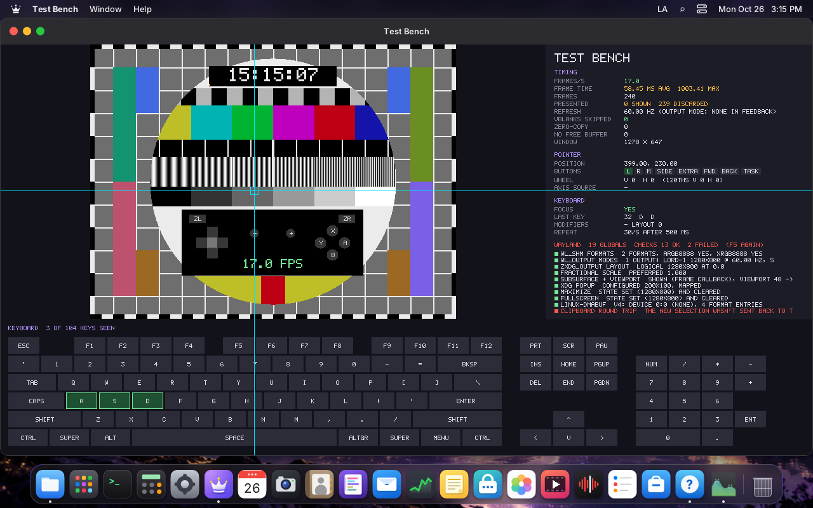
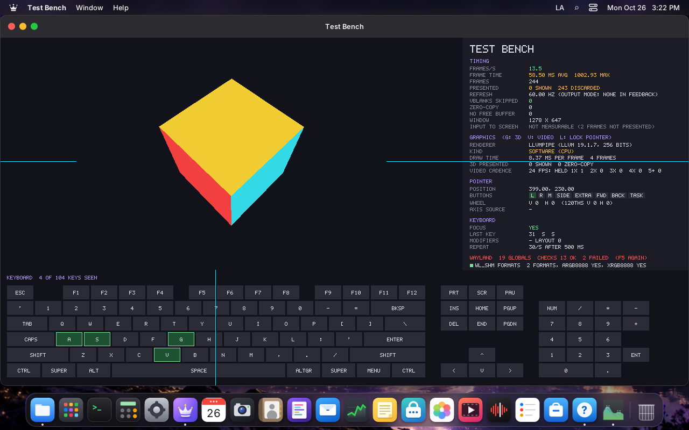
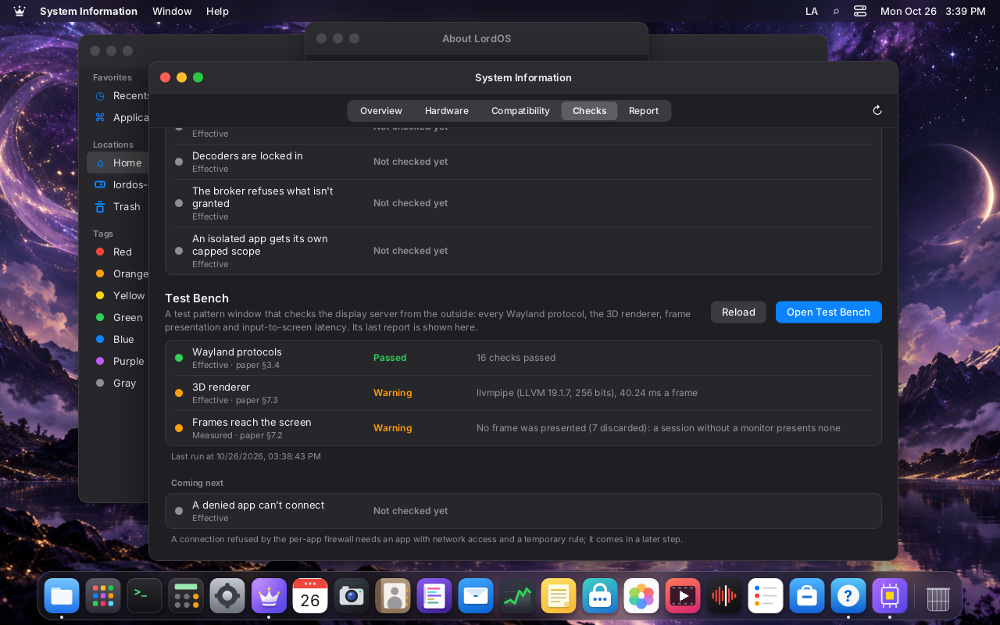

# Validating the paper

The technical paper (https://lordos.org/paper/, `docs/PAPER.md`) makes claims about LordOS. This page was
written against its 0.8.0 edition and lists each claim with how it is checked today and its state in 0.8.5, with rows added for the
0.8.6 edition (published with the 0.8.6-beta release on 2026-10-30) and for what the paper marks in 0.8.7, and one section per 0.8.8.x release up to 0.8.8.8 (2026-11-12, the paper's
current edition), so anyone can see what is proven, what was measured once and what is not tested. **The rows marked
Outdated were corrected in the paper's 0.8.5 edition (2026-10-26; published with the 0.8.5-beta release on
2026-10-27)**, which also separates whole-system
memory from a process's RSS (§7.1) and points to versioned results (§11.5, `docs/RESULTS.md`).

**How a claim is checked**

| Mark | Meaning |
|---|---|
| **Test** | An automated test in the repository (`make -C server test`, `test-full` or `node` suites) fails if the claim stops being true. |
| **Check** | System Information → Checks verifies it on the user's own computer: *configured* (the mechanism is there) or *effective* (it was tried and gave the right answer). |
| **Measured** | A number measured by hand on a named machine; nothing repeats it yet. LordBench (0.8.6) is meant to. |
| **Untested** | The paper itself says it wasn't tested (real hardware). |
| **Outdated → corrected in 0.8.5** | No longer true in 0.8.5: the paper must change. |
| **Design** | A design rule, checked by review and `AGENTS.md`, not by a program. |

## §1–§2 Vision and architecture

| § | Claim | How | State |
|---|---|---|---|
| 1.2 | JavaScript has no API to run programs, with three narrow exceptions | Design (`AGENTS.md`); the exceptions grew since: Xwayland (0.8.3), the network connectors and the blocklist downloader (0.8.5) | **Outdated → corrected in 0.8.5** (§1.2 now lists them, the Store's download child included) |
| 1.2 | GPU composition optional, the CPU path always works | Test (`canvas-test`, CPU path in every test); Check `gpu` says which path and why | Holds |
| 1.2 | The compositor never waits on helpers or apps | Design (non-blocking sockets) | Design |
| 2.2 | `lord-server` runs as the user | Check `serverUser` (configured) | Holds |
| 2.4 | `lord-netd` only takes `net-*` actions from uid 0 peers | Design; `net-test` covers the actions | Partly tested |
| 2.4 | `lord-fand` writes only fans its scan found and restores them on stop or crash | Test (`fan-test`, fake sysfs); Measured on the Pi 5 (§7.4) | Holds |
| 2.4 | (0.8.6) With no default chosen, a file opens with the system's default or the first installed app that declares its type, shown as "Automatic" | Test (`defaults-test`, fake XDG tree); checked once in an isolated session on VM 116 (2026-10-29) | Holds |
| 2.4 | Display changes revert after 15 s without confirmation | Manual | Not automated |
| 3.6 | Passwords are checked by the root process, not the login screen | Design; `remote-sec-test` covers the parsers | Design |

## §3 Compositor and remote desktop

| § | Claim | How | State |
|---|---|---|---|
| 3.1 | Modesetting with our own DRM ioctls, the card with connectors | Design (`kms.c`, no libdrm) | Design |
| 3.2 | CPU path without a 3D card; software OpenGL falls back to it | Check `gpu` names the reason (`no-3d`, `software`…) | Holds (VM 116 shows it) |
| 3.2 | GPU path tested only with Mesa's software renderer | Since corrected: it runs on V3D (Pi 5) and SVGA3D (VMware). Untested on AMD/Nvidia/Intel | **Untested** on those |
| 3.3 | Touchpad gestures replayed in tests | Test (`tp-test`, `tests/touchpad-sim`) | Holds |
| 3.4 | Only `libwayland-server` plus generated protocol code | Design | Design |
| 3.4 | **Xwayland not supported** | Xwayland launches on demand since 0.8.3 | **Outdated → corrected in 0.8.5** |
| 3.4 | No screen-capture protocol offered to apps | Design | Design |
| 3.5 | Scale 100–200 % per display; two virtual heads tested, real monitors not | Manual (VM 116) | Untested on real monitors |
| 3.6 | Remote desktop off by default, port 5673 | Check `remoteClosed` (effective: `/proc/net`) | Holds |
| 3.6 | TLS 1.2+, self-signed P-256; cookie Secure, HttpOnly, SameSite=Strict | Test (`remote-sec-test`, `remote-fuzz`) | Holds |
| 3.6 | **Failed logins wait 1, 2, 4… s up to 5 min** | Since 0.8.3: 3 failures block the source 15 min → 1 h → 24 h, answers at a fixed 1.25 s | **Outdated → corrected in 0.8.5** |
| 3.6 | **Screen updates are PNG still and JPEG moving** | WebRTC video (H.264, VP8) since 0.8.4 | **Outdated → corrected in 0.8.5** |
| 3.6 | **No audio** | Sound since 0.8.4 (Opus) | **Outdated → corrected in 0.8.5** |

## §4–§5 UI engine and apps

| § | Claim | How | State |
|---|---|---|---|
| 4.2 | React 19.3.1, QuickJS 2025-04-26; default theme 367 KB | Build output | Size changed → corrected in 0.8.5 (about 1.8 MB, 540 KB compressed) |
| 4.2 | Shaping identical to HarfBuzz on 409 of 409 sentences | Test (`shape-test`, `hb_compare.py` in `test-full`) | Holds |
| 4.2, 7.4 | NEON loops bit-identical to C | Test (`canvas-test` on the Pi) | Holds |
| 4.4 | English, Spanish, Portuguese; keys and brand names checked | Test (`tools/i18n-check.mjs`) | Holds |
| 5.1 | About thirty native apps | Count | 34 in `apps/`, System Information and its hidden probe included; the 0.8.5 edition says thirty-one (without the live installer and the hidden probe) |
| 5.2 | `.lpk` limits: 2,000 files, 64 MB | Test (`pkg-test`, `sign-test`) | Holds |
| 5.3 | InRelease signatures, plans equal to apt's in 12 cases | Test (`pkg-test`, `engine-test`) | Holds |
| 5.3 | Downloads over HTTP even for HTTPS sources | `lord-tls` (0.8.5) fetches `https://` sources over HTTPS; the Store's update and installs used it on VM 116 and the VMware machine | **Outdated → corrected in 0.8.5** (2026-10-27: §5.3 now says HTTPS since 0.8.5) |
| 5.3 | AI category: vendor repositories added with the pinned key; llama.cpp downloads models with `-hf` and runs on the CPU | Measured: VMware machine, 2026-10-27 (llama.cpp from the Store, `llama-server -hf ggml-org/Qwen3-0.6B-GGUF:Q8_0`, about 33 tokens/s on the CPU); VM 116 (Cursor's and VS Code's sources added, `apt update` and the engine's update clean). GPU through Vulkan | Holds; GPU **Untested** |
| 5.4 | Linux apps not sandboxed by default | Still true; restrictions per app since 0.8.3 | Holds, needs a note |
| 5.5 | WebAssembly 2.0 without SIMD, 26,290 of 26,290 assertions | Test (`wasm-test`) | Holds |
| 5.5 | WebAssembly 3–5× faster than JS on the example | Measured once | Measured |
| 5.6 | Install script checks the Ed25519 signature and SHA-256 | Manual | Not automated |

## §6 Security

| § | Claim | How | State |
|---|---|---|---|
| 6.4 | Landlock ABI up to 6 for `.lpk` apps | Check `landlock` (configured) + Sandbox Probe `appSandbox` (effective) | Holds |
| 6.4 | Seccomp denies ptrace, mount, exec…; no new privileges; no capabilities | Sandbox Probe (effective: each tried; NoNewPrivs, Seccomp 2, CapEff 0 read by lord-server); Test (`sandbox-test`) | Holds |
| 6.4 | Per-app cgroup: memory.high 192 MB, memory.max 512 MB, one core | Sandbox Probe `appScope` (memory.max) | Holds in a session; memory.high and CPU not shown yet |
| 6.4 | No network permission: no internet sockets, no TCP | Sandbox Probe (`netInet` refused) | Holds |
| 6.4 | `sandbox-test` 14/14 and 14/14 with network | Test (`test-full`) | Holds |
| 6.4 | Malicious test app fails at everything | Test (`tests/lpk-evil`) | Holds |
| 6.4, 7.1 | Isolated app ~13.7 MB RSS, starts in 106 ms, sandbox in 0.89 ms (VM 122) | Measured once | Measured |
| 6.5 | The broker checks every request in C | Sandbox Probe `broker` (effective: four requests refused); Test (`broker-restrict-test`, `brokermail-test`) | Holds |
| 6.6 | Seven network eBPF programs plus device and LSM programs | Check `netperm` (configured); Test (`npverify-test`, kernel, VM) | Holds where installed (VM 116 lacks it) |
| 6.6 | 480,000 random connections, 0 differences | Test (`npcompile-test`) | Holds |
| 6.6 | ~0.5 µs per UDP connect, no per-packet cost | Measured once | Measured |
| 6.6 | A denied app can't connect | Not yet effective on the user's machine | **Pending** (Checks) |
| 6.7 | Helpers: no sockets, no exec, seccomp on every thread, exit if it fails | Sandbox Probe `helperSandbox` (effective); Test (`sandbox-test helper`, 17/17) | Holds |
| 6.8 | Ed25519 and SHA-256 against NIST and RFC 8032: 55 of 55 | Test (`sign-test`) | Holds |
| 6.8 | Official `.lpk` packages signed with a development key | `server/src/sec/keys.h` (checked 2026-10-26: only the development key) | Holds; re-check before publishing |
| 6.9 | Release key fingerprint, SBOM in SPDX 2.3 | Release scripts | Manual |
| 6.9 | Every bundle verified against the signed manifest | Check `code` (effective: this session's bundles) | Holds |
| 6.10 | Vault: Argon2id, XChaCha20-Poly1305, 1,165 of 1,165 tamper tests | Test (`vault.mk` suites) | Holds |
| 6.10 | FIDO2 keys untested on real hardware | — | **Untested** |
| 6.11 | Protected windows black in screenshots, recordings, remote desktop | Test (`media-test` covers capture paths) | Partly tested |
| 3–10 | Final pass of the released code (v087.28, the tree tagged as 0.8.7 apart from the version): unpinned Dock order, Go to file after a minimize, Mail found by "correo", Classic Start menu over Linux and isolated apps, ❖M and restore of fullscreen Linux apps (Wayland 7 of 7, X11 13 of 13), Overview clicks | Seen on screen on the Raspberry Pi 5 (arm64) and VM 125 (amd64), from installed packages; the VMware guest ran v087.27 (2,172 frames compared, 0 differ) | Holds. An X11 restore came back windowed once on the build before, cause unknown, not reproduced |
| 10.1 | Cleaner's real removal of an installed Linux app, with its row in Activity | Seen on screen on VM 125 (v087.27) | Measured once |
| 6.12 | Aligned with ISO/IEC 29147, 30111, 5230, 18974; no audit | Documents | Design |

## §7 Performance

| § | Claim | How | State |
|---|---|---|---|
| 7.1 | Live ISO idle 465 MB, installed idle 487 MB, CPU 99 % idle | Measured once (VM 117, 120) | Measured → LordBench |
| 7.1 | Boot 16.3 s with UEFI | Measured once | Measured → LordBench |
| 7.1 | `lord-server` without 3D ~32 MB RSS; session ~50 MB, login 41 MB | Measured once; Check `memory` shows the current number (VM 116 today: ~100 MB in a headless session with apps open) | **Re-measure** at idle |
| 7.2 | Window drag 1280×800 CPU path 6.7–6.9 ms, ~120 fps | Measured once (VM 118) | Measured → LordBench |
| 7.2 | Video: lord-server 42 % → 13 %, fullscreen 92 % → 15 % of a core | Measured once | Measured |
| 7.1 | — | New in the 0.8.5-beta edition: the released package measured on a VMware VM updated from 0.8.4.1, whole system 592 MB used and the first frame 7.4 s after the kernel started (`results/0.8.5-beta/vmware-fusion`, `RESULTS.md`) | Measured, versioned results (§7.1) |
| 7.2 | — | New in 0.8.5: remote desktop CPU reference (`REMOTE.md`, "Measurements (0.8.5, CPU reference)") | Added in the 0.8.5 edition (§7.2) |
| 7.2 | — | New in 0.8.6: dragged windows' rounded corners no longer turn black (the drag layer's corner restore mixes both pixels alpha included); a drag frame repaints only what changed, pixel-identical except an approved 1-level change at rounded corners below the window; GPU drag composes the window with the CPU's exact arithmetic after a self-test (`WINDOWS.md`, `GPU.md`) | Test (`engine-test`: `test_drag_corners` against a full repaint on both paths, `test_drag_exact`'s 2,417 golden frame hashes per path, the `gpu-drag` path; `canvas-test`: GPU drag's arithmetic over all 8,421,376 valid combinations, x86_64 only) | Holds on VM 116; on the Pi 5 (V3D, 2026-10-29) GPU drag's self-test passes (11,373,321 pixels, 341 ms), `LORD_GPU_VERIFY=1` compared 138 frames with 0 differences, and screenshots of the monitor show clean corners while dragging; GPU drag is off by default (no measurable gain) |
| 7.3 | GPU benefits on real cards not measured | — | **Untested** |
| 7.4 | In 0.8.7: GPU drag covers the whole drag and is on by default, verified on V3D and SVGA3D only (`GPU.md`, "The whole drag") | Pi 5 (V3D, v087.22, 4 real 16 s drags per setting): alone 58.1–60.6 % → 27.2–28.4 % of a core, 7.0 → 5.0 ms; under a memory load 28.8–29.1 → 34.4–35.1 fps, 20.3 → 13.2 ms, 67 % → 45 %; `LORD_GPU_VERIFY=1` 1,662 frames, all `differ=0`. VMware (SVGA3D, development build): 2,102 frames, all `differ=0`. Any other GPU: **Untested**, only the self-test guards it. Measured |
| 7.4 | In 0.8.7: what slows the Pi 5's GPU under load is memory (`build/gpu-contention`, verdict `memory`, two runs: 1.4 ms spinning, 28 ms reading, 3.7 ms writing; no throttling) | Measured on the Pi 5 16 GB, build 0.8.6+v087.4. What a real desktop load reads, and what a compositor change can avoid, is open. Measured |
| 7.4 | In 0.8.7: the buffer-age scissor stays off (GPU part 1.51 → 2.58 ms alone; under load 30.1–31.8 → 28.4–29.9 fps, pointer p99 63–66 → 83–95 ms) | Measured on the Pi 5 (5 runs without, 3 with, v087.22); `build/engine-test` over a simulated chain. Measured |
| 10.1 | In 0.8.7: Cleaner on a Pi 5 with its monitor: 4.5–7.2 % of a core with the hero idle, 12.2–18.0 % scanning, 0.1 % closed (`CLEANER-TESTS.md`) | Measured (v087.22, two runs a cell). Aurora's pauses of up to a second are not explained. Measured |
| 7.4 | Pi 5: build 1 min 02 s, tests 23/0/0, NEON 2.0–2.3×, idle 36 MB, fan behaviour | Measured once on the Pi (2026-10-18; the tests were not rerun on the Pi for 0.8.6) | Measured |
| 7.4 | — | New in 0.8.6: with a 1920×1080 60 Hz monitor, login screen 5.99 s after the kernel starts; desktop 59.4 fps alone (p99 13.0 ms, 1 % late) and 24 fps under a low-priority all-core load (96.5 % late); 3 minutes sustained at 5.9 GFLOP/s, 55.6 °C; software video decoding per codec. LordBench on the Pi (`BENCHMARK.md`, "Built so far") | Measured with LordBench (one run each); the load result led to two fixes (compositor CPU weight: 31–33 % → 7–8 % late without the monitor; with the real-time priority, measured on the monitor: 24 → 28.9–30.5 fps, still 94–98 % late, the frame's build time under load still to explain) |
| 7.4 | — | New in 0.8.6: LordBench's square now turns; with it, the frame-cost work took the Pi 5 with its monitor from 53–58 to 59.8–60 fps alone and from 24–25 to about 31 fps under load; the frame pipeline (+2–5 fps under load, 17–29 ms more pointer latency) and GPU drag (no measurable gain) were measured and are off by default; the remaining cost under load is the GPU's time per frame (1.5 → 14–16 ms, no clock or thermal throttling; memory contention likely, not proven); fewer pixels per frame, what slows the GPU and GPU drag for the whole drag moved to 0.8.7 (2026-10-30) (`BENCHMARK.md`, "The drag frame's cost") | Measured with LordBench on the Pi 5 (2–3 runs each, 2026-10-28; final run 2026-10-29: both off 59.9 / 30.5–31.1 fps, pointer to screen p50 25.7–25.9 / 48.5–49.0 ms; GPU drag on 59.9 / 30.8–31.6; the pipeline 60.0 / 33.0–36.2 fps, pointer 42 / 78 ms; `vcgencmd` every 2 s) | Measured (2026-10-29) |
| 7.5 | No measurements on real PCs | — | **Untested** |
| 7.5 | — | New in 0.8.6: LordBench's interface workloads on VM 116 (layout and paint 37.0/39.9 fps, shaping 619/3,595 runs/s; compared only within the same LordOS version) and the helper-sandbox self-test (six tries, all refused on VM 116: seccomp `EPERM`, Landlock `EACCES`) (`BENCHMARK.md`, "Built so far") | Measured with LordBench (one Full and four Quick runs); on the Pi 5 two Quick runs from a terminal (2026-10-29): 39.3–39.4 / 45.4 fps, 630–632 / 2,522–2,527 runs/s; its reference from a Full run over SSH without the monitor (2026-10-30, `ondemand`, 180 s sustained, 37.0 → 49.6 °C, no throttling or under-voltage): 39.22 / 45.23 fps, 628.3 / 2,514.0 runs/s, a second Full run within 0.4 % | Measured (2026-10-30) |
| 7.5 | — | New in 0.8.6: on a Raspberry Pi LordBench watches the firmware's under-voltage alarm (the only flag the LordOS kernel exposes), `get_throttled` on older kernels and 80 °C as the firmware's limit (a peak test stops as throttled); System Information's Raspberry Pi section reads the same through `hw/rpifw.c` and leaves out what the kernel doesn't show (`BENCHMARK.md`, "The Raspberry Pi firmware's throttling") | Tested on fake sysfs trees (`tests/lordbench_test.c`, `tests/sysreport_test.c`) on VM 116; on the Pi 5 (2026-10-29) the `rpi_volt` alarm is present and reads 0 with the official supply (LordBench's `piFirmware`), `get_throttled` absent; an actual under-voltage not provoked |

## §10–§11 Limits and verification

| § | Claim | How | State |
|---|---|---|---|
| 10.2 | Untested on real hardware: AMD/Nvidia GPUs, monitors on PCs (one 1920×1080 monitor tested on the Pi 5), laptops, Bluetooth, printers, scanners, FIDO2, mail providers | System Information reports (0.8.7: community reports) | **Untested** |
| 10.2 | Secure Boot must be off | System Information shows Secure Boot | Holds |
| 11.2 | `make test` on a development build of the 0.8.6-beta tag's code on VM 116: 23 passed, 0 failed, 13 skipped; `engine-test` 7,010 checks, `defaults-test` 38/38, `test-full` 7 passed | The 13 skipped: 12 need node (run on the maintainer's machine, 12/12) and `bidi-test` needs its data file. Not rerun on the final ISO or on the Pi (2026-10-30) | Holds |
| 11.2 | (0.8.6) every frame compared with a full repaint; seven partial-repaint errors fixed; the 0.8.2 scene on a running desktop found no stale area | `build/engine-test` (`test_damage_pipeline`, `test_damage_fuzz`); VM 116 isolated headless session, six runs of 54 checks (`docs/MONITOR.md`, "The 0.8.2 integration test, repeated") | Holds (2026-10-29) |
| 11.2 | (0.8.6) a blurred window hidden whole behind an opaque one is no longer repainted with every change near it (a translucent Terminal behind Monitor's moving map: 46 % of the screen per frame → 11–15 % in one box, 3–4 % in several rectangles) | `build/engine-test` (`test_hidden_blur_damage`); VM 116 `--profile` and the repaint check in both modes, before and after rebasing onto the frame-cost work (`docs/MONITOR.md`, "A blurred window hidden behind Monitor") | Holds (2026-10-29; rebased build: 11.2 % and 3.3 %) |
| 11.2 | 47,395 parser checks with mutation fuzzing | Tests (`remote-fuzz`, mail, doc, imager fuzzers) | Holds: `build/mail-test` 47,395/47,395 on VM 116 (2026-11-05, 0.8.8.4 with the CalDAV/CardDAV helpers) |
| 11.4 | Port 5673 closed until enabled | Check `remoteClosed` (effective) | Holds |

## 0.8.7

| § | Claim | How | State |
|---|---|---|---|
| 3.3 | One key dispatcher per theme; a fixed list of keys kept from Linux apps, by name | Test (`keygrab-test`) | Holds |
| 3.3 | A pointer lock holds only with the pointer on the surface and the keyboard on its app; ❖Esc releases it | Test (`ptrlock-test`); reproduced on the Pi 5 with uinput and the kernel's cursor plane | Holds. The pointer speeding up by itself was not reproduced |
| 3.3 | On-screen keyboard: closed key list, no Ctrl, Alt or Super, only the theme and login screen | Test (`osk-test`, `osk_model_test.mjs`); VM 125 end to end | Holds; a real touchscreen **Untested** |
| 3.6 | Session restore after logout, restart, shutdown, forced power-off and `SIGKILL` | Manual on VM 125 | Measured once; after a forced power-off Chromium needs its own "Restore pages?" |
| 3.6 | A card with no KMS counts as no display, with a message on the text console | Manual | Not automated |
| 4.3 | `lord.fs` refuses a parent of a protected path | Test (`fsops-test`) | Holds |
| 5.1 | Files → Network: one bounded pass, read by a sandboxed helper, JS names no address | Test (`lan-test` under ASan and UBSan, 40,000 damaged answers); a pass on the real LAN on VM 116 and VM 125, outside a session | Holds outside a session; no pass through the `lan` connector inside a session is recorded |
| 5.1 | `share-mount`: guest, password and NFS 4.2 | VM 125 against a test server over a veth | Measured once; a real NFS server **Untested** |
| 5.1 | SMB with a password: sign-in, share list, mount, reading a file | One real share on a desktop system with a local account (`FILES.md`), and that test server | Measured once; no other SMB server tried; listing the shares of a server outside the local network is refused |
| 5.1 | RDP refuses RDP's own security before any credential | Test (`rdesk_rdp_test.c`, stub server; the old setting sent 395 bytes); xrdp over TLS on the test VM | Holds |
| 5.1 | SMB sign-in carries a target name and MIC and needs the server's signature | Test (`lan-test`); `lan-list` against Samba on the test VM, right and wrong password | Holds on Samba and on the one real share above |
| 5.1 | Programs that read a server's bytes run read-only with a 15 s limit | Test (`rconnect-run-test`, also `ssh-keyscan`, `openssl`, `rclone obscure` for real) | Holds with Landlock; without it only scope and deadline |
| 3.3, 7.4 | Moving wallpapers need GPU composition and hardware decoding; on the Pi 5 at login, 1080p60 HEVC: `lord-media` 41 %, `lord-server` 147 % of one core | Test (`motion_model_test.mjs`, `wallpaper_find_test.c`); Measured on the Pi 5, 30 s, SoC 52 °C (`WALLPAPERS.md`) | Measured once; no run on a desktop session is recorded |
| 3.6 | The login screen composes on the GPU (`lordos-greeter` in `render` and `video`) | Measured on the Pi 5 with the row above | Measured once |
| 5.1 | Remote Desk: VNC and RDP with pointer and keyboard | A throwaway test machine | Measured once; RDP to a real session of a desktop system and RDP's shared folders **Untested** |
| 5.1 | Disk Formats: NTFS, exFAT and FAT32 read and write, HFS+ and APFS read-only | VM 125 from the sidebar with the drivers present (`FILES.md`) | Measured once |
| 5.6 | arm64 live ISO: live desktop, wizard install, boot of the result | An unsigned development build on emulated QEMU (`ISO.md`) | Measured once; real hardware, a USB stick, a hardware-accelerated hypervisor, a 3D virtual GPU, sound, the browsers and a signed build **Untested** |
| 6.2, 6.7 | `lord-media` opens two exact decoder device files, only for `v4l2request` playback | Design (`lm_main.c`) | Design |
| 6.3 | `wallpaper-get` deletes a file whose size or SHA-256 isn't the catalog's | Design (`wallpaper_admin.c`); `wallpaper_find_test.c` covers the lookup | Partly tested |
| 6.6 | A `.desktop` file can't take `desktop:lordos-rclone`, `desktop:lordos-cloud` or `desktop:lordos-rdesk` | Design (`app_scope_reserved`) | Design |
| 6.7 | `lord-rdesk` takes the helpers' sandbox after connecting; a VNC server that skips a given password is refused | Test (`rdesk_test.c`, with a fuzz run) | Holds |
| 6.7 | SFTP keys, and certificates for ftps and https WebDAV, kept only after being shown; an accepted certificate outranks the system's list | Test (`lan-test`, `rconnect-run-test`); VM 116 against the test server | Partly tested |
| 6.9 | The tested-hardware snapshot is verified in C before it is shown | Test (`hwsnap-test`, a tampered snapshot refused) | Holds; the update path against the real signed repository **Untested** |
| 7.2 | Cleaner: a tree of 102,653 entries in 446 ms, duplicates in 5.1 s, a real delete of 20,000 files in 1.0 s | Measured on VM 116 (122,000 files, warm cache; `CLEANER-TESTS.md`) | Measured once |
| 3.3 | Windows reopen by display identity, clamped when it's gone | Test (`place_model_test.mjs`) | Model only so far; two real displays **Untested** |
| 5.1 | A network mount that stops answering doesn't freeze the interface | VM 125: never blocked in 24 samples, against 30 s on SMB and over 100 s on NFSv4 | Measured once |
| 5.1 | Monitor → Voltage | Test (`voltage-test`, `settings-hw-test`, `voltage_model_test.mjs`); an isolated session with the real board's values as a fixture | Holds on fixtures; a real under-voltage, sensor chip and battery **Untested** |
| 5.6 | `install.sh` names an administrator on a Debian with a root password | A clean amd64 Debian 13 virtual machine | Measured once; logging in on the login screen not part of that run |
| 6.3 | `admin-rescue` decides again as root and refuses when an administrator exists | Test (`admin-rescue-test`); an installed amd64 virtual machine | Holds; real hardware and arm64 **Untested** |
| 6.3 | `hw-serial-numbers`, `rpi-pmic`: read-only, values validated in C | Test (`settings-hw-test`) | Holds |
| 6.7 | `lord-clean` and `lord-lan` take the helpers' sandbox | Test (`clean-test`, `lan-test`) | Holds; `clean-test` has no case yet for what a scan shows per rule or for the minimum time per step |
| 6.11 | The on-screen keyboard's panel and System Information with serials showing are protected | Design (`protected` node) | Partly tested |

## 0.8.8.6 (released on 2026-11-08 as 0.8.8.6-beta; the paper's edition of 2026-11-08)

| § | Claim | How | State |
|---|---|---|---|
| 1.2, 6.7 | `lord-server` starts only `lord-say`, from a fixed path, with fixed arguments, the text on a sealed memfd and a voice name checked in C | Design (`server/src/tts/speak.c`, AGENTS.md); `saytext_test.c` (25) | Design |
| 5.1, 6.7 | `lord-tts` is the only binary that links audio.cpp and ggml; no network, sockets, fork or exec; on the GPU only the render node and a read-only listing of `/dev/dri` | Test (`server/tests/tts_test.sh`, 17, in `test-full` when a model is installed) | Holds where a model is installed; the Raspberry Pi **Untested** |
| 5.1 | About 10 s of speech in 1.3 s on the GPU and 3 s on the CPU, 220 MB | Measured once (i9-10900 with a Radeon RX 580; `docs/VOICE.md`) | Measured |
| 5.1 | 23 voices, Standard 128 MB and HD 672 MB (English 1.3 GB) per language, as signed packages; only voices whose recordings allow redistribution and commercial use | `sdk/voicecatalog.js` (`voicecatalog_test.mjs`, 21), `tools/voice/` | Holds in the catalog; the published packages in the APT repository were not checked for this edition |
| 5.1 | Personal Voice: consent first, a room check, six phrases or 15–30 s of free speech | Test (`voicerec_model_test.mjs`, 20) | Model tested; a run with a real microphone not recorded here |
| 5.1, 6.7 | `lord-ocr` is the only binary that links Tesseract; pixels in a sealed memfd; no home folder, `/tmp` writes, network, sockets or fork | Test (`server/tests/ocr_test.sh`, `test-full`) | Holds |
| 5.1 | Text recognition takes about 0.3 s a selection | Measured (`CHANGELOG.md`, 0.8.8.6-beta) | Measured once |
| 6.10 | A Terminal password goes between `lord-vault` and the pty in C, never through JavaScript; a typed one is kept in one `mlock`ed page and wiped on every way out | Test (`build/term-secret-test`, 10, on a real pty; `build/term-capture-test`, 28, also under ASan and UBSan; `terminal_secret_test.mjs`) | Holds |
| 3.3 | Shake to find the pointer | Test (`build/shake-test`, 12) | Detector tested; the cursor on screen not automated |
| 3.3 | Alps touchpads that report pressure above their declared range | Test (a `tp-test` case built from the driver's report format) | Holds in the test; the touchpads themselves were reported by users (#43, #54, #67) |
| 3.5 | Scales up to 300 % where the desktop keeps at least 1024 × 600 | `CHANGELOG.md`, 0.8.8.6-beta (#47) | Not automated; a 4K laptop panel **Untested** |
| 3.5 | The cursor plane at the driver's size (128 × 128 on amdgpu) and the login screen on the chosen main display | Fixed from what one PC with a Radeon RX 580 and three monitors showed | Not automated; whether each fix was seen working there is not recorded in the changelog |
| 7.1 | Memory in use counted as `MemTotal − MemFree − (Buffers + Cached + SReclaimable − Shmem)` | Test (`sysreport-test`, `server/src/meminfo.h`) | Holds; the measured rows of §7.1 were not taken again |
| 2.4 | `intel-microcode` and `amd64-microcode` are dependencies on amd64 | Package control file | Design; the update path against the signed repository not yet run |

## 0.8.8.7 (released on 2026-11-09 as 0.8.8.7-beta; the paper's edition of 2026-11-09)

| § | Claim | How | State |
|---|---|---|---|
| 1.2, 5.1, 6.7 | Files mode runs no program: `lord-server` opens channels on the tab's own `ssh` control socket with OpenSSH's mux protocol, and remote commands come from a closed list checked in C | Design (`server/src/term/sshmux.c`, `sftpc.c`, AGENTS.md); Test (`build/sftpc-test`: `tests/sftp_e2e.sh` with a private `sshd` and an `ssh` master) | Holds in the test; not checked against servers other than OpenSSH |
| 6.7 | `lord-sftp` gets the channel and the local file as descriptors, never a path, with no `clone`, socket, `connect`, `bind` or `exec` | Test (`build/sftp-test`, also under ASan and UBSan: the mux and SFTP wire against hostile bytes, `lord-sftp` against a fake server) | Holds |
| 2.2, 6.2, 6.7 | `lord-sql`: one process per connection, OpenSSL inside the helper only, sandbox applied before the server's first byte, no sockets or files | Test (`build/sql-proto-test`, also under ASan and UBSan; `build/sql-e2e-test` against a fake MySQL server: both sign-in methods, RSA, TLS, results) | Holds; real servers not recorded here. `AGENTS.md` still marks `lord-sql` and the `sql` connector as pending the maintainer's approval |
| 6.6 | The `sql` connector connects only to a saved favorite's host and port, named by id | Test (`build/sqlc-test`: the favorites validator, the lookup and the socket rule) | Holds |
| 6.10 | Passwords' 🔑 lists only entries whose host or site is exactly the address the password goes to | `CHANGELOG.md`, 0.8.8.7-beta | Not automated here |
| 6.10 | An isolated app reads the clipboard once within 2 s of a paste `lord-server` saw reach its window | `CHANGELOG.md`, 0.8.8.7-beta (#64) | Not automated here |
| 4.4 | Lithuanian complete: all 11,909 keys | Test (`tools/i18n-check.mjs`: every key in every language; 11,909/11,909 at the tag) | Holds |
| 5.1 | CDs and DVDs mount read-only; destructive actions refuse an optical drive on the root side | `CHANGELOG.md`, 0.8.8.7-beta (#92) | Not automated; seen with a virtual machine's disc image per the changelog |
| 5.1 | Asynchronous `lord.fs` calls refuse exactly what the synchronous ones refuse | Test (`build/fsasync-test`, `tests/files_remote_test.mjs`) | Holds |
| 7.2 | 1,520 12-megapixel photos: 10 GB in 23 s (killed) → 265 MB at most, no pause over 0.4 s; 300 photos, 154 MB | Measured once (`CHANGELOG.md`, 0.8.8.7-beta, #71, #82) | Measured |
| 3.6 | A hardware H.264 stream whose first keyframe doesn't decode falls back to x264 | Test (`build/encheck-test`, `build/lmstream-test` in `test-full`) | Holds where FFmpeg's -dev packages and, for VA-API, a render node exist |
| 3.6 | Every lit display gets a black frame of its own mode, let go with `CLOSEFB`, at each hand-off | Design (`lord-sessiond`); `CHANGELOG.md`, 0.8.8.7-beta | Not automated; amdgpu's warning is what was seen before |
| 2.4 | Updates bring only the Recommends a new version adds | Test (`build/pkg-test`: the new Recommends come with the upgrade) | Holds in the test; the update against the signed repository not recorded here |
| 5.1 | Four more verified Cloud providers | `assets/cloud/providers.json` (evidence per provider), `docs/CLOUD.md` §19 | Holds as recorded evidence |

## 0.8.8.8 (released on 2026-11-12 as 0.8.8.8-beta; the paper's editions of 2026-11-10, 2026-11-11 and 2026-11-12)

| § | Claim | How | State |
|---|---|---|---|
| 1.2, 5.1, 6.7 | Port forwards, drop uploads and `ls` downloads run no program: they use the tab's own `ssh` control socket, as Files mode does | Design (`server/src/term/sshmux.c`, `apps/terminal/forwards.js`, `dropupload.js`); Test (`build/sftpc-test`: a forward to the test server's own `sshd`, its banner read through it, a host with a space refused) | Holds in the test; checked on a real session against one private OpenSSH server per `CHANGELOG.md` |
| 6.7 | A forward listens on 127.0.0.1 only | Design (`sshmux.c`, `docs/TERMINAL.md`) | Not automated beyond `sftpc-test` |
| 5.1, 6.7 | The remote shell's directory (OSC 7) is kept only as an absolute path with no control characters, and no longer replaces the local one | `CHANGELOG.md`, 0.8.8.8-beta | Not automated here |
| 5.1 | ❖ + click finds a name in `ls` and `ls -l` output, looked up in the reported directory, the prompt's, the title's, then the home | Test (`tests/terminal_lsnames_test.mjs`, 38 checks) | Holds |
| 5.1, 6.7 | Uploads never follow a link and never replace a name on the server; Edit's saves are the one upload that replaces a file | `CHANGELOG.md`, 0.8.8.8-beta; checked on a real session (a name already there kept, the copy `notes (2).txt`) | Not automated here |
| 5.1 | A trigger tried on a sample line says what it matches and what the action would do | Test (`tests/terminal_triggers_test.mjs`, 13) | Holds |
| 5.1 | An account's Details shows provider, backend type, sign-in and server, never the user name, email or a secret | Test (`server/tests/cloud_model_test.mjs`, accountDetails, 6 checks) | Holds |
| 5.1 | Photos moves pictures to the Trash, one or a selection, and asks before deleting in a cloud account | Test (`server/tests/photos_trash_test.mjs`, 20 checks) | Holds for the logic |
| 5.1 | "Send text at start" types and sends each line, the last one too, and an old `\n` counts once | Test (`tests/terminal_profilefields_test.mjs`, 22) | Holds |
| 5.1 | The SDK's text fields select and edit (Shift, drag, double click, by word, copy and cut never from a password field) | Test (`tests/textfield_model_test.mjs`, 43; `tests/textarea_model_test.mjs`, 32) | Holds for the models; the drawing was seen on a session |
| 5.1 | A group of Databases favorites has a color, checked in `lord-server` like a favorite's | Test (`build/sqlc-test`, 5 more checks) | Holds |
| 5.1 | Every list of names sorts the same way, case and accents aside, numbers by value (GitHub #64) | Test (`tests/files_model_test.mjs`, with the engine's `localeCompare` swapped in) | Holds; seen in a session and on a Raspberry Pi 5 |
| 3.4 | Drag and drop between Linux apps and with Files; a drag needs a current press serial; protocol errors and mid-drag destruction end cleanly | Test (`build/dnd-client`, a Wayland client run inside a session; `build/urilist-test` in `make test`) | Holds in the session test; checked on VM 127 (Files → Chromium, a GTK 4 target with copy and Shift-move) |
| 3.4, 6.7 | A file list from a drag or the clipboard reaches LordOS only from a positively unsandboxed client and only as local `file://` paths; a drop nobody claims is cancelled | Test (`build/dndgate-test`, `build/urilist-test`, `build/clipfiles-client`) | Holds |
| 3.4 | Files copied in a Linux app paste in Files only after a confirmation with Cancel as the default | Test (`tests/files_clipfiles_test.mjs`); checked on VM 127 (Enter cancelled, Paste copied) | Holds |
| 3.4, 4.2 | LordOS's input methods compose inside text-input-v3 apps; password, PIN, hidden and sensitive fields never compose; what the app sends is clamped to UTF-8 and character boundaries | Test (`build/textinput-test`; `build/textinput-client` inside a session) | Holds in the tests; checked on VM 127 with Korean in a GTK 4 field (with `GTK_IM_MODULE=wayland`, which `lord-server` sets unless one is set); Qt and Japanese or Chinese in a Linux app not recorded |
| 3.4 | Qt gets `QT_QPA_PLATFORM=wayland;xcb`: a Qt app without Qt's Wayland plugin opens through Xwayland (GitHub #96) | Test (`build/toolkitenv-test`, 8); checked on VM 127 with MusicBrainz Picard (Qt 5) and Qt 5's Wayland plugins hidden in a private mount namespace | Holds |
| 3.4 | Linux apps' tray icons show with their menus; an SVG-only icon shows a letter | Test (`build/sni-test`, 40; `tests/tray_model_test.mjs`, 26); checked on VM 127 with a GTK app using an indicator library | Holds |
| 3.4 | MPRIS players appear in Now Playing and get the media keys; cover art only from a local file | Test (`build/mpris-test`, `tests/mpris_model_test.mjs`); checked on VM 127 with a video player | Holds |
| 3.4, 6.7 | `lord.mpris`, `lord.sni` and `lord.primary` don't exist in isolated apps; `lord.primary.get()` answers only during a middle-button press | Design (`js_hw.c`, `ui/js.c`, no broker message); Test (`tests/primary_model_test.mjs`, `build/primary-client`) | Design; the session test covers the serial rule |
| 3.4 | `xdg-activation`, `xdg-foreign-v2` and `xdg-dialog-v1` | Test (`build/xdgact-test`, `tests/dialog_model_test.mjs` 22, `build/dialog-client` 12) | Holds |
| 3.3 | Tab and Shift+Tab reach every shared control, with a focus ring shown only after keyboard use | Test (`tests/focus_model_test.mjs`, 102; `tests/focus_scene_test.mjs`, 41); checked on VM 127 in Settings | Holds; VM only |
| 3.3 | Menus in both themes work from the keyboard; F10 or the left ⌥ alone opens the menu bar | Test (`tests/menu_nav_test.mjs`, 68; `tests/menu_keys_test.mjs`, 31); checked on VM 127 | Holds; VM only |
| 3.3 | Password fields have an eye and a Caps Lock warning, and stay password fields while shown | Test (`tests/password_field_test.mjs`, 32; `password_field_scene.mjs`, 16; `test_locked` in `osk_test.c`) | Holds |
| 3.4, 6.7 | ScreenCast: nothing is shared until the person picks in LordOS's chooser; the chooser names only a verified identity; an app with "no screen capture" is refused before any question and an unknown sender fails closed; no `restore_token` | Test (`build/castsm-test`, `tests/screencast_model_test.mjs`) | Holds in the tests |
| 3.4, 6.7 | `lord-screencast` is the only binary that links libpipewire, sandboxed before its connection speaks; the app's PipeWire connection sees only the session's streams; each side checks the other's messages | Test (`build/screencast-test` against a private PipeWire daemon, `build/castproto-test` with ASan and UBSan, `build/pwguard-test`) | Holds in the tests (skipped without `pipewire`) |
| 3.4 | Screen sharing works with a browser: 176 frames in 10 s at 1280×800, the helper at about 2 % of a CPU, nothing running when nothing is shared | Checked on VM 127 with a browser's screen-sharing page (after the memfd buffer fix) | Measured once |
| 3.4 | A share follows a window by node id and a never-reused serial | Test (`test_node_ref` in `build/engine-test`) | Holds |
| 3.4, 6.7 | SVG icons are drawn only by `lord-media` (nanosvg) on an fd `lord-server` opened, with limits counted by nanosvg's own tokenizer | Test (`build/svgrast-test`, `build/media-test svg` in `test-full`, `build/iconfind-test`, `tests/iconsrc_test.mjs`); checked on VM 127 (the volume applet's symbolic tray icon) | Holds |
| 3.4 | An app takes the shortcuts only after the person allows it; the decision goes by the identity `lord-server` checks, never the app_id; ❖Esc gives them back | Test (`build/kbinhibit-test`, `tests/kbinhibit_model_test.mjs`, `build/kbinhibit-client` inside a session); checked on VM 127 (the prompt shows the verified identity) | Holds |
| 3.4 | Global shortcuts: nothing is bound before the person's answer; ❖ combinations, typing keys and LordOS's keys are never given; press and release reach only the session's connection | Test (`build/gshort-test`, `build/portal-gs-test` on a private session bus, `tests/global_shortcuts_model_test.mjs`) | Holds in the tests; not checked on the VM |
| 3.4 | Xwayland requires the session's X cookie (`-auth`): X11 apps run as root through pkexec or sudo (GParted) open, restricted Linux apps and isolated apps get neither the display nor the cookie (GitHub #107) | Test (`build/xauth-test`, `fsops-test`); checked on VM 127 (GParted through `pkexec`, root's `xdpyinfo` with and without the cookie, a `no-files` and a `no-mic` app through `build/launch-cli`) | Holds |
| 3.4 | XDND both ways with X11 apps; X files reach Files only from an unsandboxed owner, and data only from the X server's own `SelectionNotify` | Test (`build/xwm-test`) | Holds in the test; not checked on the VM |
| 3.4 | Security contexts: only an unsandboxed client may make one, and its clients count as sandboxed and don't see the trusted-only globals | Test (`build/secctx-test`, end to end over socketpairs) | Holds in the test; no real Flatpak run |
| 3.4 | X11 apps scale themselves on HiDPI (X pixels are device pixels on the densest display, `Xft.dpi`) | Test (`build/xwscale-test`) | Holds in the test; not checked on the VM |
| 3.4, 5.1 | Linux apps follow LordOS's mode and accent through the Settings portal again (from 0.8.8 to 0.8.8.7 `lord.portal.set` was lost) | Design (`js_hw.c` adds to the `lord.portal` object `js_wm.c` made) | Not automated |
| 3.6 | logind's Lock locks the screen, only from the owner of `org.freedesktop.login1`; `Unlock` is never obeyed | Test (`build/logindlock-test`) | Holds in the test; not checked on the VM |
| 4.4 | Caret and selection from the shaped, reordered text; movement by grapheme cluster | Test (`build/bidi-test` with `GraphemeBreakTest.txt`, 1,187 cases; `build/engine-test`; `tests/textfield_cluster_test.mjs`) | Holds in the tests; not checked on the VM |
| 5.1 | SDK `List`, `Table`, `Dropdown`, `Checkbox`, `RadioGroup`, `Tabs`, `Popover`, `Tooltip` and `ProgressBar` work from the keyboard | Test (`tests/list_model_test.mjs`, `tests/control_model_test.mjs`, `list_scene.mjs`) | Holds in the tests; not checked on the VM |
| 1.2, 5.1 | A `Terminal=true` app's command is typed by `lord-server` from a one-shot token, quoted in C; JavaScript never holds the command | Test (`build/apps-term-test`, `tests/terminal_profilefields_test.mjs`) | Holds in the tests; not checked on the VM |
| 1.2, 5.4 | Only `lord-server` starts `lord-web`, from a fixed path with checked `--app`/`--profile`; the registry is in `fsops_protected`; a bad registry file stops `lord-web` | Test (`build/webreg-test`, `build/webapp-test`, `build/fsops-test`) | Holds in the tests |
| 5.4, 6.7 | The web app probe never follows `https` to `http` or a public address to a local one; a permission is answered only for the app's own pages and its own `lord-web` | Test (`tests/web_probe_test.py`, headless, where `lord-web` is built; `build/webapp-test`) | Holds in the tests; `lord-web` runs on VM 127 since 2026-11-11 |
| 5.4, 6.7 | A web page's clipboard writes reach `lord-web` only from an isolated-world script in the app's own top-level documents, with the address checked again per write; a drag from an isolated app or a Flatpak offers a web app no file list; a dropped file is opened without following a link on its path | Test (`build/webapp-test`: scope pattern, `webdrop_open` with a folder link; `build/dndgate-test`: file-list types); Design (`web/webxfer.c`, `wl/wl.c` `DOffer.nofiles`) | Holds in the tests; checked on VM 127 (see CHANGELOG) |
| 5.4 | A probe peaks at 224 MB PSS; one account of a messaging web app in WPE's reference browser used about 810 MB PSS | Measured (`tests/web_probe_test.py --pss` on the main machine; VM 127 with WPE's reference browser, `docs/WEBAPPS.md`) | Measured once |
| 5.4 | Web apps follow the desktop's light or dark mode through `matchMedia`, live; `lord-server` tells `lord-web` only `light` or `dark`, from its own process; CSS-only pages stay light | Test (`build/webapp-test`, `tests/webscheme_test.mjs`) and VM 127 (a test page printing `matchMedia('(prefers-color-scheme: dark)').matches`, switched in Control Center; a call from another process refused) | Holds on VM 127 (2026-11-11) |
| 6.7 | The fixes from the two automated scans and the reviews (Flatpak identity record, slot counter, `dnd_tick`, `lord-web`'s DmaBuf) | Test (new cases in `build/kbinhibit-test`; the suites: 139 passed, 0 failed, 2 skipped after the last fix) | Holds |
| 5.4 | The catalog has 37 web apps, each passed `lord-web --probe` on 2026-11-11; only one chat app is marked tested on LordOS | `assets/webapps/catalog.json` (`verified` per app); Test (`tests/webapps_model_test.mjs`: no app inside another's scope, no shared scope, every icon used) | Holds in the test; 36 apps not tested on LordOS, as the paper says |
| 5.4 | Discover shows web apps; installing the first one also installs `lordos-web` | `CHANGELOG.md`, 0.8.8.8-beta; checked on VM 127 (banner, page, Install, Open with the app's own window and its Dock and tray icons) | Holds on VM 127 |
| 5.4 | A web app's Edit commands and right-click menu come from closed lists checked on both sides, and `lord-web` obeys only the `lord-server` that started it | Test (`build/webapp-test`, `server/src/web/webedit.c`) | Holds in the tests; not recorded on the VM |
| 5.4 | A hidden web app window's page stops painting: a busy page from 115 % of a CPU to 0.4 % while minimized | Measured once on the development VM (`CHANGELOG.md`, 0.8.8.8-beta) | Measured once |
| 5.4 | The LordOS Web Runtime is a runtime in C on WPE WebKit that runs web apps and PWAs as LordOS apps without an external browser; it is not a native client of any service and doesn't change the sites, only adds documented scripts where WPE 2.48 lacks a feature (clipboard API, drop, drag-select, copy, menus, `matchMedia`) | Design (`server/src/web/`, `docs/WEBAPPS.md`: `webxfer.c`, `webselect.c`, `webscheme.js`, `webclip.c`; the isolated worlds `lordos-web-xfer` and `lordos-web-select`) | Holds by design; the scripts are listed in `docs/WEBAPPS.md` |
| 5.4 | The comparison table: one `lord-web` per app and profile on Debian's WPE WebKit, WebKit's sandbox never off, permissions asked once per app, the app's own firewall scope and memory and CPU limits, Dock/notifications/menus/tray/light and dark | Design and test (`webmain.c` scope and `webpage_scope_limits`, `webargs.c`/`webreg.c` in `build/webapp-test` and `build/webreg-test`); the other two columns describe those kinds of apps in general, with no claim about a product | Holds; screenshots of the Store, a window, Settings → Web Apps and the menus taken on VM 127 on 2026-11-12 for the site |
| 5.4 | The layer figure (`web/content/figures/web-runtime.json`): `lord-server` starts `lord-web` from a fixed path; one scope per app shared by its profiles (firewall row, Monitor row, limits); per profile its own `lord-web`, WPE WebKit processes and data folder | Design (`webmgr.c`, `js_webapps.c`, `webmain.c` lines on the scope, `docs/WEBAPPS.md` "Isolation") | Holds by design |
| 6.7 | Logs in `/var/log/lordos`: the user's folder made by `lord-sessiond` without following links, a 16 MB cap by the writers, the previous session kept as `.prev`, no logrotate rule inside `users/` | Test (`build/lordlog-test`, 121 checks; `server/tests/logfile_test.mjs`); migration `007-0.8.8.8-logs.sh` | Holds in the tests; a login on the VM with the new folders is not recorded in `CHANGELOG.md` |
| 5.1 | Mail folds a whole account and still counts its unread mail (#121) | Test (`server/tests/mail_foldertree_test.mjs`) | Holds for the logic |
| 5.1 | Text Editor: File → Open recent, five files (#113) | Test (`server/tests/editor_recent_test.mjs`) | Holds for the logic |
| 5.1, 2.4 | Store → Installed removes a packaged Linux app found through dpkg's own lists, never an Essential, Protected or required package nor one that would take `lordos`; 21 built-in apps can be deactivated | Test (`test_dpkg_owner` in `build/pkg-test`, `tests/apps_off_model_test.mjs`) | Holds in the tests; on VM 127 only that the Store opens was recorded |
| 5.1 | A Cloud account turned off is never given to rclone and keeps its settings and sign-in | Test (`t_onoff` in `build/cloud-test`, `tests/cloud_signin_fake.sh`, `tests/cloud_model_test.mjs`) | Holds in the tests |
| 5.1 | The GitHub fixes of this round (#94, #96, #97, #99, #100, #101, #103, #104, #107, #109, #110, #111, #112, #117, #118, #123, #124, #125, #128, #130) | Each has its test named in `CHANGELOG.md`, 0.8.8.8-beta; #96, #107 and #124 also checked on VM 127 | Holds in the tests; #101 not tried against the reporter's kind of server |

## What the paper must change for 0.8.5

State in the 0.8.5 edition (`web/content/paper/paper.en.md`, checked 2026-10-26) after each item:

1. §1.2: the approved exceptions are more than three (Xwayland, the network connectors, the blocklist
   downloader, the Store's download child, the Sandbox Probe's system package). **Done**; the Sandbox
   Probe is not listed as an exception there, since it starts through `lord.apps.launchPackage(id)` (§6.4
   describes it).
2. §3.4: Xwayland is supported on demand (0.8.3). **Done.**
3. §3.6: remote login lockout (3 failures; 15 min → 1 h → 24 h; fixed 1.25 s answers); WebRTC video with
   H.264/VP8 and Opus sound instead of PNG/JPEG and no audio. **Done.**
4. §7: re-measure `lord-server`'s memory at idle and the theme's size; add the 0.8.5 remote desktop and CPU
   path measurements (`REMOTE.md`, `GPU.md`). **Partly:** the theme's size and the 0.8.5 CPU path are in;
   §7.1 now separates whole-system memory from a process's RSS, but `lord-server`'s idle RSS is still the
   0.8.0 number (not re-measured).
5. §6: mention that anyone can now check the sandbox on their own computer (System Information → Checks).
   **Done** (§6.4).

## What is still missing to validate everything

| Gap | Covers | Plan |
|---|---|---|
| A denied connection, tried on the user's machine | §6.6 effective | An app with network access and a temporary rule (Checks) |
| Repeatable performance numbers | §7 | LordBench (0.8.6: CPU, memory, GPU offscreen, storage, sustained load, software video decoding and encoders, the desktop's frame times and pointer-to-screen latency alone and under load (and the compositor's CPU weight and real-time priority they led to), the boot time per version, the N-boot test, `lordos-sysreport bench`, the interface layout/paint and shaping workloads and the helper-sandbox self-test are built, with VM 116 and the Pi 5 as references, `BENCHMARK.md` "Built so far"; idle memory and CPU, hardware video decoding and app start are not; hardware video decoding and the x86 PC reference moved to 0.8.7 on 2026-10-29) |
| Rendering, 3D and video on every GPU | §3.2, §7.2–7.3 | The visual test bench below |
| Every key, the mouse, touchpads, gamepads, and the Wayland protocols | §3.3–§3.4 | The visual test bench below |
| Real hardware | §10.2 | Reports from System Information (0.8.7) |

## The visual test bench (`lordos-testbench`)

**Phase 1 built (2026-10-26):** `server/src/testbench/` (`make -C server build/lordos-testbench`), packaged as
`/usr/bin/lordos-testbench` with `packaging/desktop/lordos-testbench.desktop` (Test Bench in the launcher).
The test card is ported from go-link-console's `pkg/testpattern` (same author). It shows the card with a
live clock and a marker that moves one step per frame, frames a second and frame times, `wp_presentation`
feedback (shown, discarded, refresh, skipped vblanks, zero-copy), the pointer (exact crosshair, eight
buttons, wheel in steps and 120ths, axis source), the keyboard (a full ISO/ANSI layout with keypad and
navigation keys lit while down and marked once seen, codes of keys not drawn, keysym and text from the
compositor's keymap, modifiers and layout, repeat rate and delay) and every global with its version.
`--auto [seconds]` prints the same as JSON. On VM 116 (headless session, CPU path) it found that
`wp_presentation` reports every frame as discarded and no refresh rate when the session has no monitor.

**Phase 2, the protocol checklist (2026-10-26, `checks.c`):** runs at start (F5 runs it again; Pause freezes
the picture for a still capture) and in `--auto`'s JSON. Each protocol is bound at the advertised version
and exercised, and a protocol error ends the connection with the failing check named (its first run caught
the bench's own mistake, `wl_shm.release` on version 1, which LordOS's compositor rightly refused). First
run on VM 116 (headless session); after the two compositor fixes below: 16 passed, 0 failed:

| Check | Result |
|---|---|
| `wl_shm` formats | pass: ARGB8888 and XRGB8888 |
| `wl_output` modes, `zxdg_output` layout | pass: LORD-1 1280×800 at 60.00 Hz, scale 1, logical 1280×800 at 0,0 |
| fractional scale | pass: preferred 1.000 |
| subsurface + viewport | pass: shown (its frame callback came back), viewport 48 → 96 |
| xdg popup | pass: configured 200×100 and mapped |
| maximize, fullscreen | pass: the configure carries the state, and loses it after unset |
| `linux-dmabuf` v4 feedback | pass, with a finding: a headless session sends main device 0:0 (none) and 4 formats |
| clipboard, primary selection round trip | **failed, then fixed (same day)**: the compositor didn't send a new selection back to the focused client that set it (`wl.c`, `offer_selection` and `prim_offer_to` returned early for "its own"), which the protocol requires. Now the focused client gets every new selection and `dev_set_selection` offers it at once; both round trips come back intact |
| `wp_presentation` | offered, but a headless session discards every frame and gives no refresh (the output's mode says 60 Hz) |
| cursor shape, relative pointer, gestures | bound; they need the real pointer or a touchpad to go green |
| idle inhibit | **added (same day)**: `zwp_idle_inhibit_manager_v1`; while a shown surface holds an inhibitor, `main.c` keeps the idle timers (screen off, lock, sleep) from running. The bench creates and releases one |
| not offered | text-input v3 (input methods for Linux apps), xdg-activation, single-pixel buffers, tearing control, content type, tablets, idle notify, drm-lease |

Also seen: system shortcuts (F1 opens Help, F4 the launcher, ❖ combinations) never reach the app, so the
keyboard test can't light them; the bench should list them as taken by the system.

**Phase 3 (2026-10-26, `gl3d.c` and `testbench.c`):**

- **3D (G, or `--gl`):** a rotating cube with EGL and OpenGL ES 2 on a subsurface through Mesa's Wayland
  platform, as a game draws: the renderer, vendor and version, whether it is a hardware GPU, a virtual
  GPU or software (llvmpipe and the like, i.e. the CPU), the time to draw a frame (`glFinish`), and its
  frames' presentation with the zero-copy flag (direct scanout). On VM 116: `llvmpipe (LLVM 19.1.7)`,
  software, 0.5–8 ms a frame.
- **Input to screen:** the time of each key or click (the event's timestamp) to the presentation time of
  the frame that shows it (`wp_presentation`, CLOCK_MONOTONIC). In the headless session it says "not
  measurable": no frame is presented there.
- **Generated video (V):** content at 24, 30 or 60 fps with a square that steps once per content frame,
  and how many refreshes each content frame stayed (24 on 60 Hz should be 2 and 3 alternating).
- **Pointer lock (Ctrl+L, 10 s at most):** `zwp_pointer_constraints_v1.lock_pointer`, shown as locked or not. Not plain L: every key of the drawn keyboard is there to be pressed.
- Built without EGL the bench still runs and the 3D row says so.

**Phase 4 (2026-10-26): the report in System Information.** The bench writes its last report to
`~/.local/state/lordos/testbench.json` (atomically, after its checklist and on exit); System Information →
Checks shows it (Wayland protocols, the 3D renderer, whether frames reach the screen, input-to-screen
latency; `evaluateBench` in `apps/sysinfo/checks.js`, tested) with **Open Test Bench**, which launches it like any
Linux app.

Keys LordOS's compositor keeps (`wl.c`, `wl_key`: Print Screen, the media keys, ❖ on its own) are outlined in
purple on the bench's keyboard, so a key that never lights isn't mistaken for a broken one.

**Shared code (2026-10-26).** The measurement pieces moved to `server/src/bench/`, shared with LordBench
(0.8.6): frame times now give p50, p99 and frames that missed the refresh budget (`frameMsP50`,
`frameMsP99`, `missedBudget` in the report); `build/bench-test` (22 checks) found that vblanks skipped were
never counted from presentation times when the first frame was at time 0, fixed.

**Still to build:** pointer confine, gamepads, and a run with the real monitor and GPU (presentation, latency,
zero-copy).

### The plan

LordOS writes its own compositor, so it needs its own tool to show, on any computer, that what it draws
and what it receives are right. The idea is a test-pattern window like a TV test card (and like the test
pattern of go-link-console), with live measurements around it:

- **What it is:** a native Wayland client in C (`tools/testbench/`, installed as `/usr/bin/lordos-testbench`
  with a `.desktop` file). It speaks the protocol directly with `libwayland-client`, the way any app does,
  so it tests the compositor from the outside. It is launched like any Linux app (`lord.apps.launch`), so
  no new exception in `lord-server`, and it also runs on other compositors for comparison.
- **The pattern (rendering):** colour bars, grey steps, a resolution grating (1-pixel lines that show
  scaling or blurring), a geometry grid and circle (wrong aspect or scaling shows at once), a live clock
  and a frame counter that changes every frame (a dropped or repeated frame is visible), scale and
  fractional-scale readout, colour format.
- **Timing:** frames per second against the display's refresh, frame-time histogram, missed frames, using
  `wl_surface.frame` and `wp_presentation` feedback (when the frame really reached the screen).
- **3D:** a rotating textured scene with EGL/GLES2 on the GPU (`linux-dmabuf`), showing the renderer and
  whether the buffer was scanned out directly or composed; a CPU-only shm mode to compare.
- **Video:** a generated moving pattern at 24/30/60 fps (no files, no decoders), to see judder and dropped
  frames; later the same through `lord-media`'s hardware decoder.
- **Keyboard:** a full keyboard drawn on screen; each key lights when its key event arrives, with the
  keycode, the keysym from the keymap the compositor sent, modifiers, repeat rate and delay; a list of
  keys never seen, to go through every key of a real keyboard.
- **Mouse and touchpad:** pointer position and the hotspot, buttons, scroll (discrete and smooth), relative
  motion, pointer constraints and locking, gestures (swipe, pinch), the cursor shapes it asks for.
- **Gamepad:** shown if the device is readable by the user (evdev); otherwise said so.
- **Protocol checklist (low level):** every global the compositor advertises, its version, and a scripted
  run of each one (create, use, destroy) with pass or fail: `wl_shm` formats, `xdg_wm_base` (configure,
  resize, maximize, fullscreen, popups), `xdg-decoration`, `linux-dmabuf` formats and feedback,
  `wp_viewporter`, `fractional-scale`, `presentation-time`, `pointer-constraints`, `relative-pointer`,
  `pointer-gestures`, `text-input`, `primary-selection`, data device (copy and paste of text and images),
  `idle-inhibit`, `xdg-activation`, cursor-shape. Its output is a report (JSON and Markdown) that System
  Information can attach, with the GPU and the monitor, so the same run on many computers shows where
  LordOS's Wayland works and where it doesn't.
- **Automation:** `lordos-testbench --auto` runs the protocol checklist and a timed render without a person,
  for CI and for the VMs (the input tests then use the remote desktop's injected keys and pointer, as the
  tests in this repository already do).
