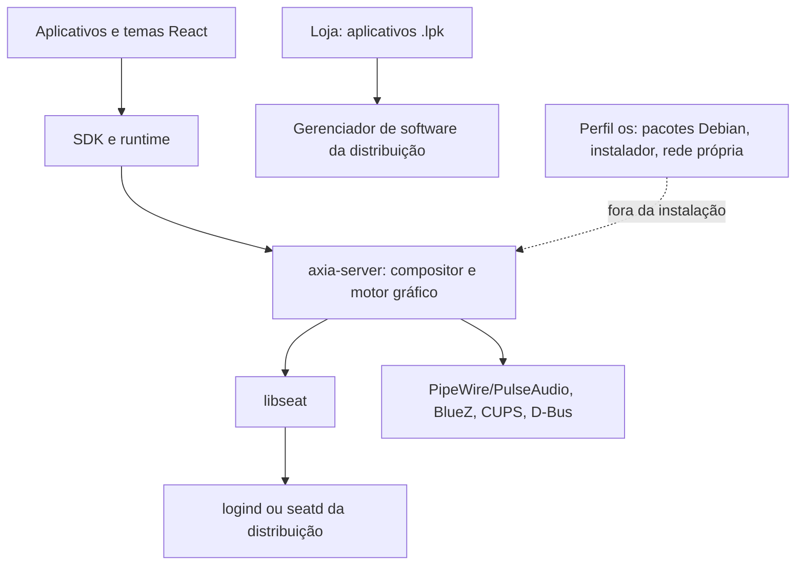

# Axia DE: desktop independente

## Objetivo e limites

A branch `feature/standalone-fedora-de` separa a unidade instalável do desktop da distribuição LordOS. O alvo inicial é Fedora 44; as interfaces usadas pela DE são de Linux/Wayland e não selecionam um backend a partir do nome Debian ou Fedora.

O build tem um único perfil, o do desktop independente; o perfil `os` do LordOS foi removido do Makefile C e do compilador dos temas. O frontend ainda recebe a constante de build `standaloneDesktop`, sempre verdadeira. `lord.pkg` e `lord.imager` não existem mais. A API administrativa retorna indisponível e nenhum helper de root é criado.

## Base upstream

O fork incorpora o LordOS **0.8.7-beta**, até o commit `ab8afcb835422723518308e8ba9e5fa1b736c106` (integrado em 2 de novembro de 2026). O remoto `upstream` aponta para `https://github.com/lordbasex/LordOS.git`. O histórico original é preservado por merge; o código de distribuição removido pode ser consultado nele.

Desktops virtuais, Overview, restauração de janelas, as melhorias do compositor e os novos aplicativos acompanham essa base. A loja usa o layout atualizado, mas encaminha pacotes do sistema ao gerenciador da distribuição; o catálogo APT e seus instaladores não entram nos bundles do desktop.

Os helpers de Cleaner, descoberta de rede, LordBench e informações de hardware são instalados junto ao compositor. O cliente RDP/VNC é opcional no build local: `sudo dnf install freerdp-devel` habilita sua compilação; o RPM inclui essa dependência de build. O build de LordBench também precisa de `xz` (`sudo dnf install xz`). A leitura das bibliotecas pelo sandbox contempla `/usr/lib64` e `/lib64`, usados pelo Fedora.

Os recursos novos que exigem o helper administrativo do LordOS continuam indisponíveis: montagem privilegiada de compartilhamentos SMB/NFS, limpeza de arquivos do sistema, download do catálogo de vídeos de fundo e alterações no login da distribuição. Vídeos próprios para o desktop conservam os requisitos de GPU e decodificação por hardware do upstream; FFmpeg continua opcional no build.

## Alterações implementadas

| Área | Desktop independente |
|---|---|
| Pacotes | O resolver Debian, índices, dpkg e ações de instalação ficam fora do binário. A loja conserva `.lpk` e oferece abrir GNOME Software/Discover quando encontrados. |
| Rede | Apenas observação por netlink; os drivers administrativos de DHCP, Wi-Fi e VPN do LordOS não são ligados ao compositor. Não há `net-restore` ao iniciar. |
| Instalador e imagens | Instalador, Imager (C e Rust), firstrun do Raspberry Pi e scripts de ISO/RPi foram removidos. A ISO Fedora é gerada por `tools/fedora-live/`. |
| Login | Entrada Wayland para o gerenciador existente; não instala nem habilita `lordos.service`. |
| Dispositivos | DRM e evdev são abertos por libseat. Revogação da sessão libera input e GPU antes da confirmação; a reativação reabre os dispositivos e reutiliza o fluxo de reconexão do compositor. |
| Teclado/mouse | Hotplug por inotify no desktop independente; a troca de TTY usa libseat. |
| Localização | Lê `/etc/locale.conf` além do caminho legado. Na ausência de `SUPPORTED`, enumera locales instalados usando `locale -a`. Não executa locale-gen ou apt. |
| Instalação | Suporta `PREFIX`, `LIBEXECDIR` e `DESTDIR`; instala apenas compositor, helpers de aplicativos, recursos e entrada de sessão. |
| Helpers opcionais | Documentos: Poppler/libarchive; mídia: FFmpeg; RDP/VNC: FreeRDP 3. São detectados no build. Vault é compilado; Mail e o downloader dependem de OpenSSL. |

SHA-256 e o leitor xz ainda ficam em `server/src/pkg/crypto.c` e `xz.c`, porque também são utilizados por assinaturas, cofre, journal e mapas. Esses arquivos são primitivas compartilhadas, não um backend de pacotes Debian. Movê-los para uma pasta comum pode ser uma refatoração posterior.

## Remoção do legado Debian

Removido do repositório: o motor de pacotes APT/dpkg (`server/src/pkg/`, exceto as primitivas `crypto.c` e `xz.c`), `lord-tls`, `apt/`, `packaging/{apt,debian,kernel,migrations,systemd,udev}`, o chaveiro do repositório LordOS, `tools/{iso,rpi,immutable,install,boot}`, a publicação do repositório APT e o SBOM do `.deb`. Também saíram as partes que só existiam na distribuição LordOS: `lord-netd` e os drivers de rede próprios (DHCP, Wi‑Fi, WireGuard, OpenVPN, IPsec), `lord-sessiond` (login, sessão e área de trabalho remota pelo navegador), o despachante `admin.c`, o instalador, o Imager e o tema `greeter`.

A loja usa diretamente `apps/store/host.jsx`, que encaminha pacotes do sistema ao gerenciador do host. A detecção de mídia live usa `rd.live.image` (dracut), em vez do caminho do `live-boot` do Debian, e `axia-fetch` conta pacotes com `rpm -qa`.

## Nome e identidade: Axia DE

O fork se chama **Axia DE**. A política de marca do LordOS pede que um fork tenha nome e logo próprios e deixe de usar o nome LordOS, a coroa e o mascote Lumo; o código continua sob a licença MIT, com os créditos do LordOS no Sobre, no README e no LICENSE.

| O quê | Antes | Agora |
|---|---|---|
| Sessão e iniciador | `lord-de.desktop`, `lord-de-session` | `axia.desktop`, `axia-session`; `XDG_CURRENT_DESKTOP=Axia` |
| Programas | `/usr/libexec/lord-de/bin/lord-*`, `lordos-*` | `/usr/libexec/axia/bin/axia-*` (o auxiliar de listas de bloqueio é `axia-dl`; `axia-fetch` é o resumo no terminal) |
| Pacote | `lord-de` | `axia-de` (substitui `lord-de` e ajusta a sessão escolhida no GDM e no AccountsService) |
| Pastas do usuário | `~/.config/lordos`, `~/.cache/lordos`, `~/.local/share/lordos`, `~/.local/state/lordos` | as mesmas com `axia`; o primeiro início move as antigas |
| Logo | coroa | logo provisório gerado por `tools/gen-brand.py` |
| Mascote | Lumo | removido |
| Papéis de parede | raposa Lumo (padrão), coroa | removidos; padrão "Galáxia infinita" |

Ficam com os nomes antigos, de propósito: a API interna (`lord.*`, `@lordos/sdk`), os identificadores internos (`lordos` no firewall e na área de transferência, escopos de cgroup `lordos-*`), os caminhos de sistema dos serviços de root não compilados (`/etc/lordos`, `/run/lordos`) e a pasta `LordOS-Backups`, cujo nome também entra na verificação da chave dos backups criptografados. Trocar esses nomes não muda nada para o usuário e quebraria dados existentes.

## Verificação

`make check` compila o desktop, executa testes do ciclo de vida da sessão com um provedor simulado, verifica que nenhuma ação administrativa funciona e examina os símbolos do binário para impedir a ligação acidental de componentes do SO.

Também valida os hashes dos bundles, instala em diretório temporário, verifica que nenhum serviço ou configuração de `/etc` foi instalado, confere o manifesto após a instalação e inicializa os temas sem monitor como usuário sem privilégios.

No Fedora, instale `libasan` e `libubsan` para os testes com sanitização. `make -C server test` executa a suíte original, sem as suítes do código removido. Os validadores das ações de root (`*_admin.c`) continuam testados isoladamente, como base para um helper polkit; eles não entram no desktop. Testes dependentes de ferramentas ou dados externos podem ser pulados pela suíte upstream.

A CI `.github/workflows/desktop-fedora.yml` reproduz o build e os testes em Fedora 44, com variantes de compilação CPU e GPU. O modo headless não exercita DRM/KMS, input físico, aceleração de GPU nem políticas SELinux.

## Compatibilidade ainda a validar

1. Login real por GDM/SDDM e TTY; seleção da GPU em máquinas com mais de uma placa.
2. Troca e retorno de TTY, suspensão, remoção de monitores e hotplug de periféricos.
3. Aceleração Mesa e Xwayland no Fedora, incluindo GPUs diferentes.
4. Helpers de mídia/documentos com as versões de FFmpeg/Poppler fornecidas pelo host.
5. Comportamento sob SELinux em enforcing, portais e ativação de aplicativos D-Bus.
6. Aplicativos isolados em sessão de usuário: delegação de cgroups e permissões que antes dependiam dos serviços LordOS.

A separação remove a necessidade dos serviços específicos do LordOS, mas não substitui automaticamente todas as suas funções. O firewall por aplicativo de `axia-netperm`, o controle de ventoinhas e a administração privilegiada não fazem parte desta instalação.

## Evolução

- Trocar o compositor próprio pelo wlroots, mantendo o motor de UI; prova de conceito e plano em [WLROOTS.md](WLROOTS.md).
- Integrar NetworkManager por D-Bus e autorização via polkit, sem assumir controle da rede do host.
- Substituir as páginas administrativas restantes por adaptadores de serviços do host.
- Publicar um RPM com build reproduzível do frontend conforme as regras de empacotamento do destino, dependências opcionais e assinatura própria do fork.
- Substituir a delegação de cgroups pedida ao `lord-sessiond` (`src/sec/cgroup.c`) pelo gerenciador systemd do usuário.
- Decidir o destino de `axia-netperm` e `axia-fand` como unidades systemd do Fedora, ou removê-los.
- Expandir a matriz de testes para outras distribuições e arquiteturas.

## Referências de implementação

- [API libseat](https://github.com/kennylevinsen/seatd/blob/master/include/libseat.h) e [exemplo oficial](https://github.com/kennylevinsen/seatd/blob/master/examples/simpletest/main.c).
- [Pacote libseat no Fedora](https://packages.fedoraproject.org/pkgs/seatd/libseat-devel/).
- [Wayland no Fedora](https://packages.fedoraproject.org/pkgs/wayland/wayland-devel/).
