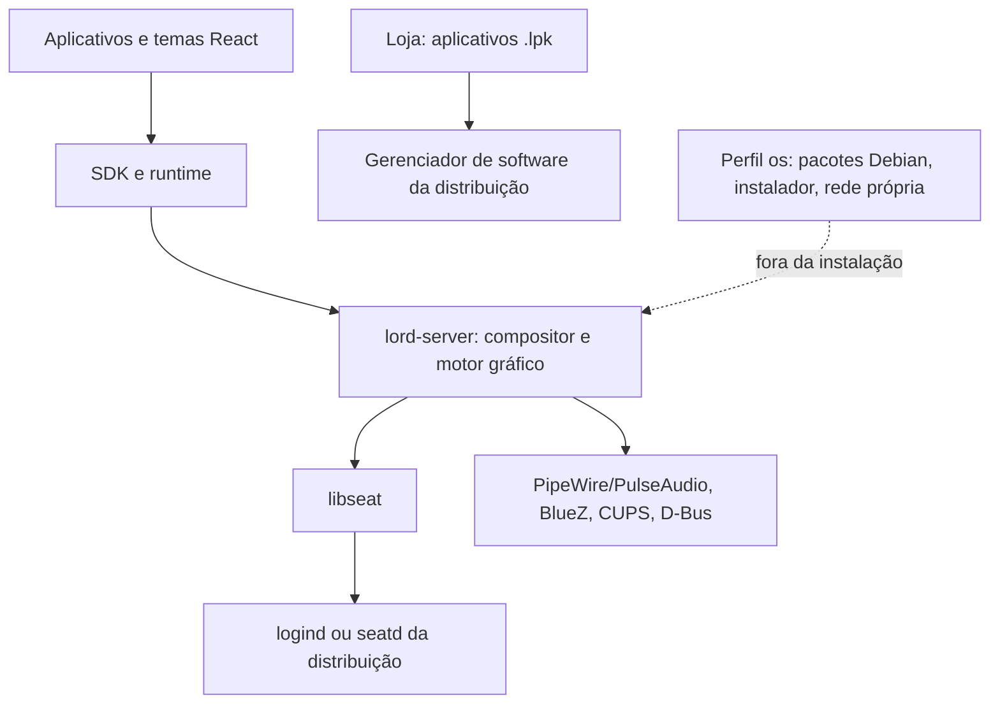

# Desktop independente

## Objetivo e limites

A branch `feature/standalone-fedora-de` separa a unidade instalável do desktop da distribuição LordOS. O alvo inicial é Fedora 44; as interfaces usadas pela DE são de Linux/Wayland e não selecionam um backend a partir do nome Debian ou Fedora.

O perfil `desktop` é padrão tanto no Makefile C quanto no compilador dos temas. O frontend usa uma capacidade de build, `standaloneDesktop`, em vez de inferir suporte à administração a partir de `/etc/os-release`. `lord.pkg` e `lord.imager` não são expostos no perfil independente. A API administrativa retorna indisponível e nenhum helper de root é criado.

## Alterações implementadas

| Área | Desktop independente |
|---|---|
| Pacotes | O resolver Debian, índices, dpkg e ações de instalação ficam fora do binário. A loja conserva `.lpk` e oferece abrir GNOME Software/Discover quando encontrados. |
| Rede | Apenas observação por netlink; os drivers administrativos de DHCP, Wi-Fi e VPN do LordOS não são ligados ao compositor. Não há `net-restore` ao iniciar. |
| Instalador e imagens | Instalador e Imager ficam fora dos temas e do binário. Scripts de ISO e Raspberry Pi não entram no RPM. |
| Login | Entrada Wayland para o gerenciador existente; não instala nem habilita `lordos.service`. |
| Dispositivos | DRM e evdev são abertos por libseat. Revogação da sessão libera input e GPU antes da confirmação; a reativação reabre os dispositivos e reutiliza o fluxo de reconexão do compositor. |
| Teclado/mouse | Hotplug por inotify no desktop independente; a troca de TTY usa libseat. |
| Localização | Lê `/etc/locale.conf` além do caminho legado. Na ausência de `SUPPORTED`, enumera locales instalados usando `locale -a`. Não executa locale-gen ou apt. |
| Instalação | Suporta `PREFIX`, `LIBEXECDIR` e `DESTDIR`; instala apenas compositor, helpers de aplicativos, recursos e entrada de sessão. |
| Helpers opcionais | Documentos: Poppler/libarchive; mídia: FFmpeg. São detectados no build. Vault é compilado; Mail depende de OpenSSL. |

SHA-256 e o leitor xz ainda ficam em `server/src/pkg/crypto.c` e `xz.c`, porque também são utilizados por assinaturas, cofre, journal e mapas. Esses arquivos são primitivas compartilhadas, não um backend de pacotes Debian. Movê-los para uma pasta comum pode ser uma refatoração posterior.

## Verificação

`make check` compila o desktop, executa testes do ciclo de vida da sessão com um provedor simulado, verifica que nenhuma ação administrativa funciona e examina os símbolos do binário para impedir a ligação acidental de componentes do SO.

Também valida os hashes dos bundles, instala em diretório temporário, verifica que nenhum serviço ou configuração de `/etc` foi instalado, confere o manifesto após a instalação e inicializa os temas sem monitor como usuário sem privilégios.

No Fedora, instale `libasan` e `libubsan` para os testes com sanitização. `make -C server test` executa a suíte original. Parte dela testa componentes legados isoladamente; isso não significa que esses componentes entram no desktop. Testes dependentes de ferramentas ou dados externos podem ser pulados pela suíte upstream.

A CI `.github/workflows/desktop-fedora.yml` reproduz o build e os testes em Fedora 44. O modo headless não exercita DRM/KMS, input físico, aceleração de GPU nem políticas SELinux.

## Compatibilidade ainda a validar

1. Login real por GDM/SDDM e TTY; seleção da GPU em máquinas com mais de uma placa.
2. Troca e retorno de TTY, suspensão, remoção de monitores e hotplug de periféricos.
3. Aceleração Mesa e Xwayland no Fedora, incluindo GPUs diferentes.
4. Helpers de mídia/documentos com as versões de FFmpeg/Poppler fornecidas pelo host.
5. Comportamento sob SELinux em enforcing, portais e ativação de aplicativos D-Bus.
6. Aplicativos isolados em sessão de usuário: delegação de cgroups e permissões que antes dependiam dos serviços LordOS.

A separação remove a necessidade dos serviços específicos do LordOS, mas não substitui automaticamente todas as suas funções. O firewall por aplicativo de `lord-netperm`, o controle de ventoinhas e a administração privilegiada não fazem parte desta instalação.

## Evolução

- Integrar NetworkManager por D-Bus e autorização via polkit, sem assumir controle da rede do host.
- Substituir as páginas administrativas restantes por adaptadores de serviços do host.
- Publicar um RPM com build reproduzível do frontend conforme as regras de empacotamento do destino, dependências opcionais e assinatura própria do fork.
- Extrair ou remover os diretórios legados da distribuição após estabilizar a sessão independente.
- Expandir a matriz de testes para outras distribuições e arquiteturas.

## Referências de implementação

- [API libseat](https://github.com/kennylevinsen/seatd/blob/master/include/libseat.h) e [exemplo oficial](https://github.com/kennylevinsen/seatd/blob/master/examples/simpletest/main.c).
- [Pacote libseat no Fedora](https://packages.fedoraproject.org/pkgs/seatd/libseat-devel/).
- [Wayland no Fedora](https://packages.fedoraproject.org/pkgs/wayland/wayland-devel/).
