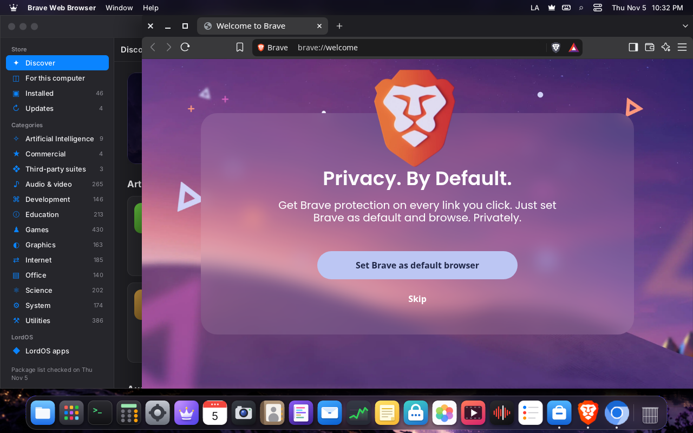
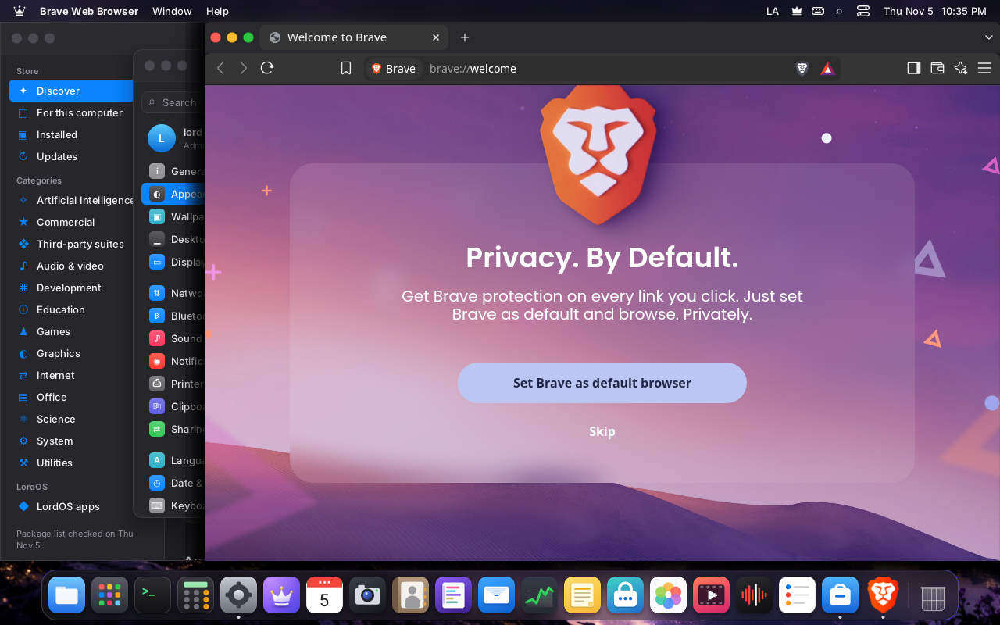
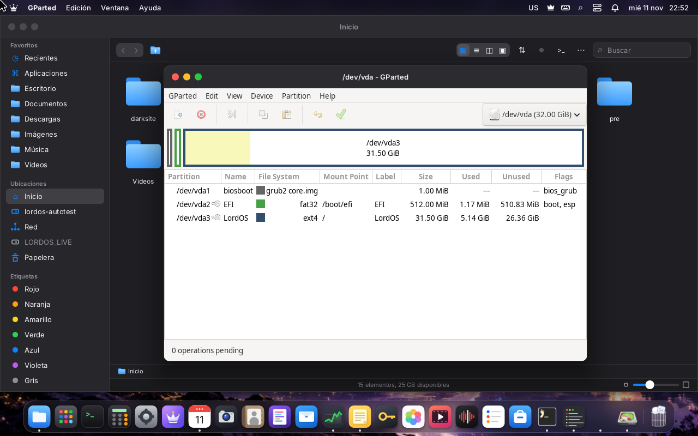
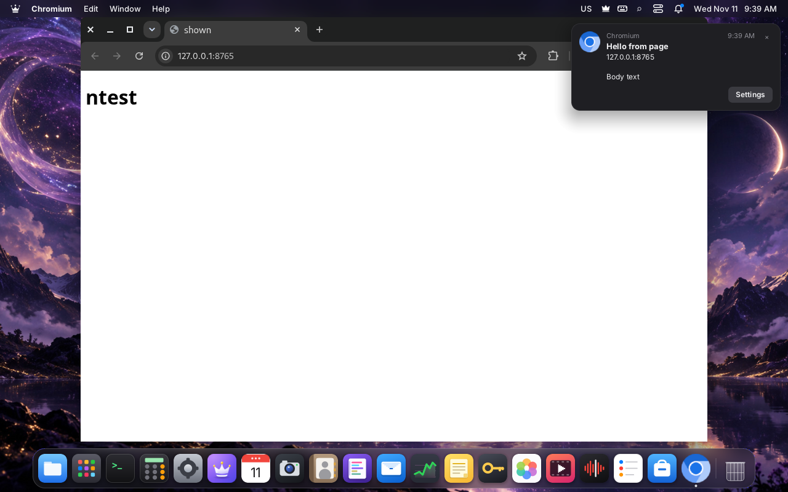
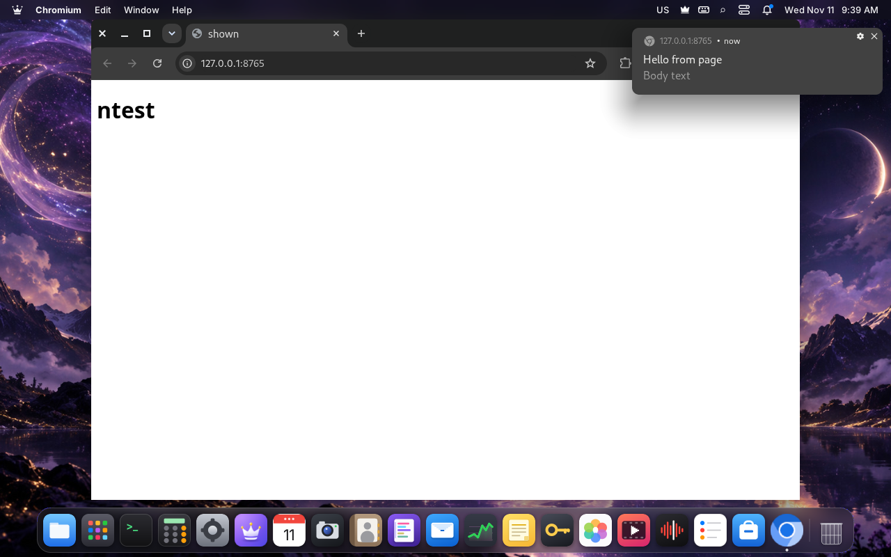
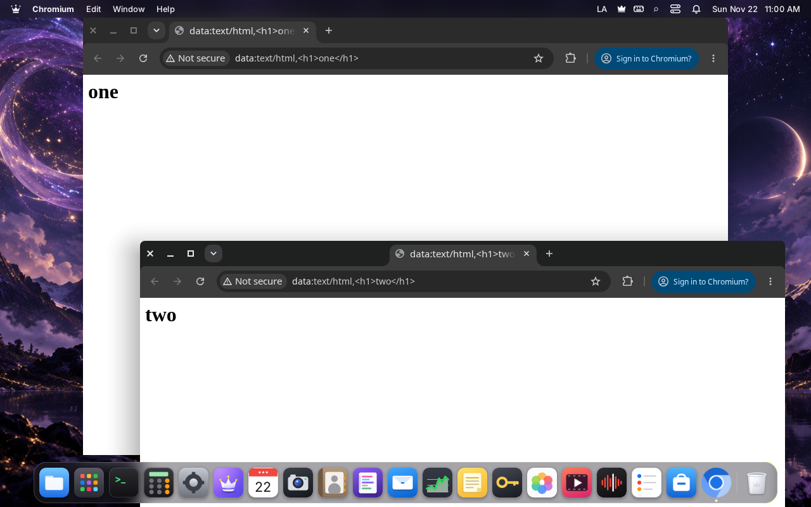
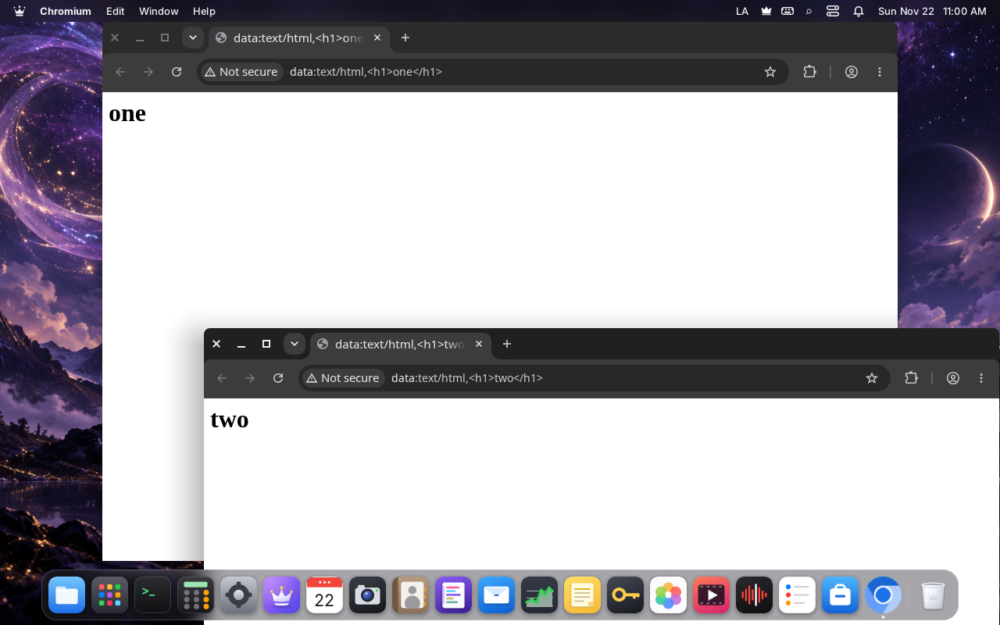

# Linux apps in LordOS (Wayland)

lord-server is also a **Wayland compositor**: GTK, Qt and any other app that speaks Wayland open
as LordOS windows, inside the theme, next to the native apps. There's no X server of its own, Weston,
wlroots or Mutter: only `libwayland-server` (it serializes the protocol; it's been in the dependency policy
since M1) and the code `wayland-scanner` generates from the `wayland-protocols` XML files. The
compositor lives in `server/src/wl/wl.c`.
Apps that only speak X11 open through Xwayland, started on demand, with our own X window manager
(see "X11 apps (Xwayland)" below).

## Screenshots (VM, real lord-server)

| | |
|---|---|
|  |  |
| foot (Wayland terminal) with the theme's frame: it asks for server-side decoration | GTK Demo (GTK 4.18): draws its own frame; LordOS clips its shadow |
|  |  |
| GTK popup menu (xdg_popup), placed with its positioner | Dragged from its own bar (xdg_toplevel.move): it follows the pointer |
|  |  |
| FeatherPad (Qt 6.8) opened from the LordOS Terminal, with the theme's frame | Qt's File menu |
|  |  |
| Copied in FeatherPad (Ctrl+C) and pasted in the LordOS Terminal | Three Linux apps open; each with its icon in the Dock |

## What's there

| Protocol | Version | What it does |
|---|---|---|
| `wl_compositor`, `wl_region` | 6 | surfaces; the buffer is copied on commit (only its damage when the size stays, 0.8.9.5) and released right away; `set_buffer_transform` is applied; `set_input_region` is applied on commit and the pointer hit test obeys it (`wlregion.h`). A surface with an empty region takes no input and the pointer goes to what is below: Firefox's content is such a subsurface, and GTK only knows the toplevel below it. `set_opaque_region` is ignored |
| `wl_shm` | (libwayland) | ARGB8888/XRGB8888 shared memory |
| `wl_subcompositor` | 1 | subsurfaces (composited on top of their parent) |
| `wl_output` | 4 | one per display: logical position, physical mode, scale rounded up, name and description (`DISPLAYS.md`) |
| `zxdg_output_manager_v1` | 3 | logical position and size of each display |
| `wp_fractional_scale_v1` | 1 | the exact scale of the display(s) a surface is on (GTK 4, Qt 6, Chromium render sharp at 125–175 %) |
| `wl_seat` | 9 | pointer (enter, leave, motion, buttons, wheel with `axis_source` and `axis_value120`; fine touchpad scrolling with `axis_source finger`, `axis_stop` and `axis_relative_direction` for natural scrolling), keyboard with LordOS's XKB keymap (`keyboard.c`), modifiers and repeat, and `wl_touch` if there's a touchscreen |
| `zwp_pointer_gestures_v1` | 3 | touchpad gestures: pinch (zoom in Chromium, GTK, Firefox), swipe and hold (`wl_input.c`, see `TRACKPAD.md`) |
| `wl_data_device_manager` | 3 | clipboard shared with LordOS's in both directions, files copied in Files as `text/uri-list` and `x-special/gnome-copied-files` (see below); drag and drop between Linux apps, from Files to a Linux app and from a Linux app to Files, with offers, actions and the drag icon, and with X11 apps through XDND (0.8.8.8; the Wayland side checked on VM 127, XDND checked on VM 127 on 2026-11-22, see "Drag and drop") |
| `zwp_primary_selection_device_manager_v1` | 1 | primary selection: select to copy, middle click to paste (0.8.3, see "X11 apps"); `set_selection` needs a recent click or key serial of the app's own, and LordOS's text fields and Terminal share it (0.8.8.8) |
| `xdg_wm_base` | 7 | windows (`xdg_toplevel`: title, move, resize, maximize, minimize, close, `set_parent` for dialogs) and popup menus (`xdg_popup` with `xdg_positioner`: anchor, gravity, flip and slide within the screen); `wm_capabilities` window menu, maximize (not while locked), fullscreen (not during a screen share) and minimize; `configure_bounds` with the work area of the window's display; `tiled_*` and (7) `constrained_*` states for a maximized or snapped window (0.8.9.5) |
| `zxdg_exporter_v2`, `zxdg_importer_v2` (xdg-foreign) | 1 | a window exported as a handle that another process imports to put its dialog over it (`set_parent_of`); the file chooser portal takes it as `wayland:<handle>` (0.8.8.8, see "Dialogs") |
| `xdg_wm_dialog_v1` | 1 | a toplevel says it is a dialog and whether it is modal: a modal one holds its parent's input (0.8.8.8, see "Dialogs") |
| `zxdg_decoration_manager_v1` | 1 | the app picks who draws the frame: server side (Qt, foot, Kitty, Alacritty: the theme's frame) or client side (Chromium with its own bar), also while it's open (0.8.4) |
| `wp_cursor_shape_manager_v1` | 2 | the app asks for the cursor by name (Chromium, GTK 4, Qt 6) and LordOS draws its own (`cursor.c`, see `WINDOWS.md`); 2 adds `dnd_ask` (the arrow) and `all_resize` (the move arrows) |
| `org_kde_kwin_server_decoration_manager` | 1 | GTK 3's way to ask for the frame (Firefox, Mousepad; see "Who draws the frame") |
| `zwp_idle_inhibit_manager_v1` | 1 | a video or presentation keeps the screen on while its surface is mapped (0.8.5, see the end of this page) |
| `zwp_keyboard_shortcuts_inhibit_manager_v1` | 1 | a VM, remote desktop or game takes ❖, ⌥Tab and LordOS's other shortcuts while it has the keyboard, once the person allowed it; ❖Esc gives them back (0.8.8.8, checked on VM 127, `kbinhibit.c`, see "Keyboard shortcuts inhibit") |
| `xdg_activation_v1` | 1 | a window asks to come to the front with a token: only one LordOS gave (a launch, a notification's button) or one the app in front asked for raises it; any other only marks it in the Dock and the taskbar (`xdgact.c`, see "Activation" below) |
| `zwp_text_input_manager_v3` | 1 | a text field took focus and where its caret is: the on-screen keyboard's hint (0.8.7, see `ON-SCREEN-KEYBOARD.md`), and LordOS's input method composes into it: preedit, commit and done, the candidate window at its caret (0.8.8.8, checked on VM 127, `wl_textinput.c`, see "Input methods") |
| `wp_security_context_manager_v1` | 1 | a sandbox (Flatpak 1.15 and later) hands over a listening socket for one app; its clients are tagged with the engine, app id and instance id, count as sandboxed and don't see the trusted-only globals (0.8.8.8, built, not yet checked on the VM, `secctx.c`, see "Security contexts") |
| `xdg_toplevel_icon_manager_v1` | 1 | a window's own icon, shown only when its app has no installed icon (an AppImage, Wine, a game); buffers copied, re-encoded and size-limited, names ignored (see "Window icons", 0.8.9.5) |
| `ext_idle_notifier_v1` | 1 | an app is told when the person is away from the computer and back, only once they allowed it (the `idle` permission, asked once per app; see "Idle notifications", 0.8.9.5) |
| `xdg_toplevel_drag_manager_v1` | 1 | tab tear-off: during a drag a window follows the pointer at the app's offset, is never the drag's target and stays where it is let go (`tldrag.c`; checked 2026-11-22 with Chromium 156 on a headless lord-server, tear-off and reattach, and `tests/shellx_headless.sh`; see "Shell extras", 0.8.9.5) |
| `xdg_toplevel_tag_manager_v1` | 1 | a window's untranslated tag keys its own remembered place (each kind of window of an app reopens where it was); its description names it while it has no title (`tltag.c`; checked 2026-11-22, headless; see "Shell extras", 0.8.9.5) |
| `xdg_system_bell_v1` | 1 | the bell: LordOS's alert sound (not in Do Not Disturb) and a window not in front marked as wanting attention; at most one ring every 250 ms per app (`sysbell.c`; checked 2026-11-22, headless; see "Shell extras", 0.8.9.5) |
| `xdg_session_manager_v1` | 1 | an app's windows come back where they were when it starts again: sessions with random ids, scoped to the program lord-server checked, kept in `~/.config/lordos/wl-sessions` (`xsession.c`; checked 2026-11-22, headless; see "Shell extras", 0.8.9.5) |
| `ext_background_effect_manager_v1` | 1 | blur behind a region of a window, drawn with the UI's own backdrop blur; offered only on the CPU path with transparency and blur on, none on the GPU path (`bgeffect.c`; checked 2026-11-22, headless CPU path; see "Shell extras", 0.8.9.5) |
| `wp_drm_lease_device_v1` | 1 | a VR headset's connector (one the kernel marks `non-desktop`) leased to an app the person allowed: Allow once, Always allow or Don't allow (the `vr` permission); only while a headset is plugged into lord-server's card, never to a sandboxed or isolated app or Xwayland, revoked on unplug, permission taken back, lock, user switch or text console (0.8.9.5, approved by the maintainer 2026-11-22, checked with `drmlease-test` and `drmlease-e2e-test`, not yet with a real headset; see "DRM leases") |
| `wp_single_pixel_buffer_manager_v1` | 1 | a buffer of one pixel (premultiplied RGBA), usually stretched by a viewport: a background, a fade (0.8.9.5) |
| `wp_alpha_modifier_v1` | 1 | a surface's opacity, double-buffered, applied to that surface only (not its subsurfaces), GPU and CPU paths (0.8.9.5) |
| `wl_fixes` | 1 | core protocol (wayland.xml 1.24): `destroy_registry` destroys a `wl_registry` the client no longer needs, so a long-lived client's registries don't pile up in lord-server and keep getting `global` events; lord-server sends `delete_id` and the id is reused. Debian 13's libwayland is 1.23, so the interface is generated from `third_party/wayland/wl-fixes.xml`, vendored from wayland.xml 1.24 (`wlfixes.c`, `mk/wlfixes.mk`). Since 0.8.9.5; checked 2026-11-22 against a headless lord-server (`tests/wlfixes_client.c`, the "fixes" part of `tests/wlperf_headless.sh`): the destroyed registry's id comes back for a new registry, which gets every global once, and a non-registry argument is a display error; not yet checked with a real app |
| `wp_color_manager_v1` (color-management-v1) | 1 | an app describes its pixels' colour and LordOS converts them to the SDR sRGB / gamma 2.2 it drives every display with: parametric descriptions only (`set_primaries`, `set_tf_power`; no ICC, no luminances or mastering metadata, no scRGB), perceptual and relative intents, transfer functions gamma22, srgb, ext_linear, bt1886, gamma28 and power curves, every named set of primaries; each output's description (target primaries from its EDID) and the surface's preferred one. No HDR. Checked 2026-11-22 headless (`tests/color_headless.sh`: everything advertised, every error, linear light on screen as converted) and with GTK 4.18.6 (`GDK_DEBUG=color-mgmt`); see "Colour management" (0.8.9.5) |
| `wp_color_representation_manager_v1` (color-representation-v1) | 1 | alpha modes premultiplied electrical, premultiplied optical and straight (converted); coefficients and range identity / full only, since lord-server imports no YUV buffer. Checked 2026-11-22 headless (`tests/color_headless.sh`); see "Colour management" (0.8.9.5) |
| `zwp_tablet_manager_v2` (tablet-v2) | 2 | graphics tablets (0.8.9.5, 2026-11-22): pens with pressure, tilt, distance, rotation, slider and their buttons, pads with buttons, rings, strips and dials (2: `bustype`, dials), read from evdev by our own `tablet.c` (no libinput or libwacom). Supported: everything the protocol has but the tool's `wheel` (a Wacom mouse's) and pad modes beyond one. Checked by `build/tablet-test` (synthetic evdev sequences) and `build/wltablet-test` (libwayland clients on the wire); the global and Xwayland's `get_tablet_seat` seen with a headless lord-server; **not yet with a real tablet or on the VM**. See "Graphics tablets" |
| `wp_pointer_warp_v1` (pointer-warp) | 1 | an app moves the pointer to a point of its own window (0.8.9.5, 2026-11-22): only with the pointer over it, the serial of the enter it got and the keyboard, inside the surface, never while the pointer is locked or in a drag (`pwarp.h`). The XML is wayland-protocols 1.45's, kept in `server/protocols/`. Checked by `build/wltablet-test`; **not yet with an app on the VM**. See "Pointer warp" |
| `wp_fifo_manager_v1` (fifo-v1) | 1 | an update waits until the display it is on has shown the one before it for a refresh: Mesa's Vulkan FIFO present mode without frame callbacks (`timing.c`, see "Frame timing"; 0.8.9.5, checked headless 2026-11-22 with vkcube on lavapipe and `wltiming-client`) |
| `wp_commit_timing_manager_v1` (commit-timing-v1) | 1 | an update is not shown before its target time on `wp_presentation`'s clock (see "Frame timing"; 0.8.9.5, checked headless 2026-11-22: within 1 ms of the target, Mesa's FIFO uses it) |
| `wp_tearing_control_manager_v1` (tearing-control-v1) | 1 | the hint is kept; "async" flips a fullscreen app's own buffer without waiting for vblank only when it is scanned out alone and the driver can (`DRM_CAP_ASYNC_PAGE_FLIP`); otherwise vsync (see "Frame timing"; 0.8.9.5: the hint checked headless 2026-11-22, the torn flip not yet checked on hardware) |
| `wp_content_type_manager_v1` (content-type-v1) | 1 | none, photo, video or game, kept per surface and applied on commit; nothing uses it yet (see "Frame timing"; 0.8.9.5, checked headless 2026-11-22) |
| `zwp_linux_dmabuf_v1` 5 (every plane with the same modifier), `wp_presentation` 2 (feedback per display), `wp_viewporter` 1, `zwp_relative_pointer_manager_v1` 1, `zwp_pointer_constraints_v1` 1 | | GPU buffers, presentation feedback, cropping and scaling, games' pointer (see `GPU.md` and `DISPLAYS.md`) |
| `wp_linux_drm_syncobj_manager_v1` (explicit sync) | 1 | a dmabuf frame comes with an acquire point (its rendering is done) and a release point (LordOS is done with it): the frame is applied once its acquire point is signalled, without blocking, and the release point is signalled after the CPU copy or after the frame that replaced it on the GPU path; every protocol error, per-client limits. Offered when a render node has timeline syncobjs and `SYNCOBJ_EVENTFD` (Linux 6.6), on the GPU and the CPU path (0.8.9.5; checked 2026-11-22 with `tests/syncobj_client.c` against a headless lord-server on the CPU path, and Mesa 25.0.7's Vulkan WSI, `vkcube`, on an AMD RX 580: 600 frames at 60 fps in FIFO and 1500 at 330 fps in mailbox, every one with `set_acquire_point`/`set_release_point`; see "Explicit sync") |

Every protocol, with what lord-server offers next to KDE's KWin and GNOME's Mutter and why some are left out on
purpose, is in "Protocol table (generated)" below and on [lordos.org/wayland-protocols-table](https://lordos.org/wayland-protocols-table/),
both made from `docs/wayland-protocols.json`. So is the Test Bench's expected list (`server/src/testbench/expected_globals.h`):
`lordos-testbench --globals` compares any compositor's registry with it, and `lordos-issue` includes the result.

Windows enter the SDK's window manager (`sdk/wayland.js`) as the internal app `linux` (id
`linux#<surface>`): the theme sees them like any other, with their title, focus, maximize,
minimize and Dock. Those that draw their own frame (GTK, and the browsers with their own bar) arrive
with `args.csd` and the theme shows only the content (both bundled themes already do); an app that
switches while open sends `deco` and the same window changes presentation (see "Who draws the
frame" below). The keyboard goes to the frontmost Linux
app; ❖ combinations still belong to LordOS.

## How to open an app

From the LordOS Terminal: every new tab has `WAYLAND_DISPLAY`, `XDG_SESSION_TYPE=wayland`,
`GDK_BACKEND=wayland,x11` and `QT_QPA_PLATFORM=wayland;xcb`, so `featherpad &`, `gtk4-demo &` or
`foot &` is enough. Both toolkits try Wayland first and fall back to X11 (Xwayland): GTK for a program that
allows only X11 (see "VMware Tools"), Qt for an app whose Wayland platform plugin is not installed
(Debian's `qtwayland5` or `qt6-wayland`, which no Qt app depends on). Until 0.8.8.7 Qt got `wayland` alone, and
such an app (MusicBrainz Picard from the Store) stopped at start with "Could not find the Qt platform plugin
\"wayland\"" (GitHub #96). The values are set in `server/src/wl/toolkitenv.h` and checked by
`tests/toolkitenv_test.c`. `GTK_IM_MODULE` is not set: GTK on Wayland takes its input-method module from the
Settings portal (see "Input methods"). Apps also receive LordOS's language and region (`LANG`, `LC_*`, see
`LANGUAGES.md`).

They also appear in the **app launcher**, in the Lord Classic theme's start menu and in the Store (see
`NATIVE-APPS.md` and `PACKAGES.md`): they are the apps with a `.desktop` in
`/usr/share/applications` or `~/.local/share/applications`. They open with one click, and their
window carries the same icon in the Dock as in the app launcher (they're recognized by the Wayland
app id or by `StartupWMClass`).

| | |
|---|---|
|  |  |
| The app launcher with the installed Linux apps next to the LordOS apps, each with its own icon | FeatherPad opened with one click; it carries the same icon in the Dock |
|  |  |
| Lord Classic theme: the start menu with LordOS apps and Linux apps, grouped by category | FeatherPad running in the Lord Classic theme, with its icon in the taskbar |

### The launcher (`server/src/apps.c`)

It's the second exception to "the server doesn't run commands"; the first is the Terminal's
shell. The user approved it for M7. Limits:

- `lord.apps.launch(id)` only receives the id of a `.desktop` in those two folders, which must
  also pass the filters:
  - `Type=Application`;
  - no `NoDisplay` or `Hidden`;
  - `OnlyShowIn`/`NotShowIn` with `LordOS`;
  - the `TryExec` exists;
  - a terminal app (`Terminal=true`) is listed with `terminal: true` only if its `Exec` program is also found in
    the fixed PATH below.
- The command is that file's `Exec` line, re-read at launch time:
  - `argv` is built according to the specification (quotes and escapes);
  - file codes (`%f %u %F %U`) are removed and no caller arguments are passed;
  - with `lord.apps.launchWith(id, path)` (Files' «Open With»), the path goes as a single
    argument in the first `%f`/`%F` (or as `file://…` in `%u`/`%U`), and only if the app declares
    `MimeType` in its `.desktop`; the path is resolved with realpath and must be in the home
    folder or on a disk mounted by the user (`/media/$USER`, `/run/media/$USER`);
  - it's run with `execve`, without a shell;
  - a terminal app is never run here: see **Terminal apps** below;
  - the program is looked up in a fixed PATH (`/usr/local/bin`, `/usr/bin`, `/bin`, games, and
    `~/.local/bin` only for the user's `.desktop` files).
- **Desktop actions (0.8.1):** the Dock's right-click menu lists the `Actions=` of an app's
  `.desktop` (a browser's "New Private Window", for instance). `lord.apps.actions(id, language)`
  returns `[{ id, name }]` and `lord.apps.launchAction(id, action)` runs one, through the **same**
  launcher (`apps_launch_action` → `launch()`): same id rules and filters, same scope, restrictions
  and fixed PATH, no shell, no caller arguments, no file. Only that action's `Exec` line replaces the
  main one, and only if:
  - the action is listed in the main group's `Actions=` key;
  - its name is `[A-Za-z0-9-]`, at most 63 characters;
  - its `[Desktop Action <name>]` group has a `Name` and an `Exec`.

  Anything else (an unlisted group, a bad name, no `Exec`) is refused. Tested by
  `build/apps-actions-test` (in `make test`).
- **Terminal apps (0.8.8.8, built, not yet checked on the VM; approved 2026-11-10):** htop, mc, ranger, vim's entry. The launcher and
  search show them with the Terminal's icon small in a corner. `lord.apps.launch(id)` doesn't exec them: it parses
  the `Exec` line the same way (no caller arguments, no file), keeps the argv in a one-shot slot
  (`src/term/termapp.c`: random 128-bit token, 10 s, single use, at most 4 pending) and answers `{ terminal: token }`.
  The SDK's `launchApp` opens a new Terminal window with `{ app: token, title: <the app's name> }`; its tab starts the
  user's login shell as always and lord-server types the argv into it once, single-quoted in C, with the profile's
  exit rule (`docs/TERMINAL.md`, Security). The app runs as part of the Terminal (its scope and firewall app), so an
  app with restrictions in Settings → Privacy is refused. Its desktop actions are neither listed nor launched.
  Tested by `build/apps-term-test`.
- **Activation:** every launch gets `XDG_ACTIVATION_TOKEN` in its environment (see "Activation"
  below), so the window it opens, or the window of the copy already running it hands the link to,
  comes to the front. That includes a copy that takes the launch over without the token (Google
  Chrome): see "A launch the copy already running took over" below.
- The app starts as an orphaned grandchild, in its own session, with normal signals and no other
  descriptors. Its output goes to its own `apps/<id>.log` in the user's log folder (`/var/log/lordos/users/<user>`,
  docs/SYSTEM.md "Log files"), after a stamped "starting" line; capped at 16 MB by its writers (the part moved aside in `apps/<id>.log.old`).
- A `.desktop` can't be created from JS:
  - `lord.fs.write` rejects `~/.local/share/applications` and `~/.config/autostart`, also
    through a symlink (see `EDITOR.md`);
  - `.lpk` packages are installed in another folder.

  So the interface can't invent a command: it can only pick an app that's already installed.
- **File names with spaces (0.8.5):** a package may name its `.desktop` freely (`LordOS
  Imager.desktop`). Its id is the file name with every character other than letters, digits, `.`, `_`
  and `-` turned into `-` (`LordOS-Imager`), and the app is listed and launched from its real file;
  the id rules above are unchanged. The two folders' modification times are compared in nanoseconds,
  so an app installed in the same second the list was last read also shows up.
- **Force Quit (0.8.5):** `lord.wayland.kill(surface)` sends SIGKILL only to the Wayland client that
  owns that surface, a process of the same user, never `lord-server`; X11 windows are only asked to
  close (`WINDOWS.md`, "The Window menu, the app menu and Force Quit").

Icons (`server/src/iconfind.c`, `build/iconfind-test`): the `hicolor` PNG (64, 48, 128… px, the
user's theme before the system's) or the one in `/usr/share/pixmaps`. Then (0.8.8.8)
SVG, which lord-media draws (`MEDIA.md`, "SVG icons"): `scalable/apps` of hicolor and Adwaita,
`/usr/share/pixmaps`; then the 64 px PNG Debian publishes in AppStream, which the package engine
already downloads (`/var/lib/lordos/pkg/icons/64`, see `PACKAGES.md`); and last a symbolic icon
(`symbolic/apps/<name>-symbolic.svg`). An absolute `Icon=` may name a PNG or an SVG. With none of
them, the initial is shown.

## Activation (`xdg_activation_v1`)

A window comes to the front only when the person asked for it; the rules are KWin's and Mutter's.
The tokens live in `server/src/wl/xdgact.c` (no Wayland types, tested by `build/xdgact-test`); the
protocol is in `wl.c`.

- **Tokens LordOS gives.** Every launch from `apps.c` (the launcher, Open With, a link, a desktop
  action) issues one and puts it in `XDG_ACTIVATION_TOKEN` of what it starts. A browser that is
  already open gets the link from the new process together with the token and calls `activate`: its
  window comes forward, on its own desktop if that one isn't showing. A click on a notification's
  button sends the `ActivationToken` signal (Desktop Notifications 1.2) before `ActionInvoked`, so
  the app that sent it can come forward too.
- **Tokens an app asks for** (`get_activation_token` … `commit`; `set_app_id` is kept, `set_surface`
  is only a hint). The token is granted when the asking app has the keyboard, or when the
  `set_serial` it sends is a click (`wl_pointer.button`), a key (`wl_keyboard.key`) or a keyboard
  `enter` LordOS sent that same client in the last 10 seconds. Otherwise it still gets a token (the
  protocol always answers `done`), but an ungranted one. The token remembers the app that asked:
  as soon as the keyboard moves to another app or to the desktop itself, or that app disconnects,
  its tokens stop granting (KWin and Mutter do the same), so an app cannot ask while in front and
  use the token later to steal the front. LordOS's own tokens are not revoked this way.
- **A launch the copy already running took over** (2026-11-23, in development; the latest release
  is 0.8.9.5). Google Chrome 158 runs once per profile: a second `google-chrome` hands its command line to the running process
  over its own socket ("Opening in existing browser session") and exits without using its token.
  The running process then asks for a token of its own with no `set_serial`, no surface and no app
  id, and activates the window it already shows (its profile chooser, or a window on a desktop that
  isn't in view). Such a request is not granted by the rules above, so the window only wanted
  attention and nothing came forward: on 2026-11-23 session restore had put Chrome's only window
  back on the desktop it was saved on, and launching Chrome again from another one did nothing
  visible. Now an app's ungranted request is granted once when LordOS issued a launch token for that
  app at most 10 s earlier that is still unused (`xact_take_launch`, `XACT_HANDOFF_MS`): the newest
  one is used up, so one launch grants once. "For that app" is `launch_was_for` in `wl.c`: a Flatpak
  app by the identity lord-server checked itself (`flatpak:<id>`); any other app by a window it
  already shows whose `app_id` names that `.desktop` entry, the same match the Dock uses (the id,
  its `StartupWMClass`, or the last part of a reverse-DNS id: `apps_window_names`). Never Xwayland,
  an isolated LordOS app or a client of another sandbox's security context. The `app_id` is the
  app's own choice, but only beside a launch the person just made: an app that set another's
  `app_id` could already take the front by opening a new window then. A handoff nobody launched
  from LordOS still only asks for attention. Tested by `build/xdgact-test` and
  `tests/handoff_headless.sh` (`tests/handoff_client.c`, a client that runs once as Chrome does;
  Lord Flow and Lord Workspaces): restored on a hidden desktop, launched again, its desktop comes
  into view with the window in front; a copy with no window maps a new one; the same handoff without
  a launch stays attention. Checked with Google Chrome 158 and a throwaway profile on a headless
  `lord-server-test`.
- **`activate(token, surface)`.** A granted token raises and focuses the surface's window (a menu or
  subsurface counts as its window). An ungranted, expired, unknown or reused token never takes the
  focus: the window is marked as wanting attention, a larger dot in the accent under its Dock icon
  (Lord Flow) or a long accent bar on its taskbar button (Lord Classic), until it comes to the front;
  a click on the icon brings that window first. Tokens work once and last 60 s (LordOS's: a cold
  start can be slow) or at most 10 s (an app's); 32 are kept, a new one replaces the oldest.
- The decision on the theme side is `activationOutcome` in `sdk/desktopmodel.js`
  (`tests/desktop_model_test.mjs`).

## Clipboard

There's a single one for the whole session:

- **Text.** What's copied in a Linux app goes to LordOS (Terminal, text fields), and what's
  copied in LordOS is received by the focused app.
- **Other formats (images, HTML…).** While the app that copied is still open, the other Linux
  apps receive from it any format it offers (up to 32).
- **Images.** If what was copied is only an image (`image/png`), LordOS stores it: it stays
  available after the source app is closed and shows up in the history.
- **Files.** Copy or Cut in Files puts the paths on the clipboard as `text/uri-list` (`file://`
  URIs, percent-encoded, CRLF), `x-special/gnome-copied-files` (`copy` or `cut`, then the URIs, LF)
  and plain text (one path per line), so a Linux file manager pastes the files and an editor the
  paths. The other way, when a Linux app copies files, the compositor reads its `text/uri-list` (or
  its gnome list) beside its text and keeps only this machine's files: `file://` URIs with an empty
  or `localhost` host, decoded to an absolute UTF-8 path without NUL or line breaks; a list of more
  than 65536 files, other hosts and other schemes are left out (`src/wl/urilist.c`,
  `build/urilist-test`). Because pasting them copies real files, the list is kept only from an app
  outside a sandbox: never from an isolated LordOS app (the broker knows its pid) nor from a Flatpak
  app (its `/proc/<pid>/root/.flatpak-info` exists; looked up with `openat` on that root, without
  following links; a root that can't be looked at counts as sandboxed), whose list isn't even read.
  And only when the selection has no text, or its text names exactly those paths (one per line, as
  paths or as `file://` URIs, same order), so what the person sees as the clipboard's text is what gets
  copied (`uril_accept`). Otherwise the copy is text only. Paste in Files then asks first, naming the
  app (its `app_id` or window title) and the first five files, with Enter on Cancel. Files copies them
  with `lord.fs.copy` and its checks; another
  app's cut is pasted as a copy, only Files moves its own cut. The list stays valid while the text it
  came with is the clipboard's, is offered again in both formats after that app closes, and goes to
  X11 apps too. JS only ever hands a list of paths (`lord.clipboard.setFiles`), never other data.
  `build/clipfiles-client` checks it inside a session.
- **No blocking.** Large copies (up to 16 MB) are sent in chunks, without a slow-reading app
  stalling the server.

| | |
|---|---|
|  |  |
| Image copied in GTK Demo, now closed: it's still in the history (❖V) | GTK Demo opened again: «Paste» receives it from LordOS |

**History (❖V quick, ❖⇧V full):** it keeps everything copied anywhere: text, links, colors,
code, paths and images, with the source (the app_id of the Linux app that copied). It's stored in
the home folder and survives reboots. Image previews are first stored in
`$XDG_RUNTIME_DIR/lordos` (the last 10 are kept) and the history copies them to
`~/.local/share/lordos/clipboard`. Whatever an app marks as secret
(`x-kde-passwordManagerHint`, like KeePassXC) can be pasted, but isn't stored. Details in
`SPOTLIGHT.md`.

## How it works

1. `wl_start()` (after dropping privileges) creates `$XDG_RUNTIME_DIR/wayland-0` and the
   globals; the event queue's fd joins `main.c`'s `poll`.
2. A window's first commit: it gets a `configure` (0×0: the app chooses). With the first buffer
   it becomes "mapped" and JS receives `map` with title, app id, size and whether it draws its
   own frame.
3. The UI draws it as a `surface` node (`<Surface surface={id} />`): `paint.c` copies the pixels
   into the node's box, clipping the shadow with the *window geometry*. If the theme changes the
   node's size (resize, maximize), it gets a `configure` with the new size and the app redraws.
4. Popup menus are drawn after the whole tree, above any window; a click outside closes them
   (`popup_done`).
5. After each frame is presented, the apps' `frame` callbacks are answered (so they don't draw
   faster than the screen).

### Hidden windows (0.8.8.8)

A window that is minimized, on a hidden desktop (`wl_set_minimized`, `wl_set_parked`: what the shell's
`surfaceState` says) or wholly covered (`wl_set_covered`: inside an opaque window above it on the showing desktop, a
LordOS window whose app isn't transparent or a web app's window, never in the overview; `sdk/desktopmodel.js`
`coveredIds`) can't be seen, so lord-server stops pacing it at the display's rate. A covered window keeps its keyboard
and pointer rules and its X11 state; only its frames slow down:

- **`suspended`:** its `xdg_toplevel` configure carries the `suspended` state (xdg-shell 6), sent again as soon as it
  is minimized, parked or brought back. An app that knows the state stops drawing on its own: lord-web (the web
  apps, `docs/WEBAPPS.md` "Performance"), GTK 4, the browsers.
- **Frame callbacks once a second** (`server/src/wl/framegate.h`): its `frame` callbacks are answered at most once a
  second, by a frame of lord-server's or, when lord-server draws nothing, by its own tick in `main.c`
  (`wl_frame_hidden`), with its presentation feedback discarded. An app that waits for one (`eglSwapBuffers`) never
  stalls for good, and one that keeps drawing (a page's animation, a game) draws one frame a second. Its menus and
  subsurfaces go with it. X11 windows are throttled the same way (Xwayland is the client); they are told through
  `WM_STATE` iconic instead.

Measured 2026-11-11 on VM 127 (a page with a CSS animation and a `requestAnimationFrame` loop in a web app, the
session watched so it draws at 60 Hz): minimized, the web app went from 112 % CPU to 0.3 % and lord-server from
4.9 % to 0.4 %; on another desktop the same. `tests/framegate_test.c`.

Memory: with foot, FeatherPad and GTK Demo open, lord-server goes from ~51 to 53 MB of RSS
(each window keeps a copy of its buffer).

## Drag and drop (0.8.8.8)

The Wayland side was checked on VM 127: a file dragged from Files opened in Chromium, and a GTK 4
drop target got copy, or move with Shift held. The bridge to X11 apps (XDND, below) was checked on VM 127 on
2026-11-22 (Firefox ESR 153 with `MOZ_ENABLE_WAYLAND=0` as the X11 app, a second Firefox on Wayland, LordOS Files),
which found and fixed two bugs that had kept it from ever working, see "With X11 apps".

The compositor in `wl.c` (`dev_drag` and the `dnd_*` functions), with the file lists in `urilist.c`:

- **Between Linux apps.** An app starts a drag with `wl_data_device.start_drag` and the serial of the press
  it is in. The serial must be the one of a press of that client, with the button still down, on the window
  that got it, or a newer one given out while that press is held: GTK 3 (Firefox, Floorp) names the newest
  serial it has seen, which after a click that focused the window is the keyboard's (#177). Any other serial
  cancels the source and nothing happens. A second `start_drag` while a drag
  runs is cancelled too. While the button is down no app gets the pointer: the surface under it gets
  `enter`, `motion` and `leave` on its data device, with a new `wl_data_offer` each time it enters (the
  source's types and, from version 3, its actions). The target's `accept` and `set_actions` reach the source
  (`target`, `action`). The action is the target's preferred one, else copy, move or ask, in that order. A
  source without `set_actions` (before version 3) copies. A drag without a source stays inside the app that
  started it.
- **The drop.** The release of the button that started the drag drops (and so does the release that leaves no
  button held; the seat's buttons are a set, `seatbtn.h`, so a lost release or a press reported twice can't
  keep a drag going, #176). Releasing over a surface whose offer accepted a type (and agreed an action, from
  version 3) sends `drop` and `dnd_drop_performed`. The offer keeps reading until the target calls `finish`, which
  sends `dnd_finished`. A target that destroys the offer without finishing is cancelled (before version 3
  that counts as finished). Releasing anywhere else, or pressing Escape, cancels.
- **The icon** (role "dnd icon") is drawn under the pointer above everything, moved by its `attach` offset
  (or `wl_surface.offset` from version 5). An icon that has another role is a protocol error, and so is a
  source used for a drag given as the selection, or the other way round, and an action mask with unknown
  bits. A source, an icon, a target or a whole client that goes away mid-drag ends that part cleanly: the
  source destroyed cancels the drag (the target gets `leave`), and the icon destroyed just stops being drawn.
- **From Files to a Linux app.** When a Files drag starts, Files hands its paths to lord-server
  (`lord.wayland.dragFiles`). Only paths are accepted: absolute, existing, UTF-8, without a NUL or a line break, at most
  256. While the drag is over a Linux window, the compositor is the source: it offers `text/uri-list`
  (`file://` URIs, percent-encoded, CRLF separated) and `text/plain` (the paths, one per line), encoded as
  Files' copy to the clipboard is (`uril_encode`), and writes
  them itself to the app's pipe, non-blocking and from the event loop. Into a Linux app Files only copies
  (dropped on a file manager, a move would take the file out of its folder unasked); with Shift held it may move,
  if the app takes a move. The ghost shows the + once the app agreed. Nothing is
  run or read for the app: it opens the files itself.
- **From a Linux app to Files.** A drag that offers `text/uri-list` and may copy, released over LordOS
  itself, is taken by the compositor. The app is told "copy" while the pointer is over LordOS. At the release,
  Files claims it if a folder of its window is under the pointer (`lord.wayland.takeDrop`). Only the UI's
  handling of that very release may claim it (`DropGate` in `src/wl/dndgate.c`): right after it, a drop
  nobody claimed is cancelled and its list is never asked for. A claimed list is read (at most 1 MB,
  non-blocking, within 5 seconds, or the drop is cancelled; a longer list is cancelled whole, never cut
  short) with the same reader as a file list on the clipboard (`uril_parse`): its local `file://` paths (an
  empty host or `localhost`, decoded to an absolute UTF-8 path; `%00`, line breaks, a query or a fragment,
  other hosts and other schemes are dropped) are copied into that folder, and the app gets `dnd_finished`.
  A drop with no local path in it, or with more than 256, is cancelled too.
- **Sandboxed apps hand LordOS no files.** The drag of an isolated LordOS app (`lord-server --app`) or of a
  sandboxed Linux app (Flatpak: its root, `/proc/<pid>/root` looked at once when it connects, holds
  `.flatpak-info`) may name files the app itself can't reach, so it is never offered to LordOS: over LordOS
  it is told nothing, and released there it is cancelled. A client whose root can't be looked at counts as
  sandboxed. Drags between Linux windows are unchanged, except into a web app (lord-web, which opens a list's
  local files and hands them to the page): such a drag's offer to it, and such an app's clipboard selection offered
  to it, leave out `text/uri-list` and the other file-list types (`dndg_file_mime`; `DOffer.nofiles`,
  `OfferRef.nofiles`, also refused at `receive`), so they arrive there as text only (`WEBAPPS.md`).
- **With X11 apps (XDND, version 5; checked on VM 127 on 2026-11-22).** The window manager (`xwm.c`) bridges
  both ways. Checked with real apps in a headless session driven over its `remote.sock` (`tools/vm/e2e/ui.py`): a
  link dragged from X11 Firefox into a page of Wayland Firefox (the page's `drop` got `text/uri-list`, `text/html`,
  `text/x-moz-url` and `text/plain` with the URL) and back the other way; a file dragged from Files onto an X11
  Firefox page (the page got the file); and a file dragged from X11 Firefox's GTK 3 file chooser onto a Files folder
  (copied there, the X app told `XdndFinished` accepted). Two bugs had kept the X app → LordOS side from working at
  all: the X app's answer to the conversion (`SelectionNotify`, which an owner always sends with `SendEvent`, as ICCCM
  says) was ignored as forged, so no X drag ever delivered its data; and Xwayland itself (X-Resource's client 0, the
  server, which lord-server starts in a user namespace of its own) counted as a sandboxed client, so no X drag of
  files ever reached Files. A third: Files claims the drop at the release, before the X app sends `XdndDrop`, and
  the app was told "refused" although the files were copied.
  - *Files or a Wayland app → an X window.* While the drag is over an X window that is `XdndAware`, the
    window manager is the XDND source: it owns `XdndSelection` with its own window, sends `XdndEnter` with
    the drag's types (interned first; more than three go in `XdndTypeList`, and `UTF8_STRING` is added
    beside `text/plain;charset=utf-8`), `XdndPosition` with the pointer and the action (copy; a Files drag
    with Shift held asks for a move, as into a Wayland app), and `XdndLeave` when the pointer leaves it or
    Escape is pressed. The window's `XdndStatus` reaches the source (and Files' ghost shows the +).
    Releasing sends `XdndDrop` only if its last status took the drag. The window's `ConvertSelection` of
    `XdndSelection` is answered only for a window of that window's client: `TARGETS`, then the data of a
    type the drag offers, read from the source (or, for Files, the same `text/uri-list` of CRLF-separated
    `file://` URIs and `text/plain` paths, `uril_encode`) through a non-blocking pipe, at most 16 MB within
    10 seconds, and written to the property (`INCR` for large ones). `XdndFinished` tells the source the
    drop is done (its action, from version 5); a window that never finishes is given up after 30 seconds.
  - *An X app → a Wayland window or Files.* An X app's drag is its own pointer grab: while a button is
    down on an X window the pointer keeps going to it. When the pointer leaves the X windows (an X app's
    drag icon doesn't count) and an X app owns `XdndSelection`, the window manager maps an invisible
    `XdndAware` window above every X window, so the app's XDND talks to it. Its types (from `XdndEnter` or
    `XdndTypeList`, each named with `GetAtomName` and kept only if it's a MIME type: printable ASCII with
    a `/`, or `UTF8_STRING` as `text/plain;charset=utf-8`, at most 32) become a drag the Wayland window
    under the pointer gets (`enter`, `motion`, offers, actions, `drop`); what the window receives is read
    with `ConvertSelection` of `XdndSelection` (`INCR` too, at most 16 MB within 10 seconds) and written
    to its fd without blocking. Its `accept` and action go back as `XdndStatus`, its `finish` as
    `XdndFinished`. The app's messages count only from the client that owns `XdndSelection` (XFixes
    says), and an owner that changes mid-drag ends it. The data is read only after a `SelectionNotify`
    whose requestor, selection, target and property are exactly the conversion's (the owner sends it with
    `SendEvent`, as ICCCM says: one with the event code's 0x80 bit is taken, since that is how every real answer
    comes; who owns the selection is what is checked next),
    and right before each read (each `INCR` chunk too) the window manager asks again who owns
    `XdndSelection` (`GetSelectionOwner`) and every client's pid (X-Resource): it must be the very window
    that owned it at `XdndEnter`, with the same client pid and the same answer on files, or the drag ends
    and its drop is refused (another X client taking the selection, or a new one that connected during
    the drag and got the same window id). Back over an X window, the invisible window is
    unmapped and the app talks to that window again; the app's own Escape ends its drag.
  - *An X app's files onto Files* are taken only when the X server ties the selection's owner to a
    process: the window manager asks X-Resource (`XResQueryClientIds`) for every X client's pid (never
    the client's own `_NET_WM_PID`), and the files may reach LordOS only if the owner's client has a pid
    and no client of the display is sandboxed (`dndg_pid_sandboxed`: its root, mount, pid and user
    namespaces are lord-server's, without `.flatpak-info`; the X server's own entry, Xwayland, resource base 0, is
    not a client and is left out), because one X client can always stand in for
    another's selection. Until that answer comes, and whenever it says no, LordOS tells the app nothing
    over it and a release there is refused. Released over a Files folder, it is claimed at that release
    (`DropGate`) and read as above (`uril_parse`, at most 1 MB and 256 paths). A Flatpak app with the X11
    socket open on the display therefore turns X drops onto Files off until it closes (drops between X
    and Wayland windows are unchanged).
  Not handled: `XdndProxy` (no toolkit we know of needs it for toplevel windows), `XdndActionList` and
  `XdndActionAsk`'s menu (an ask is passed on as such), and drags from LordOS's isolated apps.

  Isolated LordOS apps take no drop: that needs a grant of its own (`DESKTOP-PARITY.md`). Touch drags
  are not supported.
- **Tests:** `build/urilist-test` (in `make -C server test`: encoding, decoding, what a drag may not carry,
  shared with the clipboard's file lists), `build/xwm-test` (also in it: the XDND messages, enter with more
  than three types and `XdndTypeList`, positions, statuses, finished, type names, the X-Resource reply,
  who may hand files to LordOS (Xwayland's own entry left out), `SelectionNotify` events sent by the owner
  (`SendEvent`) taken and mismatched ones refused, and owners that changed before the read),
  `build/dndgate-test` (also in it: a sandboxed root, a drop claimed only at its release), `build/seatbtn-test`
  (also in it: the release that ends a drag with a lost release, a doubled press or another button down, and the
  serials a `start_drag` may name), and
  `build/dnd-client` inside a session. Without input it checks a serial that names no press, the
  protocol errors and that the compositor stays up. With two presses in its window it checks the offer, the
  actions, a second drag (started with the newest serial, as GTK 3 does), the icon and the source destroyed mid-drag, receive, drop and finish; a third,
  released on the desktop, checks that an unclaimed drop is cancelled without its list being asked for; a
  fourth, released on a Files folder with a list that never ends, that it is cancelled after 5 seconds.

**Moving and resizing** (`xdg_toplevel.move`/`resize`) is tracked by lord-server in C, with no JS
per frame, just like LordOS windows; while it lasts, the app doesn't receive the pointer. All
Linux windows, including those with their own frame, have the theme's invisible borders for
resizing (see `WINDOWS.md`).

### Dialogs (0.8.8.8)

A Linux app's dialog belongs to a window: the app says so with `xdg_toplevel.set_parent`, or another
process (a portal, a helper of the app) with xdg-foreign-v2's `zxdg_imported_v2.set_parent_of` and the
handle the app exported. xdg-dialog-v1 adds whether it is modal. lord-server keeps the owner and the
flag on the surface and tells JS in `map` (`parent`, `modal`) and in a `parent` event when they change;
`sdk/wayland.js` keeps them in the window's `args.parent` and `args.modal`, and `sdk/dialogmodel.js`
(`server/tests/dialog_model_test.mjs`) does the rest:

- the dialog opens centered over its parent, inside that display's work area, on the parent's desktop;
- it moves by as much as its parent moves (a drag is tracked in C, so the dialog joins the parent
  when the button is released), and it is minimized, brought back and sent to another desktop with it;
- a **modal** dialog stays right above its parent: bringing the parent forward brings the dialog
  above it, so the front window, the one with the keyboard, is the dialog. Minimizing a modal dialog
  minimizes its parent too. While it is up, lord-server gives the parent no presses and no wheel
  (releases still go, so a drag ends) and sends the parent's keyboard to the dialog (`modal_over` in
  `wl.c`). A dialog that isn't modal may go behind its parent.

A window that goes away leaves its dialogs to its own parent, as xdg-shell says; one that would make
a loop is ignored. **Handles** are 128 random bits from `getrandom` in hex, made for each export: they
can't be guessed, two exports of the same window get different ones, and a handle stops working when
its export or its surface goes away (every import of it is told `destroyed`; an unknown handle is told
so at once). The **file chooser portal** (`server/src/ui/portal.c`) reads its `parent_window`: for
`wayland:<handle>` it asks `wl_foreign_surface` for that window and the shell's dialog
(`PortalFilePrompt` in `sdk/filepicker.jsx`) is drawn over it instead of in the middle of the screen;
it is still the system's dialog, above every window. Not read: `x11:<id>` parents, and xdg-foreign
v1 (GTK 3 only speaks v1, so its portal dialogs still open in the middle). `build/dialog-client` (`tests/dialog_client.c`, inside a session or a headless
lord-server) checks both protocols from two connections; `hold 20` keeps a modal dialog over its
window to try by hand.

### Input methods (`zwp_text_input_v3`)

LordOS's Korean, Japanese and Chinese input methods (`server/src/ime.c`) compose inside a Linux app's
text field as they do in LordOS's own. The app enables its field with `zwp_text_input_v3` (GTK 3 and 4,
Qt 6); while it is enabled on the window with the keyboard and an input method is on, each key goes
through `ime.c` before the app (`ime_to_app` in `server/src/ui/js.c`), and a key the method uses never
reaches the app, nor its release. GTK 3 on Wayland chooses its text-input-v3 module by itself. GTK 4.18 reads its
module from the Settings portal's `org.gnome.desktop.interface` `gtk-im-module` before it looks for one itself,
and uses `simple` (no input method) when the portal leaves that key out, so LordOS's portal serves it as
`wayland` (`server/src/ui/portal.c`, checked by `build/portal-gs-test`). An IBus or Fcitx user's own
`GTK_IM_MODULE` still wins over the setting. Since 0.8.8.9, lord-server no longer exports `GTK_IM_MODULE` (0.8.8.8 does; there
`env -u GTK_IM_MODULE <app>` from the Terminal works around it): every GTK
reads the variable, also GTK 3 running on X11 inside Electron and Chromium, which then loaded the Wayland module
on an X11 display and crashed (GitHub #150). In 0.8.8.8, checked on VM 127 with the variable: a GTK 4 field got
the Hangul composition (ㅎ as preedit) and then 한글; the portal route is not yet checked on a screen. What it
composes goes to the app (`wl_textinput.c`):

- `preedit_string` with the composition; the cursor (bytes) covers the focused segment of a Japanese
  conversion, otherwise it sits at the end. The app draws it in its own font, underlined.
- `commit_string` with the finished text, `delete_surrounding_text` clamped to the text the app sent;
- each batch ends with `done` carrying the number of `commit` requests the app has sent on that object,
  as the protocol counts them. A `done` goes only with something in it: answering every commit would
  loop with an app that commits again on each `done`.

The candidate list is the shell's own window (`ImeOverlay`, `sdk/ime.js`), placed at the app's
`set_cursor_rectangle`: `lord.wayland.textCaret()` adds the window's on-screen origin to it each time it
is drawn, so it follows a window that moves. Surface coordinates are the logical pixels the window is
drawn at; a buffer scale only changes how many pixels the app paints. A password or PIN field, or one
marked hidden, sensitive or Latin, never composes: the keys go straight to it. Disabling the field,
enabling it again (another widget of the app) or the keyboard going elsewhere discards the composition,
like a LordOS field losing focus; the "off" goes to the window that had the field.

Nothing the app sends is trusted (`server/src/wl/tiutf8.c`, `build/textinput-test`): its surrounding text
is cut to valid UTF-8 and 4000 bytes and dropped when its cursor or anchor is not a character boundary
inside it, its cursor rectangle is clamped to ±32767 and to the window's edges, and every offset LordOS
sends lands on a character boundary of valid UTF-8. `build/textinput-client` (`tests/textinput_client.c`,
inside a session) checks enter, enable, that commits alone bring no `done`, garbage, a second text input
and destroying things out of order; `type 30` gives 30 s to type with a method on and checks every
`done` serial and offset (`type 30 password`: nothing composes).

### Keyboard shortcuts inhibit (`zwp_keyboard_shortcuts_inhibit_manager_v1`, 0.8.8.8)

A virtual machine viewer, a remote desktop client or a game asks for every key, ❖ and ⌥Tab included, with
`inhibit_shortcuts` on its window (GTK 4's `gdk_toplevel_inhibit_system_shortcuts` is that request). LordOS asks the person once per app, in
the system's own prompt: "«App» wants to use the keyboard shortcuts while it's in front", with "❖Esc always gives
them back" under it. The answer is the `shortcuts` permission in `~/.config/lordos/permisos.json`
(`server/src/sec/perms.c`), which Settings → Privacy → Keyboard shortcuts lists and changes (Allow, Ask, Deny); a
change there tells the app's inhibitors at once (`wl_shortcuts_changed`).

- **Whose decision.** Who the client is, as lord-server checks it itself (`kbi_identity`,
  `server/src/wl/kbinhibit.c`), never the app_id it sets: any app can set the app_id of one the person allowed. It is
  read once, when the client connects (`ClientInfo` in `wl.c`), from its `/proc/<pid>` directory opened through the
  socket's pidfd (`SO_PEERPIDFD`, checked still alive after the open, `kbi_peer_proc`), so a pid reused later can't
  answer for it. A Flatpak app (its root holds `.flatpak-info`, opened from the root's directory fd without following
  a link, a regular file) is `flatpak:<the [Application] name>`; a process in lord-server's own root and mount, pid and
  user namespaces is `program:<path>`, its `/proc/<pid>/exe` resolved with `realpath` and still the very file it runs
  (same device and inode). Anything else (another sandbox or container, a damaged `.flatpak-info`, a deleted or
  replaced program, a path with other characters or longer than 183) has no identity, and its inhibitor never holds:
  nothing is asked. A client of a security context (`wp_security_context_v1`, `secctx.c`) is the app id its engine
  gave the context, which only a client outside any sandbox can create: `flatpak:<app id>` for Flatpak's
  (`org.flatpak`), no identity for any other engine, and none when its own `.flatpak-info` names another app
  (`kbi_context_identity`). Xwayland speaks for every X11 app, so it gets none either. `lord.perms.set` takes such a name only
  for `shortcuts`; every other permission still needs an `.lpk` id. Names of the first, never released format
  (`desktop:<app_id>`, `exe:<path>`) are ignored: never looked up, and not listed in Settings.
- **What the person reads.** The prompt and Settings show the identity ("Flatpak app org.example.Viewer", "Program
  /usr/bin/viewer") under a name. The name is an installed app's only when its `.desktop` entry's Exec line runs that
  very program (its program found as the launcher finds it, past `env` and `VAR=value`, and resolved), or is
  `flatpak run` for that Flatpak app (`apps_name_of_program`, `server/src/apps.c`); the window's app_id only says
  which entries to look at first. Otherwise it is the Flatpak id or the program's file name, never the window's title.
  An unsandboxed process of the person can still run the allowed program itself (or edit `permisos.json`): this
  stops a client from borrowing another app's decision by naming itself after it, not code already running as the
  person outside any sandbox.
- **Never.** An isolated LordOS app (its pid is the broker's), the login screen (`wl_set_greeter`), and an app the
  person denied. `shortcuts` can't be declared in a manifest or asked for through the broker (`BOP_PERM` refuses it).
  The lock screen is another process with the input, so no app's inhibitor reaches it.
- **One per surface.** A second `inhibit_shortcuts` for a surface that has one is the `already_inhibited` error.
  `surface_gone` leaves the inhibitor without its surface, its destructor clears only a link that points at itself,
  and the person's answer goes by the app's name, so a window closed while the prompt is up changes nothing.
- **Events.** `active` once allowed (right away when it was already allowed), `inactive` when ❖Esc turns it off or
  the permission is revoked. They don't follow the keyboard: the keys only go to the app while its window has it.
- **Keys** (`kbi_route`, `wl_key`). While it holds and its window has the keyboard, every key goes to the app,
  before the theme's table (`keygrab.c`) and the dispatcher: ❖ alone, ❖Tab, ⌥Tab, ❖Space, ⌥F4. These stay LordOS's:
  ❖Esc, the lock (❖L, ❖⌃Q), Ctrl+Alt+F1…F12, the media, sound and light keys and Print Screen (`keygrab_system_key`),
  and the ones `on_input` in `main.c` handles before any of this (⌃⌥⌫, ⌃⌥⇧Esc). A key's release and repeats go
  where its press went.
- **Fullscreen and several displays.** A fullscreen window is presented on its own display and owns only that one:
  the pointer on another display reaches the desktop and its windows (`on_fs` in `wl.c`). The keys follow the window
  chosen, not the pointer (`fsfocus.h`, #175): a window clicked on another display keeps them when the pointer goes
  back over the fullscreen one, clicking the fullscreen window gives them back to it, a window going fullscreen takes
  them unless they are with a window on another display, and a window under the fullscreen one (on its display, not
  seen) never takes them. With no window focused they go to the fullscreen window while the pointer is on its
  display. One display: every other window is under it, so the fullscreen window always has the keys.
  `build/fsfocus-test` (in `make -C server test`) checks these rules.
- **Locked windows** (`wl_set_fixed`, from `lord.wayland.state`'s seventh argument; Lord Workspaces' padlock): the app
  gets `wm_capabilities` with minimize only (no maximize) and a configure, its set_maximized/unset_maximized are
  answered with a configure of the state as it is; set_minimized is done (since 0.8.8.10: minimizing a locked window
  leaves its slot to another app). Any refused maximize request is
  answered that way: an app such as Chrome waits for the configure.
- **❖Esc** turns it off for that window (`inactive`) and with it a locked pointer and fullscreen, so everything is
  LordOS's again; pressed again in front of the same window it holds again (`active`). ❖Esc's own press and release
  reach nobody.

Machines' VM window does the same in the session (`sdk/kbinhibit.js`, `sdk/kbinhibitmodel.js`): the dispatcher
(`sdk/shortcuts.js`) asks `shortcutsKey` first, the decision is the `machines` app's `shortcuts` permission.

`build/kbinhibit-test` (`make -C server test`) checks the identity (fake `/proc/<pid>` directories for a Flatpak app, a
damaged or linked `.flatpak-info`, a program, a link on its path, a gone program, another root or namespace; a socket's
peer, and one that left), the names, the decision, the states and the keys; `build/apps-actions-test` the names shown;
and
`tests/kbinhibit_model_test.mjs` the session's side. `build/kbinhibit-client` (`tests/kbinhibit_client.c`, inside a
session) checks a second inhibitor's error, destroy and ask again, a surface destroyed before its inhibitor and a
client leaving with one; `hold 30` keeps a window with an inhibitor and prints `active`, `inactive` and its keys.

### Graphics tablets (`zwp_tablet_manager_v2`, 0.8.9.5)

Approved by the maintainer on 2026-11-22. Wacom, Huion, XP-Pen and pen displays reach Krita, GIMP, Inkscape, GTK 4 and
Qt 6 apps with pressure and tilt, and X apps through Xwayland, which binds tablet-v2 itself (seen with a headless
lord-server: `zwp_tablet_manager_v2.get_tablet_seat` in its `WAYLAND_DEBUG`).

**Devices** (`server/src/tablet.c`, no libinput or libwacom). `tablet_kind` sorts an evdev device by its bits:

- a **pen**: `ABS_X`/`ABS_Y` with `BTN_TOOL_PEN` (or another pen tool) or `BTN_STYLUS`, no multitouch slots (those are
  `tp/tp.c`'s touch screens and touchpads), not a keyboard, mouse or accelerometer. Its axes are read when it has them:
  `ABS_PRESSURE`, `ABS_DISTANCE`, `ABS_TILT_X`/`ABS_TILT_Y`, `ABS_Z` (rotation, Wacom's Art Pen), `ABS_WHEEL` (the
  airbrush's slider); its tools from `BTN_TOOL_PEN`, `_RUBBER`, `_BRUSH`, `_PENCIL`, `_AIRBRUSH`, `_MOUSE`, `_LENS`;
  its buttons `BTN_STYLUS`, `BTN_STYLUS2`, `BTN_STYLUS3`; a tool's serial from `MSC_SERIAL` and Wacom's tool id from
  `ABS_MISC`. `INPUT_PROP_DIRECT` marks a pen display.
- a **pad**: numbered buttons (`BTN_0`…) with no pen tool and no `BTN_TOUCH`. Its buttons are numbered in the kernel's
  order (`BTN_0`…`BTN_9`, `BTN_A`…`BTN_Z`, `BTN_BASE`…, `BTN_LEFT`…); its rings are `ABS_WHEEL` and `ABS_THROTTLE`, its
  strips `ABS_RX` and `ABS_RY`, its dials `REL_WHEEL` and `REL_HWHEEL` (`REL_WHEEL_HI_RES` when it has it). An old Wacom
  pad also says `BTN_STYLUS` with X and Y: it is a pad, never a pointer (before this, it counted as an absolute pointer).
  QEMU's USB tablet (`BTN_LEFT`, no pen tool) stays the absolute pointer it was.

Each `SYN_REPORT` makes one frame (two when the tool changes in one report: the pen leaves, the eraser comes in). As
libinput does: tilt in degrees from the axis's resolution (units per radian), or Wacom's −64…64° over the range without
one; pressure and distance 0…65535; a ring's angle from north, 0 meaning the finger lifted (`stop`); a strip's position
from its bit (1, 2, 4…), 0 meaning lifted. A pen with no `BTN_TOOL_*` comes in at its first report and has its tip when
the pressure passes 5 % if it has no `BTN_TOUCH`. After `SYN_DROPPED` nothing counts until the next report.

**Where the pen goes** (`server/src/wl/wl_tablet.c`, `tablet_pen` in `main.c`):

- Over a surface whose app bound tablet-v2 (and isn't under a modal dialog), the tool gets `proximity_in` and then
  everything it has (motion in surface coordinates, X pixels for a scaled Xwayland, its axes, `down` if the tip touches,
  buttons held) in one frame; then only what changes; `up`, button releases and `proximity_out` when it leaves. The
  pointer leaves that app (`wl_pointer.leave`), so its toolkit follows the tool; the pointer image moves with the pen
  and shows the cursor the app asked for with `zwp_tablet_tool_v2.set_cursor` (only with the `proximity_in` serial) or
  cursor-shape-v1's tablet tool device. The theme still sees the tip's presses, so a tap raises and focuses the window.
- While the tip is down the surface it pressed keeps the tool, even past its edge. The press counts as one for
  `xdg_toplevel.move` and `resize` and for closing menus; once a window move begins, the pen moves it as the mouse would
  until the tip comes up.
- Anywhere else — LordOS's own UI, an app that never bound tablet-v2, a window under a modal dialog, a drag, a pointer
  lock — the pen is a mouse, as before: it moves the pointer, the tip is the left button, `BTN_STYLUS` the right,
  `BTN_STYLUS2` the middle, `BTN_STYLUS3` back. (Before, a pen only moved the pointer: `BTN_TOUCH` and the stylus
  buttons clicked nothing.) A
  press made as a mouse stays one until released: a stroke never moves into an app half-way, and one that began in an
  app stays the app's.
- Only the app under the tool hears of it: no other app learns where the pen is. A tool with a hardware serial is the
  same object on every tablet; one without belongs to its tablet and is removed with it.

**Pads** follow the keyboard: `enter` (with the pen of the same USB device, else of the same vendor and product, else
any pen) and the group's `mode_switch` to mode 0 go to the window with the keyboard, `leave` when it changes. One group
holds every button, ring, strip and dial; there is one mode, so no `modes` event. `set_feedback` is accepted and not
shown yet.

**The area** a pen covers: a pen display (`INPUT_PROP_DIRECT`) the **main display**; a tablet **every display**, the
space the mouse moves in (as the absolute pointer always did). Both follow a rotated display (the main one for a pen
display; the single display for a tablet). A choice per tablet in Settings is not there yet.

Not done yet: the tool's `wheel` (a Wacom 4D mouse's), a lens or mouse tool's rotation, several modes per pad group,
a pen display mapped to a display other than the main one, and a drag and drop started with the pen.

**Tests:** `build/tablet-test` (`tests/tablet_test.c`, `make -C server test`): which bits are a pen or a pad (an Intuos
pen, a pen display, a pen with no `BTN_TOOL`, an old Wacom pad, an ExpressKey Remote; QEMU's tablet, a mouse, a
keyboard, an accelerometer, applesmc and a joystick are not), and the frames of an Intuos's sequences: proximity in with
serial and tool id, tilt from the resolution, the tip and pressure, drawing, both buttons, leaving with the tip and a
button down, coming back with them, turning to the eraser in one report, `tablet_leave`, `SYN_DROPPED`, a pen without
`BTN_TOOL` or `BTN_TOUCH`, tilt without resolution; a pad's buttons, ring (north, 90°, lifted), strip (both ends, the
middle, lifted) and dial (detents and high resolution). `build/wltablet-test` (`tests/wltablet_test.c` with
`tests/wltablet_srv.c`): real libwayland clients against `wl_tablet.c` and `wl_warp.c`, checking each event above on
the wire (`WLTABLET_LOG=1` prints what the client heard). **Unverified:** a real Wacom (or other) tablet, and Krita or
GTK 4 on the VM with a uinput tablet.

### Pointer warp (`wp_pointer_warp_v1`, 0.8.9.5)

Approved by the maintainer on 2026-11-22. An app asks to put the pointer at a point of its surface
(`warp_pointer(surface, pointer, x, y, serial)`): a game or a 3D tool re-centring it, a VM's guest cursor. lord-server
does it only for the app in front of the person, on its own window, from an event it really got (`pwarp.h`, every
rule checked by `build/wltablet-test`):

- the pointer is over one of its surfaces, and the request names that surface or another of the same window;
- the serial is the one of the `wl_pointer.enter` it got for that focus (one serial for all its `wl_pointer`s);
- it also has the keyboard: a window in the background never takes the pointer, not even one the pointer is over;
- the point is inside the surface (X pixels from a scaled Xwayland are turned into logical ones);
- the pointer is not locked (pointer-constraints: the app asked for it to stay, and can unlock it), and no drag, window
  move, LordOS pointer lock (Machines' capture) or pen press as a mouse is running.

A confinement still holds (the new position is clamped to it). The pointer moves with no relative motion, and the app
gets its `wl_pointer.motion` with the next frame. A refused request is ignored (the protocol has no error for it);
`LORD_WL_DEBUG=1` logs each one and why. The XML is wayland-protocols 1.45's (`staging/pointer-warp`, Debian 13 ships
1.44), kept unmodified in `server/protocols/` (`THIRD_PARTY.md`). Xwayland 24.1 (Debian 13) does not use it yet.

## Frame and colors: Chromium, Firefox, GTK and GNOME

| | |
|---|---|
|  |  |
| Chromium with its own bar (0.8.4 default): tabs in the title bar and LordOS's traffic lights on the left, from LordOS's GTK theme | The same in dark: it follows the mode live |
|  |  |
| Before 0.8.4: Chromium asked to draw its own bar and LordOS put its frame on top anyway (two bars) | The Lord Classic theme: the buttons go to the right (`:minimize,maximize,close`), switched live |
|  |  |
| Firefox ESR with its own bar: LordOS's order and side, drawn in Firefox's own style | Chromium with its «Classic» theme (not GTK): LordOS's order and side, Chromium's own buttons |
|  |  |
| Mousepad (GTK 3, «LordOS-dark» theme) and GNOME Calculator (GTK 4/libadwaita, green accent and buttons on the left), dark | The same in light: they change live when the mode is switched in Settings |

### Who draws the frame (0.8.4)

An app chooses; LordOS **prefers** its own frame and honors the app's answer.

- **xdg-decoration** (Chromium, Qt, foot): the first `configure` says `SERVER_SIDE`. If the app then
  asks `set_mode(CLIENT_SIDE)` it gets `CLIENT_SIDE` and draws its own bar; `set_mode(SERVER_SIDE)`
  and `unset_mode` give the theme's frame. Destroying the decoration object means the app draws its
  own frame again (the protocol's rule).
- **`org_kde_kwin_server_decoration`** (GTK 3, so Firefox and Mousepad): default «server»;
  `request_mode(client)` is answered «client».
- **Live.** When an open window changes mode (Chromium's «Use system title bar and borders»,
  Firefox's «Title Bar»), lord-server sends JS a `deco` event (`{ csd }`) and `sdk/wayland.js` sets
  `args.csd` on the **same** window (`wm.setArgs`): place, size (the outer frame stays where it was;
  the content grows or shrinks by the theme's bar and the app gets a `configure`), maximized state,
  focus and Dock entry don't change.
- **Before 0.8.4** lord-server answered `SERVER_SIDE` whatever the app asked. Chromium with its own
  bar then drew its tab strip and buttons and LordOS put its frame on top: two bars.
- Tested with `build/deco-client` (`server/tests/deco_client.c`, run inside a session): every mode
  request in both protocols, before and after mapping, with the `xdg_surface.configure` that must
  follow; `build/deco-client hold 6` keeps switching a window to watch the theme.

What a window with its own bar still gets from LordOS (both themes, `WINDOWS.md`):

- the invisible resize edges around it and the theme's shadow (the app's own shadow is clipped
  with its window geometry);
- moving from its bar (`xdg_toplevel.move`), resizing from its edge (`xdg_toplevel.resize`),
  maximize, restore and minimize from its own buttons, double click on its bar (the app asks to
  maximize);
- **the window menu**: a right click on a GTK headerbar asks `xdg_toplevel.show_window_menu`, and
  the theme shows its menu at that point (`w.windowMenu`, `wm.showWindowMenu`): Lord Flow the
  menu bar's Window items (Minimize, Zoom, Close Window), Lord Classic its title bar menu plus **Snap
  layouts**, which opens the same flyout its maximize button shows on hover (an app's own maximize
  button can't). Chromium shows its own menu on its tab strip instead (with «Use system title bar
  and borders» in it);
- the window-button layout LordOS publishes to GTK (`button-layout`, below), which Chromium and
  Firefox follow live when the theme changes;
- the things LordOS draws that never lived in the frame: the «Remote desktop: user · IP» badge is a
  screen overlay (`sdk/remote.js`, notification layer) and a protected window is black in captures
  through its content node (`AppHost`), so both work the same for these windows.

| | |
|---|---|
|  |  |
| GTK Demo (own frame): right click on its bar, Lord Flow's window menu | Lord Classic: the window menu's «Snap layouts» on an app with its own bar |

### The browsers by default

- **Chromium.** The ISO ships `/etc/chromium/master_preferences` with
  `"browser": { "custom_chrome_frame": true }` (its own bar) and
  `"extensions": { "theme": { "system_theme": 1 } }` (the **GTK** theme): new profiles draw the tab
  strip in the title bar with the window buttons from LordOS's GTK theme, so they are LordOS's
  traffic lights (13 px circles, 8 px apart, glyph on hover, grey when the window isn't focused).
  Tested: a new profile starts that way. Back to the LordOS frame: Settings → Appearance → «Use
  system title bar and borders» (or right click on the tab strip). With Chromium's «Classic» theme
  the buttons keep LordOS's order and side but are Chromium's own.
- **Brave and other Chromium-based browsers** (0.8.8.4, #39). They don't read Debian
  Chromium's `/etc/chromium/master_preferences`, where LordOS puts its defaults (a new Brave profile
  had neither key; until 0.8.8.9 LordOS didn't write into the vendor's `/opt/brave.com/brave`, see the
  next item), so it starts with
  Chromium's defaults for a desktop it doesn't know (`XDG_CURRENT_DESKTOP=LordOS`): its own bar
  (`custom_chrome_frame` on) with the **Classic** theme, whose window buttons are Chromium's own
  (minimize, maximize and close glyphs, on LordOS's side and in its order), not LordOS's traffic
  lights; next to native windows they look like the Lord Classic theme's. Not a LordOS frame or
  decoration bug: lord-server answers Brave's `xdg-decoration` request (it runs as a native Wayland
  client, `--ozone-platform=wayland`) exactly as Chromium's, and with the GTK theme the same Brave
  draws the traffic lights. The switch below now also writes Brave's profiles
  (`~/.config/BraveSoftware/Brave-Browser`), and Store → Third-party apps installs it; in Brave
  itself: ☰ → Settings → Appearance → Theme → **GTK** (traffic lights in its bar) or «Use system title
  bar and borders» (the LordOS frame). Checked on VM 116 with Brave 1.99.55 in an isolated session: a
  new profile with the Classic buttons, then Settings → Appearance → «Change them» and Brave reopened
  with LordOS's traffic lights.

  | | |
  |---|---|
  |  |  |
  | A new Brave profile: its own bar with the Classic theme's buttons | After the switch («Change them»): the same profile with LordOS's traffic lights |
- **Google Chrome, Brave and Microsoft Edge from the Store** (0.8.8.9; the maintainer saw
  Chrome drawing its own minimize, maximize and close buttons next to Chromium's traffic lights). They get
  Chromium's two defaults in the only place they read initial preferences: next to their binary
  (`/opt/google/chrome/initial_preferences`, `/opt/brave.com/brave/…`, `/opt/microsoft/msedge/…`; Chromium's
  `InitialPreferences::Path`, which has no `/etc` location, and there is no policy for the GTK theme). The
  Store's package engine writes them after it installs or upgrades one of these packages, and migration
  `009-0.8.8.9-chromium-family` once for one already installed. Chrome 157's package ships no such file
  (checked on the dev machine); a file a vendor ships is merged, keeping its keys and values, never
  replaced (PACKAGES.md, "Browser defaults"). Only **new profiles** get them: an existing profile switches
  in the browser's Settings → Appearance → Theme → **GTK**. Not yet checked with the real browsers on
  the VM.
- **Firefox ESR.** `/etc/firefox-esr/lordos.js` has `pref("browser.tabs.inTitlebar", 1)`: its own
  bar, with the window buttons in LordOS's order and side (it reads the same `button-layout`), drawn
  in Firefox's own style: Firefox draws those buttons itself, not with the GTK theme, so they aren't
  traffic lights. Back to the LordOS frame: Customize Toolbar → «Title Bar». Firefox draws with GTK
  3, which doesn't speak xdg-decoration: lord-server also advertises
  **`org_kde_kwin_server_decoration_manager`** (KDE's), with «server» as the default mode, so GTK 3
  windows without their own bar (Firefox with «Title Bar», Mousepad) ask LordOS for the frame. The
  protocol tables are hand-written in `wl.c`, without plasma-wayland-protocols' XML.
- **Upgrades** (migration `005-0.8.4-browser-frames`): where the files are still what the 0.8.3 ISO
  wrote, they change to the new defaults. Firefox's is a default pref, so every profile follows it
  except one whose user changed «Title Bar». Chromium's are initial preferences: only new profiles
  get them; an existing profile keeps its frame until its user flips the switch below (Settings
  shows how many Chromium profiles don't follow it, with a «Change them» button). The root
  migration never touches home folders.
- **The LordOS GTK theme's title buttons** (`assets/gtk/LordOS*/gtk-3.0/gtk.css`): GTK sizes a title
  button by its 16 px icon, and Chromium does the same when it draws its tab strip with the GTK
  theme, so the button stays 16 px and the circle is a 13 px radial gradient inside it; measured on
  the VM: 12–13 px circles, 21 px from center to center, like LordOS's own frame.
- **GTK 4 / libadwaita (GNOME).** They read the mode, the accent and the button order from
  **`org.freedesktop.portal.Settings`**, and **`org.freedesktop.portal.FileChooser`** for apps with no file dialog of their own (`OpenFile`, `SaveFile`, version 3 in development after 0.8.9.5-beta, so Chromium and Google Chrome use it instead of their own GTK dialog, checked with Chrome 158 by `tests/chrome_portal_headless.sh`; it said 2 until then so browsers kept theirs; the dialog is the shell's, inside the home folder, and the answer goes only to the app that asked). It also serves **`org.freedesktop.portal.OpenURI`** (`OpenURI` for http and https, `OpenFile` and `OpenDirectory` with the file as an fd: opened the way LordOS opens files, never an executable or a launcher, and asked first when the app is not the one with the keyboard) and **`org.freedesktop.portal.Inhibit`**, plus **`org.freedesktop.ScreenSaver`**'s `Inhibit`/`UnInhibit`: a hold counts as an idle inhibitor and ends when the app lets it go or leaves the bus (docs/FLATPAK.md, "Portals"). **`org.freedesktop.portal.GlobalShortcuts`** gives an app the keys the person chooses in LordOS's sheet (push-to-talk: `Activated` on press, `Deactivated` on release), and those keys then go only to that app (docs/SHORTCUTS.md, "Linux apps' global shortcuts"). lord-server itself serves them all (`server/src/ui/portal.c`)
  on the session bus, without xdg-desktop-portal, with Passwords' own D-Bus client
  (`server/src/vault/dbus.c`). Keys:
  - `org.freedesktop.appearance`: `color-scheme`, `accent-color`, `contrast`;
  - `org.gnome.desktop.interface`: `color-scheme`, `accent-color`, `gtk-theme`, `gtk-im-module`, and the text:
    `font-name`, `document-font-name`, `monospace-font-name`, `font-antialiasing`, `font-hinting`, `font-rgba-order`,
    `text-scaling-factor`, `icon-theme` (docs/FLATPAK.md, "Fonts");
  - `org.gnome.settings-daemon.plugins.xsettings`: `antialiasing`, `hinting`, `rgba-order` (older GTKs);
  - `org.gnome.desktop.wm.preferences`: `button-layout`.

  When they change, `SettingChanged` is sent. If another program already owns the name
  `org.freedesktop.portal.Desktop`, LordOS doesn't take it over and says so in the log.
- **Media players (MPRIS).** lord-server is an MPRIS client on the session bus (`server/src/hw/mpris.c`): the
  players a Linux app publishes (`org.mpris.MediaPlayer2.*`) show in Control Center's Now Playing, and the media
  keys, which the compositor keeps from the focused app, reach them when LordOS's own Player isn't playing. Every
  call is asynchronous with a 3 s limit, the number of players and every string are bounded, and only local cover
  art is shown (docs/MEDIA.md, "Linux players"). 0.8.8.8; checked on VM 127 with mpv and its MPRIS plugin.
- **GTK 3.** Outside Flatpak it doesn't read the portal: it reads GSettings.
  - lord-server passes `GSETTINGS_BACKEND=keyfile` to the apps and writes the same keys to
    `~/.config/glib-2.0/settings/keyfile`, without deleting what the apps store. GLib watches that
    file, so GTK 3 also changes live.
  - The `LordOS`/`LordOS-dark` theme (`assets/gtk/`, installed in `/usr/share/themes`) is Adwaita
    with LordOS's colors, bar and traffic lights.
  - GTK 3 has no accent: its own stays blue.
- **The buttons** go on the left in traffic-light order (`close,minimize,maximize:`). The Lord Classic
  theme asks for them on the right with the `gtkButtons` token (`:minimize,maximize,close`). GTK
  apps, Chromium and Firefox move them live when the theme changes. Since 0.8.8.7 (#58) Settings →
  Desktop & Dock → Title bars → Window buttons (`settings.windowButtons`: `auto`, `left`, `right`;
  `sdk/windowbuttons.js`) puts both themes' frames on one side, and the same side is published here:
  Left is `close,minimize,maximize:`, Right `:minimize,maximize,close`, Automatic the theme's token.
- **Where the session can't reach** (0.8.8.6, #52). Debian's default `button-layout` is
  `appmenu:close`: a lone close button on the right, which is what an app shows when it reads neither
  the keyfile nor the portal: one restricted to «no access to your files» (its view has no
  `~/.config/glib-2.0` and no session bus), one started outside the session, or one on X11 (Xwayland),
  where GTK reads only XSETTINGS, which LordOS doesn't serve. The `lordos` package now ships
  `/usr/share/glib-2.0/schemas/90_lordos.gschema.override` (GLib's dpkg trigger compiles it) and
  `/etc/gtk-3.0/settings.ini` and `/etc/gtk-4.0/settings.ini` (`gtk-decoration-layout`), both with
  Lord Flow's `close,minimize,maximize:`. They are defaults only: a value stored by the user or the
  theme (the keyfile) wins, and `~/.config/gtk-3.0/settings.ini` wins over `/etc`. Those apps don't
  follow a theme change to Lord Classic live. `server/tests/gtk_defaults_test.mjs` compiles the
  override next to Debian's schema and checks that it, `settings.ini`, `sdk/theme.js` and `portal.c`
  agree.
- **Qt/KDE.** They use the theme's frame (xdg-decoration). Qt 6 also reads `color-scheme` from the
  portal; not tested.
- **The JS.** The SDK's `ThemeProvider` sends mode, accent and buttons with `lord.portal.set` when
  they change.

### The switch in Settings (0.8.4)

**Settings → Appearance → «Browsers: tabs in the title bar»**, on by default. On: Chromium and
Firefox draw one bar with their tabs and LordOS's window buttons. Off: they use the LordOS frame.
It replaces each browser's own setting for the user, and writes that one preference in the user's
own profiles, only when the switch is turned (never by itself at login):

| | |
|---|---|
|  |  |
| The switch; a profile made before 0.8.4 still has the LordOS frame, «Change them» applies the switch to it | Turned off while Chromium is open: it waits, and applies as soon as Chromium quits |


*Switch off: the same Chromium profile with the LordOS frame.*

- **Who writes:** `lord-server`, as the user, in C (`server/src/hw/brframe.c`, exposed as
  `lord.browserFrame` in `ui/js_hw.c`; the page is `apps/settings/BrowserFrame.jsx`, the logic
  `sdk/browserframe.js`). No program is run and JS passes no path: only `on`/`off` and which
  browser. The folders are fixed (`$XDG_CONFIG_HOME` or `~/.config`, and `~`); every file is opened
  without following links, must be a regular file owned by the user and is size-capped.
- **Chromium** (`~/.config/chromium/Default` and `Profile N`, `Preferences`), and since 0.8.8.4 **Brave**
  the same way (`~/.config/BraveSoftware/Brave-Browser`, its own `SingletonLock` held by a process named
  `brave`; one browser open doesn't stop the other from being written, and Settings says "Chromium or
  Brave is open"). Settings' «Change them» counts the profiles the switch would change (a frame or a
  theme unset or different, as in a new Brave profile), not only those with the opposite frame:
  `browser.custom_chrome_frame` = on/off, and with on `extensions.theme.system_theme` = 1 (the GTK
  theme, for the traffic lights) unless the profile uses a theme extension the user installed
  (kept). Chromium rewrites `Preferences` when it quits, so it is only written while Chromium is
  closed: its `SingletonLock` (`<host>-<pid>`) must be missing or stale (that pid isn't one of the
  user's `chromium` processes; a lock from another host counts as open). If Chromium is open the
  change waits (`settings.browserFramePending`, a check every 5 s and at login) and is applied when
  it quits. The edit is surgical: only those values change, the rest of the file stays byte for
  byte; the file must parse as JSON before (strict reader, `sec/json.c`) and after, with the asked
  value in it; a malformed or unexpected file (`browser` not an object, an escaped duplicate key) is
  left alone and reported. The previous file goes to `Preferences.lordos-backup`, then the new one
  is written next to it (`O_EXCL`, `fsync`) and renamed over it, keeping its mode. Chromium
  accepts the edited file (tested with Chromium 155: no reset, the value survives its own rewrite).
- **Firefox** (`~/.config/mozilla/firefox`, where Firefox 153 makes new profiles, and the legacy
  `~/.mozilla/firefox`; the relative profiles of `profiles.ini`): one marked line
  `user_pref("browser.tabs.inTitlebar", 1|0); // lordos: …` in `user.js`, which Firefox reads at
  start, so it can be written while Firefox runs (it applies when Firefox restarts). Not needed
  when `prefs.js` already holds the value. A `user.js` line the user wrote themselves is never
  touched («kept», and the page says so). At login `lord.browserFrame.tidy()` removes LordOS's line
  again once Firefox has started with it (its `lock` link or `.parentlock` newer than `user.js`,
  the profile not open: a live `.parentlock` lock or a `lock` link to a live `firefox` process), so
  a later choice in Firefox's own «Title Bar» sticks. `prefs.js` is only read, never written.
- **Not done:** traffic lights in Firefox too. Firefox draws its window buttons itself, so it
  would need a per-profile `chrome/userChrome.css` and
  `toolkit.legacyUserProfileCustomizations.stylesheets`; the roadmap keeps it as a separate item
  to weigh first. A profile created later follows the system defaults (its own bar), not the
  switch: turn the switch again for it.
- **Tests:** `build/brframe-test` (`make -C server test`): the Chromium edit (missing keys, pretty
  and compact files, strings with braces and quotes, theme extensions, idempotence, 12 malformed
  inputs), the `user.js` line (other lines kept, the user's own line, comments, NUL bytes), and on
  fake homes: profile discovery (`Default`/`Profile N` only, `profiles.ini` with absolute and
  `../` paths refused), a running Chromium (a process named `chromium` holding the lock), stale and
  foreign locks, a linked `Preferences` or `user.js` refused, backups, modes, a running Firefox
  (`.parentlock` held, a live `lock` link) and the tidy-up rules. On VM 119 (`VM-SETUP.md`, step 39)
  with Chromium 155 and Firefox ESR 153.

Tested in VM 118 with Chromium 155, Firefox ESR 153, Mousepad (GTK 3) and GNOME Calculator
(GTK 4, libadwaita); the 0.8.4 frame changes on VM 119 (`VM-SETUP.md`, step 38) with Chromium 155,
Firefox ESR 153, GTK Demo (GTK 4) and foot, both themes, light and dark.

## X11 apps (Xwayland)

Apps that only speak X11 (xterm, Java/Swing, many games and older tools) open through **Xwayland**
(Debian's `xwayland` package), started only when one of them connects. They get the theme's frame,
their icon in the Dock, LordOS's cursor and the shared clipboard, and they run in their app's scope
like any other Linux app.

| | |
|---|---|
|  |  |
| XTerm opened from search: the theme's frame, its icon in the Dock (`StartupWMClass=XTerm`), the menu bar, and its process in `app-lordos-debian-xterm.scope` | XTerm's Ctrl+click menu: an override-redirect X window, drawn above the Dock |
|  |  |
| A Swing app (OpenJDK 21): pasted with Ctrl+V what a Wayland app copied | Its list, the pointer at the right place |
|  |  |
| Neverball with `SDL_VIDEODRIVER=x11` (OpenGL through Mesa) | Its "Fullscreen" option: `_NET_WM_STATE_FULLSCREEN`, presented by the compositor |
|  |  |
| The same on the GPU composition path (`LORD_GPU=1`) | XTerm restricted to no internet (Settings → Firewall): its `curl` is refused, the per-app rules apply to X11 apps |

### How it starts (`server/src/wl/xwayland.c`)

- At the start of a user session (not the login screen, not app mode), if `/usr/bin/Xwayland`
  exists, lord-server reserves a display: the lock file `/tmp/.X<n>-lock` and the socket
  `/tmp/.X11-unix/X<n>` with mode **0600** (only this user's programs can connect; no abstract
  socket, no TCP). It sets `DISPLAY=:<n>` (and `_JAVA_AWT_WM_NONREPARENTING=1`, see below) for the
  apps it starts. **Nothing else runs.**
- When the first X11 client connects, lord-server starts Xwayland with a fixed argument list:

  ```
  /usr/bin/Xwayland :<n> -rootless -listenfd 3 -wm 5 -nolisten tcp -extension XTEST -auth $XDG_RUNTIME_DIR/lord-xauth.<n>
  ```

  fd 3 is the listening socket (Xwayland accepts that first connection), fd 4 its Wayland connection
  (`WAYLAND_SOCKET`, a socketpair, so the compositor knows which client is Xwayland) and fd 5 the
  window manager's connection. This is the fourth launcher exception (`AGENTS.md`): the binary must
  be a root-owned file nobody else can write; there are no arguments from JS or from anyone; the
  only trigger is a connection to the session's own X socket.
- **The X cookie (0.8.8.8, GitHub #107).** When it reserves the display, lord-server makes a random
  `MIT-MAGIC-COOKIE-1` (16 bytes from `getrandom`) and writes it as an Xauthority file,
  `$XDG_RUNTIME_DIR/lord-xauth.<n>` (mode 0600, written to a fresh `O_EXCL | O_NOFOLLOW` name, fsynced and
  renamed into place; entries for the host name and `FamilyWild`, so renaming the computer doesn't
  matter), and sets `XAUTHORITY` to it for the apps it starts. Xwayland gets `-auth` with that file
  and then lets in any client that shows the cookie, whatever its uid. That is what a program run as
  root needs: `pkexec gparted` or `sudo gparted` from the Terminal keeps `DISPLAY` and `XAUTHORITY`
  (GParted's polkit action has `allow_gui`; sudo keeps both by default), and root connects with the
  cookie. Before this, Xwayland let in only its own uid and refused root with "Authorization
  required, but no authorization protocol specified". The socket is still 0600, so in practice only
  this user's programs and root's reach it. **Same uid included:** with `-auth`, a client of this user
  without the cookie is refused too, so a program that drops `XAUTHORITY` from its environment can't
  open a window (everything LordOS starts has it). If the file is gone when Xwayland starts again it
  is written again with the same cookie (the X client that started it had already read the missing
  file and fails once; the next ones connect), and it is removed at logout (`xwl_stop`). If it can't be written (no private
  runtime folder), Xwayland starts as before, without `-auth`, and the session log says so.
  **Who doesn't get it:** restricted Linux apps and isolated apps lose `XAUTHORITY` together with
  `DISPLAY` (`xauth_env_drop`, `server/src/wl/xauth.h`), and a restricted app's own view mounts an
  empty runtime folder, so the file isn't there; `lord.fs` neither reads nor writes it
  (`FSOPS_PF_XAUTH`, besides `/run` being outside what it reads); lord-web starts with a fixed
  environment without either; a Flatpak app gets the cookie only if it has the X11 permission
  (Flatpak copies the entry for the display into its own sandbox, as with any X server). Tested by
  `build/xauth-test` (the file format, 0600, `O_EXCL`, a link at either name never followed, and
  both variables removed by the two launchers).
  **Checked on VM 127 (2026-11-11, the 0.8.8.8 release candidate):** before, `sudo env DISPLAY=:0 xdpyinfo`
  gave "Authorization required, but no authorization protocol specified"; with this, Xwayland runs
  with `-auth /run/user/1000/lord-xauth.0` (0600, 105 bytes: the `lordos-autotest` entry and the wild
  one), XTerm and UXTerm opened by LordOS carry `XAUTHORITY` and open, root with the cookie connects
  (`sudo` keeps both variables), root or alex without it or with a wrong one is refused, and
  `pkexec /usr/sbin/gparted` from a terminal (pkexec's text prompt) opened GParted as root on the desktop
  (`xwayland-gparted-root.png`). Through the real launcher (`build/launch-cli`), an unrestricted probe
  app got both variables and read the file; the same app with `no-files` or `no-mic` got neither and
  its runtime folder held only `wayland-0`, `pipewire-0` and `pulse`. An isolated app (Calendar) had
  neither variable.

  | |
  |---|
  |  |
  | GParted run as root with `pkexec` from a terminal, its window on the LordOS desktop through Xwayland's cookie |
- Xwayland runs in its own scope (`lordos-xwayland.scope`, never lord-server's), in an empty network
  namespace inside a user namespace that maps only the user (it has no network at all), with
  `no_new_privs`, a minimal environment and its log in `/var/log/lordos/users/<user>/xwayland.log`. **XTEST is
  off**: an X11 app can't type or click into another one with synthetic input.
- **Off when unused.** The window manager is an X client too, so Xwayland's own `-terminate` never
  fires: 10 s after the last X window closes, the window manager asks the X-Resource extension
  whether any other client is still connected (a clipboard tool without windows) and, if none,
  stops Xwayland. The socket stays in lord-server, so the next X11 app starts it again (about a
  second). Three failed starts in a row → X11 apps are refused for a minute (logged).

### The window manager (`server/src/wl/xwm.c`, `x11wire.c`)

Our own, in C: it speaks the X11 protocol itself (no libxcb or libX11, dependency policy), fully
asynchronously, so lord-server never waits on Xwayland while Xwayland waits on the compositor.

- **Windows.** It redirects the root's children (Composite, manual: rootless Xwayland then gives each
  top-level window a `wl_surface` and says which with `WL_SURFACE_ID`), takes SubstructureRedirect
  and maps the windows that ask. A normal window becomes a LordOS window (`linux#<surface>`, like
  Wayland apps) with its title (`_NET_WM_NAME` or `WM_NAME`, Latin-1 converted), and its app from
  `WM_CLASS`: the class, or the instance if only that names a `.desktop` (`StartupWMClass` or the
  desktop id), so the Dock groups it with its launcher icon. Motif "no decorations" (or a splash)
  gets no theme frame. Override-redirect windows and menus, tooltips, combo lists, notifications
  and drag icons are drawn above everything at the place X gave them.
- **Place, stacking and focus.** The X position of a window is its content's position on screen
  (updated as the theme moves it), so Xwayland routes the pointer right; the focused window is put
  on top of X's stack and a minimized one at the bottom (iconic). Focus uses `SetInputFocus` and
  `WM_TAKE_FOCUS` (ICCCM); an X app can't move the keyboard to another X app's window (that
  `FocusIn` is reverted); `_NET_ACTIVE_WINDOW` is granted only from a pager (source 2) while an X window has the
  keyboard, or from the app whose window has it, and then also brings back a minimized window; any other request only
  marks the window as wanting attention (no focus stealing). The urgency hint and `DEMANDS_ATTENTION` mark it too.
  `WM_TRANSIENT_FOR` and `_NET_WM_STATE_MODAL` give a dialog its owner and modality, as `xdg_toplevel.set_parent` and
  xdg-dialog-v1 do; `WM_NORMAL_HINTS` minimum and maximum sizes are enforced; `_NET_WM_ICON` becomes the window's
  icon; `_NET_WORKAREA` is the theme's work area; `_NET_CLOSE_WINDOW` closes as the theme's button does. The
  association of X windows and surfaces is xwayland-shell-v1's serial (`xwshell.c`), offered to Xwayland only
  ("Conformance", below).
- **Requests.** Close (`WM_DELETE_WINDOW`, else `KillClient`), maximize and fullscreen
  (`_NET_WM_STATE`, also set before mapping), minimize (`WM_CHANGE_STATE`), and moves and resizes
  asked by apps that draw their own frame (`_NET_WM_MOVERESIZE`) go to the theme like a Wayland
  app's. A resize of the frame becomes `ConfigureWindow`; an app may change its own size, never its
  place.
- **Cursor.** The root window's cursor is LordOS's arrow (a Render ARGB cursor), so X apps that
  don't set one show ours; those that do (xterm's I-beam) show theirs, like Wayland apps.
- **Java.** AWT guesses the insets of a reparenting window manager; ours doesn't reparent, so
  `_JAVA_AWT_WM_NONREPARENTING=1` is set for the session's apps (without it Swing windows are blank).

### X11 apps on HiDPI displays (0.8.8.8, built, not yet checked on the VM)

On a display above 100 % an X11 app used to be drawn at its logical size and enlarged by LordOS: the right
size, but blurry. Now, as in KWin's "apps scale themselves", **the X11 apps scale themselves** by default
(`server/src/wl/xwscale.c`, the pure part, tested by `build/xwscale-test` in `make -C server test`):

- **One scale per run.** When Xwayland starts, it gets the largest display scale (`wlx_begin_scale` in
  `wl.c`, 100–300 %) for as long as it runs. X's coordinates are LordOS's logical pixels times it: on the
  densest display one X pixel is one device pixel. Xwayland's `-hidpi` option is for rootful mode only,
  so this is done in the compositor, for Xwayland's connection alone (a per-client scale, like KWin's).
- **What wl.c converts** for Xwayland's surfaces: their logical size is the buffer's divided by the scale
  (so LordOS copies them 1:1 on that display instead of enlarging them), the input region, the pointer
  (`enter`, `motion`), relative motion, touches (`wl_input.c`) and a text field's caret. Its `wl_output`s
  and `zxdg_output_v1`s carry the position and size in X pixels and scale 1.
- **What xwm.c converts**: every place and size it gives X (`xwm_place`, `xwm_resize`, fullscreen) and
  every one it reads back (a new window, a menu or tooltip moved). Both directions round to the nearest
  and give the same value back for every scale of 100 % or more. The root window's arrow is made at
  that scale.
- **The apps are told** with `Xft.dpi` (96 × scale, 192 at 200 %) in the root window's
  `RESOURCE_MANAGER`, set before the window manager lets the first app in. Xft text (xterm with
  `-fa`), Qt, Chromium and Electron, and Tk read it. LordOS serves no XSETTINGS and sets no `GDK_SCALE` or
  `QT_SCALE_FACTOR` (neither KWin nor GNOME does; they would change Wayland apps too), so an app that
  reads neither (core-font xterm, Java/Swing, GTK 3 on X11) looks small.
- **Settings → Displays → X11 apps**: «Scale themselves (sharp)», the default, or «Scaled by LordOS
  (blurry)», the old behaviour (`settings.x11Scaling`, `'self'` | `'lordos'`; `sdk/wayland.js` sends it with
  `lord.wayland.x11SelfScale(on)`). The row shows only where Xwayland is installed. A change of the
  setting or of a display's scale applies the next time Xwayland starts, when no X11 app is open (10 s
  after the last one closes). `lord.wayland.info()` gives `x11SelfScale` and `x11Scale` (the running
  one's scale, 0 when it isn't running), and lord-server's log says the scale it started with
  (`xwayland: started ... X pixels at 200 %`).
- **Not done:** the scale doesn't follow a display change while X11 apps are open; an X app's cursor
  follows `XCURSOR_SIZE`, which LordOS sets in logical pixels, so it can look small at 200 %; scroll and
  gesture deltas are not converted.

### Clipboard and primary selection

Both ways, for **CLIPBOARD** and **PRIMARY** (select to copy, middle click to paste):

- **X11 → LordOS.** XFixes tells when an X app takes a selection; the window manager reads it once
  (`TARGETS`, then the best text — `UTF8_STRING`, `text/plain;charset=utf-8`, `STRING` — or
  `image/png`; `INCR` for large ones, up to 16 MB) and it becomes LordOS's: the Wayland apps, the
  Terminal and the history (with the X app's class as its source) see it.
- **LordOS → X11.** LordOS's selection is put in X **only while an X window has the keyboard** and
  only if it's newer than what an X app copied; when the keyboard goes to a LordOS or Wayland
  window, the window manager gives the selection up. A paste request is answered only for the app with
  the keyboard: a window of the focused window's X client, or of another X client that X-Resource
  (`XResQueryClientIds`, the pid Xwayland reads from the socket) ties to the same process, as with
  apps whose clipboard library opens its own X connection and window (arboard in Rust apps; GitHub
  #125). Any other requestor, a client without a known pid, or a focus change before X-Resource
  answers gets a refusal. Large pastes go in `INCR` chunks. Files copied
  in Files are also offered as `text/uri-list` and `x-special/gnome-copied-files`; files an X app
  copies arrive as their text only (the window manager reads one text target; an X client's sandbox
  can't be told, so its file list is never read).
- **Secrets never go to X.** What Passwords (or a password field) copies is marked sensitive and is
  not offered to X11 apps at all: in X, the pasted text is written to a window property any X client
  can read.
- **Primary selection for Wayland apps** (`zwp_primary_selection_v1`, new in 0.8.3): what the app
  with the keyboard selects is kept and offered to the app that gets the keyboard next, and to X.
  `set_selection` counts only from the app with the keyboard and with the serial of a click, key or
  keyboard enter it got in the last 10 s (a made-up serial is ignored; `xdgact.c` keeps them). The
  text is read once through a non-blocking pipe, at most 16 MB; a slower read of an older selection
  is dropped when a newer one came. Offers list `text/plain;charset=utf-8`, `text/plain` and
  `UTF8_STRING`; any other type gives nothing (`build/primary-client`).
- **LordOS's own text fields and the Terminal** (0.8.8.8) share it both ways: selecting text in a
  `TextInput`, a `TextArea` (`sdk/primarymodel.js`) or a Terminal pane (with the mouse) makes it
  the primary selection the apps are offered (never a password field's), and a middle click in a
  field or a pane (when the program in it doesn't take the mouse) pastes the primary selection at
  the click point, whoever made it. `lord.primary.set(text)` publishes; `lord.primary.get()` gives
  the text only while LordOS is handling a middle-button press, so what a Linux app selects can't
  be read at will (isolated `.lpk` apps have no `lord.primary`). **Settings → Mouse & Trackpad →
  Middle click pastes** (`middlePaste`, on by default) turns it off: selecting still sets it, but
  no Wayland or X11 app is offered it and fields and the Terminal paste nothing.
- **Offers are bound to their selection.** A `wl_data_offer` (and a primary offer) carries the
  generation it was made for and only gives data for that selection, and only to its client while
  it has the keyboard: an app can't keep an old offer to read later copies (`build/clip-offers`).
- **Drag and drop** between X11 and Wayland apps (and Files) through XDND: checked on VM 127 on 2026-11-22 (see
  "Drag and drop", "With X11 apps"). Inside X (X app to X app) it's X's own protocol; not tested.

### VMware Tools (`open-vm-tools-desktop`)

VMware's copy and paste between the guest and the host is done by `vmware-user`
(`/usr/bin/vmware-user-suid-wrapper` → `vmtoolsd -n vmusr`), an X11 client without visible windows:
its `dndcp` plugin calls `gdk_set_allowed_backends("x11")` and then `gtk_init`, takes CLIPBOARD and
PRIMARY in X when the host copies, and reads X's CLIPBOARD when the host asks for the guest's. On a
Wayland session the wrapper also opens `/dev/uinput` (for drag and drop) because
`XDG_SESSION_TYPE=wayland`. Other desktops start it from `/etc/xdg/autostart/vmware-user.desktop`.

What works with LordOS (0.8.8.7, issue #76):

- **It can run.** Until 0.8.8.6 the session had `GDK_BACKEND=wayland`; GTK then skips every backend
  the program doesn't allow, so `vmware-user` stopped at `gtk_init` ("cannot open display"). Now it is
  `GDK_BACKEND=wayland,x11`: GTK apps still open on Wayland, and a program that only allows X11 gets
  Xwayland.
- **Host → guest.** When the host copies, `vmware-user` takes CLIPBOARD in X; XFixes tells the
  window manager, which reads it as with any X app, and it becomes LordOS's clipboard (the history
  shows `x11` as its source: the agent has no managed window).
- **Guest → host, from an X11 app**: the X app answers `vmware-user` directly.

What doesn't, and why:

- **Nothing starts it.** LordOS doesn't run XDG autostart entries (`/etc/xdg/autostart`,
  `~/.config/autostart`), and lord-server only launches the programs listed in `AGENTS.md`. Starting
  `vmware-user` by itself in a VMware guest is a new launcher exception (a setuid-root program, so it
  can't run with `no_new_privs`) that needs the maintainer's approval. Until then it can be started
  from the Terminal: `setsid vmware-user &` (it lives until the session ends).
- **Guest → host, from LordOS or a Wayland app.** LordOS's selection is in X only while an X window
  has the keyboard ("LordOS → X11" above). `vmware-user` never has it: when the pointer leaves the
  VMware window the keyboard is still on a LordOS window, so what was copied there is not readable by
  `vmware-user`. Offering it would make it readable by every X client while the agent runs (the
  requestor of a selection isn't authenticated and the data lands in a window property any X client
  can read), which also needs the maintainer's approval.
- Drag and drop with the host: not tested (XDND inside the guest's session: see "Drag and drop").

Checked by the reporter on a VMware host with 0.8.8.8 (GitHub #76, 2026-11): host → guest works, guest → host doesn't
(from LordOS's own apps, as expected above). `setsid vmware-user &` "exits at once": that is normal. `setsid` run from
a shell's background job forks and returns, and the wrapper replaces itself with `vmtoolsd -n vmusr` (host → guest
working means an agent is already running). `pgrep -a vmtoolsd` shows whether `vmtoolsd -n vmusr` is there; not
checked on a VMware host.

#### Proposed for guest → host (not built: needs the maintainer's approval, GitHub #76)

Two pieces, each a new exception in `AGENTS.md`; neither can be done with what is approved today.

1. **Starting the agent** (a new launcher exception in lord-server). Once per session, only when the machine is a
   VMware guest (DMI `sys_vendor` "VMware, Inc." read by lord-server itself, as `sysreport.c` does, never a value from
   JS) and `/usr/bin/vmware-user-suid-wrapper` exists, is root-owned and not writable by others: run that fixed path,
   no arguments, with the session's `DISPLAY` and `XAUTHORITY` (so it reaches Xwayland, which then starts as usual),
   outside the apps' sandbox. It is setuid root (it opens `/dev/uinput` for drag and drop, then drops to the user and
   execs `vmtoolsd -n vmusr`), so `no_new_privs` can't be set on it; that is why it needs its own review. Never from
   JS, never another path, no XDG autostart in general.
2. **An authenticated requestor for LordOS's clipboard** (a widening of the approved #125 rule in `xwm.c`). Today
   LordOS owns CLIPBOARD in X only while an X window has the keyboard, and answers only the focused X client's process.
   The agent asks for the guest's clipboard when the pointer leaves the VMware window, with a LordOS window focused.
   The change: in a VMware guest, LordOS also holds CLIPBOARD (never PRIMARY) in X while the agent is connected, and
   answers a paste request when X-Resource `XResQueryClientIds` gives a pid whose `/proc/<pid>/exe` is
   `/usr/bin/vmtoolsd` (root-owned, not writable by others), whose command line is exactly `vmtoolsd -n vmusr`, of the
   session's uid and not sandboxed (`dndg_pid_sandboxed`), checked again when the answer is sent; secrets
   (`lord_has`: Passwords and password fields) are never offered, and other requestors are still refused. What remains
   is X's own weakness: the answer is written into a property of the agent's window, which any X client of the session
   could read at that moment. Restricted Linux apps and isolated apps have no `DISPLAY`, so only unrestricted X
   programs the person runs could.

Without these, the workaround stays: copy from an X11 app (for example `xterm`, or a GTK app started with
`GDK_BACKEND=x11`), which answers the agent itself.

Not tested on VMware yet: the guest side was checked against `open-vm-tools-desktop`
2:12.5.0-2+deb13u1 (Debian 13) by reading what its binaries call, not on a VMware host.

### HiDPI and displays

X11 apps work in logical pixels at scale 1: the X screen is the bounding box of the displays'
logical rectangles (Xwayland reads them from `xdg_output`), and on a display above 100 % the
compositor scales their buffers up (sharp text needs the app's own scaling, e.g. `GDK_SCALE`, Java's
`-Dsun.java2d.uiScale`). Tested at 100 % on two displays (2987×1067 logical); not tested on a HiDPI
display.

### Tests

- `make -C server wl-conformance`: ICCCM, EWMH, the selections with INCR and the XWM's unit tests, scored per item (see
  "Conformance" below).
- `build/xwm-test` (in `make -C server test`): request encoding, the setup reply, packet framing,
  sequence numbers, `WM_CLASS`, titles (UTF-8, Latin-1, invalid), Motif hints, size hints,
  `WM_HINTS`, `_NET_WM_MOVERESIZE`, text targets, the same-client check, the display choice, the XDND
  messages (enter, more than three types, position, status, finished), type names and the X-Resource pids.
- `tests/xwayland/selections.sh` (inside a session on a test VM, with `build/clip-offers`): X11 →
  Wayland for both selections, offers bound to their selection, and a Wayland copy not readable by
  X apps while no X window has the keyboard.
- `tests/xwayland/keysnoop.sh`: an X keylogger (polling the X keyboard state) sees the keys typed
  into an X window, and **none** of those typed into Passwords.
- On VM 118 (CPU path and `LORD_GPU=1` with llvmpipe): xeyes, XTerm, a Swing app (OpenJDK 21),
  Neverball with `SDL_VIDEODRIVER=x11` (windowed and fullscreen), menus, move and resize from the
  frame, close, the Dock icons, Xwayland stopping 10 s after the last app and starting again, the
  firewall restriction on XTerm, and the protected-window checks in `PRIVACY.md`.

## Notifications of Linux apps (0.8.8.8)

A Linux app's notifications are LordOS banners: `hw/notifyd.c` serves `org.freedesktop.Notifications` on the
session bus (`docs/SETTINGS.md`, "Notifications"). Chromium, Google Chrome and Electron use it only when they reach
the bus at startup and the service answers `GetCapabilities` with `body` and `actions` and `GetServerInformation`
with a specification version of at least 1.1 (notifyd: `body`, `body-markup`, `actions`; spec 1.2). Otherwise they
draw each notification themselves, as a window of their own.

**The address of the bus.** lord-sessiond starts lord-server with `XDG_RUNTIME_DIR` but without
`DBUS_SESSION_BUS_ADDRESS` (no PAM session sets it), and every app the session starts inherited that. LordOS's own
D-Bus client and GIO look for `$XDG_RUNTIME_DIR/bus` by themselves; Chromium does not: without the variable it
has no session bus at all ("Failed to connect to the bus: Could not parse server address" in its log, no connection
in `busctl --user list`). So it found no notification service and drew its own popups, and it also lost the tray,
the portal and every other D-Bus service. Since 0.8.8.8 lord-server sets `DBUS_SESSION_BUS_ADDRESS` to
`unix:path=$XDG_RUNTIME_DIR/bus` (escaped as the D-Bus address syntax asks) right after Wayland starts, when the
variable is unset and that path is a socket of the session's user (`dbus_session_export`, `vault/dbus.c`); the
session log says `lord-server: DBUS_SESSION_BUS_ADDRESS=…`. An address already set is kept. The login screen has
no bus and doesn't set it. A restricted app still can't reach the bus: its sandbox hides the socket, whatever the
variable says.



**The browser's own popups.** A browser that still draws them (another bus, the feature turned off with
`--disable-features=SystemNotifications`, an old version) makes each one an `xdg_toplevel` with an empty app id
and an empty title, no parent, `set_min_size(1, 1)` and `set_max_size(0, 0)`, and no activation token. xdg-shell
has no way to say "a notification" or "don't focus me", and no way to place a toplevel. Taken as a normal window,
LordOS opened it in the middle of the work area, in front, cascaded over the one before, and gave it the keyboard
(`wl_keyboard.enter` on the popup, the browser shown inactive), so typing went nowhere until it closed.
`sdk/desktopmodel.js` `isNoticeWindow` names such a window: a Wayland toplevel with no app id, no title, no parent
and not a dialog (an X11 window of type `_NET_WM_WINDOW_TYPE_NOTIFICATION` was already a popup in `xwm.c`, never a
managed window). `sdk/wayland.js` opens it floating, as picture-in-picture is (`wm.open` with `pip`): above the
windows and on every desktop, never the front window, so the keyboard stays with the window that had it, in the
top end corner of the work area (`noticeFrame`: top right, top left in right-to-left languages), each new one below
the ones already there while they fit. Its pointer input is its own (the browser's close button and clicks work),
it follows its own size changes, it isn't a Dock item, and a window taken for one that later sets a title becomes
a normal window.



Tests: `build/notifyd-test` (the capabilities and server information Chromium checks, a Notify the way Chrome sends
it with actions and its `image-data`, `image-path`, `desktop-entry`, `suppress-sound` and `x-kde-origin-name`
hints, and `dbus_session_export`: set when unset, escaped, an address already set kept, nothing without the socket
or a runtime directory); `tests/desktop_model_test.mjs` (which windows are notices, where they go, and that the
keyboard stays with the window below). Checked on VM 127 (Chromium 156) in a dev session started without the
variable: Chromium launched from the session got the address, called `GetCapabilities`, `GetServerInformation`
and `Notify`, and showed a LordOS banner; started with no bus, its popup opened in the top right corner, the
keyboard entered only the browser's window, and a click on the popup's close button closed it. On the maintainer's
computer Google Chrome 157, started from the launcher by a 0.8.8.7 session, had no `DBUS_SESSION_BUS_ADDRESS` and
no bus connection, and its popup took the keyboard.

## Security contexts (`wp_security_context_v1`, 0.8.8.8, built, not yet checked on the VM)

A sandbox engine tells lord-server which connections come from inside it. Flatpak 1.15 and later
does it when the compositor offers `wp_security_context_manager_v1`: `flatpak run` makes a listening
socket for the app, sends it with `create_listener(listen_fd, close_fd)`, names itself with
`set_sandbox_engine("org.flatpak")`, `set_app_id` and `set_instance_id`, commits, and mounts that
socket in the sandbox instead of the normal one (`server/src/wl/secctx.c`).

- **The context.** `listen_fd` must be a listening `AF_UNIX` stream socket (else `invalid_listen_fd`);
  lord-server makes it non-blocking and, after `commit`, accepts on it from its event loop, at most 16
  connections per wakeup, until `close_fd` hangs up. That goes on after the launcher destroys the
  object or disconnects, as the protocol asks. Each field is set once (`already_set`), is 1 to 255
  bytes of printable ASCII without spaces (`invalid_metadata`), and nothing but `destroy` comes after
  `commit` (`already_used`). At most 64 contexts are alive at once.
- **Who may make one.** The manager is offered only to a client lord-server knows is outside any
  sandbox (not an isolated LordOS app, and the same root and mount, pid and user namespaces as
  lord-server when it connected): Flatpak's launcher runs outside the sandbox, and a sandboxed app
  must not open connections tagged as another app. A client that connected through a context never
  sees the manager, and asking for one from inside a context is the `nested` error.
- **Its clients.** Every client that connects through the socket carries the metadata. It counts as
  sandboxed everywhere: its drags and its clipboard file lists never hand files to LordOS
  (`client_from` answers Flatpak for `org.flatpak`, unknown for another engine). Its windows take the
  context's app id (cut to 127 bytes) until they set one of their own, so the Dock groups them.
- **What it doesn't see.** Like KWin and wlroots, the display's global filter hides from such a client
  the interfaces that only make sense for a trusted one (`secctx_hidden`): other windows
  (`ext_foreign_toplevel_list_v1`, `zwlr_foreign_toplevel_manager_v1`, `ext_workspace_manager_v1`), the
  screen and the outputs (`ext_image_copy_capture_manager_v1` and its capture sources,
  `zwlr_screencopy_manager_v1`, `zwlr_export_dmabuf_manager_v1`, `zwlr_gamma_control_manager_v1`,
  `zwlr_output_manager_v1`, `zwlr_output_power_manager_v1`, `wp_drm_lease_device_v1`), the clipboard
  without focus (`ext_data_control_manager_v1`, `zwlr_data_control_manager_v1`), made-up or snooped
  input (`zwp_virtual_keyboard_manager_v1`, `zwlr_virtual_pointer_manager_v1`, the input-method
  interfaces, `ext_transient_seat_manager_v1`), surfaces over everything (`zwlr_layer_shell_v1`,
  `ext_session_lock_manager_v1`), `xwayland_shell_v1`, and the manager itself. lord-server offers none
  of them today but the manager; they are listed so one added later is hidden from the start. Every
  global lord-server has now (surfaces, the seat, the clipboard with focus, dmabuf, activation, the
  pointer for games, text input…) is one an app in a window needs. `zwp_keyboard_shortcuts_inhibit_manager_v1`
  is left out on purpose: games and virtual machines in a sandbox need it, so the person's permission gates it instead.
- **Tests.** `build/secctx-test` (in `make -C server test`): the string bounds and fields set once,
  the hidden list, which `listen_fd` is taken, and the protocol end to end: a server in the test and a
  forked client over socketpairs make a context on a listening socket, the launcher disconnects, an
  app connects through it, is tagged with the metadata, sees neither the manager nor a trusted-only
  global and can't bind the manager by name; a client not known to be unsandboxed gets no manager;
  `close_fd` hanging up stops the listener; and each protocol error. Not yet checked on the VM with a
  real Flatpak.

## Tray icons (StatusNotifierItem, 0.8.8.8)

Sync clients, messengers, game launchers and VPNs put an icon in the desktop's tray with the
StatusNotifierItem protocol (Qt, KDE, Ayatana's AppIndicator, Chromium and Electron). lord-server
serves it itself on the session bus (`server/src/ui/sni.c`), with Passwords' own D-Bus client, and
the icons show next to LordOS's status items in both themes (`sdk/trayitems.jsx`).

- **The watcher.** lord-server owns `org.kde.StatusNotifierWatcher` (`/StatusNotifierWatcher`) and is
  its host: `RegisterStatusNotifierItem` in both forms (an object path on the caller's connection, or
  a bus name with the item at `/StatusNotifierItem`; a unique name only the caller's own),
  `RegisterStatusNotifierHost`, the `StatusNotifierItemRegistered`/`Unregistered` and
  `StatusNotifierHostRegistered`/`Unregistered` signals, and the `RegisteredStatusNotifierItems`,
  `IsStatusNotifierHostRegistered` (always true) and `ProtocolVersion` properties. At most 32 items,
  4 per connection. If another program already owns the name, LordOS leaves it and says so in the log.
- **An item.** Its properties are read with `GetAll` and again on each `New*` signal (`NewIcon`,
  `NewStatus`, `NewTitle`, `NewToolTip`, …; one read at a time). It shows `Title` (or `Id`), the
  `ToolTip`'s title as the menu's header, and `Status`: `Passive` hides it, `NeedsAttention` shows
  `AttentionIconName` (or its pixmap). It leaves when its connection or the name it registered
  leaves the bus, or when its first `GetAll` fails.
- **The icon.** `IconName` is looked up as a plain name (never a path) in hicolor's `status` and
  `apps` folders at the bar's sizes, the user's and the system's, then `/usr/share/pixmaps`
  (`apps_status_icon` in `server/src/apps.c`, `server/src/iconfind.c`). Then SVG (0.8.8.8): the
  `scalable/` folders of hicolor and Adwaita, `/usr/share/pixmaps`, and last the symbolic icons
  (`symbolic/status/<name>-symbolic.svg`, where the themes keep `audio-volume-high`,
  `network-wireless-*` and the like), drawn by lord-media at the bar's size and recolored to the
  bar's text color (`sdk/iconsrc.js`; `MEDIA.md`, "SVG icons"). Otherwise `IconPixmap` is used: network-order
  ARGB32, the size nearest 22–32 px, each entry at most 256 × 256 with exactly w × h × 4 bytes, at most
  16 entries and 2 MiB in all. `IconThemePath` (a folder the app names) is not read.
- **Clicks.** A click sends `Activate(x, y)`, the middle button `SecondaryActivate`; an item that is
  only a menu (`ItemIsMenu`), or whose app answers `Activate` with an error, opens its menu instead. A
  right click shows its `com.canonical.dbusmenu` menu (`AboutToShow`, then `GetLayout`) with the SDK's
  menu: labels without their mnemonic, separators, check marks and radios, disabled and hidden
  entries, submenus up to 4 levels (the SDK opens one; deeper ones are laid out under a header) and
  256 entries. A choice sends `Event(id, "clicked")`, only for an entry of the menu just shown. An item
  with no menu gets `ContextMenu(x, y)` and draws its own. A menu that comes more than 5 s after the
  click opens nothing. With a menu bar on every display each bar draws its own copy of the icon; the
  menu opens only on the display whose copy was clicked (`sdk/traymodel.js`, `trayMenuHere`). While the
  menu is open, the app's `LayoutUpdated` and `ItemsPropertiesUpdated` make lord-server read the layout
  again and the open menu takes the new rows: fyne.io/systray's apps build their menu anew with new ids
  at every change. A choice is matched by its place and label too, so an id the app has already
  replaced still reaches the entry's new id (a fresh layout is asked for first when needed).
- **Never waiting.** Every call is sent and its answer handled when it comes in the main loop: an app
  that hangs only loses its own icon or menu. The texts are cleaned (`server/src/ui/snimodel.c`: valid
  UTF-8, no control or bidi formatting characters, 128 bytes).
- **The JS.** `lord.sni` (`list`, `pixels`, `activate`, `menu`, `clicked`) and the `sni`, `sni-gone`
  and `sni-menu` events exist only in the desktop's own context, never in an isolated app.
- **Tests.** `build/sni-test` (in `make -C server test`): the two registration forms, pixmap picking
  and validation, texts, and dbusmenu layouts within the depth and item caps, over messages built and
  validated by our own D-Bus code. `server/tests/tray_model_test.mjs`: which items show, the layout as
  the SDK's menu, where it opens. Checked on VM 127 with a GTK app using the Ayatana indicator library, and
  the volume applet's symbolic SVG icon.
  validated by our own D-Bus code, a menu built again with new ids, and the `Event(isvu)` call a
  choice sends.
  `server/tests/tray_model_test.mjs`: which items show, the layout as the SDK's menu, where it opens,
  and on which display. Checked on VM 127 with pasystray (Ayatana) and go-link Desk (fyne.io/systray).

## Sharing a screen or a window (ScreenCast, 0.8.8.8, checked on VM 127)

A browser's video call ("share a window / entire screen"), a recorder or a chat app asks the desktop for a screen or
a window through `org.freedesktop.portal.ScreenCast`. LordOS serves it itself, on the portal name lord-server already
owns (`server/src/ui/portal.c`), with no `xdg-desktop-portal`: version 4, `CreateSession`, `SelectSources`, `Start`,
`OpenPipeWireRemote` and the `Session` object. The frames go to the app as a PipeWire video stream made by the
sandboxed helper `lord-screencast`, the only binary that links `libpipewire-0.3` (approved 2026-11-10).

- **The sessions** (`server/src/cast/castsm.c`, a state machine with no I/O): `CreateSession` → `SelectSources` once
  (types monitor and window, `multiple`, `cursor_mode` hidden or embedded) → `Start` → `OpenPipeWireRemote`, only
  then. A session belongs to the bus name that made it; another sender's is "not found". At most 16 sessions, 4 per
  app, one chooser on screen at a time. `AvailableSourceTypes` is 3 (monitor and window) when `lord-screencast` is next
  to lord-server and the bus passes fds, else 0; `AvailableCursorModes` is 3 (hidden, embedded): the cursor as
  metadata isn't offered. `persist_mode` is accepted and nothing is kept: no `restore_token` is ever given, so the
  person picks every time.
- **Not offered: `org.freedesktop.portal.RemoteDesktop`.** Nothing lets a Linux app move the pointer or type into
  the session through a portal, and adding it would be a new security exception (`AGENTS.md`). A remote desktop host
  whose Linux build asks for RemoteDesktop and ScreenCast together finds no portal for it, so it never calls
  `CreateSession` and LordOS never shows the chooser: what such a host sends is its own fallback. Checked on VM 127:
  `AvailableSourceTypes` reads 3 and `RemoteDesktop.AvailableDeviceTypes` is an unknown interface.
- **The chooser** (`sdk/screencast.jsx`, `sdk/screencastmodel.js`): `Start` asks the bus which process called
  (`GetConnectionUnixProcessID`, the socket's credentials), and the system layer shows the app's name (only an
  identity LordOS verified: the app id of its launcher's scope, `appid_of_pid`; a process it can't tell is "An unknown
  program" with a warning, never its `/proc/<pid>/comm`, which any process sets), the displays and the open windows
  (not minimized), each with a picture of it
  now (`lord.portal.castThumb`, only while that chooser is up; painted in capture mode, so a protected window is
  black there too). Nothing is shared until the person picks and presses Share; Cancel answers response 1 and the app
  may `Start` again. An app with "no screen capture" (Firewall, `restrict_blocks(FW_R_NO_SCREEN)`) gets response 2
  with no question. It fails closed, as the PipeWire guard does (`csm_gate`): a sender LordOS can't identify also gets
  response 2 while any app with "no screen capture" runs (it may be that app, out of its scope), and the chooser with
  the warning otherwise.
- **While it shares.** The capture indicator by the clock (`sdk/capturestatus.jsx`, docs/PRIVACY.md "What is captured
  now") shows the app with what it shares (a screen, a window, both: lord-server says which) and its Stop sharing.
  lord-server sends no frame until the indicator is on screen (`lord.portal.castShown`). Stop, a lock or a user switch (`remote/mirror.c`), the shell being replaced, the
  window being closed (its node destroyed: `node_gone_hook`; a share holds each node id with its never-reused serial,
  `Node.serial` and `node_ref`, so a later window that gets the same id is never captured), the helper failing or the
  app leaving the bus end the session, and the app hears
  `Session.Closed` (not when it closed the session itself).
- **The pixels** (`server/src/cast/cast.c`). Each source is painted again in capture mode, as Screenshots does: a
  display is `paint_capture` at that display's own view and scale plus a fullscreen app (`wl_paint_fullscreen`); a
  window is `paint_capture_node`, that window's frame and its sheets alone, so nothing above it shows and nothing
  below it either, sharp on the display it is mostly on, its stream resized with it (a new ring, the consumer
  renegotiates). Protected windows (Passwords) are black, as in every capture. Only what changed is painted: the
  frame's UI damage (`paint_ui` → `cast_damage`) and, because on the GPU path an app's new frame is only a texture,
  the boxes of the Linux apps' windows and menus that committed (`wl_content_track`/`wl_content_take`). The pointer,
  when embedded, is the LordOS arrow drawn into the frame.
- **The ring** (`server/src/cast/castproto.h`): per stream a memfd of three whole frames, sealed against shrinking
  and growing; the helper gets a read-only reopen. lord-server writes a free slot (only the part of it older than
  the source's canvas), sends `CM_FRAME`, and the slot is the helper's until its `CM_DONE`. Frames go only when the
  consumer is streaming (`CM_WANT`), never faster than the rate it negotiated (at most 60 a second). With nothing
  changing nothing is sent. Each side checks every message (`cast_check_helper`, `cast_check_server`): a slot the
  helper doesn't hold, a node twice, an answer nobody asked for or a frame of another size ends the session.
- **`lord-screencast`** (`server/src/cast/lordscreencast.c`): one per session, from `<lord-server dir>/lord-screencast`
  (root's or the user's, not writable by others), no arguments, `LANG` only, the channel on fd 3. lord-server opens
  the connections to the user's PipeWire itself (`$XDG_RUNTIME_DIR/pipewire-0`: a socket owned by the user, the
  daemon at the other end checked with `SO_PEERCRED`) and passes them. The helper sets PipeWire up with no real-time
  module, no D-Bus and no devices, then `sandbox_apply_helper` (scope `lordos-screencast`, `/usr` read-only, extra
  syscalls only the three `timerfd_*`; no socket, connect, bind, clone of a process or exec) before the connection says
  a word. Each source is a `Video/Source` node (`media.role` Screen, `node.name` `lordos-screencast-N`), BGRx or RGBx,
  the source's size, a variable rate up to 60, driven by us (`PW_STREAM_FLAG_DRIVER`: each frame from lord-server starts
  a graph cycle with `pw_stream_trigger_process`, and the buffer is filled in that cycle's `process`). Its buffers are
  its own (`PW_STREAM_FLAG_ALLOC_BUFFERS`), each a sealed memfd, as xdg-desktop-portal-wlr's and mutter's are: left to
  PipeWire, a video stream's buffers are one shared block that the consumer sees as `SPA_DATA_MemPtr` with no fd, and
  Chromium's WebRTC capturer takes only MemFd or DmaBuf, so it dropped every frame and the page's video stayed black.
  Once its nodes exist, its own connection lowers its permissions: read-only for everything (a link is only made
  between nodes whose owners see each other) and full only for its nodes, so it can execute no factory: no node of its
  own to record with, no link, no module. It never runs a thread of its own.
- **The app's connection.** `OpenPipeWireRemote` is answered later, with an fd: lord-server opens a second connection,
  the helper restricts it to the core, the client-node factory (to make the app's own stream) and the session's
  nodes, with `PW_ID_ANY` to nothing for everything else and whatever comes later, waits for the daemon to apply it,
  and hands it back (`pw_core_steal_fd`). A client can only lower its own permissions, so the app can't widen them.
  The session manager links the app's stream to the node as for any other.
- **Other apps.** Any PipeWire client could see a node, so the PipeWire guard (`sec/pwguard.c`) treats a shared
  screen as a capture node of its own kind: hidden, with its ports, from every app with "no screen capture"
  (`pwguard_node_flag`).
- **What it costs.** Nothing when nothing is shared: no helper runs, nothing is tracked, painted or copied. Sharing
  1920×1080 at 30 frames a second, every frame different, on the main machine's CPU path (Intel Core i9-10900,
  `make -C server screencast-bench`, three runs): lord-server's copy into the ring 1.0–1.2 ms a frame (3–3.5 % of
  one core), `lord-screencast` 2.8–3.2 % of one core (0.9–1.1 ms a frame, copying into PipeWire's buffer), plus
  painting the changed part again in capture mode: the whole 1920×1080 desktop took 1.5 ms (a headless session's,
  wallpaper, menu bar and Dock), a window or a video only its own area. A still screen sends no frames.
- **Not yet.** dmabuf buffers (the frames are shared memory); the cursor as metadata; restoring a choice
  (`restore_token`); a window's menus (popups) in a window share; audio. Checked on VM 127 with a browser on 2026-11-11 (176 frames in 10 s at 1280x800, the helper at about 2 % CPU).
- **Tests** (`make -C server test`): `build/castsm-test` (every call in its state and refused in the others, Cancel,
  the app's `Request.Close` of its `Start`, the limits, an app leaving the bus, who gets the chooser: `csm_gate`),
  `build/engine-test` (`test_node_ref`: a destroyed node's id taken by another, never its serial), `build/castproto-test` (the ring's
  limits and header, slots and who holds them, each side refusing what the other may not say, the rate, the channel
  over a real socketpair; with ASan and UBSan), `build/screencast-test` (`tests/screencast_test.sh`: `lord-screencast`
  against a private PipeWire daemon of its own: the node, the app's connection seeing only the stream and the one
  factory, frames reaching the app pixel for pixel, a resize, a frame of a wrong size ending it; "skipped: needs
  pipewire" without the daemon), `build/dbus-test` (fds sent with replies, in order), `build/pwguard-test` (a screen
  node is not a camera) and `tests/screencast_model_test.mjs` (the chooser's choices).

## Frames, titles and damage (0.8.9.5)

The Wayland audit of 2026-11-22 (items 1–7, approved by the maintainer that day) made the compositor do less per app
frame. `tests/wlperf_headless.sh` checks each part against a headless lord-server with `build/wlperf-client`
(`tests/wlperf_client.c`); `tests/run_suites.sh` runs it.

- **Titles.** `xdg_toplevel.set_title` (and an X11 window's `WM_NAME`, `wlx_set_title`) is compared with the title the
  window has: the same one (once cut to its 255 bytes) is not news. A different one is noted and goes to JS at most once
  per 16 ms per window, the last of a burst (`set_title`, `titles_flush`; `wl_title_wait` wakes the main loop for one
  that waits). A terminal or a player that sets its title on every redraw re-rendered the theme's window list each
  time. The stall detector now names the event of `__lordWayland` and `__lordTerm` lines (`js __lordWayland title`).
  Measured with `wlperf-client titles`: the title it had set 1000 more times gives 0 events (1000 before); 1000
  different titles in one burst give 2 (1000 before), `b999` last.
- **Frame callbacks and presentation per display.** Each window has a main display: the one with most of it
  (`outpick_main`, `src/wl/outpick.h`, computed with the enter/leave events once a frame; subsurfaces follow their
  window). `main.c` passes `wl_frame_done` the displays that just got a frame or have none waiting for a flip, and a
  window's callbacks go only with those of its own display; while its display waits for a flip they wait too
  (`wl_wants_frame` stays on, so the loop runs again after that flip). Before, every window's callbacks went with any
  display's frame: with a 60 Hz and a 144 Hz display, an app on the 60 Hz one drew about 198 frames a second of which 60
  were shown (`build/outpick-test`, which runs three displays at 60, 60 and 144 Hz for a simulated second, since a
  headless lord-server has one display: 61, 61 and 145 callbacks a second now). `wp_presentation` feedback is answered by
  the flip of the window's display, with that display's time, vblank count and refresh (`wl_presented(key, …)`; a window
  on no known display follows the main one); a headless lord-server now answers it at the end of each frame (it never
  did: `wlperf-client frames 3` got 0 of 180 answered, now 180). `WlOutput.key` is main.c's index of each display.
- **New content reaches only its displays (GPU path).** An app's new buffer is only a texture: no UI damage, but the
  displays showing it must present again. `main.c` marked every GPU display (`wl_new`) for any app's frame, so a video on
  one display made all three compose. Now `wl_new_content()` gives the displays it is on: the window's box and the
  displays it was on at the last frame (`surf_keys`, `outpick_keys`), the one a fullscreen window covers, the drag icon's
  and a menu's box; a window last drawn inside a transform (the Overview, the minimize effect) or not placed yet still
  marks every display. `engine-test`'s damage suites (`test_damage_fuzz`, `test_damage_pipeline`) pass unchanged, and
  `build/outpick-test` checks the keys of a box (one display, two, mirrored, none).
- **xdg-shell polish.** `xdg_wm_base` 7: `wm_capabilities` now also offers the window menu (the theme's, at the app's
  own bar) and fullscreen (withdrawn while a screen share refuses it, and offered again after); `configure_bounds` gives
  the work area of the window's display (a new window: the display under the pointer), which the theme sends with
  `lord.wayland.workAreas` (`sdk/wayland.js`); a maximized window is told every edge tiled and constrained, a window
  snapped to a half, quarter or third the edges on its work area's border (`tiledEdges`, `sdk/snap.js`; the eighth
  argument of `lord.wayland.state`). `zwp_linux_dmabuf_v1` 5 refuses planes with different modifiers
  (`invalid_format`), `wp_presentation` 2 (feedback objects of the client's version), `wp_cursor_shape_manager_v1` 2
  (`dnd_ask`, `all_resize`; a version 1 client asking for them gets `invalid_shape`). Checked with `WAYLAND_DEBUG` on
  foot 1.21, FeatherPad (Qt 6.8) and zenity (GTK 4.18) against a headless lord-server: each binds what it knows (GTK 4
  binds dmabuf 5), gets the four capabilities and `configure_bounds(1280, 690)` on a 1280 × 800 desktop, no protocol
  error; `wlperf-client protocols` checks the versions, the capabilities and the bounds.
- **Surface damage for shared memory.** `wl_surface.damage` (surface coordinates, through the buffer scale and the
  viewport: `buftf_surface_damage`) and `damage_buffer` (buffer pixels) are kept as one box each and applied on commit
  (`commit_damage`). A buffer of the same size, format and transform is copied only in that box (`copy_buffer`); the
  texture gets only what changed since its last upload (`gpu_tex_pixels_rect`, `glTexSubImage2D` with
  `GL_EXT_unpack_subimage`); on the CPU path only the box on screen is repainted (`damage_box`: a toplevel whose shape
  didn't change, not fullscreen, not in a transform; anything else repaints the whole window as before). A commit with a
  new buffer and no damage, or a new size, is all of it. `LORD_PAINT_VERIFY=1` compares every frame painted with only
  that damage against a full repaint: `wlperf-client damage 30` gave 206 frames, 0 differing pixels. Measured headless
  (CPU path, 1280 × 800, lord-server's CPU over 20 s): `wlperf-client damage 60` (a 10 × 10 square in a 640 × 480
  window, 60 times a second) 1130–1250 ms before, 340 ms after; foot at 180 × 50 cells printing a few characters ten
  times a second 1910–1920 ms before, 210–360 ms after (idle: 20–30 ms).
- **Buffer transform.** `wl_surface.set_buffer_transform` is applied (it was ignored, so a turned buffer showed turned
  and at the wrong size): shared memory and mapped dmabufs are copied upright (`buftf_copy`), so everything after the
  copy is unchanged; a dmabuf drawn from its texture gets its corners' texture coordinates turned (`gpu_draw_uv`); the
  logical size swaps for a quarter turn. The mapping is weston's and wlroots' (`buftf_point`); `build/buftf-test`
  checks all eight transforms pixel by pixel, and `wlperf-client transform` a 200 × 100 buffer at 90° mapping as a
  100 × 200 window. A transform out of range is `invalid_transform`.
- **`wp_single_pixel_buffer_manager_v1` and `wp_alpha_modifier_v1`.** A single-pixel buffer is a `wl_buffer` of its own
  kind (`spb_of`), taken as a 1 × 1 premultiplied pixel (a colour above its alpha is cut to it) and released at once;
  the viewport stretches it like any buffer. The alpha multiplier is pending until commit, multiplies the surface's own
  draw (CPU `blit_surface`, GPU `gpu_draw` at draw time, so a new opacity needs no UI repaint), not its subsurfaces, and
  a new value repaints the whole window; destroying the object is `set_multiplier(UINT32_MAX)` from the next commit, and
  using it after its surface is gone is `no_surface`. Both are generated from wayland-protocols 1.44 (`WL_MORE`) and
  offered to every client, sandboxed ones too: they read nothing of other clients (`secctx_hidden` is unchanged).
  Behind a window drawn with the multiplier on the GPU path is the compositor's black, not the desktop (the UI leaves a
  hole there, as for any translucent app pixel). `wlperf-client protocols` binds both and shows a one-pixel window at
  50 %.

## Frame timing (fifo-v1, commit-timing-v1, tearing-control-v1, content-type-v1; 0.8.9.5)

Approved by the maintainer on 2026-11-22 ("everything the compositor is missing"). The four globals are made in
`server/src/wl/timing.c`; the decisions are pure functions in `server/src/wl/wltiming.h` (`build/wltiming-test`);
`wl.c` holds and applies the updates. All four are version 1, generated from wayland-protocols 1.44, offered to every
client (sandboxed ones too: they say something about the client's own surface and read nothing of others).

**Held content updates, one queue with explicit sync.** A `wl_surface.commit` is one content update. One that may not
apply yet is *held*: its whole pending state (buffer, damage, frame callbacks, presentation feedback, transform, scale,
viewport, alpha, icon, input region, window geometry, subsurface position, the explicit-sync points, the colour
management and representation state: `WlcPend`, `wlcolor.h`, its image description referenced) is moved out of
the surface into a `Pend` (`pend_take`) with this commit's fifo, timing and hint values (`Pend.tu`), and every later
commit of that surface queues behind it in the surface's one queue, the same one explicit sync uses (`s->sq`,
`SobjQueue`, `syncobj.h`): updates always apply in the order they came. The first one applies only when **all** its
conditions hold: its acquire point is signalled (else explicit sync's eventfd or poll timer waits for it, `sq_arm`,
with its per-client and per-process limits and its fair share of the session's waits), its fifo barrier is down, and
its target time has come (`sq_drain_at`). Applying one puts aside what the client set since, puts the held state back,
runs the normal commit (`surface_apply`: the same color-management conversion, damage, role, frame callback and
feedback code as any commit), and restores the newer state. The queue holds 8 (explicit sync's `SOBJ_MAX_PENDING`; past
it explicit sync disconnects the client): when it is full and its first update waits only for its barrier or its time,
that one applies at once instead, so fifo and commit timing never cost a client its connection.
Held updates are tried at three points:

- **the latch** — `main.c` calls `wl_latch(keys, immediate)` at the start of each frame it is about to paint, with the
  displays not waiting for a flip; what applies there is in that frame;
- **the frame done** — `wl_frame_done`, for each surface whose own display (`outpick.h`) just got a frame;
- **the loop** — `wl_timing_wait` wakes the main loop for a held update's time (and, with the screen off, applies the
  ones whose time has passed).

A held update's frame callbacks and feedback go with it: they are answered for the frame that shows it. A buffer the
client destroys while its update is held (Mesa does when it recreates a swapchain) makes that update keep what is shown
instead of unmapping the window. When the surface is destroyed, its held updates are dropped: their feedback is
`discarded`, their callbacks destroyed, their release points signalled. Subsurfaces apply their commits at once in
LordOS (synchronized mode is not implemented), so each surface's queue is its own.

**fifo-v1.** `set_barrier` and `wait_barrier` are double-buffered. When an update with `set_barrier` applies, the
surface's barrier goes up; it is cleared right after the next frame of the surface's own display has been latched
(`wl_frame_done` names it; a display waiting for a flip keeps it until its flip), and an update with `wait_barrier`
waits while it is up. So an update stays on screen at least one refresh, and a client that sets and waits on every
present runs at the display's rate. Without a monitor, and on drivers whose flips complete at once, that refresh is (since 0.8.9.5)
lord-server's own software vblank (`softpace.h`): a frame drawn late starts the grid again, so the next one never comes
less than seven eighths of a refresh after it, nor less than half a refresh after a frame painted slowly was
shown (before, it could come 1 to 7 ms later and the update was on screen for that long; `tests/softpace_test.c`,
`wl-conformance`'s `fifo.barrier`). An update that sets the barrier also asks for a
frame, so the barrier clears even if it drew nothing. Never a stall: a window nobody can see (minimized, on another desktop, wholly covered,
`framegate.h`) clears it with its own once-a-second tick, as its frame callbacks; with the screen off every barrier
clears once a second (`wl_frame_unseen`); a surface with no role (never on screen) follows any frame. The protocol's
rule that a synchronized subsurface ignores `wait_barrier` is kept (`set_sync`/`set_desync` are tracked for it).
Errors: a second `wp_fifo_v1` for a surface is `already_exists`; a request after its surface is gone is
`surface_destroyed`.

**commit-timing-v1.** `set_timestamp` gives a time on `wp_presentation`'s clock (`CLOCK_MONOTONIC`); the update is not
presented before it. It applies at the latch of the first frame predicted to be shown at or after the target, less a
slack of 1/16 of the refresh period (vblank times jitter a little). With a monitor, a frame latched now is shown at the
display's next vblank, predicted from its last flip time and refresh (`wlt_next_vblank`, `wl_presented` keeps the
grid); `wl_timing_wait` wakes the loop at the vblank before that one. Without a monitor, and on drivers whose flips
complete at once (main.c paces those itself), a frame is shown when painted, which can't be known ahead: the latch's
own time is used, so an update is never shown early, at worst a refresh late. Errors: `invalid_timestamp` (nanoseconds
past 999 999 999), `timestamp_exists` (twice before a commit), `surface_destroyed`; a second timer for a surface is
`commit_timer_exists`.

**tearing-control-v1.** The hint (vsync or async) is double-buffered; destroying the object is vsync from the next
commit. LordOS tears only in one case: the window is fullscreen and its own dmabuf goes straight to the screen (direct
scanout: one display, no menus, no subsurfaces, the cursor on its plane, `wl_try_scanout`), its current hint is
async, and the card's driver says it can flip asynchronously (`DRM_CAP_ASYNC_PAGE_FLIP`, read at `kms_setup`). That
buffer is flipped with `DRM_MODE_PAGE_FLIP_ASYNC` (`kms_flip_fb`); a driver that refuses that flip (amdgpu does when
the buffer's format, modifier or pitch differs from the one shown, as for the first one after a composed frame) gets
the same flip at vblank instead. Every composed frame waits for vblank. A torn flip's presentation feedback has no
`vsync` and no `hw_clock` flag, it doesn't move the display's vblank grid used above, and main.c's detector of drivers
whose flips don't wait for vblank ignores it. Errors: a second object for a surface is `tearing_control_exists`.

**content-type-v1.** The type (none, photo, video, game) is double-buffered and kept per surface (`WlTiming.ctype`);
destroying the object is none from the next commit. Nothing uses it yet: it does not turn on tearing (only the tearing
hint does), and LordOS doesn't set the connector's HDMI content type. Errors: a second object is
`already_constructed`.

**How it was checked (2026-11-22, headless lord-server on the CPU path, 1280 × 800, 60 Hz).**
`tests/wltiming_headless.sh` (run by `tests/run_suites.sh`) with `build/wltiming-client` (`tests/wltiming_client.c`):

- the four globals at version 1;
- `fifo 3`: a client that sets and waits on the barrier on every commit, with no frame callbacks, at most three
  waiting for their feedback: 182 commits in 3 s (60.5 a second), all presented, none in the same refresh as the one
  before. The same client without fifo (the control) committed 180 a second and 2 of 3 shared a refresh, so the check
  can fail;
- `timing`: targets 17–400 ms ahead, presented between 0.9 ms before (within the slack) and 0.5 ms after them; an
  update with no target queued behind a timed one is not shown first;
- every protocol error above; a surface destroyed with updates held (behind the barrier, and 10 s ahead): their
  feedback discarded, no error; a surface with no role using the barrier 30 times: no stall; both hints set, changed,
  destroyed and made again: no error;
- **vkcube** (Vulkan-Tools 1.4.304, Mesa 25.0.7 lavapipe, `--present_mode 2`, FIFO) with `WAYLAND_DEBUG=1`: it binds
  `wp_fifo_manager_v1`, `wp_commit_timing_manager_v1` and `wp_tearing_control_manager_v1`, gets a `wp_fifo_v1` and a
  `wp_commit_timer_v1` for its surface, and on each present sends `set_timestamp` (the last presentation time plus
  whole refreshes), `set_barrier`, `wait_barrier` and a commit, then `wait_barrier` and an empty commit: 226 frames
  presented in 4 s at 51–57 a second over several runs, no gap over 50 ms. Before the fix to the main loop's wake-up (held updates applied
  while a frame was done must wake the loop again) it ran at about 25 a second with 100–200 ms stalls; before the fix
  for destroyed buffers, each swapchain recreation unmapped and mapped the window again. On the headless path some
  frames are a refresh late (about 1 in 12), because the latch's own time is used as the presentation time (above).

- `vkcube --present_mode 0` (IMMEDIATE) gets a `wp_tearing_control_v1` and sends `set_presentation_hint(1)` (async):
  the hint is taken, and the window, composed on the headless CPU path, stays vsync'd as described. MAILBOX
  (`--present_mode 1`) uses fifo and the timer objects without barriers. ffplay 7.1 (SDL 2) binds none of the four.
- With explicit sync too (2026-11-22, the queue shared with `linux-drm-syncobj-v1`): vkcube on Mesa 25.0.7's Intel
  driver (anv, rendering on the machine's Intel render node, nothing on its monitor) against the same headless
  lord-server. FIFO: on every present an acquire and a release point, `set_timestamp`, `set_barrier` and
  `wait_barrier` (279 presents in 5 s), 271 frames presented at 55 a second, one gap over 50 ms (at the start), no
  error. MAILBOX: an acquire and a release point on each of 16 896 commits in 5 s, no barriers (Mesa uses none there),
  no error, no disconnection. `tests/syncobj_headless.sh` (its fairness case included) and `tests/color_headless.sh`
  pass unchanged.

**Not checked yet:** a real monitor's vblank path (the prediction from flip times); the torn flip on hardware (no card
here was free to test it: the development machine's session must not be used and the VMs' virtio-gpu has no
asynchronous flips); mpv (not installed here); several displays at different rates.

## Idle notifications (`ext_idle_notifier_v1`, 0.8.9.5, approved by the maintainer 2026-11-22)

Chat apps show a person as away, and some apps pause work, with `ext-idle-notify-v1`: they ask to be told after N ms
without input and again when the person is back. That says when someone is at the computer, so LordOS asks first.

- **Whose decision.** An isolated LordOS app by its id; any other client by the identity lord-server checked when it
  connected (`program:<path>` or `flatpak:<id>`, the same as the keyboard shortcuts permission, `kbinhibit.h`), never
  by an app_id it set. Xwayland (it speaks for every X11 app), the login screen and a client with no identity are
  never told. The answer is the `idle` permission in `permisos.json` (`PERM_IDLE`, `sec/perms.c`): not declarable in a
  manifest (`perm_declarable`), refused to the broker (`BOP_PERM`), set by `lord.perms.set` only for those names, and
  listed and changed in Settings → Privacy under Away from the computer.
- **The prompt.** The first notification of an app with no decision makes lord-server emit `idlenotify`
  (`{app, name, lpk}`, one prompt per app while it is up); `sdk/wayland.js` shows the system-drawn prompt
  (`promptForServer`, perm `idle`) with the app's installed name and the checked identity under it, and the answer goes
  back through `lord.wayland.idleAnswer(app, allow)`, which only answers a prompt lord-server is waiting on.
- **Denied or undecided.** The global stays (clients that bind it unconditionally keep working), the notification
  objects are made, and `idled` is never sent; a permission taken back while idled sends `resumed` once.
- **Idle** is the time since lord-server's last activity for its own idle timers (`display_last_activity`, `hw/display.c`):
  input, remote input, and every pass while a surface's idle inhibitor or a portal inhibit holds, so a video keeps
  everyone "present". Version 1 only (version 2's input-only notifications ignore inhibitors).
- **Tests.** `build/idlenotify-test` (the decision, idled and resumed, revoked while idled, an inhibitor holding) and
  `wlperf-client idle` in `tests/wlperf_headless.sh`: the first notification asks and gets nothing before the answer,
  an allowed one is told `idled`, a denied one never (`WLPERF_IDLE=deny`).

## DRM leases (`wp_drm_lease_device_v1`, 0.8.9.5, approved by the maintainer 2026-11-22)

A VR runtime (Monado, and anything built on it) drives the headset's display itself: it asks the compositor for a DRM
lease of the headset's connector and gets a file descriptor that may modeset and page-flip only that connector, a CRTC
and a plane. That hands an app direct control of a display, so LordOS gates it twice: only headsets, and only with the
person's yes. Approved by the maintainer as a security exception (recorded in `AGENTS.md`).

- **Only non-desktop connectors.** The kernel sets a connector's `non-desktop` property from the EDID (or a quirk) for
  head-mounted displays. `kms.c` reads it (`drm_conn_non_desktop`, `drmcard.h`) and counts such a connector as not
  connected (`KmsOutput.non_desktop`): no head, no Settings → Displays choice, no mirror and no hotplug plan ever lights
  it, and `drm_card_score` doesn't take a card with only a headset for the display card. A connector LordOS drives as a
  desktop display is never offered. The leased CRTCs are kept from LordOS's own heads (`kms_set_leased_crtcs`) while a
  lease lasts.
- **The global.** One `wp_drm_lease_device_v1` (version 1), for the card lord-server is DRM master of, and only while a
  headset is plugged into it (`drmlease_card`, called after the card is attached and at every hotplug from
  `outputs_apply`); with none it is removed (`wl_global_remove`, destroyed 5 s later). It is hidden by the display's
  global filter (`secctx_set_gate`) from every client that may never lease: a sandboxed one (Flatpak, a security
  context), an isolated LordOS app, Xwayland (it speaks for every X11 app, so an X11 VR runtime such as SteamVR's RandR
  lease path can't be told apart; not supported), lord-server itself, and every client on the login screen. A client
  that binds it anyway gets nothing and its leases end at once.
- **`drm_fd`.** A fresh `open()` of the same `/dev/dri/cardN` (the session user is in `video`), done only while
  lord-server is master (so the new file never becomes master), checked to be the same device and not master, never
  authenticated, sent once per bind. A file that was ever master is never handed out (it could take master back later).
  If it can't be made, `drm_fd` (and the connectors after it) wait for the next attach or hotplug, as the protocol allows.
- **Connectors.** Each headset is offered with `name` (`DP-2`, as a `wl_output` would be named), `description` (the
  EDID's name, else the connector) and `connector_id`, then `done`. A connector leased to anyone is `withdrawn` from
  every client while the lease lasts and offered again after; an unplugged one is `withdrawn`.
- **The request and the prompt.** `request_connector` checks the device (`wrong_device`) and duplicates
  (`duplicate_connector`); `submit` with none is `empty_lease`; at most 4 connectors per lease. On submit
  (`drml_submit`, `drmlcore.c`): the client must be trusted (above) and named by the identity lord-server checked when
  it connected (`program:<path>`, `kbinhibit.h`, never an app_id it set). The `vr` permission (`PERM_VR`,
  `permisos.json`) decides: **deny** → `finished` at once; **allow** → leased; **ask** → lord-server emits `drmlease`
  (`{app, name, headset}`, one prompt per app while one waits) and `sdk/wayland.js` shows the system-drawn prompt
  ("‹App› wants to use the VR headset ‹Valve Index (DP-2)›") with the checked identity under it and three answers:
  **Don't allow** (saved as deny), **Allow once** (nothing saved: this request only) and **Always allow** (saved as
  allow). The answer comes back through `lord.wayland.leaseAnswer(app, "once" | "always" | "deny")`, which only answers
  a request lord-server is waiting on. `vr` can't be declared in a manifest (`perm_declarable`), is refused to the broker
  (`BOP_PERM`), is set by `lord.perms.set` only for a checked identity, and is listed and changed in Settings → Privacy
  under VR headsets.
- **The lease.** `DRM_IOCTL_MODE_CREATE_LEASE` (no libdrm) with, per connector, the connector, a free CRTC that can
  drive it (not a head's, not another lease's) and that CRTC's primary plane (`kms_lease_objects`; the card's fd has
  `UNIVERSAL_PLANES`, so the plane is named), `O_CLOEXEC`; its fd goes out as `lease_fd`. No free CRTC or a refused
  ioctl → `finished`.
- **When it ends** (`DRM_IOCTL_MODE_REVOKE_LEASE`, then `finished` while the object is there): the client destroys the
  lease object or disconnects; the permission is taken back in Settings (a lease from Always allow ends when it is set
  to Ask or Deny, one from Allow once only on Deny); the headset is unplugged or no longer `non-desktop`; the session
  leaves the monitor (`display_detach`: lock, Switch User, logging out, Ctrl+Alt+F*n*).
- **Session switching and lord-sessiond.** `lord-sessiond` takes master away (`DROP_MASTER` on its copy of the lent
  file) *before* it sends `RP_UNDISPLAY`, so on a lock or a user switch lord-server's revoke fails (`EACCES`, logged) and
  only `finished` reaches the client. That still ends the lease: the kernel counts a lessee as master only while its
  lessor is the device's current master (`drm_is_current_master`), and the lent file never is again (the next session,
  or this one coming back, gets a freshly opened card); `black_out` in lord-sessiond also puts a black frame on every
  lit CRTC it finds driving a connector, which should include the headset's (not checked with one). After the lock the
  client must ask again (Always allow leases at once). A standalone lord-server on its own text console (VT_PROCESS)
  revokes for real: `display_detach` runs while it is still master. Nothing in lord-sessiond changed.
- **Tests.** `build/drmlease-test` (`drmlcore.c` against a fake DRM layer: only non-desktop connectors offered, who may
  lease, the prompt once per app, Allow once / Always / Don't allow, revoked on destroy, Settings, unplug, a lost
  `non-desktop`, leaving the monitor with and without master, no free CRTC, two headsets on two CRTCs) and
  `build/drmlease-e2e-test` (`drmlease.c` end to end with two clients over socketpairs and the card faked: the global
  only with a headset and only for the trusted client, `drm_fd`, the headset and never the desktop display, the prompt
  before any lease, `lease_fd`, `withdrawn` while leased and offered again after, Always allow saved, `finished` and the
  global removed when leaving the monitor and on unplug, `empty_lease`). `wlperf-client protocols` checks a headless
  lord-server offers no lease device; `make -C server wl-conformance` runs the whole protocol in a real headless
  lord-server on the test hooks' fake card (`lease plug|unplug`, `drmlease_fake_card`: the theme's real prompt, the `vr`
  permission saved in its home, every error; see "Conformance"). **Not checked with a real headset:** no VR headset was available and neither the
  dev VM (virtio-gpu, QXL) nor VKMS has a non-desktop connector, so the real `CREATE_LEASE`/`REVOKE_LEASE` path and a VR
  runtime on top are untested.

## Window icons (`xdg_toplevel_icon_manager_v1`, 0.8.9.5, approved by the maintainer 2026-11-22)

An app may hand its window an icon. LordOS's rule: **the official icon wins.** A window whose app has an installed icon
(its `.desktop` entry, a Flatpak's exported one, an isolated or packaged LordOS app, a web app) always shows that one in
the Dock, the switcher and the Overview (`windowIcon`, `sdk/apps.js`); the app's own icon is used only for a window with
none of those (an AppImage, a Wine program, a game), instead of a letter. A window never changes another app's icon:
the icon belongs to that window, and the Dock entry of an app id nobody installed shows its first window's.

- **What lord-server keeps** (`wlicon.h`): each `add_buffer` is copied at once into its own memory, never kept as the
  client's: shared memory only and square (else `invalid_buffer`), ARGB8888 or XRGB8888, 1 to 256 px a side (larger
  ones are just not taken), re-encoded from premultiplied ARGB to straight RGBA; of an icon's buffers the one closest
  to 128 px is kept; at most 16 MB of icons alive in the whole session (past it a buffer is not taken). `set_name` is
  ignored: a name could show another app's icon (the protocol lets a compositor fall back to the pixels). `set_icon` is
  double-buffered and applied on the window's commit (`icon` event to JS); an icon is immutable once set
  (`immutable`). The compositor asks for 64 and 128 px (`icon_size`).
- **To the shell:** `lord.wayland.icon(window)` gives `{ width, height, data }` (RGBA) for `<Image pixels>`;
  `sdk/wayland.js` keeps it per window in `windowPixelIcons` (fetched at map and on each `icon` event, dropped at unmap).
- **Tests:** `build/wlicon-test` (the re-encoding, the limits, the session budget, which buffer is kept) and
  `wlperf-client icon` (the 64 px buffer of 64, 300 and 48 reaches the theme as 64 × 64 RGBA, a 64 × 32 buffer is
  `invalid_buffer`).

## Protocol table (generated)

<!-- BEGIN wayland-protocols table: generated by tools/gen-wayland-table.mjs from docs/wayland-protocols.json; edit the JSON, not this -->

Compared on 2026-11-22: LordOS's own globals (`server/src/wl/*.c`) against KDE Plasma's KWin 6.7 and GNOME's Mutter 51 as [wayland.app](https://wayland.app/protocols/) lists them
(its data from 2026-09-04 and 2026-09-06: the globals each advertised to an ordinary client, so protocols a compositor keeps for its own
trusted programs show as not offered). The number is the version of the protocol's first global; "—" is not advertised. Published as
[lordos.org/wayland-protocols-table](https://lordos.org/wayland-protocols-table/). To change a row, edit `docs/wayland-protocols.json` and run
`node tools/gen-wayland-table.mjs`; `server/tests/wayland_table_test.mjs` fails when the JSON and `server/src/wl` disagree.

108 protocols. LordOS offers 47; KWin 6.7 63; Mutter 51 40. Of the 37 that both KWin and Mutter offer, LordOS offers 37;
30 are left out on purpose and 31 are not offered (yet).

| Protocol | Category | LordOS | KWin 6.7 | Mutter 51 | Note |
|---|---|---|---|---|---|
| [wayland-wl_compositor](https://wayland.app/protocols/wayland#wl_compositor) | core | 6 | 6 | 6 |  |
| [wayland-wl_shm](https://wayland.app/protocols/wayland#wl_shm) | core | 2 | 2 | 2 | Created by libwayland's wl_display_init_shm (version 2 since libwayland 1.22; Debian 13 has 1.23). |
| [wayland-wl_data_device_manager](https://wayland.app/protocols/wayland#wl_data_device_manager) | core | 3 | 3 | 3 |  |
| [wayland-wl_shell](https://wayland.app/protocols/wayland#wl_shell) (deprecated) | core | — | — | — | Deprecated; replaced by xdg-shell. |
| [wayland-wl_seat](https://wayland.app/protocols/wayland#wl_seat) | core | 9 | 10 | 10 |  |
| [wayland-wl_output](https://wayland.app/protocols/wayland#wl_output) | core | 4 | 4 | 4 |  |
| [wayland-wl_subcompositor](https://wayland.app/protocols/wayland#wl_subcompositor) | core | 1 | 1 | 1 |  |
| [wayland-wl_fixes](https://wayland.app/protocols/wayland#wl_fixes) | core | 1 (since 0.8.9.5) | 2 | 1 | destroy_registry: a client drops a wl_registry it no longer needs and lord-server stops sending it global events. Debian 13's libwayland is 1.23, so the interface comes from wayland.xml 1.24, vendored. Not yet checked with a real app. |
| [presentation-time](https://wayland.app/protocols/presentation-time) | stable | 2 (1 before 0.8.9.5) | 2 | 2 | Version 2 (feedback per display) since 0.8.9.5. |
| [viewporter](https://wayland.app/protocols/viewporter) | stable | 1 | 1 | 1 |  |
| [xdg-shell](https://wayland.app/protocols/xdg-shell) | stable | 7 (6 before 0.8.9.5) | 6 | 7 | Version 7 (constrained_* states) since 0.8.9.5. |
| [linux-dmabuf-v1](https://wayland.app/protocols/linux-dmabuf-v1) | stable | 5 (4 before 0.8.9.5) | 5 | 5 | Version 5 (one modifier for every plane) since 0.8.9.5. |
| [tablet-v2](https://wayland.app/protocols/tablet-v2) | stable | 2 (since 0.8.9.5) | 2 | 2 | Pens (pressure, tilt, distance, rotation, slider, buttons, a mouse or lens tool's wheel) and pads (buttons, rings, strips, dials; set_feedback kept) read from evdev by LordOS's own tablet.c, without libinput or libwacom. One mode per pad group (no libwacom data to know the mode-switch button). Not yet checked with a real tablet. |
| [xdg-activation-v1](https://wayland.app/protocols/xdg-activation-v1) | staging | 1 | 1 | 1 |  |
| [drm-lease-v1](https://wayland.app/protocols/drm-lease-v1) | staging | 1 (since 0.8.9.5) | 1 | 1 | Only a connector the kernel marks non-desktop (a VR headset), only to an app the person allowed (the vr permission: Allow once, Always allow, Don't allow), never to a sandboxed or isolated app or Xwayland; revoked on unplug, permission taken back, lock, user switch or text console. Approved by the maintainer 2026-11-22. Not yet checked with a real headset. |
| [linux-drm-syncobj-v1](https://wayland.app/protocols/linux-drm-syncobj-v1) | staging | 1 (since 0.8.9.5) | 1 | 1 | A dmabuf frame is applied once its acquire point is signalled, without blocking, and its release point is signalled when LordOS is done with it. Offered when a render node has timeline syncobjs and SYNCOBJ_EVENTFD (Linux 6.6), on the GPU and the CPU path (docs/WAYLAND.md, "Explicit sync"). |
| [ext-session-lock-v1](https://wayland.app/protocols/ext-session-lock-v1) | staging | no, on purpose | — | — | LordOS locks the screen itself; an outside locker would draw over the session (docs/DESKTOP-PARITY.md). |
| [single-pixel-buffer-v1](https://wayland.app/protocols/single-pixel-buffer-v1) | staging | 1 (since 0.8.9.5) | 1 | 1 |  |
| [content-type-v1](https://wayland.app/protocols/content-type-v1) | staging | 1 | 1 | — | Kept per surface and applied on commit; nothing uses it yet (docs/WAYLAND.md "Frame timing"). |
| [ext-idle-notify-v1](https://wayland.app/protocols/ext-idle-notify-v1) | staging | 1 (since 0.8.9.5) | 2 | — | Only once the person allowed the app (the idle permission). |
| [ext-image-capture-source-v1](https://wayland.app/protocols/ext-image-capture-source-v1) | staging | no, on purpose | — | — | No app copies the screen on its own. It asks through LordOS's ScreenCast portal and gets only what the person picks, while the indicator shows it (docs/FIREWALL.md, docs/WAYLAND.md "Sharing a screen or a window"). |
| [ext-image-copy-capture-v1](https://wayland.app/protocols/ext-image-copy-capture-v1) | staging | no, on purpose | — | — | No app copies the screen on its own. It asks through LordOS's ScreenCast portal and gets only what the person picks, while the indicator shows it (docs/FIREWALL.md, docs/WAYLAND.md "Sharing a screen or a window"). |
| [tearing-control-v1](https://wayland.app/protocols/tearing-control-v1) | staging | 1 | 1 | — | The hint is kept; "async" tears only a fullscreen app's own buffer scanned out alone, when the driver reports DRM_CAP_ASYNC_PAGE_FLIP; composed frames wait for vblank. The torn flip is not yet checked on hardware (docs/WAYLAND.md "Frame timing"). |
| [xwayland-shell-v1](https://wayland.app/protocols/xwayland-shell-v1) | staging | 1 (since 0.8.9.5) | — | — | Offered to Xwayland only (hidden from every other client; a bind by anyone else is an error). X windows are matched to their surfaces by serial (WL_SURFACE_SERIAL), so a recycled surface id can't show another window; WL_SURFACE_ID still works for older Xwayland (server/src/wl/xwshell.c, xwm.c). |
| [fractional-scale-v1](https://wayland.app/protocols/fractional-scale-v1) | staging | 1 | 1 | 1 |  |
| [cursor-shape-v1](https://wayland.app/protocols/cursor-shape-v1) | staging | 2 (1 before 0.8.9.5) | 2 | 2 | Version 2 (dnd_ask, all_resize) since 0.8.9.5. |
| [ext-foreign-toplevel-list-v1](https://wayland.app/protocols/ext-foreign-toplevel-list-v1) | staging | no, on purpose | — | — | A program could list and control other apps' windows (third-party docks and taskbars). LordOS's Dock, switcher and window list are part of the desktop (docs/DESKTOP-PARITY.md). |
| [security-context-v1](https://wayland.app/protocols/security-context-v1) | staging | 1 (since 0.8.8.8) | 1 | — | Built; not yet checked on the VM with a real Flatpak. |
| [ext-transient-seat-v1](https://wayland.app/protocols/ext-transient-seat-v1) | staging | — | — | — | Only for a trusted desktop tool; if it is ever added, sandboxed clients won't see it (secctx.c's hidden list). |
| [xdg-toplevel-drag-v1](https://wayland.app/protocols/xdg-toplevel-drag-v1) | staging | 1 (since 0.8.9.5) | 1 | 1 | Tab tear-off: the window follows the pointer at the app's offset, is never the drag's target and stays where it is let go. |
| [xdg-toplevel-icon-v1](https://wayland.app/protocols/xdg-toplevel-icon-v1) | staging | 1 (since 0.8.9.5) | 1 | — | Used only when the app has no installed icon; buffers re-encoded and size-limited, icon names ignored. |
| [xdg-dialog-v1](https://wayland.app/protocols/xdg-dialog-v1) | staging | 1 (since 0.8.8.8) | 1 | 1 |  |
| [alpha-modifier-v1](https://wayland.app/protocols/alpha-modifier-v1) | staging | 1 (since 0.8.9.5) | 1 | — |  |
| [commit-timing-v1](https://wayland.app/protocols/commit-timing-v1) | staging | 1 | — | 1 | An update is not shown before its target on wp_presentation's clock: it applies at the latch of the first frame predicted at or after it (docs/WAYLAND.md "Frame timing"). |
| [ext-data-control-v1](https://wayland.app/protocols/ext-data-control-v1) | staging | no, on purpose | 1 | — | A program could read every copy, or replace the clipboard, without having the focus. LordOS gives the clipboard only to the focused app; GNOME doesn't offer it either (docs/DESKTOP-PARITY.md). |
| [fifo-v1](https://wayland.app/protocols/fifo-v1) | staging | 1 | 1 | 1 | An update waits until the surface's display has latched a frame since the one that set the barrier: Mesa's Vulkan FIFO mode runs at the display's rate. Held in explicit sync's queue; hidden windows and a screen that is off clear it once a second (docs/WAYLAND.md "Frame timing"). |
| [xdg-system-bell-v1](https://wayland.app/protocols/xdg-system-bell-v1) | staging | 1 (since 0.8.9.5) | 1 | 1 | LordOS's alert sound (not in Do Not Disturb) and a window not in front marked as wanting attention; at most one ring every 250 ms per app. |
| [ext-workspace-v1](https://wayland.app/protocols/ext-workspace-v1) | staging | — | — | — | Only for a trusted desktop tool; if it is ever added, sandboxed clients won't see it (secctx.c's hidden list). |
| [color-management-v1](https://wayland.app/protocols/color-management-v1) | staging | partly, 1 (since 0.8.9.5) | 2 | 2 | Parametric descriptions only (no ICC, no luminances or mastering metadata, no scRGB); pixels are converted to the SDR sRGB / gamma 2.2 every display is driven with. No HDR (docs/WAYLAND.md, "Colour management"). |
| [color-representation-v1](https://wayland.app/protocols/color-representation-v1) | staging | partly, 1 (since 0.8.9.5) | 1 | 1 | Alpha modes premultiplied electrical, premultiplied optical and straight; coefficients and range identity / full only, since lord-server imports no YUV buffer. |
| [xdg-toplevel-tag-v1](https://wayland.app/protocols/xdg-toplevel-tag-v1) | staging | 1 (since 0.8.9.5) | 1 | 1 | A window's tag keys its own remembered place; its description names the window while it has no title. |
| [pointer-warp-v1](https://wayland.app/protocols/pointer-warp-v1) | staging | 1 (since 0.8.9.5) | 1 | 1 | Only within the app's own surface, with the pointer over it, the serial of its enter and the keyboard; never while the pointer is locked or in a drag. Not yet checked with an app on the VM. |
| [ext-background-effect-v1](https://wayland.app/protocols/ext-background-effect-v1) | staging | partly, 1 (since 0.8.9.5) | 1 | 1 | Blur behind a region of a window, drawn with the UI's own backdrop blur: offered only on the CPU path with transparency and blur on, not on the GPU path. |
| [xdg-session-management-v1](https://wayland.app/protocols/xdg-session-management-v1) | staging | 1 (since 0.8.9.5) | 1 | 1 | An app's windows come back where they were: random session ids, scoped to the program lord-server checked, kept in ~/.config/lordos/wl-sessions (mode 0600). |
| [xx-input-method-v2](https://wayland.app/protocols/xx-input-method-v2) | experimental | no, on purpose | — | — | An outside input method would read every key. LordOS's own input methods (server/src/ime.c) compose into apps through text-input-v3 (docs/WAYLAND.md, "Input methods"). |
| [xx-session-management-v1](https://wayland.app/protocols/xx-session-management-v1) | experimental | — | — | — |  |
| [xx-cutouts-v1](https://wayland.app/protocols/xx-cutouts-v1) | experimental | — | — | — |  |
| [xx-keyboard-filter-v1](https://wayland.app/protocols/xx-keyboard-filter-v1) | experimental | — | — | — |  |
| [xx-hotkey-v1](https://wayland.app/protocols/xx-hotkey-v1) | experimental | — | — | — |  |
| [xx-image-capture-color-management-v1](https://wayland.app/protocols/xx-image-capture-color-management-v1) | experimental | — | — | — |  |
| [xx-text-input-v3](https://wayland.app/protocols/xx-text-input-v3) | experimental | — | — | — |  |
| [xx-zones-v1](https://wayland.app/protocols/xx-zones-v1) | experimental | — | — | — |  |
| [xx-fractional-scale-v2](https://wayland.app/protocols/xx-fractional-scale-v2) | experimental | — | — | — |  |
| [fullscreen-shell-unstable-v1](https://wayland.app/protocols/fullscreen-shell-unstable-v1) | unstable | — | — | — |  |
| [idle-inhibit-unstable-v1](https://wayland.app/protocols/idle-inhibit-unstable-v1) | unstable | 1 (since 0.8.5) | 1 | 1 |  |
| [input-method-unstable-v1](https://wayland.app/protocols/input-method-unstable-v1) | unstable | no, on purpose | 1 | — | An outside input method would read every key. LordOS's own input methods (server/src/ime.c) compose into apps through text-input-v3 (docs/WAYLAND.md, "Input methods"). |
| [input-timestamps-unstable-v1](https://wayland.app/protocols/input-timestamps-unstable-v1) | unstable | — | — | — |  |
| [keyboard-shortcuts-inhibit-unstable-v1](https://wayland.app/protocols/keyboard-shortcuts-inhibit-unstable-v1) | unstable | 1 (since 0.8.8.8) | 1 | 1 | Once the person allowed the app; ❖Esc gives the shortcuts back. |
| [linux-explicit-synchronization-unstable-v1](https://wayland.app/protocols/linux-explicit-synchronization-unstable-v1) (deprecated) | unstable | — | — | — |  |
| [pointer-constraints-unstable-v1](https://wayland.app/protocols/pointer-constraints-unstable-v1) | unstable | 1 | 1 | 1 |  |
| [pointer-gestures-unstable-v1](https://wayland.app/protocols/pointer-gestures-unstable-v1) | unstable | 3 | 3 | 3 |  |
| [primary-selection-unstable-v1](https://wayland.app/protocols/primary-selection-unstable-v1) | unstable | 1 (since 0.8.3) | 1 | 1 |  |
| [relative-pointer-unstable-v1](https://wayland.app/protocols/relative-pointer-unstable-v1) | unstable | 1 | 1 | 1 |  |
| [text-input-unstable-v3](https://wayland.app/protocols/text-input-unstable-v3) | unstable | 1 (since 0.8.7) | 2 | 2 |  |
| [xdg-decoration-unstable-v1](https://wayland.app/protocols/xdg-decoration-unstable-v1) | unstable | 1 (since 0.8.4) | 2 | — |  |
| [xdg-foreign-unstable-v2](https://wayland.app/protocols/xdg-foreign-unstable-v2) | unstable | 1 (since 0.8.8.8) | 1 | 1 |  |
| [xdg-output-unstable-v1](https://wayland.app/protocols/xdg-output-unstable-v1) | unstable | 3 | 3 | 3 |  |
| [xwayland-keyboard-grab-unstable-v1](https://wayland.app/protocols/xwayland-keyboard-grab-unstable-v1) | unstable | — | — | — |  |
| [wlr-data-control-unstable-v1](https://wayland.app/protocols/wlr-data-control-unstable-v1) | wlr | no, on purpose | — | — | A program could read every copy, or replace the clipboard, without having the focus. LordOS gives the clipboard only to the focused app; GNOME doesn't offer it either (docs/DESKTOP-PARITY.md). |
| [wlr-export-dmabuf-unstable-v1](https://wayland.app/protocols/wlr-export-dmabuf-unstable-v1) | wlr | no, on purpose | — | — | No app copies the screen on its own. It asks through LordOS's ScreenCast portal and gets only what the person picks, while the indicator shows it (docs/FIREWALL.md, docs/WAYLAND.md "Sharing a screen or a window"). |
| [wlr-foreign-toplevel-management-unstable-v1](https://wayland.app/protocols/wlr-foreign-toplevel-management-unstable-v1) | wlr | no, on purpose | — | — | A program could list and control other apps' windows (third-party docks and taskbars). LordOS's Dock, switcher and window list are part of the desktop (docs/DESKTOP-PARITY.md). |
| [wlr-gamma-control-unstable-v1](https://wayland.app/protocols/wlr-gamma-control-unstable-v1) | wlr | — | — | — | Only for a trusted desktop tool; if it is ever added, sandboxed clients won't see it (secctx.c's hidden list). Night Light is LordOS's own (Settings → Displays). |
| [wlr-input-inhibitor-unstable-v1](https://wayland.app/protocols/wlr-input-inhibitor-unstable-v1) | wlr | — | — | — | Deprecated in favour of ext-session-lock-v1. |
| [wlr-layer-shell-unstable-v1](https://wayland.app/protocols/wlr-layer-shell-unstable-v1) | wlr | no, on purpose | 5 | — | Panels, docks and overlays from other programs would draw above every window. LordOS draws its own Dock, menu bar and notifications (docs/DESKTOP-PARITY.md, "Left out on purpose"). |
| [wlr-output-management-unstable-v1](https://wayland.app/protocols/wlr-output-management-unstable-v1) | wlr | — | — | — | Only for a trusted desktop tool; if it is ever added, sandboxed clients won't see it (secctx.c's hidden list). Displays are set in LordOS's Settings. |
| [wlr-output-power-management-unstable-v1](https://wayland.app/protocols/wlr-output-power-management-unstable-v1) | wlr | — | — | — | Only for a trusted desktop tool; if it is ever added, sandboxed clients won't see it (secctx.c's hidden list). |
| [wlr-screencopy-unstable-v1](https://wayland.app/protocols/wlr-screencopy-unstable-v1) | wlr | no, on purpose | — | — | No app copies the screen on its own. It asks through LordOS's ScreenCast portal and gets only what the person picks, while the indicator shows it (docs/FIREWALL.md, docs/WAYLAND.md "Sharing a screen or a window"). |
| [wlr-virtual-pointer-unstable-v1](https://wayland.app/protocols/wlr-virtual-pointer-unstable-v1) | wlr | no, on purpose | — | — | Made-up keys and pointer motion from other programs. LordOS has its own on-screen keyboard, and RemoteDesktop input is not offered: it would be a new security exception (docs/WAYLAND.md, "Sharing a screen or a window"). |
| [input-method-unstable-v2](https://wayland.app/protocols/input-method-unstable-v2) | other | no, on purpose | — | — | An outside input method would read every key. LordOS's own input methods (server/src/ime.c) compose into apps through text-input-v3 (docs/WAYLAND.md, "Input methods"). |
| [kde-appmenu](https://wayland.app/protocols/kde-appmenu) | kde | — | 2 | — |  |
| [kde-blur](https://wayland.app/protocols/kde-blur) | kde | — | — | — |  |
| [kde-contrast](https://wayland.app/protocols/kde-contrast) | kde | — | — | — |  |
| [kde-dpms](https://wayland.app/protocols/kde-dpms) | kde | no, on purpose | 1 | — | Plasma's private link between KWin and its own shell or System Settings. LordOS's desktop and Settings run inside lord-server, so no outside program needs it, and it would let one control the desktop. Confirmed by the maintainer 2026-11-22. |
| [kde-external-brightness-v1](https://wayland.app/protocols/kde-external-brightness-v1) | kde | no, on purpose | 3 | — | Plasma's private link between KWin and its own shell or System Settings. LordOS's desktop and Settings run inside lord-server, so no outside program needs it, and it would let one control the desktop. Confirmed by the maintainer 2026-11-22. |
| [kde-fake-input](https://wayland.app/protocols/kde-fake-input) | kde | no, on purpose | — | — | Made-up keys and pointer motion from other programs. LordOS has its own on-screen keyboard, and RemoteDesktop input is not offered: it would be a new security exception (docs/WAYLAND.md, "Sharing a screen or a window"). |
| [kde-idle](https://wayland.app/protocols/kde-idle) (deprecated) | kde | — | 1 | — | Deprecated; ext-idle-notify-v1 is offered instead. |
| [kde-keystate](https://wayland.app/protocols/kde-keystate) | kde | — | 5 | — |  |
| [kde-lockscreen-overlay-v1](https://wayland.app/protocols/kde-lockscreen-overlay-v1) | kde | no, on purpose | — | — | Plasma's private link between KWin and its own shell or System Settings. LordOS's desktop and Settings run inside lord-server, so no outside program needs it, and it would let one control the desktop. Confirmed by the maintainer 2026-11-22. |
| [kde-output-management](https://wayland.app/protocols/kde-output-management) | kde | no, on purpose | — | — | Plasma's private link between KWin and its own shell or System Settings. LordOS's desktop and Settings run inside lord-server, so no outside program needs it, and it would let one control the desktop. Confirmed by the maintainer 2026-11-22. |
| [kde-output-management-v2](https://wayland.app/protocols/kde-output-management-v2) | kde | no, on purpose | 21 | — | Plasma's private link between KWin and its own shell or System Settings. LordOS's desktop and Settings run inside lord-server, so no outside program needs it, and it would let one control the desktop. Confirmed by the maintainer 2026-11-22. |
| [kde-outputdevice](https://wayland.app/protocols/kde-outputdevice) | kde | no, on purpose | — | — | Plasma's private link between KWin and its own shell or System Settings. LordOS's desktop and Settings run inside lord-server, so no outside program needs it, and it would let one control the desktop. Confirmed by the maintainer 2026-11-22. |
| [kde-output-device-v2](https://wayland.app/protocols/kde-output-device-v2) | kde | no, on purpose | 23 | — | Plasma's private link between KWin and its own shell or System Settings. LordOS's desktop and Settings run inside lord-server, so no outside program needs it, and it would let one control the desktop. Confirmed by the maintainer 2026-11-22. |
| [kde-output-order-v1](https://wayland.app/protocols/kde-output-order-v1) | kde | no, on purpose | 1 | — | Plasma's private link between KWin and its own shell or System Settings. LordOS's desktop and Settings run inside lord-server, so no outside program needs it, and it would let one control the desktop. Confirmed by the maintainer 2026-11-22. |
| [kde-plasma-shell](https://wayland.app/protocols/kde-plasma-shell) | kde | no, on purpose | 8 | — | Plasma's private link between KWin and its own shell or System Settings. LordOS's desktop and Settings run inside lord-server, so no outside program needs it, and it would let one control the desktop. Confirmed by the maintainer 2026-11-22. |
| [kde-plasma-virtual-desktop](https://wayland.app/protocols/kde-plasma-virtual-desktop) | kde | no, on purpose | 4 | — | Plasma's private link between KWin and its own shell or System Settings. LordOS's desktop and Settings run inside lord-server, so no outside program needs it, and it would let one control the desktop. Confirmed by the maintainer 2026-11-22. |
| [kde-plasma-window-management](https://wayland.app/protocols/kde-plasma-window-management) | kde | no, on purpose | — | — | Plasma's private link between KWin and its own shell or System Settings. LordOS's desktop and Settings run inside lord-server, so no outside program needs it, and it would let one control the desktop. Confirmed by the maintainer 2026-11-22. |
| [kde-primary-output-v1](https://wayland.app/protocols/kde-primary-output-v1) | kde | no, on purpose | — | — | Plasma's private link between KWin and its own shell or System Settings. LordOS's desktop and Settings run inside lord-server, so no outside program needs it, and it would let one control the desktop. Confirmed by the maintainer 2026-11-22. |
| [kde-screen-edge-v1](https://wayland.app/protocols/kde-screen-edge-v1) | kde | no, on purpose | 1 | — | Plasma's private link between KWin and its own shell or System Settings. LordOS's desktop and Settings run inside lord-server, so no outside program needs it, and it would let one control the desktop. Confirmed by the maintainer 2026-11-22. |
| [kde-zkde-screencast-unstable-v1](https://wayland.app/protocols/kde-zkde-screencast-unstable-v1) | kde | no, on purpose | — | — | No app copies the screen on its own. It asks through LordOS's ScreenCast portal and gets only what the person picks, while the indicator shows it (docs/FIREWALL.md, docs/WAYLAND.md "Sharing a screen or a window"). |
| [kde-server-decoration](https://wayland.app/protocols/kde-server-decoration) (deprecated) | kde | 1 (since 0.8.4) | 1 | — | GTK 3's way to ask for the theme's frame (Firefox, Mousepad). |
| [kde-server-decoration-palette](https://wayland.app/protocols/kde-server-decoration-palette) | kde | — | 1 | — |  |
| [kde-shadow](https://wayland.app/protocols/kde-shadow) | kde | — | 2 | — |  |
| [kde-slide](https://wayland.app/protocols/kde-slide) | kde | — | — | — |  |
| [frog-color-management-v1](https://wayland.app/protocols/frog-color-management-v1) | other | — | 1 | — |  |
| [virtual-keyboard-unstable-v1](https://wayland.app/protocols/virtual-keyboard-unstable-v1) | other | no, on purpose | — | — | Made-up keys and pointer motion from other programs. LordOS has its own on-screen keyboard, and RemoteDesktop input is not offered: it would be a new security exception (docs/WAYLAND.md, "Sharing a screen or a window"). |
| [gtk-shell](https://wayland.app/protocols/gtk-shell) | other | — | — | 7 | GNOME's own extensions to GTK windows. |
| [xdg-foreign-unstable-v1](https://wayland.app/protocols/) (deprecated) | unstable | — | — | 1 | Superseded; xdg-foreign-unstable-v2 is offered. |
| [text-input-unstable-v2](https://wayland.app/protocols/) (deprecated) | kde | — | 1 | — | KDE's older text input; text-input-unstable-v3 is offered. |

<!-- END wayland-protocols table -->
## Conformance (`tools/wl-conformance.mjs`, 0.8.9.5)

A script checks the compositor **point by point** against the protocol XML files and gives every advertised
global, and every X11 area, a score from 0 to 100 %. The numbers below are from 2026-11-22 (X11 re-recorded after "Always on top", branch `feat/always-on-top`)
(`docs/wayland-conformance.json` has every check, its result and a `file:line` hint).

```sh
npm run build && make -C server -j4      # the theme bundle and lord-server
make -C server wl-conformance            # static + dynamic + X11 + real clients, about a minute
node tools/wl-conformance.mjs --static-only            # only the source (no server, seconds)
node tools/wl-conformance.mjs --only xdg_wm_base,wl_seat --verbose
make -C server wl-conformance WLCONF_ARGS=--record     # rewrites docs/wayland-conformance.json
```

It never touches a session: it starts its own `build/lord-server-test --headless 1280x800 --test-hooks` on the CPU path, in a
private runtime folder and home (with `--user`, so the X socket exists and Xwayland starts on the first X11 client), and
the theme with a small hook that logs what it gets for the test windows (the bell, the blur rectangles, a window's tag,
a dragged tab), closes the one titled `wlconf-close` and answers the idle, shortcuts and VR headset permission prompts
(an open prompt holds the keyboard; the first headset prompt is answered "allow once", the next "don't allow").

**Test hooks** (`server/src/testhooks.{c,h}`): compiled only into `build/lord-server-test`, the same sources with
`-DLORD_TEST_HOOKS` for `main.c`, `wl/wl.c` and `wl/drmlease.c` (`make -C server build/lord-server-test`; the
conformance tool and `tools/wl-proof.mjs` run it). The installed `lord-server` has no `--test-hooks` flag, no socket and
none of this code (`strings`/`nm` find none of it), and `tools/iso/mkdeb.sh` refuses a `lord-server` that holds it.
Even in the test build, only with `--headless … --test-hooks` (refused on a monitor and on the login screen): a socket, `$XDG_RUNTIME_DIR/lordos-test-hooks.sock` (0600, the same
user only), where the test client asks lord-server for what a session without a screen doesn't have, one short command
at a time. `ptr`, `btn` and `wheel` go through the remote desktop's injection (the same path a viewer's mouse takes),
so a window really gets `wl_pointer.enter`, motion and button serials; `tablet add|remove`, `pen` and `pad` make a
graphics tablet's pen and pad with `tablet.c`'s own `tablet_new` and feed them evdev events through `tablet_input`, as
a real device's (the tablet path is named `/dev/input/lordos-test-pen`, which doesn't exist); `xwl` makes a Wayland
connection the way lord-server makes Xwayland's (a socketpair it creates itself) and takes it as Xwayland's while no
Xwayland runs, so xwayland-shell-v1 is spoken under the very rule that keeps it from everyone else; `lease
plug|unplug` gives `drmlease.c` a fake card (a desktop display and a non-desktop "LordOS test headset", memfds for
`drm_fd` and every `lease_fd`, no ioctl) while the rest is real: `drmlcore.c`'s rules, the `vr` permission, the
theme's prompt; `painted` answers how many pixels of the UI were repainted since it was last asked (a fullscreen window's
subsurface repaints its own box, `tests/fsub_headless.sh`, GitHub #232). None of it reaches a device, a card or another session.

**What it reads.** The protocol XML files: the ones the build names in `server/Makefile` and `server/mk/*.mk` first, then
copies vendored in the repository, then `/usr/share/wayland`, `/usr/share/wayland-protocols` and
`/usr/share/plasma-wayland-protocols` (`--xml-dirs` adds more). The globals: `wl_global_create` in `server/src` and what a
client really sees (`build/wl-globals`), and `docs/wayland-protocols.json` when it exists (`--claims`: each global's
claimed version becomes a check). From each global it follows every `new_id` to the interfaces it creates, at the
advertised version. A protocol added to the compositor is picked up with no change to the script.

**The checks**, with their weights:

| Kind | Weight | Passes when |
|---|---|---|
| Request (static) | 3 | every implementation table of the interface has a handler for it (a NULL one makes libwayland abort lord-server when a client sends it), the handler isn't a stub (an empty body, only `(void)` casts, or "not implemented"/TODO), and a destructor calls `wl_resource_destroy` |
| Event (static) | 2 | `<interface>_send_<event>()` (or `wl_resource_post_event` with its opcode) is called somewhere |
| Error (static) | 1 | `<INTERFACE>_ERROR_<NAME>` is raised somewhere |
| Protocol flow (dynamic) | 3 | `server/tests/wl_conformance.c` against the headless server: the protocol's main flow (objects created and destroyed, the events expected and their order) and each misuse answered with exactly the protocol error the specification names |
| Generic (dynamic) | 1 | binding at every version from 1 to the advertised one, and the destructor at each, end without an error (any protocol, even one with no flow yet) |
| X11 (dynamic) | 3 | `server/tests/x11_conformance.c` (xcb) against Xwayland on that server, and what the theme got for its windows |
| X11 source pattern, unit test | 1 | the item's patterns in `xwm.c`/`xwayland.c` (`tools/wl-conformance/xwayland.json`), and `build/xwm-test`, `xwscale-test`, `xauth-test`, `dndgate-test`, `urilist-test` |

Score = points of the passed checks / points of all checks (skipped ones don't count). An item is **complete** only at
100 % with nothing skipped, its XML found and at least one protocol-specific flow: a protocol checked only by the generic
bind is never called complete. Exceptions the protocol itself allows (an optimization hint the compositor may ignore, an
error no request can trigger, an optional feature that isn't advertised) are listed with their reason in
`tools/wl-conformance/allow.json`; they count as passed and the report shows them. A global an ordinary client never
sees (drm-lease without a headset, xwayland-shell for Xwayland only) counts as complete when its own flow ran it through
the test hooks. Each flow check names in its hint every request, event and error it exercised, and the JSON report
gives each global a `coverage` (those named out of all, and the ones missing): the static checks cover every message,
this says which ones a flow also ran. Real programs that are installed (foot, vkcube, xterm here; `weston-simple-*`, `wayland-info`,
GTK and Qt demos when present) run for 6 s each and are reported with the globals they bound (`WAYLAND_DEBUG`), not
scored (Chromium, GTK 4 and Qt 6 are run by `tools/wl-proof.mjs`, below). Not yet covered: Firefox (not installed
here) and touch input (no touchscreen; the test hooks give a pointer and a tablet, not touch).

**Wayland (2026-11-23, after the conformance work): 48 globals, mean 100 %, 48 complete.** Every advertised global
scores 100 %: every request has a real handler, every event is sent, every protocol error is raised where the
specification names it, and every flow of `server/tests/wl_conformance.c` passes. Before that work (commit `a597e93c`):
47 globals, mean 95.8 %, 19 complete; after its first part, 29 complete. The other 19 became complete with their own
flows (branch `feat/wl-conformance-complete`): 15 had only the generic bind, `wl_seat`'s pointer role and KDE's server
decoration were partial, and drm-lease and xwayland-shell were checked in the code only. The depth of each before and
after, with what its flow checks:

| Global | Before | After | Its flow (`server/tests/wl_conformance.c`) |
|---|---|---|---|
| `ext_background_effect_manager_v1` | general | complete | capabilities (blur on the CPU path), a two-rectangle region reaching the shell, null region, destroy, `background_effect_exists`, `surface_destroyed` |
| `wl_fixes` | general | complete | `destroy_registry` (the id comes back for a new registry), a wl_fixes named as a registry (libwayland's `invalid_object`), destroy |
| `wp_color_manager_v1` | general | complete | every supported_* event and done, the output's description and all its information, preferred and preferred parametric, parametric descriptions (named, power curve, primaries as numbers, max_cll/max_fall, same parameters same identity, `failed` for primaries on one line), set/unset on a window, and every error that can happen without ICC (14 errors, in 18 cases) |
| `wp_color_representation_manager_v1` | general | complete | the three alpha modes, coefficients and range, chroma location, and `surface_exists`, `alpha_mode`, `coefficients`, `pixel_format`, `inert` |
| `wp_commit_timing_manager_v1` | general | complete | targets 100, 250 and 400 ms ahead applied at or after them, the next commit not held, and `commit_timer_exists`, `invalid_timestamp`, `timestamp_exists`, `surface_destroyed` |
| `wp_content_type_manager_v1` | general | complete | photo, video, game, none, destroyed and made again, `already_constructed` |
| `wp_fifo_manager_v1` | general | complete | a commit waiting on the barrier the one before set applies a refresh later (5 of 5), a wait with no barrier doesn't hold, `already_exists`, `surface_destroyed` |
| `wp_linux_drm_syncobj_manager_v1` | general | complete | timelines imported on a render node, a frame held until its acquire point is signalled, release points (the replaced buffer's, and the last one's when the surface goes), implicit sync again after destroy, and all 8 errors |
| `wp_pointer_warp_v1` | general | complete | the pointer over the window (test hooks), a warp with the enter's serial moves it there; a stale serial and a point outside are ignored |
| `wp_tearing_control_manager_v1` | general | complete | the async hint on a window and back to vsync, frames shown, destroyed and made again, `tearing_control_exists` |
| `xdg_session_manager_v1` | general | complete | created, a window added and renamed, restored from a new connection with `restore_toplevel` before the first commit (also a window maximized from its first frame to its close and restored right away), replaced by another connection, removed, and all 7 errors |
| `xdg_system_bell_v1` | general | complete | ring on a window and with no surface, the shell told "bell", 30 more held back by the rate limit |
| `xdg_toplevel_drag_manager_v1` | general | complete | a tab torn off with a real press (test hooks): the attached window follows ("tldrag" to the shell), ends at the release, `invalid_source` (twice, and a selection's source), `toplevel_attached`, `ongoing_drag` |
| `xdg_toplevel_tag_manager_v1` | general | complete | tag and description before the map (read with the window), changed later (a control character taken out), a long tag cut to 127 bytes |
| `zwp_tablet_manager_v2` | general | complete | a fake tablet (test hooks): tablet, pad (group, ring, strip, dial, one mode) and tools announced; a mouse tool's wheel; a pen with a serial and a Wacom id: proximity, down, pressure, distance, tilt, rotation, button, up; an airbrush's slider; set_cursor; the pad's enter, mode_switch, buttons, ring, strip and dial with their stops, set_feedback, leave; unplugged (the tool with no serial removed, the one with a serial kept); `role` |
| `wl_seat` | partial | complete | `pointer.role` now runs: the pointer is put over the window through the test hooks |
| `org_kde_kwin_server_decoration_manager` | partial | complete | KDE's XML vendored (`third_party/plasma-wayland-protocols/`, LGPL-2.1-or-later): the static checks and the generic bind run; request_mode Client, Server and None each answered with the same mode |
| `wp_drm_lease_device_v1` | code only | complete | a fake headset (test hooks): the global only while plugged, drm_fd, only the headset offered, the system's prompt ("allow once": lease_fd; "don't allow": finished, then finished with no prompt), withdrawn while leased, finished when unplugged, release/released, `wrong_device`, `duplicate_connector`, `empty_lease` |
| `xwayland_shell_v1` | code only | complete | hidden from an ordinary client; on a connection made as Xwayland's (test hooks): the role and a serial, destroy, `role` (twice, and on a subsurface), an xwayland_surface given an xdg_surface after (`xdg_wm_base.error.role`), `invalid_serial`, `already_associated` |

Bugs these flows found, fixed: a surface with the xwayland_surface role could still be given an xdg_surface, a
subsurface, a cursor or a drag icon role (xwayland-shell-v1 never marked it; `wlx_surface_free` also took a surface that
already had an xdg_surface or a subsurface); KDE's `request_mode(None)` was answered with Client (the protocol: "the
same mode"); and the tool's own XML reader dropped everything between a self-closing `<description/>` and the next
`</description>`, so color-management-v1's error enums (and `wl_touch.shape`) were never scored. Once read: the ICC
creator's five errors and `get_preferred_parametric`'s `unsupported_feature` are allowed (ICC is an optional feature
lord-server doesn't advertise, and every description it makes is parametric), and so is `wl_touch.shape` ("only sent
by the compositor if the touch device supports shape reports": LordOS doesn't read the touch shape yet).

What a flow can't make happen headless is left to the static checks and said here: `image_description_changed` and
`preferred_changed` need a display whose colour description changes (one fixed headless display), and the information
events `tf_power`, `target_max_cll` and `target_max_fall` only exist for a compositor description with them (the
display's is gamma 2.2 with no light levels; a client's own description may not be asked for its information).

| Global | Version | Before | After | Complete |
|---|---|---|---|---|
| `xdg_wm_base` | 7 | 71.7 % | 100 % | yes |
| `wl_subcompositor` | 1 | 75.6 % | 100 % | yes |
| `zxdg_decoration_manager_v1` | 1 | 78.0 % | 100 % | yes |
| `wp_viewporter` | 1 | 81.3 % | 100 % | yes |
| `wp_linux_drm_syncobj_manager_v1` | 1 | 83.8 % | 100 % | yes (since `feat/wl-conformance-complete`) |
| `xdg_activation_v1` | 1 | 84.2 % | 100 % | yes |
| `wl_data_device_manager` | 3 | 85.2 % | 100 % | yes |
| `zwp_pointer_constraints_v1` | 1 | 85.3 % | 100 % | yes |
| `wl_compositor` | 6 | 86.2 % | 100 % | yes |
| `zwp_tablet_manager_v2` | 2 | 89.1 % | 100 % | yes (since `feat/wl-conformance-complete`: a fake tablet through the test hooks) |
| `wp_color_manager_v1` | 1 | 92.3 % | 100 % | yes (since `feat/wl-conformance-complete`) |
| `wl_seat` | 9 | 93.5 % | 100 % | yes (since `feat/wl-conformance-complete`: the pointer through the test hooks) |
| `xdg_toplevel_icon_manager_v1` | 1 | 97.4 % | 100 % | yes |
| `zwp_linux_dmabuf_v1` | 5 | 98.9 % | 100 % | yes |
| `xwayland_shell_v1` (new) | 1 | — | 100 % | yes (since `feat/wl-conformance-complete`, on an Xwayland-like connection of the test hooks; X11 `xwayland.startup` checks it in use) |
| the 33 others | | 100 % | 100 % | all of them (19 then, the rest since `feat/wl-conformance-complete`) |

What changed for each one is in `CHANGELOG.md` ("0.8.9.5-beta"). The errors are raised where Mutter or wlroots raise them,
never stricter where they are lenient; where the specification and the big compositors differ, the more lenient
choice was kept: a wl_surface destroyed before its role object is an error only from version 6 and only for an
`xdg_toplevel`/`xdg_popup` (a wl_subsurface becomes inert, as wayland.xml says); a positioner's unknown adjustment bits
are ignored; a popup's grab is refused only once it is mapped. Four exceptions are allowed with the protocol's own
words (`tools/wl-conformance/allow.json`): `xdg_wm_base.error.unresponsive` (LordOS pings and logs an app that
doesn't answer, but never disconnects it, as Mutter and KWin), `zwp_tablet_pad_group_v2.modes` (only sent with more
than one mode; a pad group has one), and the ICC parts of color-management-v1 (an optional feature that isn't
advertised).

Where the tool was wrong and was fixed: its client acked the same configure serial twice (that is `invalid_serial` in
xdg-shell, and wlroots raises it too; it now acks each once); an error posted on an object the request destroyed (a
refused destructor: `defunct_role_object`, `defunct_surfaces`) reaches libwayland-client with no interface, so those
checks compare the code; an event handed to a helper as a function (`wlcolor.c` `info_prim(...,
wp_image_description_info_v1_send_primaries)`) counts as sent; and the headless server is stopped with SIGTERM, then
SIGKILL.

**Hostile clients** (`server/tests/wlfuzz_client.c`, in `make -C server test`): 400 connections send a random mix of
the requests whose misuse is an error (subsurface order against strangers and itself, unknown and repeated acks,
destroys in the wrong order, incomplete positioners, viewports outside their buffers, odd scales and size limits,
decoration modes, constraint regions, data sources, activation tokens) while a well-behaved window stays mapped on its
own connection. lord-server answers every one, the window is never disconnected and still gets its frame callbacks,
and a new client maps a window afterwards. Also run on 2026-11-22 with six more seeds × 1,500 connections, and with three
seeds × 800 against an AddressSanitizer/UBSan build of lord-server (no report).

**Xwayland / X11 (2026-11-23, Xwayland 24.1.6, run headless): 28 items, mean 100 %** (74 % before the conformance
work, 99.9 % after it). Every item is at 100 %. The last one was `_NET_WM_STATE` (96.2 %): `_NET_WM_STATE_ABOVE` was
kept in the property but not offered, because LordOS had no always-on-top layer (the keyboard always went to the window
in front). Always on top (`docs/WINDOWS.md`, "Always on top") separated stacking from focus in the SDK, for every theme,
so `_NET_WM_STATE_ABOVE`, `_NET_WM_STATE_BELOW` and `_NET_WM_STATE_SKIP_PAGER` (out of the Overview) are now honoured
and in `_NET_SUPPORTED`; `x11-conformance-client` checks the property at map, a window staying at the top of
`_NET_CLIENT_LIST_STACKING` while a normal window mapped after it has the keyboard, toggles and `BELOW`, and the tool
checks that the layer and skip pager reach the theme. An initial `_NET_WM_STATE` is now read until the window manager
first writes the property (an app that creates, sets and maps in one go used to lose it). What the conformance work added:
xwayland-shell-v1 (the serial association, offered to Xwayland only), the `WM_HINTS` urgency hint and
`DEMANDS_ATTENTION` (the Dock's attention mark), `WM_NORMAL_HINTS` minimum and maximum enforced, `WM_TRANSIENT_FOR` and
`MODAL` as the window's owner and modality, `_NET_WM_ICON` as the window's icon, `_NET_ACTIVE_WINDOW` from a pager,
`SKIP_TASKBAR`, the utility and toolbar types, `_NET_CLIENT_LIST_STACKING`, `_NET_REQUEST_FRAME_EXTENTS`,
`_NET_WORKAREA`, `_NET_CLOSE_WINDOW` and `_NET_WM_PID` (read for diagnostics only, never trusted). The tool's
`DEMANDS_ATTENTION` check used to set it on the window in front, which KWin and Mutter refuse; it now uses a window
that isn't in front.

<!-- BEGIN wayland-conformance table: generated by tools/gen-wayland-table.mjs from docs/wayland-conformance.json; record a new run, do not edit this -->

Every item of the recorded run: 2026-11-23, `tools/wl-conformance.mjs` (report schema 1) at commit `535e79a0`;
wayland-protocols 1.44, libwayland 1.23.1, Xwayland 2:24.1.6-1; static+dynamic (headless, CPU path). Published with the screenshots on
[lordos.org/wayland-protocols-table](https://lordos.org/wayland-protocols-table/#conformance). **Depth**: *complete* = protocol-specific
tests of every request, event and error, all passed and nothing skipped (pointer, graphics tablet, VR headset and
Xwayland's connection come from the test build `lord-server-test --test-hooks`, never the installed one); *partial* = protocol-specific tests, with
a point skipped headless; *general* = the static code check and the generic bind at every version (X11: the static
check and the unit tests), no flow of its own yet; *code only* = the static code check alone (X11: nothing to run headless).

**Wayland: 48 globals, mean 100 %, 48 complete.**

| Global | Protocol (table row) | Version | Score | Points | Depth |
|---|---|---|---|---|---|
| `ext_background_effect_manager_v1` | `ext-background-effect-v1` | 1 | 100 % | 42/42 | complete |
| `ext_idle_notifier_v1` | `ext-idle-notify-v1` | 1 | 100 % | 18/18 | complete |
| `org_kde_kwin_server_decoration_manager` | `kde-server-decoration` | 1 | 100 % | 32/32 | complete |
| `wl_compositor` | `wayland-wl_compositor` | 6 | 100 % | 102/102 | complete |
| `wl_data_device_manager` | `wayland-wl_data_device_manager` | 3 | 100 % | 95/95 | complete |
| `wl_fixes` | `wayland-wl_fixes` | 1 | 100 % | 20/20 | complete |
| `wl_output` | `wayland-wl_output` | 4 | 100 % | 42/42 | complete |
| `wl_seat` | `wayland-wl_seat` | 9 | 100 % | 116/116 | complete |
| `wl_shm` | `wayland-wl_shm` | 2 | 100 % | 43/43 | complete |
| `wl_subcompositor` | `wayland-wl_subcompositor` | 1 | 100 % | 41/41 | complete |
| `wp_alpha_modifier_v1` | `alpha-modifier-v1` | 1 | 100 % | 25/25 | complete |
| `wp_color_manager_v1` | `color-management-v1` | 1 | 100 % | 236/236 | complete |
| `wp_color_representation_manager_v1` | `color-representation-v1` | 1 | 100 % | 58/58 | complete |
| `wp_commit_timing_manager_v1` | `commit-timing-v1` | 1 | 100 % | 39/39 | complete |
| `wp_content_type_manager_v1` | `content-type-v1` | 1 | 100 % | 24/24 | complete |
| `wp_cursor_shape_manager_v1` | `cursor-shape-v1` | 2 | 100 % | 26/26 | complete |
| `wp_drm_lease_device_v1` (not advertised to an ordinary client; run through the test hooks) | `drm-lease-v1` | 1 | 100 % | 82/82 | complete |
| `wp_fifo_manager_v1` | `fifo-v1` | 1 | 100 % | 34/34 | complete |
| `wp_fractional_scale_manager_v1` | `fractional-scale-v1` | 1 | 100 % | 23/23 | complete |
| `wp_linux_drm_syncobj_manager_v1` | `linux-drm-syncobj-v1` | 1 | 100 % | 76/76 | complete |
| `wp_pointer_warp_v1` | `pointer-warp-v1` | 1 | 100 % | 20/20 | complete |
| `wp_presentation` | `presentation-time` | 2 | 100 % | 26/26 | complete |
| `wp_security_context_manager_v1` | `security-context-v1` | 1 | 100 % | 46/46 | complete |
| `wp_single_pixel_buffer_manager_v1` | `single-pixel-buffer-v1` | 1 | 100 % | 19/19 | complete |
| `wp_tearing_control_manager_v1` | `tearing-control-v1` | 1 | 100 % | 27/27 | complete |
| `wp_viewporter` | `viewporter` | 1 | 100 % | 43/43 | complete |
| `xdg_activation_v1` | `xdg-activation-v1` | 1 | 100 % | 38/38 | complete |
| `xdg_session_manager_v1` | `xdg-session-management-v1` | 1 | 100 % | 98/98 | complete |
| `xdg_system_bell_v1` | `xdg-system-bell-v1` | 1 | 100 % | 26/26 | complete |
| `xdg_toplevel_drag_manager_v1` | `xdg-toplevel-drag-v1` | 1 | 100 % | 44/44 | complete |
| `xdg_toplevel_icon_manager_v1` | `xdg-toplevel-icon-v1` | 1 | 100 % | 39/39 | complete |
| `xdg_toplevel_tag_manager_v1` | `xdg-toplevel-tag-v1` | 1 | 100 % | 32/32 | complete |
| `xdg_wm_base` | `xdg-shell` | 7 | 100 % | 248/248 | complete |
| `xdg_wm_dialog_v1` | `xdg-dialog-v1` | 1 | 100 % | 24/24 | complete |
| `xwayland_shell_v1` (not advertised to an ordinary client; run through the test hooks) | `xwayland-shell-v1` | 1 | 100 % | 42/42 | complete |
| `zwp_idle_inhibit_manager_v1` | `idle-inhibit-unstable-v1` | 1 | 100 % | 14/14 | complete |
| `zwp_keyboard_shortcuts_inhibit_manager_v1` | `keyboard-shortcuts-inhibit-unstable-v1` | 1 | 100 % | 22/22 | complete |
| `zwp_linux_dmabuf_v1` | `linux-dmabuf-v1` | 5 | 100 % | 96/96 | complete |
| `zwp_pointer_constraints_v1` | `pointer-constraints-unstable-v1` | 1 | 100 % | 41/41 | complete |
| `zwp_pointer_gestures_v1` | `pointer-gestures-unstable-v1` | 3 | 100 % | 45/45 | complete |
| `zwp_primary_selection_device_manager_v1` | `primary-selection-unstable-v1` | 1 | 100 % | 42/42 | complete |
| `zwp_relative_pointer_manager_v1` | `relative-pointer-unstable-v1` | 1 | 100 % | 16/16 | complete |
| `zwp_tablet_manager_v2` | `tablet-v2` | 2 | 100 % | 201/201 | complete |
| `zwp_text_input_manager_v3` | `text-input-unstable-v3` | 1 | 100 % | 50/50 | complete |
| `zxdg_decoration_manager_v1` | `xdg-decoration-unstable-v1` | 1 | 100 % | 41/41 | complete |
| `zxdg_exporter_v2` | `xdg-foreign-unstable-v2` | 1 | 100 % | 23/23 | complete |
| `zxdg_importer_v2` | `xdg-foreign-unstable-v2` | 1 | 100 % | 26/26 | complete |
| `zxdg_output_manager_v1` | `xdg-output-unstable-v1` | 3 | 100 % | 43/43 | complete |

**X11 / Xwayland: 28 items, mean 100 %, 23 complete.**

| Item | What | Score | Points | Depth |
|---|---|---|---|---|
| `xwayland.startup` | Xwayland startup and surface association | 100 % | 13/13 | complete |
| `icccm.wm_name` | ICCCM WM_NAME / EWMH _NET_WM_NAME | 100 % | 8/8 | complete |
| `icccm.wm_class` | ICCCM WM_CLASS | 100 % | 4/4 | complete |
| `icccm.wm_protocols` | ICCCM WM_PROTOCOLS (WM_DELETE_WINDOW, WM_TAKE_FOCUS) | 100 % | 9/9 | complete |
| `icccm.wm_hints` | ICCCM WM_HINTS (input, urgency) | 100 % | 8/8 | complete |
| `icccm.wm_normal_hints` | ICCCM WM_NORMAL_HINTS (min/max size) | 100 % | 7/7 | complete |
| `icccm.transient_for` | ICCCM WM_TRANSIENT_FOR | 100 % | 7/7 | complete |
| `icccm.focus` | ICCCM input focus model | 100 % | 5/5 | complete |
| `icccm.wm_state` | ICCCM WM_STATE and WM_CHANGE_STATE | 100 % | 8/8 | complete |
| `ewmh.supporting_wm_check` | EWMH _NET_SUPPORTING_WM_CHECK | 100 % | 10/10 | complete |
| `ewmh.net_supported` | EWMH _NET_SUPPORTED | 100 % | 4/4 | complete |
| `ewmh.wm_name` | EWMH _NET_WM_NAME | 100 % | 3/3 | complete |
| `ewmh.wm_state` | EWMH _NET_WM_STATE (fullscreen, maximized, hidden, above, below, demands attention, modal, skip taskbar and pager, focused) | 100 % | 127/127 | complete |
| `ewmh.window_type` | EWMH _NET_WM_WINDOW_TYPE | 100 % | 22/22 | complete |
| `ewmh.active_window` | EWMH _NET_ACTIVE_WINDOW | 100 % | 10/10 | complete |
| `ewmh.client_list` | EWMH _NET_CLIENT_LIST | 100 % | 17/17 | complete |
| `ewmh.wm_pid` | EWMH _NET_WM_PID | 100 % | 4/4 (1 skipped) | partial |
| `ewmh.wm_icon` | EWMH _NET_WM_ICON | 100 % | 7/7 | complete |
| `ewmh.moveresize` | EWMH _NET_WM_MOVERESIZE | 100 % | 4/4 | complete |
| `ewmh.frame_extents` | EWMH _NET_FRAME_EXTENTS | 100 % | 14/14 | complete |
| `ewmh.workarea` | EWMH _NET_WORKAREA | 100 % | 7/7 | complete |
| `ewmh.close_window` | EWMH _NET_CLOSE_WINDOW | 100 % | 7/7 | complete |
| `motif.wm_hints` | _MOTIF_WM_HINTS | 100 % | 4/4 | complete |
| `xdnd` | XDND drag and drop (both ways) | 100 % | 15/15 | general |
| `selections` | CLIPBOARD and PRIMARY, both ways, INCR | 100 % | 19/19 | complete |
| `xwayland.hidpi` | HiDPI scale (xwscale.c) | 100 % | 3/3 (1 skipped) | partial |
| `xwayland.cursor` | Cursor (root cursor; app cursors through wl_pointer) | 100 % | 1/1 | code only |
| `xwayland.security` | Isolation (auth cookie, no TCP, own network namespace) | 100 % | 4/4 | general |

<!-- END wayland-conformance table -->

**Proof with real programs** (`docs/wayland-proofs/`, its `README.md` lists each image): `tools/wl-proof.mjs` runs
foot, zenity (GTK 4), FeatherPad (Qt 6), vkcube, es2gears and Chromium, and a purpose-built client for subsurface
order and viewports, on a headless lord-server and screenshots each (vkcube also proves fifo-v1, commit-timing-v1 and
explicit sync in use by Mesa's Vulkan WSI, foot the system bell and color-management-v1); `tools/wl-conformance/x11-proofs.sh` does the
same for the X11 items with xterm, xprop, xwininfo and zenity on X11. Not installed here, so not tried: Firefox, mpv,
GTK demos, xdotool and wmctrl (the `_NET_ACTIVE_WINDOW`, `_NET_CLOSE_WINDOW` and state requests are sent only by
`x11-conformance-client`, whose `netstate` mode sends the ABOVE request in `x11-always-on-top.png`). Not checked with
real hardware: a graphics tablet and a VR headset (the conformance run simulates both through the test hooks: the
protocol and LordOS's handling are real, the device isn't) and a touchscreen (touch orientation and shape).

**Adding to it.** A new global is scored as soon as it's advertised: static checks from its XML and the generic bind.
To call it complete, add its flow to `server/tests/wl_conformance.c` (a function, under `#ifdef CONF_HAVE_<XML FILE
NAME>`, in the `flows` table with the global it's scored under, and the XML's file name in the tool's `flowBases`) with
its main flow and one check per protocol error, each check's hint naming every request, event and error it ran
(comma-separated). What the shell gets goes in the tool's `themeFlowChecks`; what needs input or hardware, in the test
hooks. An X11
item or pattern goes in `tools/wl-conformance/xwayland.json`, its dynamic checks in `server/tests/x11_conformance.c`
under the same item id.
## Shell extras (0.8.9.5, approved by the maintainer 2026-11-22)

Five protocols that make Linux windows behave as on a full desktop, one file each in `server/src/wl/` (`wlshell.h`
lists them and the few hooks `wl.c` calls; they read `wl.c`'s state only through its `wl__` helpers). They ship
since 0.8.9.5. None of them reads another app's windows, the screen, the clipboard or
input, so none is hidden from sandboxed clients (`secctx_hidden`).

| | |
|---|---|
|  |  |
| Chromium 156: a tab dragged out of the window follows the pointer as its own window (headless lord-server, CPU path) | Let go on the desktop, it stays there as a window; dragged back onto the first window's tabs, it is reattached |

| Protocol | Version | Supported | How it was checked (2026-11-22) |
|---|---|---|---|
| `xdg_toplevel_drag_manager_v1` | 1 | yes | **Chromium 156** (Debian 13, `--ozone-platform=wayland`) on a headless lord-server, the pointer driven through the session's `remote.sock`: a tab dragged out became a window that followed the pointer, let go on the desktop it stayed there as its own window, and dragged back onto the first window's tab strip it was reattached (Chromium's `WAYLAND_DEBUG`: `attach`, `dnd_drop_performed`, `dnd_finished`, no error). `tests/shellx_headless.sh` with `SHELLX_DRAG=1`: a new window attached at (20, 10) follows the pointer, the drag never enters it (it entered the window under it twice), let go over nothing it is dropped (not cancelled) at the pointer less the offset; `invalid_source` and `toplevel_attached`. Firefox not yet tried |
| `xdg_toplevel_tag_manager_v1` | 1 | yes | `tests/shellx_headless.sh`: the tag set before the first frame comes with the window, a later one as a `tag` event, a control character cleaned out |
| `xdg_system_bell_v1` | 1 | yes | `tests/shellx_headless.sh`: a burst of ten rings is one, a ring with no window reaches window 0; `build/shellx-units-test` (the limits) |
| `xdg_session_manager_v1` | 1 | yes | `tests/shellx_headless.sh`: a new session is saved with its window; a saved one is restored (`restored`, and the window's `restored` before its first configure) at its saved place and size; another program's session id gives a new session; `in_use`, `already_mapped`; the file is 0600 |
| `ext_background_effect_manager_v1` | 1 | yes, CPU path | `tests/shellx_headless.sh`: blur offered on the CPU path, the region reaches the shell as rectangles in the window's coordinates, `background_effect_exists`; `build/shellx-units-test` (regions cut into rectangles) |

- **Tab tear-off (`xdg-toplevel-drag-v1`, `tldrag.c`).** A browser starts an ordinary drag (`wl_data_device.start_drag`)
  and attaches a window to the drag's source with the point of the window under the pointer (its offset, window
  geometry coordinates): a new window for the torn tab, attached before it is mapped, or the whole window. From the
  drag's start until it ends, lord-server sends `tldrag` to the shell (on, with the offset and the pointer; off), and
  `sdk/wayland.js` moves the window so that point stays under the pointer (`lord.wayland.toplevelDrag(window,
  frameNode)` gives the offset and where its geometry is now, so the theme's frame is accounted for exactly;
  `sdk/shellxmodel.js` `dragFrameAt`). The window doesn't take part in choosing the drag's target: `tldrag_hit` runs
  the UI's hit test again with the window's frame left out (its surface until the shell named the frame), so dropping
  it over another window of the browser reattaches the tab there, and the drag's `enter`/`leave` go to that window.
  Let go where nothing takes the drop, it stays there, as after a move: lord-server then ends the drag with
  `dnd_drop_performed` and `dnd_finished` instead of `cancelled` (a browser takes a cancelled tab back), as Mutter and
  KWin do; such a drag never hands files to LordOS (it is a window, not a file list). Rules: only a window of the client that owns the source
  follows (no app moves another app's window); a source used as the selection, before or after, is `invalid_source`;
  `attach` while an attached window still has its role is `toplevel_attached`; `destroy` while the drag runs is
  `ongoing_drag`; a window unmapped while attached is detached; a maximized window is restored first; a locked window
  (`isWindowLocked`) doesn't move.
- **Window tags (`xdg-toplevel-tag-v1`, `tltag.c`).** The tag ("main window", "preferences") and the description are the
  app's own words: kept per window as text only (at most 127 and 255 bytes of valid UTF-8, cut on a character,
  control characters out). The shell reads them at `map` (`lord.wayland.tag`) and gets a `tag` event when they change.
  The tag keys the window's **remembered place** (`sdk/windowmemory.js`, `settings.windowPlaces`): the key is the app's
  Dock id plus `#<tag>` (`placeKeyOf`: letters, digits, spaces and `. _ : -`, at most 64 characters), so each kind of
  window of a multi-window app (GIMP's toolboxes, an e-mail composer, a preferences window) reopens where that kind of
  window was, instead of every window taking the last one's place. A tag can only ever name places beside its own
  app's Dock id; the 200-place limit (`placemodel.js`) still applies. The description is the window's name while it
  has no title.
- **The bell (`xdg-system-bell-v1`, `sysbell.c`).** `ring` becomes a `bell` event on the window the surface belongs to
  (its toplevel), or on window 0 with no surface. The shell plays LordOS's own alert sound (`lord.sound.play('error')`,
  synthesized by lord-server and played as a PipeWire event sound, so the system volume and mute apply) unless Do Not
  Disturb is on, and marks a window that isn't in front as wanting attention in the Dock and the taskbar (the visual
  bell, as `xdg_activation_v1` does). LordOS has no separate "visual bell" setting; this is it. Rate limit
  (`bellgate.h`): per app at most one ring every 250 ms and five in 10 s, at most one every 100 ms from all apps; a ring
  held back is dropped.
- **Session management (`xdg-session-management-v1`, `xsession.c`, `xsstore.c`).** An app gets a session (new, or by the
  id it was given), adds its windows by name, and when it starts again restores each by name before its first commit.
  LordOS keeps, per window of a session, its geometry on screen and whether it was maximized (updated every 2 s while
  it is open and when it closes; a maximized or fullscreen window keeps its last normal geometry, and one that was
  never normal, opened maximized, keeps the geometry it has, so it comes back too: `xs_top_note`), and a restored
  window opens there: the shell asks once (`lord.wayland.sessionFrame`),
  adds the theme's frame (`restoredFrame`) and fits it on today's displays with session restore's own `fitFrame`
  (`sdk/sessionmodel.js`). With LordOS's session restore: that one relaunches the apps after a login; a window its app
  then restores by name takes its own place first, ahead of session restore's frame and the remembered place.
  - **Security.** Ids are 16 bytes from `getrandom`, as 32 hex characters. A session belongs to who lord-server checked
    the app is (`program:<exe>`, `flatpak:<id>`, `app:<isolated LordOS app>`, the same identity as the `shortcuts` and
    `idle` permissions), never to an app_id or id the app sent, and is found only by id **and** that owner: an app
    that learns another app's id gets a new, empty session, and nothing of the other's is told. Xwayland, the login
    screen and clients LordOS can't identify get sessions that live in memory only. The file
    (`~/.config/lordos/wl-sessions/sessions`, 0600 in a 0700 folder, replaced whole by write and rename) is written by
    lord-server only: the folder is on `fsops_protected`'s list, so `lord.fs` can't touch it. It holds window places for
    windows that already exist and can't launch anything; every line is checked again when read (`xs_load`: a bad
    line is skipped, a bad session with its windows). Limits: 128 sessions, 16 per app (the least recently used goes,
    never one in use), 32 windows each, names up to 255 bytes without control characters (a longer name works while
    the app runs, but isn't kept), 256 KB.
  - Not kept: the desktop a window was on and its stacking order (the protocol's `recover` reason could use them).
- **Blur behind windows (`ext-background-effect-v1`, `bgeffect.c`, `bgregion.h`).** The region (double-buffered, set on
  the window's commit) is cut into at most 16 rectangles clipped to the window geometry (a region of more than 64
  rectangles, or one needing more than 16, becomes its bounding box) and sent to the shell (`blur`), which draws a box
  with the UI's own backdrop blur (`backdropFilter: blur(24px)`, as the theme's panels, with its damage rules and
  cache in `ui/paint.c`) under the window's surface for each one (`LinuxWindow`, `sdk/wayland.js`). **The capability is
  honest:** blur is offered (`capabilities` = `blur`) only while it can really be drawn, which is on the CPU path
  (windows are painted into the same canvas as the UI, so the blur sees what is under them) with Settings →
  transparency with blur on (`lord.wayland.effects`). With GPU compositing (windows are textures under the UI's
  layer, and the GPU path has no blur shader yet) or effects off, the capabilities are none, the boxes go away and
  every bound manager is told again when it changes (`bgeffect_caps_changed`, also on a GPU switch). Only a window's
  main surface is blurred behind; a region on a popup or a subsurface is kept, never drawn.
- **Tests:** `build/shellx-units-test` (the bell's limits, regions cut into rectangles, the session store and its file
  read back and edited by hand, the per-app limit), `tests/shellx_model_test.mjs` (`sdk/shellxmodel.js`),
  `tests/shellx_headless.sh` (all five against a headless lord-server, `build/shellx-client`; the pointer-driven
  tear-off with `SHELLX_DRAG=1` and root for the session's `remote.sock`, through `tests/shellx_inject.py`) and
  `build/fsops-test` (the sessions folder is protected).

## Two wl_seat bindings (Firefox) and menus drawn as subsurfaces (0.8.9.5, checked 2026-11-22)

The open item from October 19 ("Firefox ESR 153 ignored mouse clicks on VM 119 … two `wl_seat` bindings from the same
client get the events twice") was checked again on VM 127 on 2026-11-22, with Firefox ESR 153.6 on Wayland
(`MOZ_ENABLE_WAYLAND=1`) in a headless session driven over its `remote.sock` (`tools/vm/e2e/ui.py`), with
`WAYLAND_DEBUG=1` and screenshots of each step:

- **The two bindings are correct.** Firefox binds `wl_seat` twice on one connection (GTK 3's at version 5 and its own
  `WaylandDisplay`'s at version 8) and gets a `wl_pointer` and a `wl_keyboard` from each. Each resource gets every
  event once, as the protocol says: for a click, `wl_pointer#49.enter`, `#20.enter`, then for each its own `motion`,
  `button` press and release, each closed by its own `frame`; every event has a serial of its own, all of them
  remembered as the press's (`press_serials`, `seatbtn.h`), so a `start_drag`, `xdg_popup.grab` or activation that
  names either one is taken. Nothing arrives twice on one resource. The page's button, links, text fields, tabs, the
  hamburger menu, the context menu and drag and drop all reacted.
- **What was wrong: the menus.** GTK 3 maps Firefox's `<select>` lists (and its tooltips) not as `xdg_popup`s but as
  *desync subsurfaces* of the window, and destroys them when they close. lord-server's partial repaint took a
  subsurface's commit as a change of its window, whose own last damage (a pixel or nothing) was all that was painted
  again, and a subsurface that was destroyed, unmapped or moved marked nothing: a list that closed stayed on the screen
  (its option chosen, the page still showing the old one) and the next one never showed, so a `<select>` looked dead.
  Now a subsurface's own commit damages its own box on screen (`damage_sub`), and one that comes, moves (its
  `set_position`, applied when the parent's commit is applied: a commit held by explicit sync or frame timing brings
  the places it was committed with, and a subsurface's own commit no longer moves it), is unmapped or destroyed damages all of its window (on the GPU
  path its window is drawn again, since its draw list changed). Checked on VM 127: the list opens, an option is
  chosen, the list goes and the page shows the new value, and again for each of eight opens.
- **A pointer made over the window gets its `enter`.** A `wl_pointer` created while the pointer is already over one of
  that client's surfaces (a second `wl_seat`, a toolkit's own pointer made late) was told nothing until the pointer
  left and came back, so its buttons came with no `enter` and a toolkit drops those. It now gets `enter` (and `frame`)
  at once, as a new `wl_keyboard` already got its `enter`.
- **Tests:** `build/seat2-client` (`tests/seat2_client.c`, inside a session, as `dnd-client`: a client with two
  `wl_seat` bindings, two pointers and two keyboards, then a third pointer made while over its window; it checks
  each resource's event stream: one `enter`, each press and release once with its own `frame`, the same time stamps,
  and the third pointer's `enter`). On VM 127 the build before this change failed the third pointer's two checks and
  this one passes all twelve. `wlperf-client subsurface` in `tests/wlperf_headless.sh` (in `make -C server test`): a
  window with desync subsurfaces shown, redrawn on their own, destroyed with no commit of the window, made elsewhere,
  moved, and destroyed under a subsurface of their own (Firefox's order), with `LORD_PAINT_VERIFY` comparing every
  frame painted with a full repaint. That headless check passes on the old build too (the test session repaints more
  than the damage there), so it guards the new paths rather than catching the old bug; the old bug was shown by the
  same client at 1.5 s a step (`wlperf-client subsurface 1500`) in a session on VM 127, captured at each step: the old
  build kept the destroyed square on screen and didn't show the new one, this one shows each step right.
- Not reproduced: the October report's clicks that did nothing on the page itself (VM 119, QEMU's USB tablet through
  QMP). Through the remote desktop's pointer every click on the page reached it on the current build. While these
  checks ran, the 0.8.9.4 build installed on VM 127 (`0.8.9.4+ws95`) crashed once in its render threads (`libc`,
  reading freed memory) as a `<select>` list closed; not seen again on the current build across a dozen opens.

## Colour management (`wp_color_manager_v1`, `wp_color_representation_manager_v1`, 0.8.9.5, approved by the maintainer 2026-11-22)

LordOS drives every display as an **SDR sRGB display**: sRGB (BT.709) primaries, D65 white, encoded for a gamma 2.2
display, 8 bits a channel. HDR output (PQ, HLG, more than 8 bits, the display's HDR metadata) is **out of scope**: it
is not built and not advertised. `color-management-v1` and `color-representation-v1` let an app say what its pixels
are, and lord-server converts what it can into that encoding. Everything advertised is converted; nothing else is
advertised (`server/src/wl/wlcolor.c`, the conversion in `colorconv.c`).

- **What is advertised.** Rendering intents perceptual and relative (the same mapping, below). Features `parametric`,
  `set_primaries` and `set_tf_power`; not `icc_v2_v4` (no ICC parser), `set_luminances`, `set_mastering_display_primaries`,
  `extended_target_volume` or `windows_scrgb` (all about HDR). Transfer functions `gamma22`, `srgb`, `ext_linear`,
  `bt1886` and `gamma28`, and power curves from 1.0 to 10.0; not `st2084_pq` or `hlg` (HDR), nor `st240`, `log_100`,
  `log_316`, `xvycc`, `ext_srgb` or `st428`. Every named set of primaries (sRGB, PAL-M, PAL, NTSC, generic film, BT.2020,
  CIE 1931 XYZ, DCI-P3, Display P3, Adobe RGB) and any `set_primaries` whose triangle holds its white point.
  `set_max_cll` and `set_max_fall` are taken (the protocol always allows them) and checked against the luminance range;
  they change nothing in SDR. Representation: alpha modes premultiplied electrical, premultiplied optical and straight;
  coefficients and range **identity / full only**: lord-server takes only RGB buffers (shared memory ARGB/XRGB8888, dmabufs
  ARGB/XRGB/ABGR/XBGR8888) and imports no YUV (NV12 and the like), so no YCbCr matrix or limited range is offered.
- **The conversion** (`colorconv.h`), when a surface's buffer is taken, into the surface's own copy of the pixels (only
  where the buffer was damaged): (1) alpha: straight colour as is; premultiplied electrical divided by alpha
  (interpolated between table steps); premultiplied optical decoded first and divided in linear light; (2) decode to
  linear light: `gamma22` and `srgb` as a 2.2 power (LordOS shows untagged content, which is sRGB, as it is on a gamma
  2.2 display, the display the sRGB standard assumes, so `srgb` and `gamma22` decode the same and both are the output's
  own encoding), `bt1886` as a 2.4 power with a zero black level, `gamma28` and power curves as that power, `ext_linear`
  as is, clamped to [0, 1] (8-bit buffers can't hold more); (3) a 3×3 matrix from the content's primaries to sRGB's, the
  content's white adapted to D65 with Bradford (relative colorimetric; the perceptual intent uses the same mapping),
  out-of-gamut colour clipped per channel in linear light (no gamut compression); (4) encode with 1/2.2 and premultiply
  again. A description equal to the output's (gamma22 or srgb, sRGB primaries, premultiplied electrical) converts
  nothing and keeps every fast path: dmabuf textures, direct scanout, partial copies.
- **GPU and CPU paths.** The conversion happens before composition, in the CPU copy both paths draw, so a converted
  surface shows the same on both. Shared memory is converted as it is copied; a linear dmabuf the CPU can map is copied
  and converted; any other dmabuf is imported, read back from its texture (`gpu_tex_read`, the same read the GPU-lost
  path uses) and converted. A converted dmabuf surface therefore loses zero-copy and direct scanout and costs a CPU pass
  per frame (and a GPU read-back for tiled buffers): that is the price of a description LordOS has to convert. A new
  description takes effect with the surface's next buffer (the current pixels are not converted again).
- **Outputs.** Each display's image description: primaries sRGB (named `srgb`), transfer function `gamma22`, luminances
  0.2 / 80 / 80 cd/m² (the protocol's sRGB defaults), target luminance 0.2–80, and **target primaries the display's own
  from its EDID** (bytes 25–34, `edid.c`) when they make a gamut, else sRGB's. The target is information only: LordOS
  doesn't characterise the panel or convert to it, and a wide-gamut panel still gets sRGB values. A display whose
  description changes sends `image_description_changed` before the `wl_output.done`; a display that goes away makes its
  objects inert (`failed`, `no_output`). Descriptions are shared records: the same parameters give the same identity.
- **Surfaces.** `wp_color_management_surface_feedback_v1`'s preferred description is the description of the surface's
  main display (the first display before it has one); `preferred_changed` is sent when it moves to a display with a
  different one. `get_preferred` and `get_preferred_parametric` give the same (every description here is parametric);
  `get_information` is allowed on those and on outputs', not on a client's own (`no_information`).
- **Errors** as the protocols define them: `unsupported_feature` (ICC, scRGB, luminances, mastering), `invalid_tf`,
  `invalid_primaries_named`, `already_set`, `incomplete_set`, `invalid_luminance`, `surface_exists`, `render_intent`
  (absolute, relative_bpc and saturation are not offered), `image_description` (a failed one), `inert`, `not_ready`,
  `no_information`; representation `alpha_mode`, `coefficients` (anything but identity / full), `pixel_format` (a chroma
  location committed with a buffer: every buffer here is RGB), `inert`, `surface_exists`. Primaries that can't make a
  matrix (on one line, a white outside the triangle) give `failed` with `unsupported`.
- **How it was checked (2026-11-22).** `build/colorconv-test` (`make -C server test`): the BT.2020 and Display P3
  matrices against the published ones, white stays white for every set, refused primaries, and 10 sweeps of 13,824
  pixels each (every alpha mode, transfer function and several primaries) against a double-precision reference within
  one level (more near black and at low alpha, where 8 bits hold few steps). `tests/color_headless.sh` against a
  headless lord-server (CPU path): `color-client protocols` checks every advertised value, the output's information,
  the preferred description, shared records, `failed`, a description and straight alpha on a mapped window, and 22
  protocol errors; `color-client show` maps a 200×100 window of (0x80, 0x40, 0x20) marked `ext_linear` and then the same
  pixels undescribed, and the theme reads the screen: all 20,000 pixels of the first are (0xba, 0x88, 0x63) =
  255·(v/255)^(1/2.2) and none is unconverted; all 20,000 of the second are as sent. **GTK 4.18.6** (Debian 13's
  `libgtk-4-1`, color management on with `GDK_DEBUG=color-mgmt`) against the same headless lord-server, from
  `WAYLAND_DEBUG=1`: it binds `wp_color_manager_v1`, gets the supported events, creates sRGB, linear sRGB and linear
  BT.2020 descriptions (all `ready`), asks for `get_preferred_parametric` and reads its information (`primaries_named(1)`,
  `tf_named(2)`, `luminances(2000, 80, 80)`, `target_primaries` sRGB's), then sets gamma 2.2 / sRGB on its window,
  which converts nothing. Not checked: the GPU path's read-back of a converted tiled dmabuf (it needs the GPU; the live
  session was not used), mpv `--vo=gpu-next` and the Weston colour tools (not installed on the development machine), a
  real display's EDID primaries (to check on the dev VM, whose virtio display reports sRGB's).

## Explicit sync (`linux-drm-syncobj-v1`, 0.8.9.5, approved by the maintainer 2026-11-22)

With implicit sync a GPU buffer's own fences (its dma-resv) make LordOS's reading of it wait for the app's rendering.
With explicit sync the app hands over two timeline points with each buffer instead: NVIDIA's driver needs it (it has no
reliable implicit sync), and Mesa's Vulkan WSI (24.1 and later) and Xwayland 24.1 and later use it whenever the
compositor offers it. The design and what differs from it: [SYNCOBJ-PLAN.md](SYNCOBJ-PLAN.md).

- **The global:** `wp_linux_drm_syncobj_manager_v1` version 1, created only when lord-server can open a render node
  with `DRM_CAP_SYNCOBJ_TIMELINE` and `DRM_IOCTL_SYNCOBJ_EVENTFD` (`syncobj.c`, raw ioctls with the kernel's headers, no
  libdrm, no DRM master). It is offered on the GPU path and on the CPU path, and inside security contexts.
  `LORD_SYNCOBJ=0` turns it off. The log says which node it uses (`wayland: explicit sync (linux-drm-syncobj-v1) on
  /dev/dri/renderD129`) or why it isn't offered.
- **A commit:** with a `wp_linux_drm_syncobj_surface_v1`, a commit with a buffer must have both points and a commit
  without one neither (`no_acquire_point`, `no_release_point`, `no_buffer`; a null buffer counts as none), the buffer
  must be a dmabuf (`unsupported_buffer`), and on one timeline the acquire point must be below the release point
  (`conflicting_points`); a second object for a surface is `surface_exists`, a point after its surface is gone
  `no_surface`, a timeline fd that isn't a syncobj `invalid_timeline`. If the acquire point is already signalled (the
  usual case) the commit is applied at once; otherwise all of the commit's state (buffer, damage, frame callbacks,
  presentation feedback, viewport, scale, transform, input region, icon…) waits in the surface's queue and the Wayland
  event loop polls an eventfd the kernel signals with the point. Later commits of that surface wait behind it, in order,
  with or without points. Nothing ever blocks: other surfaces, other apps, the shell and the cursor go on.
- **Release:** the release point is signalled when LordOS stops using the buffer: at once after the CPU copy (or for a
  buffer it refused), on the GPU path after the frame that replaced it is done or its direct scanout ends, carrying
  the buffer's own fences (the GPU's last read is waited for in the kernel). A frame never shown (its surface destroyed
  while it waited) is released too, so the app never waits on LordOS forever. `wl_buffer.release` is still sent as
  before.
- **A point that never signals:** only that surface freezes on its last frame (its frame callbacks wait with it). After 5
  s lord-server logs it once per surface (`wayland: <app>: a frame waits for its acquire point for 5 s`); closing the
  window or the app frees everything.
- **Limits** (past one the client is disconnected with `no_memory`): 64 timelines per client, one object per surface
  (at most 256 per client), 8 commits waiting per surface, 32 eventfds per connection. The session has 128 eventfds;
  when they are taken, only a client whose process already holds 32 of them is disconnected, and any other client's
  waiting frame is checked every 4 ms instead, so one app can't get others disconnected. Those checks count in the
  client's and process's 32 like eventfds; at most 64 surfaces in the session wait that way, all checked by one timer,
  and past that a frame is applied as it is (implicit sync), never a disconnection.
- **Mixing:** an app may use it on some surfaces and not others, or destroy the object and go back to implicit sync;
  apps that don't bind it (Mesa's EGL in 25.0, GTK, Qt, Chromium, Firefox on Mesa) are unchanged.
- **Tests:** `build/syncobj-test` (the error rules, what a commit does, the queue, the limits; in `make test`),
  `build/syncobj-kernel-test` (`syncobj.c` on this machine's render node: import, eventfd, release at once and through a
  udmabuf's exported fences) and `tests/syncobj_headless.sh` (`build/syncobj-client` against a headless lord-server, in `tests/run_suites.sh`; skipped
  without a render node with timelines or `/dev/udmabuf`): a frame held until its acquire point is signalled from the
  CPU and then applied and presented, the replaced buffer released; a ready commit waiting behind a waiting one and both
  applied in order; a point never signalled freezing only its surface while another window of the same client gets
  about 90 frames in 1.5 s, and destroying it releasing both points; a ninth waiting commit disconnecting the client; one app
  holding the session's 128 waits from 4 connections while another process's explicit-sync frames still work and it
  stays connected, and the flooding app refused one more; 33 polling waits on one connection disconnecting it,
  and three processes of 31 getting 64 polling waits and 29 frames applied as they are, none disconnected;
  every protocol error; implicit sync again after the object is destroyed.
- **Checked 2026-11-22** on the development PC (Debian 13, Linux 6.12, Mesa 25.0.7), headless lord-server on the CPU
  path: the suite above passes; `vkcube --wsi wayland` (RADV, AMD RX 580) binds the global and commits every frame with
  `set_acquire_point` and `set_release_point` (`WAYLAND_DEBUG`): 600 frames at 60.1 fps in FIFO and 1500 at 330 fps in
  mailbox, no protocol error, no stall; `eglgears_wayland` (Mesa's EGL doesn't use it yet) unchanged; an ASan build of
  lord-server ran the suite with no error. On VM 116 the suite passes headless and with GPU composition on the monitor
  (llvmpipe on virtio-gpu, `LORD_GPU=1`); there virtio-gpu refuses udmabufs in EGL, so buffers are copied on that path
  too. Not checked yet: a buffer sampled in place by a real GPU and released after the next frame with its fences,
  NVIDIA's driver (LordOS doesn't support it), Xwayland 24.1's own use.

## Pending

- SVG app icons: built in 0.8.8.8 (lord-media draws them, `MEDIA.md`, "SVG icons"); the tray's checked on VM 127.
- (Opening files with a Linux app, `%f`/`%u`, `.desktop` actions and terminal apps: done, see "The launcher" above;
  actions since 0.8.1, terminal apps in 0.8.8.8.)
- Already done (see `GPU.md`): `linux-dmabuf` v4, GPU composition (Mesa, optional), direct
  fullscreen scanout, `wp_presentation`, `wp_viewporter`, `relative-pointer`,
  `pointer-constraints`, real fullscreen (❖Esc exits) and app cursors (image or hidden).
- (XDND with X11 apps: built in 0.8.8.8, checked on VM 127 on 2026-11-22, see "Drag and drop". Firefox and two
  `wl_seat` bindings: resolved on 2026-11-22, see "Two wl_seat bindings (Firefox)". Wayland drag and drop: done in
  0.8.8.8, see "Drag and drop". `text-input`, LordOS input methods inside Wayland apps: done in 0.8.8.8, see "Input methods". Activation,
  `xdg-activation`: done, see "Activation" above. Fractional scale and several outputs: done, see `DISPLAYS.md`; primary
  selection and Xwayland: done in 0.8.3, above.)

## Clipboard to its owner and idle-inhibit (0.8.5)

- **The selection goes to the focused client, its owner included.** `offer_selection` and `prim_offer_to`
  used to skip the client that set the selection; the protocol says the client with the keyboard gets every
  new selection. Now it does, and `dev_set_selection` offers the new selection at once (a receive from the
  owner is forwarded to its own source). Found by `lordos-testbench` (`docs/PAPER-VALIDATION.md`).
- **`zwp_idle_inhibit_manager_v1`**: a video player or a presentation creates an inhibitor on its surface;
  while that surface is mapped, `wl_idle_inhibited()` is true and `main.c` resets the idle timers (screen off,
  lock, sleep; Settings → Battery) on every loop.
