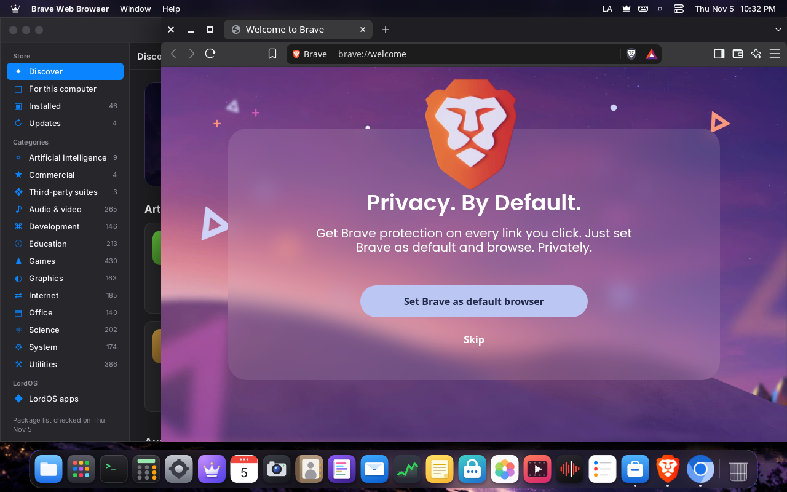
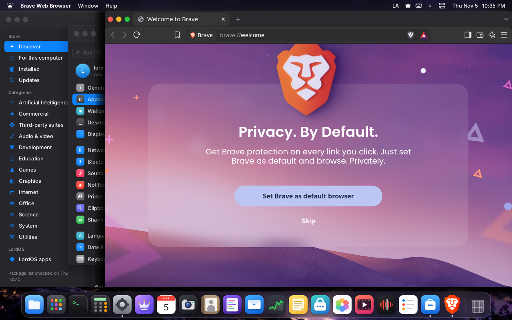

# Linux apps in LordOS (Wayland)

lord-server is also a **Wayland compositor**: GTK, Qt and any other app that speaks Wayland open
as LordOS windows, inside the theme, next to the native apps. There's no X server of its own, Weston,
wlroots or Mutter: only `libwayland-server` (it serializes the protocol; it's been in the dependency policy
since M1) and the code `wayland-scanner` generates from the `wayland-protocols` XML files. The
compositor lives in `server/src/wl/wl.c`.
Apps that only speak X11 open through Xwayland, started on demand, with our own X window manager
(see "X11 apps (Xwayland)" below).

## Screenshots (VM, real lord-server)

| | |
|---|---|
|  |  |
| foot (Wayland terminal) with the theme's frame: it asks for server-side decoration | GTK Demo (GTK 4.18): draws its own frame; LordOS clips its shadow |
|  |  |
| GTK popup menu (xdg_popup), placed with its positioner | Dragged from its own bar (xdg_toplevel.move): it follows the pointer |
|  |  |
| FeatherPad (Qt 6.8) opened from the LordOS Terminal, with the theme's frame | Qt's File menu |
|  |  |
| Copied in FeatherPad (Ctrl+C) and pasted in the LordOS Terminal | Three Linux apps open; each with its icon in the Dock |

## What's there

| Protocol | Version | What it does |
|---|---|---|
| `wl_compositor`, `wl_region` | 6 | surfaces; the buffer is copied on commit and released right away; `set_input_region` is applied on commit and the pointer hit test obeys it (`wlregion.h`). A surface with an empty region takes no input and the pointer goes to what is below: Firefox's content is such a subsurface, and GTK only knows the toplevel below it. `set_opaque_region` is ignored |
| `wl_shm` | (libwayland) | ARGB8888/XRGB8888 shared memory |
| `wl_subcompositor` | 1 | subsurfaces (composited on top of their parent) |
| `wl_output` | 4 | one per display: logical position, physical mode, scale rounded up, name and description (`DISPLAYS.md`) |
| `zxdg_output_manager_v1` | 3 | logical position and size of each display |
| `wp_fractional_scale_v1` | 1 | the exact scale of the display(s) a surface is on (GTK 4, Qt 6, Chromium render sharp at 125–175 %) |
| `wl_seat` | 9 | pointer (enter, leave, motion, buttons, wheel with `axis_source` and `axis_value120`; fine touchpad scrolling with `axis_source finger`, `axis_stop` and `axis_relative_direction` for natural scrolling), keyboard with LordOS's XKB keymap (`keyboard.c`), modifiers and repeat, and `wl_touch` if there's a touchscreen |
| `zwp_pointer_gestures_v1` | 3 | touchpad gestures: pinch (zoom in Chromium, GTK, Firefox), swipe and hold (`wl_input.c`, see `TRACKPAD.md`) |
| `wl_data_device_manager` | 3 | clipboard shared with LordOS's in both directions, files copied in Files as `text/uri-list` and `x-special/gnome-copied-files` (see below); drag and drop between Linux apps, from Files to a Linux app and from a Linux app to Files, with offers, actions and the drag icon, and with X11 apps through XDND (in development, see "Drag and drop") |
| `zwp_primary_selection_device_manager_v1` | 1 | primary selection: select to copy, middle click to paste (0.8.3, see "X11 apps"); `set_selection` needs a recent click or key serial of the app's own, and LordOS's text fields and Terminal share it (0.8.8.8) |
| `xdg_wm_base` | 6 | windows (`xdg_toplevel`: title, move, resize, maximize, minimize, close, `set_parent` for dialogs) and popup menus (`xdg_popup` with `xdg_positioner`: anchor, gravity, flip and slide within the screen) |
| `zxdg_exporter_v2`, `zxdg_importer_v2` (xdg-foreign) | 1 | a window exported as a handle that another process imports to put its dialog over it (`set_parent_of`); the file chooser portal takes it as `wayland:<handle>` (0.8.8.8, see "Dialogs") |
| `xdg_wm_dialog_v1` | 1 | a toplevel says it is a dialog and whether it is modal: a modal one holds its parent's input (0.8.8.8, see "Dialogs") |
| `zxdg_decoration_manager_v1` | 1 | the app picks who draws the frame: server side (Qt, foot, Kitty, Alacritty: the theme's frame) or client side (Chromium with its own bar), also while it's open (0.8.4) |
| `wp_cursor_shape_manager_v1` | 1 | the app asks for the cursor by name (Chromium, GTK 4, Qt 6) and LordOS draws its own (`cursor.c`, see `WINDOWS.md`) |
| `org_kde_kwin_server_decoration_manager` | 1 | GTK 3's way to ask for the frame (Firefox, Mousepad; see "Who draws the frame") |
| `zwp_idle_inhibit_manager_v1` | 1 | a video or presentation keeps the screen on while its surface is mapped (0.8.5, see the end of this page) |
| `zwp_keyboard_shortcuts_inhibit_manager_v1` | 1 | a VM, remote desktop or game takes ❖, ⌥Tab and LordOS's other shortcuts while it has the keyboard, once the person allowed it; ❖Esc gives them back (in development, `kbinhibit.c`, see "Keyboard shortcuts inhibit") |
| `xdg_activation_v1` | 1 | a window asks to come to the front with a token: only one LordOS gave (a launch, a notification's button) or one the app in front asked for raises it; any other only marks it in the Dock and the taskbar (`xdgact.c`, see "Activation" below) |
| `zwp_text_input_manager_v3` | 1 | a text field took focus and where its caret is: the on-screen keyboard's hint (0.8.7, see `ON-SCREEN-KEYBOARD.md`), and LordOS's input method composes into it: preedit, commit and done, the candidate window at its caret (in development, `wl_textinput.c`, see "Input methods") |
| `wp_security_context_manager_v1` | 1 | a sandbox (Flatpak 1.15 and later) hands over a listening socket for one app; its clients are tagged with the engine, app id and instance id, count as sandboxed and don't see the trusted-only globals (in development, `secctx.c`, see "Security contexts") |
| `zwp_linux_dmabuf_v1` 4, `wp_presentation` 1, `wp_viewporter` 1, `zwp_relative_pointer_manager_v1` 1, `zwp_pointer_constraints_v1` 1 | | GPU buffers, presentation feedback, cropping and scaling, games' pointer (see `GPU.md` and `DISPLAYS.md`) |

Windows enter the SDK's window manager (`sdk/wayland.js`) as the internal app `linux` (id
`linux#<surface>`): the theme sees them like any other, with their title, focus, maximize,
minimize and Dock. Those that draw their own frame (GTK, and the browsers with their own bar) arrive
with `args.csd` and the theme shows only the content (both bundled themes already do); an app that
switches while open sends `deco` and the same window changes presentation (see "Who draws the
frame" below). The keyboard goes to the frontmost Linux
app; ❖ combinations still belong to LordOS.

## How to open an app

From the LordOS Terminal: every new tab has `WAYLAND_DISPLAY`, `XDG_SESSION_TYPE=wayland`,
`GDK_BACKEND=wayland,x11` and `QT_QPA_PLATFORM=wayland`, so `featherpad &`, `gtk4-demo &` or
`foot &` is enough. Apps also receive LordOS's language and region (`LANG`, `LC_*`, see
`LANGUAGES.md`).

They also appear in the **app launcher**, in the Lord Classic theme's start menu and in the Store (see
`NATIVE-APPS.md` and `PACKAGES.md`): they are the apps with a `.desktop` in
`/usr/share/applications` or `~/.local/share/applications`. They open with one click, and their
window carries the same icon in the Dock as in the app launcher (they're recognized by the Wayland
app id or by `StartupWMClass`).

| | |
|---|---|
|  |  |
| The app launcher with the installed Linux apps next to the LordOS apps, each with its own icon | FeatherPad opened with one click; it carries the same icon in the Dock |
|  |  |
| Lord Classic theme: the start menu with LordOS apps and Linux apps, grouped by category | FeatherPad running in the Lord Classic theme, with its icon in the taskbar |

### The launcher (`server/src/apps.c`)

It's the second exception to "the server doesn't run commands"; the first is the Terminal's
shell. The user approved it for M7. Limits:

- `lord.apps.launch(id)` only receives the id of a `.desktop` in those two folders, which must
  also pass the filters:
  - `Type=Application`;
  - no `NoDisplay` or `Hidden`;
  - `OnlyShowIn`/`NotShowIn` with `LordOS`;
  - the `TryExec` exists;
  - a terminal app (`Terminal=true`) is listed with `terminal: true` only if its `Exec` program is also found in
    the fixed PATH below.
- The command is that file's `Exec` line, re-read at launch time:
  - `argv` is built according to the specification (quotes and escapes);
  - file codes (`%f %u %F %U`) are removed and no caller arguments are passed;
  - with `lord.apps.launchWith(id, path)` (Files' «Open With»), the path goes as a single
    argument in the first `%f`/`%F` (or as `file://…` in `%u`/`%U`), and only if the app declares
    `MimeType` in its `.desktop`; the path is resolved with realpath and must be in the home
    folder or on a disk mounted by the user (`/media/$USER`, `/run/media/$USER`);
  - it's run with `execve`, without a shell;
  - a terminal app is never run here: see **Terminal apps** below;
  - the program is looked up in a fixed PATH (`/usr/local/bin`, `/usr/bin`, `/bin`, games, and
    `~/.local/bin` only for the user's `.desktop` files).
- **Desktop actions (0.8.1):** the Dock's right-click menu lists the `Actions=` of an app's
  `.desktop` (a browser's "New Private Window", for instance). `lord.apps.actions(id, language)`
  returns `[{ id, name }]` and `lord.apps.launchAction(id, action)` runs one, through the **same**
  launcher (`apps_launch_action` → `launch()`): same id rules and filters, same scope, restrictions
  and fixed PATH, no shell, no caller arguments, no file. Only that action's `Exec` line replaces the
  main one, and only if:
  - the action is listed in the main group's `Actions=` key;
  - its name is `[A-Za-z0-9-]`, at most 63 characters;
  - its `[Desktop Action <name>]` group has a `Name` and an `Exec`.

  Anything else (an unlisted group, a bad name, no `Exec`) is refused. Tested by
  `build/apps-actions-test` (in `make test`).
- **Terminal apps (0.8.8.8, in development; approved 2026-11-10):** htop, mc, ranger, vim's entry. The launcher and
  search show them with the Terminal's icon small in a corner. `lord.apps.launch(id)` doesn't exec them: it parses
  the `Exec` line the same way (no caller arguments, no file), keeps the argv in a one-shot slot
  (`src/term/termapp.c`: random 128-bit token, 10 s, single use, at most 4 pending) and answers `{ terminal: token }`.
  The SDK's `launchApp` opens a new Terminal window with `{ app: token, title: <the app's name> }`; its tab starts the
  user's login shell as always and lord-server types the argv into it once, single-quoted in C, with the profile's
  exit rule (`docs/TERMINAL.md`, Security). The app runs as part of the Terminal (its scope and firewall app), so an
  app with restrictions in Settings → Privacy is refused. Its desktop actions are neither listed nor launched.
  Tested by `build/apps-term-test`.
- **Activation:** every launch gets `XDG_ACTIVATION_TOKEN` in its environment (see "Activation"
  below), so the window it opens, or the window of the copy already running it hands the link to,
  comes to the front.
- The app starts as an orphaned grandchild, in its own session, with normal signals and no other
  descriptors. Its output goes to `~/.cache/lordos/apps.log`, which is trimmed when it passes 1 MB.
- A `.desktop` can't be created from JS:
  - `lord.fs.write` rejects `~/.local/share/applications` and `~/.config/autostart`, also
    through a symlink (see `EDITOR.md`);
  - `.lpk` packages are installed in another folder.

  So the interface can't invent a command: it can only pick an app that's already installed.
- **File names with spaces (0.8.5):** a package may name its `.desktop` freely (`LordOS
  Imager.desktop`). Its id is the file name with every character other than letters, digits, `.`, `_`
  and `-` turned into `-` (`LordOS-Imager`), and the app is listed and launched from its real file;
  the id rules above are unchanged. The two folders' modification times are compared in nanoseconds,
  so an app installed in the same second the list was last read also shows up.
- **Force Quit (0.8.5):** `lord.wayland.kill(surface)` sends SIGKILL only to the Wayland client that
  owns that surface, a process of the same user, never `lord-server`; X11 windows are only asked to
  close (`WINDOWS.md`, "The Window menu, the app menu and Force Quit").

Icons (`server/src/iconfind.c`, `build/iconfind-test`): the `hicolor` PNG (64, 48, 128… px, the
user's theme before the system's) or the one in `/usr/share/pixmaps`. Then (0.8.8.8, in development)
SVG, which lord-media draws (`MEDIA.md`, "SVG icons"): `scalable/apps` of hicolor and Adwaita,
`/usr/share/pixmaps`; then the 64 px PNG Debian publishes in AppStream, which the package engine
already downloads (`/var/lib/lordos/pkg/icons/64`, see `PACKAGES.md`); and last a symbolic icon
(`symbolic/apps/<name>-symbolic.svg`). An absolute `Icon=` may name a PNG or an SVG. With none of
them, the initial is shown.

## Activation (`xdg_activation_v1`)

A window comes to the front only when the person asked for it; the rules are KWin's and Mutter's.
The tokens live in `server/src/wl/xdgact.c` (no Wayland types, tested by `build/xdgact-test`); the
protocol is in `wl.c`.

- **Tokens LordOS gives.** Every launch from `apps.c` (the launcher, Open With, a link, a desktop
  action) issues one and puts it in `XDG_ACTIVATION_TOKEN` of what it starts. A browser that is
  already open gets the link from the new process together with the token and calls `activate`: its
  window comes forward, on its own desktop if that one isn't showing. A click on a notification's
  button sends the `ActivationToken` signal (Desktop Notifications 1.2) before `ActionInvoked`, so
  the app that sent it can come forward too.
- **Tokens an app asks for** (`get_activation_token` … `commit`; `set_app_id` is kept, `set_surface`
  is only a hint). The token is granted when the asking app has the keyboard, or when the
  `set_serial` it sends is a click (`wl_pointer.button`), a key (`wl_keyboard.key`) or a keyboard
  `enter` LordOS sent that same client in the last 10 seconds. Otherwise it still gets a token (the
  protocol always answers `done`), but an ungranted one. The token remembers the app that asked:
  as soon as the keyboard moves to another app or to the desktop itself, or that app disconnects,
  its tokens stop granting (KWin and Mutter do the same), so an app cannot ask while in front and
  use the token later to steal the front. LordOS's own tokens are not revoked this way.
- **`activate(token, surface)`.** A granted token raises and focuses the surface's window (a menu or
  subsurface counts as its window). An ungranted, expired, unknown or reused token never takes the
  focus: the window is marked as wanting attention, a larger dot in the accent under its Dock icon
  (Lord Flow) or a long accent bar on its taskbar button (Lord Classic), until it comes to the front;
  a click on the icon brings that window first. Tokens work once and last 60 s (LordOS's: a cold
  start can be slow) or at most 10 s (an app's); 32 are kept, a new one replaces the oldest.
- The decision on the theme side is `activationOutcome` in `sdk/desktopmodel.js`
  (`tests/desktop_model_test.mjs`).

## Clipboard

There's a single one for the whole session:

- **Text.** What's copied in a Linux app goes to LordOS (Terminal, text fields), and what's
  copied in LordOS is received by the focused app.
- **Other formats (images, HTML…).** While the app that copied is still open, the other Linux
  apps receive from it any format it offers (up to 32).
- **Images.** If what was copied is only an image (`image/png`), LordOS stores it: it stays
  available after the source app is closed and shows up in the history.
- **Files.** Copy or Cut in Files puts the paths on the clipboard as `text/uri-list` (`file://`
  URIs, percent-encoded, CRLF), `x-special/gnome-copied-files` (`copy` or `cut`, then the URIs, LF)
  and plain text (one path per line), so a Linux file manager pastes the files and an editor the
  paths. The other way, when a Linux app copies files, the compositor reads its `text/uri-list` (or
  its gnome list) beside its text and keeps only this machine's files: `file://` URIs with an empty
  or `localhost` host, decoded to an absolute UTF-8 path without NUL or line breaks; a list of more
  than 65536 files, other hosts and other schemes are left out (`src/wl/urilist.c`,
  `build/urilist-test`). Because pasting them copies real files, the list is kept only from an app
  outside a sandbox: never from an isolated LordOS app (the broker knows its pid) nor from a Flatpak
  app (its `/proc/<pid>/root/.flatpak-info` exists; looked up with `openat` on that root, without
  following links; a root that can't be looked at counts as sandboxed), whose list isn't even read.
  And only when the selection has no text, or its text names exactly those paths (one per line, as
  paths or as `file://` URIs, same order), so what the person sees as the clipboard's text is what gets
  copied (`uril_accept`). Otherwise the copy is text only. Paste in Files then asks first, naming the
  app (its `app_id` or window title) and the first five files, with Enter on Cancel. Files copies them
  with `lord.fs.copy` and its checks; another
  app's cut is pasted as a copy, only Files moves its own cut. The list stays valid while the text it
  came with is the clipboard's, is offered again in both formats after that app closes, and goes to
  X11 apps too. JS only ever hands a list of paths (`lord.clipboard.setFiles`), never other data.
  `build/clipfiles-client` checks it inside a session.
- **No blocking.** Large copies (up to 16 MB) are sent in chunks, without a slow-reading app
  stalling the server.

| | |
|---|---|
|  |  |
| Image copied in GTK Demo, now closed: it's still in the history (❖V) | GTK Demo opened again: «Paste» receives it from LordOS |

**History (❖V quick, ❖⇧V full):** it keeps everything copied anywhere: text, links, colors,
code, paths and images, with the source (the app_id of the Linux app that copied). It's stored in
the home folder and survives reboots. Image previews are first stored in
`$XDG_RUNTIME_DIR/lordos` (the last 10 are kept) and the history copies them to
`~/.local/share/lordos/clipboard`. Whatever an app marks as secret
(`x-kde-passwordManagerHint`, like KeePassXC) can be pasted, but isn't stored. Details in
`SPOTLIGHT.md`.

## How it works

1. `wl_start()` (after dropping privileges) creates `$XDG_RUNTIME_DIR/wayland-0` and the
   globals; the event queue's fd joins `main.c`'s `poll`.
2. A window's first commit: it gets a `configure` (0×0: the app chooses). With the first buffer
   it becomes "mapped" and JS receives `map` with title, app id, size and whether it draws its
   own frame.
3. The UI draws it as a `surface` node (`<Surface surface={id} />`): `paint.c` copies the pixels
   into the node's box, clipping the shadow with the *window geometry*. If the theme changes the
   node's size (resize, maximize), it gets a `configure` with the new size and the app redraws.
4. Popup menus are drawn after the whole tree, above any window; a click outside closes them
   (`popup_done`).
5. After each frame is presented, the apps' `frame` callbacks are answered (so they don't draw
   faster than the screen).

Memory: with foot, FeatherPad and GTK Demo open, lord-server goes from ~51 to 53 MB of RSS
(each window keeps a copy of its buffer).

## Drag and drop (in development: built, to check on the VM)

The compositor in `wl.c` (`dev_drag` and the `dnd_*` functions), with the file lists in `urilist.c`:

- **Between Linux apps.** An app starts a drag with `wl_data_device.start_drag` and the serial of the press
  it is in. The serial must be the one of a press of that client, with the button still down, on the window
  that got it: any other serial cancels the source and nothing happens. A second `start_drag` while a drag
  runs is cancelled too. While the button is down no app gets the pointer: the surface under it gets
  `enter`, `motion` and `leave` on its data device, with a new `wl_data_offer` each time it enters (the
  source's types and, from version 3, its actions). The target's `accept` and `set_actions` reach the source
  (`target`, `action`). The action is the target's preferred one, else copy, move or ask, in that order. A
  source without `set_actions` (before version 3) copies. A drag without a source stays inside the app that
  started it.
- **The drop.** Releasing over a surface whose offer accepted a type (and agreed an action, from version 3)
  sends `drop` and `dnd_drop_performed`. The offer keeps reading until the target calls `finish`, which
  sends `dnd_finished`. A target that destroys the offer without finishing is cancelled (before version 3
  that counts as finished). Releasing anywhere else, or pressing Escape, cancels.
- **The icon** (role "dnd icon") is drawn under the pointer above everything, moved by its `attach` offset
  (or `wl_surface.offset` from version 5). An icon that has another role is a protocol error, and so is a
  source used for a drag given as the selection, or the other way round, and an action mask with unknown
  bits. A source, an icon, a target or a whole client that goes away mid-drag ends that part cleanly: the
  source destroyed cancels the drag (the target gets `leave`), and the icon destroyed just stops being drawn.
- **From Files to a Linux app.** When a Files drag starts, Files hands its paths to lord-server
  (`lord.wayland.dragFiles`). Only paths are accepted: absolute, existing, UTF-8, without a NUL or a line break, at most
  256. While the drag is over a Linux window, the compositor is the source: it offers `text/uri-list`
  (`file://` URIs, percent-encoded, CRLF separated) and `text/plain` (the paths, one per line), encoded as
  Files' copy to the clipboard is (`uril_encode`), and writes
  them itself to the app's pipe, non-blocking and from the event loop. Into a Linux app Files only copies
  (dropped on a file manager, a move would take the file out of its folder unasked); with Shift held it may move,
  if the app takes a move. The ghost shows the + once the app agreed. Nothing is
  run or read for the app: it opens the files itself.
- **From a Linux app to Files.** A drag that offers `text/uri-list` and may copy, released over LordOS
  itself, is taken by the compositor. The app is told "copy" while the pointer is over LordOS. At the release,
  Files claims it if a folder of its window is under the pointer (`lord.wayland.takeDrop`). Only the UI's
  handling of that very release may claim it (`DropGate` in `src/wl/dndgate.c`): right after it, a drop
  nobody claimed is cancelled and its list is never asked for. A claimed list is read (at most 1 MB,
  non-blocking, within 5 seconds, or the drop is cancelled; a longer list is cancelled whole, never cut
  short) with the same reader as a file list on the clipboard (`uril_parse`): its local `file://` paths (an
  empty host or `localhost`, decoded to an absolute UTF-8 path; `%00`, line breaks, a query or a fragment,
  other hosts and other schemes are dropped) are copied into that folder, and the app gets `dnd_finished`.
  A drop with no local path in it, or with more than 256, is cancelled too.
- **Sandboxed apps hand LordOS no files.** The drag of an isolated LordOS app (`lord-server --app`) or of a
  sandboxed Linux app (Flatpak: its root, `/proc/<pid>/root` looked at once when it connects, holds
  `.flatpak-info`) may name files the app itself can't reach, so it is never offered to LordOS: over LordOS
  it is told nothing, and released there it is cancelled. A client whose root can't be looked at counts as
  sandboxed. Drags between Linux windows are unchanged.
- **With X11 apps (XDND, version 5; built, to check on the VM).** The window manager (`xwm.c`) bridges
  both ways:
  - *Files or a Wayland app → an X window.* While the drag is over an X window that is `XdndAware`, the
    window manager is the XDND source: it owns `XdndSelection` with its own window, sends `XdndEnter` with
    the drag's types (interned first; more than three go in `XdndTypeList`, and `UTF8_STRING` is added
    beside `text/plain;charset=utf-8`), `XdndPosition` with the pointer and the action (copy; a Files drag
    with Shift held asks for a move, as into a Wayland app), and `XdndLeave` when the pointer leaves it or
    Escape is pressed. The window's `XdndStatus` reaches the source (and Files' ghost shows the +).
    Releasing sends `XdndDrop` only if its last status took the drag. The window's `ConvertSelection` of
    `XdndSelection` is answered only for a window of that window's client: `TARGETS`, then the data of a
    type the drag offers, read from the source (or, for Files, the same `text/uri-list` of CRLF-separated
    `file://` URIs and `text/plain` paths, `uril_encode`) through a non-blocking pipe, at most 16 MB within
    10 seconds, and written to the property (`INCR` for large ones). `XdndFinished` tells the source the
    drop is done (its action, from version 5); a window that never finishes is given up after 30 seconds.
  - *An X app → a Wayland window or Files.* An X app's drag is its own pointer grab: while a button is
    down on an X window the pointer keeps going to it. When the pointer leaves the X windows (an X app's
    drag icon doesn't count) and an X app owns `XdndSelection`, the window manager maps an invisible
    `XdndAware` window above every X window, so the app's XDND talks to it. Its types (from `XdndEnter` or
    `XdndTypeList`, each named with `GetAtomName` and kept only if it's a MIME type: printable ASCII with
    a `/`, or `UTF8_STRING` as `text/plain;charset=utf-8`, at most 32) become a drag the Wayland window
    under the pointer gets (`enter`, `motion`, offers, actions, `drop`); what the window receives is read
    with `ConvertSelection` of `XdndSelection` (`INCR` too, at most 16 MB within 10 seconds) and written
    to its fd without blocking. Its `accept` and action go back as `XdndStatus`, its `finish` as
    `XdndFinished`. The app's messages count only from the client that owns `XdndSelection` (XFixes
    says), and an owner that changes mid-drag ends it. The data is read only after a `SelectionNotify`
    the X server made (one sent with `SendEvent`, the event code's 0x80 bit, is ignored, since any X
    client can send it) whose requestor, selection, target and property are exactly the conversion's,
    and right before each read (each `INCR` chunk too) the window manager asks again who owns
    `XdndSelection` (`GetSelectionOwner`) and every client's pid (X-Resource): it must be the very window
    that owned it at `XdndEnter`, with the same client pid and the same answer on files, or the drag ends
    and its drop is refused (another X client taking the selection, or a new one that connected during
    the drag and got the same window id). Back over an X window, the invisible window is
    unmapped and the app talks to that window again; the app's own Escape ends its drag.
  - *An X app's files onto Files* are taken only when the X server ties the selection's owner to a
    process: the window manager asks X-Resource (`XResQueryClientIds`) for every X client's pid (never
    the client's own `_NET_WM_PID`), and the files may reach LordOS only if the owner's client has a pid
    and no client of the display is sandboxed (`dndg_pid_sandboxed`: its root, mount, pid and user
    namespaces are lord-server's, without `.flatpak-info`), because one X client can always stand in for
    another's selection. Until that answer comes, and whenever it says no, LordOS tells the app nothing
    over it and a release there is refused. Released over a Files folder, it is claimed at that release
    (`DropGate`) and read as above (`uril_parse`, at most 1 MB and 256 paths). A Flatpak app with the X11
    socket open on the display therefore turns X drops onto Files off until it closes (drops between X
    and Wayland windows are unchanged).
  Not handled: `XdndProxy` (no toolkit we know of needs it for toplevel windows), `XdndActionList` and
  `XdndActionAsk`'s menu (an ask is passed on as such), and drags from LordOS's isolated apps.

  Isolated LordOS apps take no drop: that needs a grant of its own (`DESKTOP-PARITY.md`). Touch drags
  are not supported.
- **Tests:** `build/urilist-test` (in `make -C server test`: encoding, decoding, what a drag may not carry,
  shared with the clipboard's file lists), `build/xwm-test` (also in it: the XDND messages, enter with more
  than three types and `XdndTypeList`, positions, statuses, finished, type names, the X-Resource reply,
  who may hand files to LordOS, synthetic or mismatched `SelectionNotify` events and owners that changed
  before the read),
  `build/dndgate-test` (also in it: a sandboxed root, a drop claimed only at its release), and
  `build/dnd-client` inside a session. Without input it checks a serial that names no press, the
  protocol errors and that the compositor stays up. With two presses in its window it checks the offer, the
  actions, a second drag, the icon and the source destroyed mid-drag, receive, drop and finish; a third,
  released on the desktop, checks that an unclaimed drop is cancelled without its list being asked for; a
  fourth, released on a Files folder with a list that never ends, that it is cancelled after 5 seconds.

**Moving and resizing** (`xdg_toplevel.move`/`resize`) is tracked by lord-server in C, with no JS
per frame, just like LordOS windows; while it lasts, the app doesn't receive the pointer. All
Linux windows, including those with their own frame, have the theme's invisible borders for
resizing (see `WINDOWS.md`).

### Dialogs (0.8.8.8)

A Linux app's dialog belongs to a window: the app says so with `xdg_toplevel.set_parent`, or another
process (a portal, a helper of the app) with xdg-foreign-v2's `zxdg_imported_v2.set_parent_of` and the
handle the app exported. xdg-dialog-v1 adds whether it is modal. lord-server keeps the owner and the
flag on the surface and tells JS in `map` (`parent`, `modal`) and in a `parent` event when they change;
`sdk/wayland.js` keeps them in the window's `args.parent` and `args.modal`, and `sdk/dialogmodel.js`
(`server/tests/dialog_model_test.mjs`) does the rest:

- the dialog opens centered over its parent, inside that display's work area, on the parent's desktop;
- it moves by as much as its parent moves (a drag is tracked in C, so the dialog joins the parent
  when the button is released), and it is minimized, brought back and sent to another desktop with it;
- a **modal** dialog stays right above its parent: bringing the parent forward brings the dialog
  above it, so the front window, the one with the keyboard, is the dialog. Minimizing a modal dialog
  minimizes its parent too. While it is up, lord-server gives the parent no presses and no wheel
  (releases still go, so a drag ends) and sends the parent's keyboard to the dialog (`modal_over` in
  `wl.c`). A dialog that isn't modal may go behind its parent.

A window that goes away leaves its dialogs to its own parent, as xdg-shell says; one that would make
a loop is ignored. **Handles** are 128 random bits from `getrandom` in hex, made for each export: they
can't be guessed, two exports of the same window get different ones, and a handle stops working when
its export or its surface goes away (every import of it is told `destroyed`; an unknown handle is told
so at once). The **file chooser portal** (`server/src/ui/portal.c`) reads its `parent_window`: for
`wayland:<handle>` it asks `wl_foreign_surface` for that window and the shell's dialog
(`PortalFilePrompt` in `sdk/filepicker.jsx`) is drawn over it instead of in the middle of the screen;
it is still the system's dialog, above every window. Not read: `x11:<id>` parents, and xdg-foreign
v1 (GTK 3 only speaks v1, so its portal dialogs still open in the middle). `build/dialog-client` (`tests/dialog_client.c`, inside a session or a headless
lord-server) checks both protocols from two connections; `hold 20` keeps a modal dialog over its
window to try by hand.

### Input methods (`zwp_text_input_v3`)

LordOS's Korean, Japanese and Chinese input methods (`server/src/ime.c`) compose inside a Linux app's
text field as they do in LordOS's own. The app enables its field with `zwp_text_input_v3` (GTK 3 and 4,
Qt 6); while it is enabled on the window with the keyboard and an input method is on, each key goes
through `ime.c` before the app (`ime_to_app` in `server/src/ui/js.c`), and a key the method uses never
reaches the app, nor its release. GTK 4.18 doesn't choose its text-input module by itself when no input-method
framework runs, so lord-server sets `GTK_IM_MODULE=wayland` for what it starts, unless the person set another
(an IBus or Fcitx user keeps theirs). Checked on VM 127: a GTK 4 field got the Hangul composition (ㅎ as preedit)
and then 한글. What it composes goes to the app (`wl_textinput.c`):

- `preedit_string` with the composition; the cursor (bytes) covers the focused segment of a Japanese
  conversion, otherwise it sits at the end. The app draws it in its own font, underlined.
- `commit_string` with the finished text, `delete_surrounding_text` clamped to the text the app sent;
- each batch ends with `done` carrying the number of `commit` requests the app has sent on that object,
  as the protocol counts them. A `done` goes only with something in it: answering every commit would
  loop with an app that commits again on each `done`.

The candidate list is the shell's own window (`ImeOverlay`, `sdk/ime.js`), placed at the app's
`set_cursor_rectangle`: `lord.wayland.textCaret()` adds the window's on-screen origin to it each time it
is drawn, so it follows a window that moves. Surface coordinates are the logical pixels the window is
drawn at; a buffer scale only changes how many pixels the app paints. A password or PIN field, or one
marked hidden, sensitive or Latin, never composes: the keys go straight to it. Disabling the field,
enabling it again (another widget of the app) or the keyboard going elsewhere discards the composition,
like a LordOS field losing focus; the "off" goes to the window that had the field.

Nothing the app sends is trusted (`server/src/wl/tiutf8.c`, `build/textinput-test`): its surrounding text
is cut to valid UTF-8 and 4000 bytes and dropped when its cursor or anchor is not a character boundary
inside it, its cursor rectangle is clamped to ±32767 and to the window's edges, and every offset LordOS
sends lands on a character boundary of valid UTF-8. `build/textinput-client` (`tests/textinput_client.c`,
inside a session) checks enter, enable, that commits alone bring no `done`, garbage, a second text input
and destroying things out of order; `type 30` gives 30 s to type with a method on and checks every
`done` serial and offset (`type 30 password`: nothing composes).

### Keyboard shortcuts inhibit (`zwp_keyboard_shortcuts_inhibit_manager_v1`, in development)

A virtual machine viewer, a remote desktop client or a game asks for every key, ❖ and ⌥Tab included, with
`inhibit_shortcuts` on its window (GTK 4's `gdk_toplevel_inhibit_system_shortcuts` is that request). LordOS asks the person once per app, in
the system's own prompt: "«App» wants to use the keyboard shortcuts while it's in front", with "❖Esc always gives
them back" under it. The answer is the `shortcuts` permission in `~/.config/lordos/permisos.json`
(`server/src/sec/perms.c`), which Settings → Privacy → Keyboard shortcuts lists and changes (Allow, Ask, Deny); a
change there tells the app's inhibitors at once (`wl_shortcuts_changed`).

- **Whose decision.** Who the client is, as lord-server checks it itself (`kbi_identity`,
  `server/src/wl/kbinhibit.c`), never the app_id it sets: any app can set the app_id of one the person allowed. It is
  read once, when the client connects (`ClientInfo` in `wl.c`), from its `/proc/<pid>` directory opened through the
  socket's pidfd (`SO_PEERPIDFD`, checked still alive after the open, `kbi_peer_proc`), so a pid reused later can't
  answer for it. A Flatpak app (its root holds `.flatpak-info`, opened from the root's directory fd without following
  a link, a regular file) is `flatpak:<the [Application] name>`; a process in lord-server's own root and mount, pid and
  user namespaces is `program:<path>`, its `/proc/<pid>/exe` resolved with `realpath` and still the very file it runs
  (same device and inode). Anything else (another sandbox or container, a damaged `.flatpak-info`, a deleted or
  replaced program, a path with other characters or longer than 183) has no identity, and its inhibitor never holds:
  nothing is asked. A client of a security context (`wp_security_context_v1`, `secctx.c`) is the app id its engine
  gave the context, which only a client outside any sandbox can create: `flatpak:<app id>` for Flatpak's
  (`org.flatpak`), no identity for any other engine, and none when its own `.flatpak-info` names another app
  (`kbi_context_identity`). Xwayland speaks for every X11 app, so it gets none either. `lord.perms.set` takes such a name only
  for `shortcuts`; every other permission still needs an `.lpk` id. Names of the first, never released format
  (`desktop:<app_id>`, `exe:<path>`) are ignored: never looked up, and not listed in Settings.
- **What the person reads.** The prompt and Settings show the identity ("Flatpak app org.example.Viewer", "Program
  /usr/bin/viewer") under a name. The name is an installed app's only when its `.desktop` entry's Exec line runs that
  very program (its program found as the launcher finds it, past `env` and `VAR=value`, and resolved), or is
  `flatpak run` for that Flatpak app (`apps_name_of_program`, `server/src/apps.c`); the window's app_id only says
  which entries to look at first. Otherwise it is the Flatpak id or the program's file name, never the window's title.
  An unsandboxed process of the person can still run the allowed program itself (or edit `permisos.json`): this
  stops a client from borrowing another app's decision by naming itself after it, not code already running as the
  person outside any sandbox.
- **Never.** An isolated LordOS app (its pid is the broker's), the login screen (`wl_set_greeter`), and an app the
  person denied. `shortcuts` can't be declared in a manifest or asked for through the broker (`BOP_PERM` refuses it).
  The lock screen is another process with the input, so no app's inhibitor reaches it.
- **One per surface.** A second `inhibit_shortcuts` for a surface that has one is the `already_inhibited` error.
  `surface_gone` leaves the inhibitor without its surface, its destructor clears only a link that points at itself,
  and the person's answer goes by the app's name, so a window closed while the prompt is up changes nothing.
- **Events.** `active` once allowed (right away when it was already allowed), `inactive` when ❖Esc turns it off or
  the permission is revoked. They don't follow the keyboard: the keys only go to the app while its window has it.
- **Keys** (`kbi_route`, `wl_key`). While it holds and its window has the keyboard, every key goes to the app,
  before the theme's table (`keygrab.c`) and the dispatcher: ❖ alone, ❖Tab, ⌥Tab, ❖Space, ⌥F4. These stay LordOS's:
  ❖Esc, the lock (❖L, ❖⌃Q), Ctrl+Alt+F1…F12, the media, sound and light keys and Print Screen (`keygrab_system_key`),
  and the ones `on_input` in `main.c` handles before any of this (⌃⌥⌫, ⌃⌥⇧Esc). A key's release and repeats go
  where its press went.
- **❖Esc** turns it off for that window (`inactive`) and with it a locked pointer and fullscreen, so everything is
  LordOS's again; pressed again in front of the same window it holds again (`active`). ❖Esc's own press and release
  reach nobody.

Machines' VM window does the same in the session (`sdk/kbinhibit.js`, `sdk/kbinhibitmodel.js`): the dispatcher
(`sdk/shortcuts.js`) asks `shortcutsKey` first, the decision is the `machines` app's `shortcuts` permission.

`build/kbinhibit-test` (`make -C server test`) checks the identity (fake `/proc/<pid>` directories for a Flatpak app, a
damaged or linked `.flatpak-info`, a program, a link on its path, a gone program, another root or namespace; a socket's
peer, and one that left), the names, the decision, the states and the keys; `build/apps-actions-test` the names shown;
and
`tests/kbinhibit_model_test.mjs` the session's side. `build/kbinhibit-client` (`tests/kbinhibit_client.c`, inside a
session) checks a second inhibitor's error, destroy and ask again, a surface destroyed before its inhibitor and a
client leaving with one; `hold 30` keeps a window with an inhibitor and prints `active`, `inactive` and its keys.

## Frame and colors: Chromium, Firefox, GTK and GNOME

| | |
|---|---|
|  |  |
| Chromium with its own bar (0.8.4 default): tabs in the title bar and LordOS's traffic lights on the left, from LordOS's GTK theme | The same in dark: it follows the mode live |
|  |  |
| Before 0.8.4: Chromium asked to draw its own bar and LordOS put its frame on top anyway (two bars) | The Lord Classic theme: the buttons go to the right (`:minimize,maximize,close`), switched live |
|  |  |
| Firefox ESR with its own bar: LordOS's order and side, drawn in Firefox's own style | Chromium with its «Classic» theme (not GTK): LordOS's order and side, Chromium's own buttons |
|  |  |
| Mousepad (GTK 3, «LordOS-dark» theme) and GNOME Calculator (GTK 4/libadwaita, green accent and buttons on the left), dark | The same in light: they change live when the mode is switched in Settings |

### Who draws the frame (0.8.4)

An app chooses; LordOS **prefers** its own frame and honors the app's answer.

- **xdg-decoration** (Chromium, Qt, foot): the first `configure` says `SERVER_SIDE`. If the app then
  asks `set_mode(CLIENT_SIDE)` it gets `CLIENT_SIDE` and draws its own bar; `set_mode(SERVER_SIDE)`
  and `unset_mode` give the theme's frame. Destroying the decoration object means the app draws its
  own frame again (the protocol's rule).
- **`org_kde_kwin_server_decoration`** (GTK 3, so Firefox and Mousepad): default «server»;
  `request_mode(client)` is answered «client».
- **Live.** When an open window changes mode (Chromium's «Use system title bar and borders»,
  Firefox's «Title Bar»), lord-server sends JS a `deco` event (`{ csd }`) and `sdk/wayland.js` sets
  `args.csd` on the **same** window (`wm.setArgs`): place, size (the outer frame stays where it was;
  the content grows or shrinks by the theme's bar and the app gets a `configure`), maximized state,
  focus and Dock entry don't change.
- **Before 0.8.4** lord-server answered `SERVER_SIDE` whatever the app asked. Chromium with its own
  bar then drew its tab strip and buttons and LordOS put its frame on top: two bars.
- Tested with `build/deco-client` (`server/tests/deco_client.c`, run inside a session): every mode
  request in both protocols, before and after mapping, with the `xdg_surface.configure` that must
  follow; `build/deco-client hold 6` keeps switching a window to watch the theme.

What a window with its own bar still gets from LordOS (both themes, `WINDOWS.md`):

- the invisible resize edges around it and the theme's shadow (the app's own shadow is clipped
  with its window geometry);
- moving from its bar (`xdg_toplevel.move`), resizing from its edge (`xdg_toplevel.resize`),
  maximize, restore and minimize from its own buttons, double click on its bar (the app asks to
  maximize);
- **the window menu**: a right click on a GTK headerbar asks `xdg_toplevel.show_window_menu`, and
  the theme shows its menu at that point (`w.windowMenu`, `wm.showWindowMenu`): Lord Flow the
  menu bar's Window items (Minimize, Zoom, Close Window), Lord Classic its title bar menu plus **Snap
  layouts**, which opens the same flyout its maximize button shows on hover (an app's own maximize
  button can't). Chromium shows its own menu on its tab strip instead (with «Use system title bar
  and borders» in it);
- the window-button layout LordOS publishes to GTK (`button-layout`, below), which Chromium and
  Firefox follow live when the theme changes;
- the things LordOS draws that never lived in the frame: the «Remote desktop: user · IP» badge is a
  screen overlay (`sdk/remote.js`, notification layer) and a protected window is black in captures
  through its content node (`AppHost`), so both work the same for these windows.

| | |
|---|---|
|  |  |
| GTK Demo (own frame): right click on its bar, Lord Flow's window menu | Lord Classic: the window menu's «Snap layouts» on an app with its own bar |

### The browsers by default

- **Chromium.** The ISO ships `/etc/chromium/master_preferences` with
  `"browser": { "custom_chrome_frame": true }` (its own bar) and
  `"extensions": { "theme": { "system_theme": 1 } }` (the **GTK** theme): new profiles draw the tab
  strip in the title bar with the window buttons from LordOS's GTK theme, so they are LordOS's
  traffic lights (13 px circles, 8 px apart, glyph on hover, grey when the window isn't focused).
  Tested: a new profile starts that way. Back to the LordOS frame: Settings → Appearance → «Use
  system title bar and borders» (or right click on the tab strip). With Chromium's «Classic» theme
  the buttons keep LordOS's order and side but are Chromium's own.
- **Brave and other Chromium-based browsers** (0.8.8.4, #39). They don't read Debian
  Chromium's `/etc/chromium/master_preferences`, where LordOS puts its defaults (a new Brave profile
  has neither key; LordOS doesn't write into the vendor's `/opt/brave.com/brave`), so it starts with
  Chromium's defaults for a desktop it doesn't know (`XDG_CURRENT_DESKTOP=LordOS`): its own bar
  (`custom_chrome_frame` on) with the **Classic** theme, whose window buttons are Chromium's own
  (minimize, maximize and close glyphs, on LordOS's side and in its order), not LordOS's traffic
  lights; next to native windows they look like the Lord Classic theme's. Not a LordOS frame or
  decoration bug: lord-server answers Brave's `xdg-decoration` request (it runs as a native Wayland
  client, `--ozone-platform=wayland`) exactly as Chromium's, and with the GTK theme the same Brave
  draws the traffic lights. The switch below now also writes Brave's profiles
  (`~/.config/BraveSoftware/Brave-Browser`), and Store → Third-party apps installs it; in Brave
  itself: ☰ → Settings → Appearance → Theme → **GTK** (traffic lights in its bar) or «Use system title
  bar and borders» (the LordOS frame). Checked on VM 116 with Brave 1.99.55 in an isolated session: a
  new profile with the Classic buttons, then Settings → Appearance → «Change them» and Brave reopened
  with LordOS's traffic lights.

  | | |
  |---|---|
  |  |  |
  | A new Brave profile: its own bar with the Classic theme's buttons | After the switch («Change them»): the same profile with LordOS's traffic lights |
- **Firefox ESR.** `/etc/firefox-esr/lordos.js` has `pref("browser.tabs.inTitlebar", 1)`: its own
  bar, with the window buttons in LordOS's order and side (it reads the same `button-layout`), drawn
  in Firefox's own style: Firefox draws those buttons itself, not with the GTK theme, so they aren't
  traffic lights. Back to the LordOS frame: Customize Toolbar → «Title Bar». Firefox draws with GTK
  3, which doesn't speak xdg-decoration: lord-server also advertises
  **`org_kde_kwin_server_decoration_manager`** (KDE's), with «server» as the default mode, so GTK 3
  windows without their own bar (Firefox with «Title Bar», Mousepad) ask LordOS for the frame. The
  protocol tables are hand-written in `wl.c`, without plasma-wayland-protocols' XML.
- **Upgrades** (migration `005-0.8.4-browser-frames`): where the files are still what the 0.8.3 ISO
  wrote, they change to the new defaults. Firefox's is a default pref, so every profile follows it
  except one whose user changed «Title Bar». Chromium's are initial preferences: only new profiles
  get them; an existing profile keeps its frame until its user flips the switch below (Settings
  shows how many Chromium profiles don't follow it, with a «Change them» button). The root
  migration never touches home folders.
- **The LordOS GTK theme's title buttons** (`assets/gtk/LordOS*/gtk-3.0/gtk.css`): GTK sizes a title
  button by its 16 px icon, and Chromium does the same when it draws its tab strip with the GTK
  theme, so the button stays 16 px and the circle is a 13 px radial gradient inside it; measured on
  the VM: 12–13 px circles, 21 px from center to center, like LordOS's own frame.
- **GTK 4 / libadwaita (GNOME).** They read the mode, the accent and the button order from
  **`org.freedesktop.portal.Settings`**, and **`org.freedesktop.portal.FileChooser`** for apps with no file dialog of their own (`OpenFile`, `SaveFile`, version 2 so browsers keep theirs; the dialog is the shell's, inside the home folder, and the answer goes only to the app that asked). It also serves **`org.freedesktop.portal.OpenURI`** (`OpenURI` for http and https, `OpenFile` and `OpenDirectory` with the file as an fd: opened the way LordOS opens files, never an executable or a launcher, and asked first when the app is not the one with the keyboard) and **`org.freedesktop.portal.Inhibit`**, plus **`org.freedesktop.ScreenSaver`**'s `Inhibit`/`UnInhibit`: a hold counts as an idle inhibitor and ends when the app lets it go or leaves the bus (docs/FLATPAK.md, "Portals"). **`org.freedesktop.portal.GlobalShortcuts`** gives an app the keys the person chooses in LordOS's sheet (push-to-talk: `Activated` on press, `Deactivated` on release), and those keys then go only to that app (docs/SHORTCUTS.md, "Linux apps' global shortcuts"). lord-server itself serves them all (`server/src/ui/portal.c`)
  on the session bus, without xdg-desktop-portal, with Passwords' own D-Bus client
  (`server/src/vault/dbus.c`). Keys:
  - `org.freedesktop.appearance`: `color-scheme`, `accent-color`, `contrast`;
  - `org.gnome.desktop.interface`: `color-scheme`, `accent-color`, `gtk-theme`;
  - `org.gnome.desktop.wm.preferences`: `button-layout`.

  When they change, `SettingChanged` is sent. If another program already owns the name
  `org.freedesktop.portal.Desktop`, LordOS doesn't take it over and says so in the log.
- **Media players (MPRIS).** lord-server is an MPRIS client on the session bus (`server/src/hw/mpris.c`): the
  players a Linux app publishes (`org.mpris.MediaPlayer2.*`) show in Control Center's Now Playing, and the media
  keys, which the compositor keeps from the focused app, reach them when LordOS's own Player isn't playing. Every
  call is asynchronous with a 3 s limit, the number of players and every string are bounded, and only local cover
  art is shown (docs/MEDIA.md, "Linux players"). In development for 0.8.8.8, to check on the VM.
- **GTK 3.** Outside Flatpak it doesn't read the portal: it reads GSettings.
  - lord-server passes `GSETTINGS_BACKEND=keyfile` to the apps and writes the same keys to
    `~/.config/glib-2.0/settings/keyfile`, without deleting what the apps store. GLib watches that
    file, so GTK 3 also changes live.
  - The `LordOS`/`LordOS-dark` theme (`assets/gtk/`, installed in `/usr/share/themes`) is Adwaita
    with LordOS's colors, bar and traffic lights.
  - GTK 3 has no accent: its own stays blue.
- **The buttons** go on the left in traffic-light order (`close,minimize,maximize:`). The Lord Classic
  theme asks for them on the right with the `gtkButtons` token (`:minimize,maximize,close`). GTK
  apps, Chromium and Firefox move them live when the theme changes. Since 0.8.8.7 (#58) Settings →
  Desktop & Dock → Title bars → Window buttons (`settings.windowButtons`: `auto`, `left`, `right`;
  `sdk/windowbuttons.js`) puts both themes' frames on one side, and the same side is published here:
  Left is `close,minimize,maximize:`, Right `:minimize,maximize,close`, Automatic the theme's token.
- **Where the session can't reach** (0.8.8.6, #52). Debian's default `button-layout` is
  `appmenu:close`: a lone close button on the right, which is what an app shows when it reads neither
  the keyfile nor the portal: one restricted to «no access to your files» (its view has no
  `~/.config/glib-2.0` and no session bus), one started outside the session, or one on X11 (Xwayland),
  where GTK reads only XSETTINGS, which LordOS doesn't serve. The `lordos` package now ships
  `/usr/share/glib-2.0/schemas/90_lordos.gschema.override` (GLib's dpkg trigger compiles it) and
  `/etc/gtk-3.0/settings.ini` and `/etc/gtk-4.0/settings.ini` (`gtk-decoration-layout`), both with
  Lord Flow's `close,minimize,maximize:`. They are defaults only: a value stored by the user or the
  theme (the keyfile) wins, and `~/.config/gtk-3.0/settings.ini` wins over `/etc`. Those apps don't
  follow a theme change to Lord Classic live. `server/tests/gtk_defaults_test.mjs` compiles the
  override next to Debian's schema and checks that it, `settings.ini`, `sdk/theme.js` and `portal.c`
  agree.
- **Qt/KDE.** They use the theme's frame (xdg-decoration). Qt 6 also reads `color-scheme` from the
  portal; not tested.
- **The JS.** The SDK's `ThemeProvider` sends mode, accent and buttons with `lord.portal.set` when
  they change.

### The switch in Settings (0.8.4)

**Settings → Appearance → «Browsers: tabs in the title bar»**, on by default. On: Chromium and
Firefox draw one bar with their tabs and LordOS's window buttons. Off: they use the LordOS frame.
It replaces each browser's own setting for the user, and writes that one preference in the user's
own profiles, only when the switch is turned (never by itself at login):

| | |
|---|---|
|  |  |
| The switch; a profile made before 0.8.4 still has the LordOS frame, «Change them» applies the switch to it | Turned off while Chromium is open: it waits, and applies as soon as Chromium quits |


*Switch off: the same Chromium profile with the LordOS frame.*

- **Who writes:** `lord-server`, as the user, in C (`server/src/hw/brframe.c`, exposed as
  `lord.browserFrame` in `ui/js_hw.c`; the page is `apps/settings/BrowserFrame.jsx`, the logic
  `sdk/browserframe.js`). No program is run and JS passes no path: only `on`/`off` and which
  browser. The folders are fixed (`$XDG_CONFIG_HOME` or `~/.config`, and `~`); every file is opened
  without following links, must be a regular file owned by the user and is size-capped.
- **Chromium** (`~/.config/chromium/Default` and `Profile N`, `Preferences`), and since 0.8.8.4 **Brave**
  the same way (`~/.config/BraveSoftware/Brave-Browser`, its own `SingletonLock` held by a process named
  `brave`; one browser open doesn't stop the other from being written, and Settings says "Chromium or
  Brave is open"). Settings' «Change them» counts the profiles the switch would change (a frame or a
  theme unset or different, as in a new Brave profile), not only those with the opposite frame:
  `browser.custom_chrome_frame` = on/off, and with on `extensions.theme.system_theme` = 1 (the GTK
  theme, for the traffic lights) unless the profile uses a theme extension the user installed
  (kept). Chromium rewrites `Preferences` when it quits, so it is only written while Chromium is
  closed: its `SingletonLock` (`<host>-<pid>`) must be missing or stale (that pid isn't one of the
  user's `chromium` processes; a lock from another host counts as open). If Chromium is open the
  change waits (`settings.browserFramePending`, a check every 5 s and at login) and is applied when
  it quits. The edit is surgical: only those values change, the rest of the file stays byte for
  byte; the file must parse as JSON before (strict reader, `sec/json.c`) and after, with the asked
  value in it; a malformed or unexpected file (`browser` not an object, an escaped duplicate key) is
  left alone and reported. The previous file goes to `Preferences.lordos-backup`, then the new one
  is written next to it (`O_EXCL`, `fsync`) and renamed over it, keeping its mode. Chromium
  accepts the edited file (tested with Chromium 155: no reset, the value survives its own rewrite).
- **Firefox** (`~/.config/mozilla/firefox`, where Firefox 153 makes new profiles, and the legacy
  `~/.mozilla/firefox`; the relative profiles of `profiles.ini`): one marked line
  `user_pref("browser.tabs.inTitlebar", 1|0); // lordos: …` in `user.js`, which Firefox reads at
  start, so it can be written while Firefox runs (it applies when Firefox restarts). Not needed
  when `prefs.js` already holds the value. A `user.js` line the user wrote themselves is never
  touched («kept», and the page says so). At login `lord.browserFrame.tidy()` removes LordOS's line
  again once Firefox has started with it (its `lock` link or `.parentlock` newer than `user.js`,
  the profile not open: a live `.parentlock` lock or a `lock` link to a live `firefox` process), so
  a later choice in Firefox's own «Title Bar» sticks. `prefs.js` is only read, never written.
- **Not done:** traffic lights in Firefox too. Firefox draws its window buttons itself, so it
  would need a per-profile `chrome/userChrome.css` and
  `toolkit.legacyUserProfileCustomizations.stylesheets`; the roadmap keeps it as a separate item
  to weigh first. A profile created later follows the system defaults (its own bar), not the
  switch: turn the switch again for it.
- **Tests:** `build/brframe-test` (`make -C server test`): the Chromium edit (missing keys, pretty
  and compact files, strings with braces and quotes, theme extensions, idempotence, 12 malformed
  inputs), the `user.js` line (other lines kept, the user's own line, comments, NUL bytes), and on
  fake homes: profile discovery (`Default`/`Profile N` only, `profiles.ini` with absolute and
  `../` paths refused), a running Chromium (a process named `chromium` holding the lock), stale and
  foreign locks, a linked `Preferences` or `user.js` refused, backups, modes, a running Firefox
  (`.parentlock` held, a live `lock` link) and the tidy-up rules. On VM 119 (`VM-SETUP.md`, step 39)
  with Chromium 155 and Firefox ESR 153.

Tested in VM 118 with Chromium 155, Firefox ESR 153, Mousepad (GTK 3) and GNOME Calculator
(GTK 4, libadwaita); the 0.8.4 frame changes on VM 119 (`VM-SETUP.md`, step 38) with Chromium 155,
Firefox ESR 153, GTK Demo (GTK 4) and foot, both themes, light and dark.

## X11 apps (Xwayland)

Apps that only speak X11 (xterm, Java/Swing, many games and older tools) open through **Xwayland**
(Debian's `xwayland` package), started only when one of them connects. They get the theme's frame,
their icon in the Dock, LordOS's cursor and the shared clipboard, and they run in their app's scope
like any other Linux app.

| | |
|---|---|
|  |  |
| XTerm opened from search: the theme's frame, its icon in the Dock (`StartupWMClass=XTerm`), the menu bar, and its process in `app-lordos-debian-xterm.scope` | XTerm's Ctrl+click menu: an override-redirect X window, drawn above the Dock |
|  |  |
| A Swing app (OpenJDK 21): pasted with Ctrl+V what a Wayland app copied | Its list, the pointer at the right place |
|  |  |
| Neverball with `SDL_VIDEODRIVER=x11` (OpenGL through Mesa) | Its "Fullscreen" option: `_NET_WM_STATE_FULLSCREEN`, presented by the compositor |
|  |  |
| The same on the GPU composition path (`LORD_GPU=1`) | XTerm restricted to no internet (Settings → Firewall): its `curl` is refused, the per-app rules apply to X11 apps |

### How it starts (`server/src/wl/xwayland.c`)

- At the start of a user session (not the login screen, not app mode), if `/usr/bin/Xwayland`
  exists, lord-server reserves a display: the lock file `/tmp/.X<n>-lock` and the socket
  `/tmp/.X11-unix/X<n>` with mode **0600** (only this user's programs can connect; no abstract
  socket, no TCP). It sets `DISPLAY=:<n>` (and `_JAVA_AWT_WM_NONREPARENTING=1`, see below) for the
  apps it starts. **Nothing else runs.**
- When the first X11 client connects, lord-server starts Xwayland with a fixed argument list:

  ```
  /usr/bin/Xwayland :<n> -rootless -listenfd 3 -wm 5 -nolisten tcp -extension XTEST
  ```

  fd 3 is the listening socket (Xwayland accepts that first connection), fd 4 its Wayland connection
  (`WAYLAND_SOCKET`, a socketpair, so the compositor knows which client is Xwayland) and fd 5 the
  window manager's connection. This is the fourth launcher exception (`AGENTS.md`): the binary must
  be a root-owned file nobody else can write; there are no arguments from JS or from anyone; the
  only trigger is a connection to the session's own X socket.
- Xwayland runs in its own scope (`lordos-xwayland.scope`, never lord-server's), in an empty network
  namespace inside a user namespace that maps only the user (it has no network at all), with
  `no_new_privs`, a minimal environment and its log in `~/.cache/lordos/xwayland.log`. **XTEST is
  off**: an X11 app can't type or click into another one with synthetic input.
- **Off when unused.** The window manager is an X client too, so Xwayland's own `-terminate` never
  fires: 10 s after the last X window closes, the window manager asks the X-Resource extension
  whether any other client is still connected (a clipboard tool without windows) and, if none,
  stops Xwayland. The socket stays in lord-server, so the next X11 app starts it again (about a
  second). Three failed starts in a row → X11 apps are refused for a minute (logged).

### The window manager (`server/src/wl/xwm.c`, `x11wire.c`)

Our own, in C: it speaks the X11 protocol itself (no libxcb or libX11, dependency policy), fully
asynchronously, so lord-server never waits on Xwayland while Xwayland waits on the compositor.

- **Windows.** It redirects the root's children (Composite, manual: rootless Xwayland then gives each
  top-level window a `wl_surface` and says which with `WL_SURFACE_ID`), takes SubstructureRedirect
  and maps the windows that ask. A normal window becomes a LordOS window (`linux#<surface>`, like
  Wayland apps) with its title (`_NET_WM_NAME` or `WM_NAME`, Latin-1 converted), and its app from
  `WM_CLASS`: the class, or the instance if only that names a `.desktop` (`StartupWMClass` or the
  desktop id), so the Dock groups it with its launcher icon. Motif "no decorations" (or a splash)
  gets no theme frame. Override-redirect windows and menus, tooltips, combo lists, notifications
  and drag icons are drawn above everything at the place X gave them.
- **Place, stacking and focus.** The X position of a window is its content's position on screen
  (updated as the theme moves it), so Xwayland routes the pointer right; the focused window is put
  on top of X's stack and a minimized one at the bottom (iconic). Focus uses `SetInputFocus` and
  `WM_TAKE_FOCUS` (ICCCM); an X app can't move the keyboard to another X app's window (that
  `FocusIn` is reverted); `_NET_ACTIVE_WINDOW` from an app is ignored (no focus stealing).
- **Requests.** Close (`WM_DELETE_WINDOW`, else `KillClient`), maximize and fullscreen
  (`_NET_WM_STATE`, also set before mapping), minimize (`WM_CHANGE_STATE`), and moves and resizes
  asked by apps that draw their own frame (`_NET_WM_MOVERESIZE`) go to the theme like a Wayland
  app's. A resize of the frame becomes `ConfigureWindow`; an app may change its own size, never its
  place.
- **Cursor.** The root window's cursor is LordOS's arrow (a Render ARGB cursor), so X apps that
  don't set one show ours; those that do (xterm's I-beam) show theirs, like Wayland apps.
- **Java.** AWT guesses the insets of a reparenting window manager; ours doesn't reparent, so
  `_JAVA_AWT_WM_NONREPARENTING=1` is set for the session's apps (without it Swing windows are blank).

### X11 apps on HiDPI displays (in development, 0.8.8.8)

On a display above 100 % an X11 app used to be drawn at its logical size and enlarged by LordOS: the right
size, but blurry. Now, as in KWin's "apps scale themselves", **the X11 apps scale themselves** by default
(`server/src/wl/xwscale.c`, the pure part, tested by `build/xwscale-test` in `make -C server test`):

- **One scale per run.** When Xwayland starts, it gets the largest display scale (`wlx_begin_scale` in
  `wl.c`, 100–300 %) for as long as it runs. X's coordinates are LordOS's logical pixels times it: on the
  densest display one X pixel is one device pixel. Xwayland's `-hidpi` option is for rootful mode only,
  so this is done in the compositor, for Xwayland's connection alone (a per-client scale, like KWin's).
- **What wl.c converts** for Xwayland's surfaces: their logical size is the buffer's divided by the scale
  (so LordOS copies them 1:1 on that display instead of enlarging them), the input region, the pointer
  (`enter`, `motion`), relative motion, touches (`wl_input.c`) and a text field's caret. Its `wl_output`s
  and `zxdg_output_v1`s carry the position and size in X pixels and scale 1.
- **What xwm.c converts**: every place and size it gives X (`xwm_place`, `xwm_resize`, fullscreen) and
  every one it reads back (a new window, a menu or tooltip moved). Both directions round to the nearest
  and give the same value back for every scale of 100 % or more. The root window's arrow is made at
  that scale.
- **The apps are told** with `Xft.dpi` (96 × scale, 192 at 200 %) in the root window's
  `RESOURCE_MANAGER`, set before the window manager lets the first app in. Xft text (xterm with
  `-fa`), Qt, Chromium and Electron, and Tk read it. LordOS serves no XSETTINGS and sets no `GDK_SCALE` or
  `QT_SCALE_FACTOR` (neither KWin nor GNOME does; they would change Wayland apps too), so an app that
  reads neither (core-font xterm, Java/Swing, GTK 3 on X11) looks small.
- **Settings → Displays → X11 apps**: «Scale themselves (sharp)», the default, or «Scaled by LordOS
  (blurry)», the old behaviour (`settings.x11Scaling`, `'self'` | `'lordos'`; `sdk/wayland.js` sends it with
  `lord.wayland.x11SelfScale(on)`). The row shows only where Xwayland is installed. A change of the
  setting or of a display's scale applies the next time Xwayland starts, when no X11 app is open (10 s
  after the last one closes). `lord.wayland.info()` gives `x11SelfScale` and `x11Scale` (the running
  one's scale, 0 when it isn't running), and lord-server's log says the scale it started with
  (`xwayland: started ... X pixels at 200 %`).
- **Not done:** the scale doesn't follow a display change while X11 apps are open; an X app's cursor
  follows `XCURSOR_SIZE`, which LordOS sets in logical pixels, so it can look small at 200 %; scroll and
  gesture deltas are not converted.

### Clipboard and primary selection

Both ways, for **CLIPBOARD** and **PRIMARY** (select to copy, middle click to paste):

- **X11 → LordOS.** XFixes tells when an X app takes a selection; the window manager reads it once
  (`TARGETS`, then the best text — `UTF8_STRING`, `text/plain;charset=utf-8`, `STRING` — or
  `image/png`; `INCR` for large ones, up to 16 MB) and it becomes LordOS's: the Wayland apps, the
  Terminal and the history (with the X app's class as its source) see it.
- **LordOS → X11.** LordOS's selection is put in X **only while an X window has the keyboard** and
  only if it's newer than what an X app copied; when the keyboard goes to a LordOS or Wayland
  window, the window manager gives the selection up. Large pastes go in `INCR` chunks. Files copied
  in Files are also offered as `text/uri-list` and `x-special/gnome-copied-files`; files an X app
  copies arrive as their text only (the window manager reads one text target; an X client's sandbox
  can't be told, so its file list is never read).
- **Secrets never go to X.** What Passwords (or a password field) copies is marked sensitive and is
  not offered to X11 apps at all: in X, the pasted text is written to a window property any X client
  can read.
- **Primary selection for Wayland apps** (`zwp_primary_selection_v1`, new in 0.8.3): what the app
  with the keyboard selects is kept and offered to the app that gets the keyboard next, and to X.
  `set_selection` counts only from the app with the keyboard and with the serial of a click, key or
  keyboard enter it got in the last 10 s (a made-up serial is ignored; `xdgact.c` keeps them). The
  text is read once through a non-blocking pipe, at most 16 MB; a slower read of an older selection
  is dropped when a newer one came. Offers list `text/plain;charset=utf-8`, `text/plain` and
  `UTF8_STRING`; any other type gives nothing (`build/primary-client`).
- **LordOS's own text fields and the Terminal** (0.8.8.8) share it both ways: selecting text in a
  `TextInput`, a `TextArea` (`sdk/primarymodel.js`) or a Terminal pane (with the mouse) makes it
  the primary selection the apps are offered (never a password field's), and a middle click in a
  field or a pane (when the program in it doesn't take the mouse) pastes the primary selection at
  the click point, whoever made it. `lord.primary.set(text)` publishes; `lord.primary.get()` gives
  the text only while LordOS is handling a middle-button press, so what a Linux app selects can't
  be read at will (isolated `.lpk` apps have no `lord.primary`). **Settings → Mouse & Trackpad →
  Middle click pastes** (`middlePaste`, on by default) turns it off: selecting still sets it, but
  no Wayland or X11 app is offered it and fields and the Terminal paste nothing.
- **Offers are bound to their selection.** A `wl_data_offer` (and a primary offer) carries the
  generation it was made for and only gives data for that selection, and only to its client while
  it has the keyboard: an app can't keep an old offer to read later copies (`build/clip-offers`).
- **Drag and drop** between X11 and Wayland apps (and Files) through XDND: built, to check on the VM (see
  "Drag and drop", "With X11 apps"). Inside X (X app to X app) it's X's own protocol; not tested.

### VMware Tools (`open-vm-tools-desktop`)

VMware's copy and paste between the guest and the host is done by `vmware-user`
(`/usr/bin/vmware-user-suid-wrapper` → `vmtoolsd -n vmusr`), an X11 client without visible windows:
its `dndcp` plugin calls `gdk_set_allowed_backends("x11")` and then `gtk_init`, takes CLIPBOARD and
PRIMARY in X when the host copies, and reads X's CLIPBOARD when the host asks for the guest's. On a
Wayland session the wrapper also opens `/dev/uinput` (for drag and drop) because
`XDG_SESSION_TYPE=wayland`. Other desktops start it from `/etc/xdg/autostart/vmware-user.desktop`.

What works with LordOS (0.8.8.7, issue #76):

- **It can run.** Until 0.8.8.6 the session had `GDK_BACKEND=wayland`; GTK then skips every backend
  the program doesn't allow, so `vmware-user` stopped at `gtk_init` ("cannot open display"). Now it is
  `GDK_BACKEND=wayland,x11`: GTK apps still open on Wayland, and a program that only allows X11 gets
  Xwayland.
- **Host → guest.** When the host copies, `vmware-user` takes CLIPBOARD in X; XFixes tells the
  window manager, which reads it as with any X app, and it becomes LordOS's clipboard (the history
  shows `x11` as its source: the agent has no managed window).
- **Guest → host, from an X11 app**: the X app answers `vmware-user` directly.

What doesn't, and why:

- **Nothing starts it.** LordOS doesn't run XDG autostart entries (`/etc/xdg/autostart`,
  `~/.config/autostart`), and lord-server only launches the programs listed in `AGENTS.md`. Starting
  `vmware-user` by itself in a VMware guest is a new launcher exception (a setuid-root program, so it
  can't run with `no_new_privs`) that needs the maintainer's approval. Until then it can be started
  from the Terminal: `setsid vmware-user &` (it lives until the session ends).
- **Guest → host, from LordOS or a Wayland app.** LordOS's selection is in X only while an X window
  has the keyboard ("LordOS → X11" above). `vmware-user` never has it: when the pointer leaves the
  VMware window the keyboard is still on a LordOS window, so what was copied there is not readable by
  `vmware-user`. Offering it would make it readable by every X client while the agent runs (the
  requestor of a selection isn't authenticated and the data lands in a window property any X client
  can read), which also needs the maintainer's approval.
- Drag and drop with the host: not tested (XDND inside the guest's session: see "Drag and drop").

Not tested on VMware yet: the guest side was checked against `open-vm-tools-desktop`
2:12.5.0-2+deb13u1 (Debian 13) by reading what its binaries call, not on a VMware host.

### HiDPI and displays

X11 apps work in logical pixels at scale 1: the X screen is the bounding box of the displays'
logical rectangles (Xwayland reads them from `xdg_output`), and on a display above 100 % the
compositor scales their buffers up (sharp text needs the app's own scaling, e.g. `GDK_SCALE`, Java's
`-Dsun.java2d.uiScale`). Tested at 100 % on two displays (2987×1067 logical); not tested on a HiDPI
display.

### Tests

- `build/xwm-test` (in `make -C server test`): request encoding, the setup reply, packet framing,
  sequence numbers, `WM_CLASS`, titles (UTF-8, Latin-1, invalid), Motif hints, size hints,
  `WM_HINTS`, `_NET_WM_MOVERESIZE`, text targets, the same-client check, the display choice, the XDND
  messages (enter, more than three types, position, status, finished), type names and the X-Resource pids.
- `tests/xwayland/selections.sh` (inside a session on a test VM, with `build/clip-offers`): X11 →
  Wayland for both selections, offers bound to their selection, and a Wayland copy not readable by
  X apps while no X window has the keyboard.
- `tests/xwayland/keysnoop.sh`: an X keylogger (polling the X keyboard state) sees the keys typed
  into an X window, and **none** of those typed into Passwords.
- On VM 118 (CPU path and `LORD_GPU=1` with llvmpipe): xeyes, XTerm, a Swing app (OpenJDK 21),
  Neverball with `SDL_VIDEODRIVER=x11` (windowed and fullscreen), menus, move and resize from the
  frame, close, the Dock icons, Xwayland stopping 10 s after the last app and starting again, the
  firewall restriction on XTerm, and the protected-window checks in `PRIVACY.md`.

## Security contexts (`wp_security_context_v1`, 0.8.8.8, in development)

A sandbox engine tells lord-server which connections come from inside it. Flatpak 1.15 and later
does it when the compositor offers `wp_security_context_manager_v1`: `flatpak run` makes a listening
socket for the app, sends it with `create_listener(listen_fd, close_fd)`, names itself with
`set_sandbox_engine("org.flatpak")`, `set_app_id` and `set_instance_id`, commits, and mounts that
socket in the sandbox instead of the normal one (`server/src/wl/secctx.c`).

- **The context.** `listen_fd` must be a listening `AF_UNIX` stream socket (else `invalid_listen_fd`);
  lord-server makes it non-blocking and, after `commit`, accepts on it from its event loop, at most 16
  connections per wakeup, until `close_fd` hangs up. That goes on after the launcher destroys the
  object or disconnects, as the protocol asks. Each field is set once (`already_set`), is 1 to 255
  bytes of printable ASCII without spaces (`invalid_metadata`), and nothing but `destroy` comes after
  `commit` (`already_used`). At most 64 contexts are alive at once.
- **Who may make one.** The manager is offered only to a client lord-server knows is outside any
  sandbox (not an isolated LordOS app, and the same root and mount, pid and user namespaces as
  lord-server when it connected): Flatpak's launcher runs outside the sandbox, and a sandboxed app
  must not open connections tagged as another app. A client that connected through a context never
  sees the manager, and asking for one from inside a context is the `nested` error.
- **Its clients.** Every client that connects through the socket carries the metadata. It counts as
  sandboxed everywhere: its drags and its clipboard file lists never hand files to LordOS
  (`client_from` answers Flatpak for `org.flatpak`, unknown for another engine). Its windows take the
  context's app id (cut to 127 bytes) until they set one of their own, so the Dock groups them.
- **What it doesn't see.** Like KWin and wlroots, the display's global filter hides from such a client
  the interfaces that only make sense for a trusted one (`secctx_hidden`): other windows
  (`ext_foreign_toplevel_list_v1`, `zwlr_foreign_toplevel_manager_v1`, `ext_workspace_manager_v1`), the
  screen and the outputs (`ext_image_copy_capture_manager_v1` and its capture sources,
  `zwlr_screencopy_manager_v1`, `zwlr_export_dmabuf_manager_v1`, `zwlr_gamma_control_manager_v1`,
  `zwlr_output_manager_v1`, `zwlr_output_power_manager_v1`, `wp_drm_lease_device_v1`), the clipboard
  without focus (`ext_data_control_manager_v1`, `zwlr_data_control_manager_v1`), made-up or snooped
  input (`zwp_virtual_keyboard_manager_v1`, `zwlr_virtual_pointer_manager_v1`, the input-method
  interfaces, `ext_transient_seat_manager_v1`), surfaces over everything (`zwlr_layer_shell_v1`,
  `ext_session_lock_manager_v1`), `xwayland_shell_v1`, and the manager itself. lord-server offers none
  of them today but the manager; they are listed so one added later is hidden from the start. Every
  global lord-server has now (surfaces, the seat, the clipboard with focus, dmabuf, activation, the
  pointer for games, text input…) is one an app in a window needs. `zwp_keyboard_shortcuts_inhibit_manager_v1`
  is left out on purpose: games and virtual machines in a sandbox need it, so the person's permission gates it instead.
- **Tests.** `build/secctx-test` (in `make -C server test`): the string bounds and fields set once,
  the hidden list, which `listen_fd` is taken, and the protocol end to end: a server in the test and a
  forked client over socketpairs make a context on a listening socket, the launcher disconnects, an
  app connects through it, is tagged with the metadata, sees neither the manager nor a trusted-only
  global and can't bind the manager by name; a client not known to be unsandboxed gets no manager;
  `close_fd` hanging up stops the listener; and each protocol error. Not yet checked on the VM with a
  real Flatpak.

## Tray icons (StatusNotifierItem, 0.8.8.8, in development)

Sync clients, messengers, game launchers and VPNs put an icon in the desktop's tray with the
StatusNotifierItem protocol (Qt, KDE, Ayatana's AppIndicator, Chromium and Electron). lord-server
serves it itself on the session bus (`server/src/ui/sni.c`), with Passwords' own D-Bus client, and
the icons show next to LordOS's status items in both themes (`sdk/trayitems.jsx`).

- **The watcher.** lord-server owns `org.kde.StatusNotifierWatcher` (`/StatusNotifierWatcher`) and is
  its host: `RegisterStatusNotifierItem` in both forms (an object path on the caller's connection, or
  a bus name with the item at `/StatusNotifierItem`; a unique name only the caller's own),
  `RegisterStatusNotifierHost`, the `StatusNotifierItemRegistered`/`Unregistered` and
  `StatusNotifierHostRegistered`/`Unregistered` signals, and the `RegisteredStatusNotifierItems`,
  `IsStatusNotifierHostRegistered` (always true) and `ProtocolVersion` properties. At most 32 items,
  4 per connection. If another program already owns the name, LordOS leaves it and says so in the log.
- **An item.** Its properties are read with `GetAll` and again on each `New*` signal (`NewIcon`,
  `NewStatus`, `NewTitle`, `NewToolTip`, …; one read at a time). It shows `Title` (or `Id`), the
  `ToolTip`'s title as the menu's header, and `Status`: `Passive` hides it, `NeedsAttention` shows
  `AttentionIconName` (or its pixmap). It leaves when its connection or the name it registered
  leaves the bus, or when its first `GetAll` fails.
- **The icon.** `IconName` is looked up as a plain name (never a path) in hicolor's `status` and
  `apps` folders at the bar's sizes, the user's and the system's, then `/usr/share/pixmaps`
  (`apps_status_icon` in `server/src/apps.c`, `server/src/iconfind.c`). Then SVG (0.8.8.8): the
  `scalable/` folders of hicolor and Adwaita, `/usr/share/pixmaps`, and last the symbolic icons
  (`symbolic/status/<name>-symbolic.svg`, where the themes keep `audio-volume-high`,
  `network-wireless-*` and the like), drawn by lord-media at the bar's size and recolored to the
  bar's text color (`sdk/iconsrc.js`; `MEDIA.md`, "SVG icons"). Otherwise `IconPixmap` is used: network-order
  ARGB32, the size nearest 22–32 px, each entry at most 256 × 256 with exactly w × h × 4 bytes, at most
  16 entries and 2 MiB in all. `IconThemePath` (a folder the app names) is not read.
- **Clicks.** A click sends `Activate(x, y)`, the middle button `SecondaryActivate`; an item that is
  only a menu (`ItemIsMenu`), or whose app answers `Activate` with an error, opens its menu instead. A
  right click shows its `com.canonical.dbusmenu` menu (`AboutToShow`, then `GetLayout`) with the SDK's
  menu: labels without their mnemonic, separators, check marks and radios, disabled and hidden
  entries, submenus up to 4 levels (the SDK opens one; deeper ones are laid out under a header) and
  256 entries. A choice sends `Event(id, "clicked")`, only for an entry of the menu just shown. An item
  with no menu gets `ContextMenu(x, y)` and draws its own. A menu that comes more than 5 s after the
  click opens nothing.
- **Never waiting.** Every call is sent and its answer handled when it comes in the main loop: an app
  that hangs only loses its own icon or menu. The texts are cleaned (`server/src/ui/snimodel.c`: valid
  UTF-8, no control or bidi formatting characters, 128 bytes).
- **The JS.** `lord.sni` (`list`, `pixels`, `activate`, `menu`, `clicked`) and the `sni`, `sni-gone`
  and `sni-menu` events exist only in the desktop's own context, never in an isolated app.
- **Tests.** `build/sni-test` (in `make -C server test`): the two registration forms, pixmap picking
  and validation, texts, and dbusmenu layouts within the depth and item caps, over messages built and
  validated by our own D-Bus code. `server/tests/tray_model_test.mjs`: which items show, the layout as
  the SDK's menu, where it opens. Not yet checked on the VM with real apps.

## Sharing a screen or a window (ScreenCast, 0.8.8.8, in development)

A browser's video call ("share a window / entire screen"), a recorder or a chat app asks the desktop for a screen or
a window through `org.freedesktop.portal.ScreenCast`. LordOS serves it itself, on the portal name lord-server already
owns (`server/src/ui/portal.c`), with no `xdg-desktop-portal`: version 4, `CreateSession`, `SelectSources`, `Start`,
`OpenPipeWireRemote` and the `Session` object. The frames go to the app as a PipeWire video stream made by the
sandboxed helper `lord-screencast`, the only binary that links `libpipewire-0.3` (approved 2026-11-10).

- **The sessions** (`server/src/cast/castsm.c`, a state machine with no I/O): `CreateSession` → `SelectSources` once
  (types monitor and window, `multiple`, `cursor_mode` hidden or embedded) → `Start` → `OpenPipeWireRemote`, only
  then. A session belongs to the bus name that made it; another sender's is "not found". At most 16 sessions, 4 per
  app, one chooser on screen at a time. `AvailableSourceTypes` is 3 (monitor and window) when `lord-screencast` is next
  to lord-server and the bus passes fds, else 0; `AvailableCursorModes` is 3 (hidden, embedded): the cursor as
  metadata isn't offered. `persist_mode` is accepted and nothing is kept: no `restore_token` is ever given, so the
  person picks every time.
- **The chooser** (`sdk/screencast.jsx`, `sdk/screencastmodel.js`): `Start` asks the bus which process called
  (`GetConnectionUnixProcessID`, the socket's credentials), and the system layer shows the app's name (only an
  identity LordOS verified: the app id of its launcher's scope, `appid_of_pid`; a process it can't tell is "An unknown
  program" with a warning, never its `/proc/<pid>/comm`, which any process sets), the displays and the open windows
  (not minimized), each with a picture of it
  now (`lord.portal.castThumb`, only while that chooser is up; painted in capture mode, so a protected window is
  black there too). Nothing is shared until the person picks and presses Share; Cancel answers response 1 and the app
  may `Start` again. An app with "no screen capture" (Firewall, `restrict_blocks(FW_R_NO_SCREEN)`) gets response 2
  with no question. It fails closed, as the PipeWire guard does (`csm_gate`): a sender LordOS can't identify also gets
  response 2 while any app with "no screen capture" runs (it may be that app, out of its scope), and the chooser with
  the warning otherwise.
- **While it shares.** The screen-sharing API's indicator (`ShareBadge`, `sdk/share.js`) shows one more pill per
  session, "{app} can see what you chose to share", with its Stop. lord-server sends no frame until that pill is on
  screen (`lord.portal.castShown`). Stop, a lock or a user switch (`remote/mirror.c`), the shell being replaced, the
  window being closed (its node destroyed: `node_gone_hook`; a share holds each node id with its never-reused serial,
  `Node.serial` and `node_ref`, so a later window that gets the same id is never captured), the helper failing or the
  app leaving the bus end the session, and the app hears
  `Session.Closed` (not when it closed the session itself).
- **The pixels** (`server/src/cast/cast.c`). Each source is painted again in capture mode, as Screenshots does: a
  display is `paint_capture` at that display's own view and scale plus a fullscreen app (`wl_paint_fullscreen`); a
  window is `paint_capture_node`, that window's frame and its sheets alone, so nothing above it shows and nothing
  below it either, sharp on the display it is mostly on, its stream resized with it (a new ring, the consumer
  renegotiates). Protected windows (Passwords) are black, as in every capture. Only what changed is painted: the
  frame's UI damage (`paint_ui` → `cast_damage`) and, because on the GPU path an app's new frame is only a texture,
  the boxes of the Linux apps' windows and menus that committed (`wl_content_track`/`wl_content_take`). The pointer,
  when embedded, is the LordOS arrow drawn into the frame.
- **The ring** (`server/src/cast/castproto.h`): per stream a memfd of three whole frames, sealed against shrinking
  and growing; the helper gets a read-only reopen. lord-server writes a free slot (only the part of it older than
  the source's canvas), sends `CM_FRAME`, and the slot is the helper's until its `CM_DONE`. Frames go only when the
  consumer is streaming (`CM_WANT`), never faster than the rate it negotiated (at most 60 a second). With nothing
  changing nothing is sent. Each side checks every message (`cast_check_helper`, `cast_check_server`): a slot the
  helper doesn't hold, a node twice, an answer nobody asked for or a frame of another size ends the session.
- **`lord-screencast`** (`server/src/cast/lordscreencast.c`): one per session, from `<lord-server dir>/lord-screencast`
  (root's or the user's, not writable by others), no arguments, `LANG` only, the channel on fd 3. lord-server opens
  the connections to the user's PipeWire itself (`$XDG_RUNTIME_DIR/pipewire-0`: a socket owned by the user, the
  daemon at the other end checked with `SO_PEERCRED`) and passes them. The helper sets PipeWire up with no real-time
  module, no D-Bus and no devices, then `sandbox_apply_helper` (scope `lordos-screencast`, `/usr` read-only, extra
  syscalls only the three `timerfd_*`; no socket, connect, bind, clone of a process or exec) before the connection says
  a word. Each source is a `Video/Source` node (`media.role` Screen, `node.name` `lordos-screencast-N`), BGRx or RGBx,
  the source's size, a variable rate up to 60, driven by us (`PW_STREAM_FLAG_DRIVER`: each frame from lord-server starts
  a graph cycle with `pw_stream_trigger_process`, and the buffer is filled in that cycle's `process`). Its buffers are
  its own (`PW_STREAM_FLAG_ALLOC_BUFFERS`), each a sealed memfd, as xdg-desktop-portal-wlr's and mutter's are: left to
  PipeWire, a video stream's buffers are one shared block that the consumer sees as `SPA_DATA_MemPtr` with no fd, and
  Chromium's WebRTC capturer takes only MemFd or DmaBuf, so it dropped every frame and the page's video stayed black.
  Once its nodes exist, its own connection lowers its permissions: read-only for everything (a link is only made
  between nodes whose owners see each other) and full only for its nodes, so it can execute no factory: no node of its
  own to record with, no link, no module. It never runs a thread of its own.
- **The app's connection.** `OpenPipeWireRemote` is answered later, with an fd: lord-server opens a second connection,
  the helper restricts it to the core, the client-node factory (to make the app's own stream) and the session's
  nodes, with `PW_ID_ANY` to nothing for everything else and whatever comes later, waits for the daemon to apply it,
  and hands it back (`pw_core_steal_fd`). A client can only lower its own permissions, so the app can't widen them.
  The session manager links the app's stream to the node as for any other.
- **Other apps.** Any PipeWire client could see a node, so the PipeWire guard (`sec/pwguard.c`) treats a shared
  screen as a capture node of its own kind: hidden, with its ports, from every app with "no screen capture"
  (`pwguard_node_flag`).
- **What it costs.** Nothing when nothing is shared: no helper runs, nothing is tracked, painted or copied. Sharing
  1920×1080 at 30 frames a second, every frame different, on the main machine's CPU path (Intel Core i9-10900,
  `make -C server screencast-bench`, three runs): lord-server's copy into the ring 1.0–1.2 ms a frame (3–3.5 % of
  one core), `lord-screencast` 2.8–3.2 % of one core (0.9–1.1 ms a frame, copying into PipeWire's buffer), plus
  painting the changed part again in capture mode: the whole 1920×1080 desktop took 1.5 ms (a headless session's,
  wallpaper, menu bar and Dock), a window or a video only its own area. A still screen sends no frames.
- **Not yet.** dmabuf buffers (the frames are shared memory); the cursor as metadata; restoring a choice
  (`restore_token`); a window's menus (popups) in a window share; audio. Checked on VM 127 with a browser on 2026-11-11 (176 frames in 10 s at 1280x800, the helper at about 2 % CPU).
- **Tests** (`make -C server test`): `build/castsm-test` (every call in its state and refused in the others, Cancel,
  the app's `Request.Close` of its `Start`, the limits, an app leaving the bus, who gets the chooser: `csm_gate`),
  `build/engine-test` (`test_node_ref`: a destroyed node's id taken by another, never its serial), `build/castproto-test` (the ring's
  limits and header, slots and who holds them, each side refusing what the other may not say, the rate, the channel
  over a real socketpair; with ASan and UBSan), `build/screencast-test` (`tests/screencast_test.sh`: `lord-screencast`
  against a private PipeWire daemon of its own: the node, the app's connection seeing only the stream and the one
  factory, frames reaching the app pixel for pixel, a resize, a frame of a wrong size ending it; "skipped: needs
  pipewire" without the daemon), `build/dbus-test` (fds sent with replies, in order), `build/pwguard-test` (a screen
  node is not a camera) and `tests/screencast_model_test.mjs` (the chooser's choices).

## Pending

- **Firefox ESR 153 ignored mouse clicks on VM 119** (October 19, QEMU's USB tablet through QMP):
  the pointer reaches it (`enter`, `motion`, `button` on its content subsurface, checked with
  `WAYLAND_DEBUG`) and the keyboard works, but buttons, menus and pages don't react; the same with
  the build installed before (October 18) and with the LordOS frame, so it isn't the frame. To
  investigate (two `wl_seat` bindings from the same client get the events twice).
- SVG app icons: built in 0.8.8.8 (lord-media draws them, `MEDIA.md`, "SVG icons"); the tray's checked on VM 127.
- (Opening files with a Linux app, `%f`/`%u`, `.desktop` actions and terminal apps: done, see "The launcher" above;
  actions since 0.8.1, terminal apps in 0.8.8.8.)
- Already done (see `GPU.md`): `linux-dmabuf` v4, GPU composition (Mesa, optional), direct
  fullscreen scanout, `wp_presentation`, `wp_viewporter`, `relative-pointer`,
  `pointer-constraints`, real fullscreen (❖Esc exits) and app cursors (image or hidden).
- Drag and drop (Wayland and X11 through XDND) is in development, see "Drag and drop". (`text-input`, LordOS input methods inside Wayland apps: in development, see "Input methods". Activation,
  `xdg-activation`: done, see "Activation" above. Fractional scale and several outputs: done, see `DISPLAYS.md`; primary
  selection and Xwayland: done in 0.8.3, above.)

## Clipboard to its owner and idle-inhibit (0.8.5)

- **The selection goes to the focused client, its owner included.** `offer_selection` and `prim_offer_to`
  used to skip the client that set the selection; the protocol says the client with the keyboard gets every
  new selection. Now it does, and `dev_set_selection` offers the new selection at once (a receive from the
  owner is forwarded to its own source). Found by `lordos-testbench` (`docs/PAPER-VALIDATION.md`).
- **`zwp_idle_inhibit_manager_v1`**: a video player or a presentation creates an inhibitor on its surface;
  while that surface is mapped, `wl_idle_inhibited()` is true and `main.c` resets the idle timers (screen off,
  lock, sleep; Settings → Battery) on every loop.
